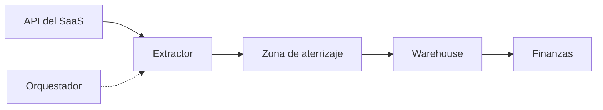
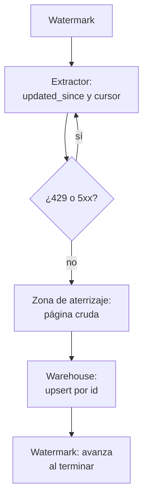
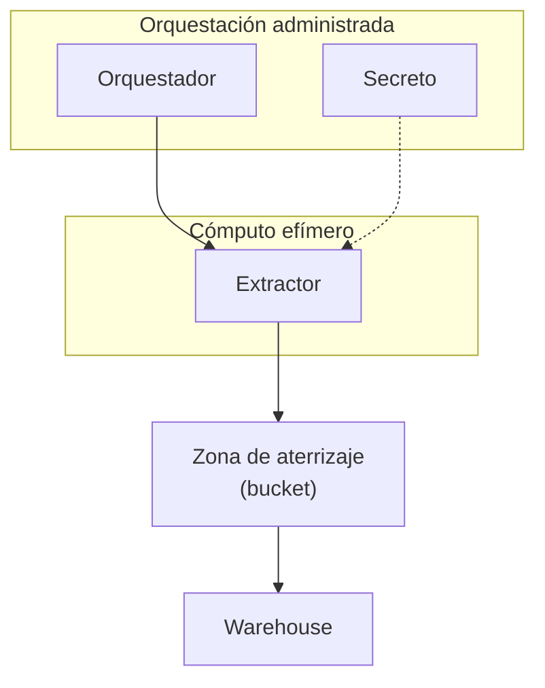

## 1. Resumen

Un pipeline API → warehouse llama a una API de terceros por páginas, respeta su límite de tasa, guarda cada respuesta tal como llegó y la carga en el warehouse por clave. La API manda: decide el tamaño de página, cuántas llamadas por minuto acepta y qué filtros ofrece. El código 429 indica demasiadas peticiones, y la respuesta puede traer Retry-After con cuánto esperar (*Additional HTTP Status Codes*).

Lo que lo hace confiable es separar tres cosas: **página cruda en la zona de aterrizaje** (para reprocesar sin volver a llamar), **upsert por clave** (reintentar no duplica) y **watermark que avanza solo si la corrida termina** (una corrida a medias se repite entera). Conviene para SaaS y APIs de socios. No conviene si el origen es una base propia y se necesitan los borrados: ahí va `cdc-architecture`.

## 2. Escenario y requerimientos

Escenario: los pedidos de una tienda viven en un SaaS con API REST paginada por cursor y filtrable por `updated_since`. Finanzas los quiere en el warehouse cada hora.

| Requerimiento | Valor del escenario |
|---|---|
| Frecuencia | Cada hora |
| Volumen | Solo lo cambiado desde la última corrida |
| Límite de tasa | 429 con Retry-After: esperar y seguir |
| Reintentos | Una corrida repetida no duplica |
| Auditoría | Las respuestas crudas se conservan |

## 3. Vista de contexto



## 4. Componentes

| Componente | Responsabilidad | Por qué está |
|---|---|---|
| Orquestador | Programa la corrida y reintenta la tarea entera | La frecuencia no vive en el extractor |
| Extractor | Pagina, espera ante 429 y 5xx y guarda cada página | Cumple el contrato de la API |
| Zona de aterrizaje | Una página cruda por archivo, con nombre estable | Reprocesar sin volver a llamar; sobrescribir no duplica |
| Warehouse | Upsert por clave | Reintentar no duplica filas |
| Watermark | Mayor `updated_at` cargado, guardado al terminar | La próxima corrida pide solo lo cambiado |
| Secreto | Credencial de la API fuera del código | Rotación sin desplegar |

## 5. Vista de datos



El filtro usa `>=` sobre el watermark: la fila del borde se relee y el upsert la absorbe. Con `>`, una fila con el mismo `updated_at` que llegó tarde se perdería.

## 6. Vista de despliegue



## 7. Seguridad y gobierno

- La credencial de la API va en un gestor de secretos: el HTTP Task de Step Functions la toma de una conexión de EventBridge cuyo secreto se guarda cifrado en Secrets Manager (*Call HTTPS APIs in Step Functions workflows*).
- La zona de aterrizaje guarda la respuesta completa, con todos sus campos personales: misma clasificación y retención que el warehouse.
- Pedir solo los campos que se usan, si la API lo permite.

## 8. Escalabilidad, observabilidad y operación

- **Escala:** el límite de tasa de la API es el techo; paralelizar sin respetarlo solo produce más 429.
- **Qué se mide:** páginas, filas, 429 y reintentos por corrida, atraso del watermark y duración.
- **Reintentos:** en el ejemplo oficial de Step Functions se reintentan 429, 502, 503 y 504 con backoff y jitter (*Call HTTPS APIs in Step Functions workflows*); las bibliotecas cliente de Google Cloud reintentan errores transitorios con backoff exponencial (*Retry*).
- **Runbook:** corrida fallida → se repite entera desde el mismo watermark; cambio de esquema en la respuesta → la página cruda queda, se corrige el parser y se recarga desde la zona de aterrizaje.

## 9. Costos

El cómputo es corto y periódico; lo que más pesa suele ser el límite de tasa (tiempo de espera) y, en el warehouse, el upsert. Cargar solo lo cambiado mantiene chico cada MERGE: el MERGE de Redshift falla si varias filas de origen coinciden con una del destino (*MERGE*), así que se deduplica por clave antes. Algunas APIs cobran por llamada: eso se revisa en el contrato del proveedor, no en el warehouse. Los montos dependen de cada servicio.

## 10. Código y configuración

```python
# Python 3.12+, biblioteca estándar (ejecutado en la CI): API → warehouse de punta a punta. Una API local pagina con
# cursor, filtra por updated_since y responde 429 una vez; el extractor reintenta con espera, guarda cada página cruda
# en la zona de aterrizaje (sobrescribe: reintentar no duplica archivos), carga con upsert por id en el warehouse
# (sqlite3) y avanza el watermark solo si la corrida termina. La segunda corrida trae solo lo cambiado.
import json
import sqlite3
import sys
import tempfile
import threading
import time
import urllib.error
import urllib.request
from http.server import BaseHTTPRequestHandler, HTTPServer
from pathlib import Path
from urllib.parse import parse_qs, urlparse

ORDERS = {1: ("new", "2026-11-01T10:00"), 2: ("new", "2026-11-01T11:00"), 3: ("new", "2026-11-01T12:00")}
calls = {"429": 0, "pages": 0}


class Api(BaseHTTPRequestHandler):
    def do_GET(self) -> None:
        q = parse_qs(urlparse(self.path).query)
        since, cursor = q.get("updated_since", [""])[0], int(q.get("cursor", ["0"])[0])
        if cursor == 2 and calls["429"] == 0:   # límite de tasa, una sola vez
            calls["429"] += 1
            self.send_response(429)
            self.send_header("Retry-After", "0")
            self.end_headers()
            return
        rows = [{"id": i, "status": s, "updated_at": u} for i, (s, u) in sorted(ORDERS.items()) if u >= since]
        page = rows[cursor:cursor + 2]
        nxt = cursor + 2 if cursor + 2 < len(rows) else None
        calls["pages"] += 1
        body = json.dumps({"data": page, "next_cursor": nxt}).encode()
        self.send_response(200)
        self.send_header("Content-Type", "application/json")
        self.end_headers()
        self.wfile.write(body)

    def log_message(self, *args: object) -> None:
        pass


def get(url: str, attempts: int = 3) -> dict[str, object]:
    for attempt in range(attempts):
        try:
            with urllib.request.urlopen(url, timeout=5) as response:
                data: dict[str, object] = json.load(response)
                return data
        except urllib.error.HTTPError as error:
            if error.code not in (429, 500, 502, 503) or attempt == attempts - 1:
                raise
            time.sleep(float(error.headers.get("Retry-After", 2 ** attempt)))
    raise RuntimeError("sin respuesta")


def run(base: str, landing: Path, db: sqlite3.Connection, run_id: str) -> int:
    since = db.execute("SELECT value FROM state WHERE key = 'watermark'").fetchone()[0]
    cursor: object = 0
    loaded, page = 0, 0
    while cursor is not None:
        body = get(f"{base}/orders?updated_since={since}&cursor={cursor}")
        (landing / f"{run_id}-p{page}.json").write_text(json.dumps(body), encoding="utf-8")   # crudo, tal cual
        rows = body["data"]
        assert isinstance(rows, list)
        with db:
            db.executemany("INSERT INTO orders VALUES (:id, :status, :updated_at) ON CONFLICT (id) DO UPDATE SET "
                           "status = excluded.status, updated_at = excluded.updated_at", rows)
        loaded, page, cursor = loaded + len(rows), page + 1, body["next_cursor"]
    with db:   # el watermark avanza solo al terminar la corrida
        db.execute("UPDATE state SET value = (SELECT COALESCE(MAX(updated_at), ?) FROM orders) "
                   "WHERE key = 'watermark'", (since,))
    return loaded


server = HTTPServer(("127.0.0.1", 0), Api)
threading.Thread(target=server.serve_forever, daemon=True).start()
base = f"http://127.0.0.1:{server.server_port}"
landing = Path(sys.argv[1] if len(sys.argv) > 1 else tempfile.mkdtemp()) / "landing"
landing.mkdir(parents=True, exist_ok=True)
db = sqlite3.connect(":memory:")
db.executescript("""
CREATE TABLE orders (id INTEGER PRIMARY KEY, status TEXT, updated_at TEXT);
CREATE TABLE state (key TEXT PRIMARY KEY, value TEXT);
INSERT INTO state VALUES ('watermark', '');
""")

print("corrida 1:", run(base, landing, db, "r1"), "filas; 429 recibidos:", calls["429"], "; páginas:", calls["pages"])
ORDERS[2] = ("paid", "2026-11-02T09:00")   # cambia en el origen
ORDERS[4] = ("new", "2026-11-02T10:00")    # llega uno nuevo
print("corrida 2 (incremental, desde el watermark):", run(base, landing, db, "r2"), "filas")
print("corrida 3 (sin cambios):", run(base, landing, db, "r3"),
      "fila (la del watermark: se relee y el upsert la absorbe)")
print("warehouse:", db.execute("SELECT id, status FROM orders ORDER BY id").fetchall())
print("watermark:", db.execute("SELECT value FROM state").fetchone()[0], "; archivos crudos:",
      sorted(p.name for p in landing.iterdir()))
server.shutdown()
```

El script se **ejecuta en la CI** con la biblioteca estándar (una API local en un hilo) y pasa `mypy --strict`:

```text
corrida 1: 3 filas; 429 recibidos: 1 ; páginas: 2
corrida 2 (incremental, desde el watermark): 3 filas
corrida 3 (sin cambios): 1 fila (la del watermark: se relee y el upsert la absorbe)
warehouse: [(1, 'new'), (2, 'paid'), (3, 'new'), (4, 'new')]
watermark: 2026-11-02T10:00 ; archivos crudos: ['r1-p0.json', 'r1-p1.json', 'r2-p0.json', 'r2-p1.json', 'r3-p0.json']
```

La primera corrida recibe un 429, espera lo que dice Retry-After y sigue. La segunda pide desde el watermark: relee el pedido 3 (el borde), trae el 2 cambiado y el 4 nuevo. La tercera no tiene cambios y solo relee el borde, que el upsert absorbe. Los archivos crudos tienen nombre por corrida y página: reintentar una corrida sobrescribe los suyos. Lo que no ejecuta: un warehouse administrado ni un gestor de secretos.

## 11. GCP

| Pieza | Servicio | Detalle y diferencia |
|---|---|---|
| Orquestación | Managed Service for Apache Airflow | Cloud Composer «is evolving to become Managed Service for Apache Airflow» (*Managed Service for Apache Airflow release notes*); `HttpOperator` pagina con `pagination_function` (*HTTP Operators*). No ejecutado |
| Extractor | Cloud Run | Contenedor efímero que ejecuta el extractor. No ejecutado |
| Warehouse | BigQuery con Dataform | Tablas incrementales que fusionan por `uniqueKey` (*Create tables*) |

## 12. AWS

| Pieza | Servicio | Detalle y diferencia |
|---|---|---|
| Orquestación y llamada | Step Functions con HTTP Task | Credencial en una conexión de EventBridge; las peticiones vencen a los 60 segundos (*Call HTTPS APIs in Step Functions workflows*). No ejecutado |
| Warehouse | Redshift | MERGE desde una tabla de staging (*MERGE*) |

## 13. Azure

| Pieza | Servicio | Detalle y diferencia |
|---|---|---|
| Extracción | Conector REST de Data Factory | Paginación declarativa con `paginationRules` y `requestInterval` entre páginas; solo respuestas JSON (*Copy and transform data from and to a REST endpoint…*). No ejecutado |

## 14. Riesgos y modos de falla

| Riesgo | Cómo se detecta | Cómo se recupera |
|---|---|---|
| Watermark que avanza en una corrida a medias | Filas que nunca llegan | Guardar el watermark al final, como en el §10 |
| Filtro `>` sobre el watermark | Filas del borde perdidas | `>=` y upsert por clave |
| Paginación por offset con datos que cambian | Filas saltadas o repetidas | Cursor de la API, si existe |
| La API no informa borrados | El warehouse conserva filas eliminadas | Endpoint de borrados o reconciliación periódica |

## 15. Errores frecuentes

| Error | Consecuencia |
|---|---|
| Reintentar sin esperar | Más 429 y un bloqueo de la cuenta |
| No guardar la respuesta cruda | Corregir el parser obliga a volver a llamar |
| Credencial en el código | Rotarla exige desplegar |
| INSERT en vez de upsert | Duplicados al reintentar |

## 16. Trade-offs y alternativas

| Opción | Gana | Cuesta |
|---|---|---|
| Extractor propio | Control total del contrato de la API | Código que mantener |
| Conector administrado (Data Factory, `HttpOperator`) | Menos código | Lo que el conector no cubra |
| `cdc-architecture` | Borrados y minutos de atraso | Solo si el origen es una base accesible |

## 17. Conceptos relacionados

- `api-ingestion` y `python-api-consumption`: el cliente y el contrato de la API.
- `incremental-load`: el watermark.
- `idempotency` y `retries`: reintentar sin duplicar.
- `batch-pipeline-architecture`: la carga programada con archivos.
- `modern-data-warehouse-architecture`: el destino.
- `cdc-architecture`: cuando el origen es una base propia.
- `event-driven-architecture`: webhooks del proveedor.

## 18. Evolución

Se llega desde exportaciones manuales del SaaS. Si el proveedor ofrece webhooks, la parte incremental puede pasar a eventos (`event-driven-architecture`), conservando la extracción completa como reconciliación. La señal para no adoptarla: el proveedor ya entrega los datos al warehouse con un conector propio.

## 19. Laboratorio relacionado

F4: laboratorio en la nube con un extractor en contenedor, una zona de aterrizaje y una carga incremental con reintentos ante 429, con `terraform apply` en sandbox, costo estimado con fuente, teardown verificado y evidencia de la corrida.

## 20. Fuentes

- IETF: *Additional HTTP Status Codes* (RFC 6585); *RFC 9110*.
- Python: *urllib.request — Extensible library for opening URLs*; *urllib.error — Exception classes raised by urllib.request*.
- Apache Airflow: *HTTP Operators*.
- Google Cloud: *Managed Service for Apache Airflow release notes*; *Create tables*; *Retry*.
- AWS: *Call HTTPS APIs in Step Functions workflows*; *MERGE*.
- Microsoft Learn: *Copy and transform data from and to a REST endpoint by using Azure Data Factory*.

El detalle de cada fuente está en `sources` del frontmatter.

## 21. Fecha de última verificación

2026-11-03: fichas de origen de cada cita revisadas; las páginas se consultaron en las fechas de `sources`. `verified`: aprobada por Felipe el 2026-11-03 (`owner_approved_at`).

## 22. Historial de cambios importantes

- 2026-11-03: creación (lote 07c, ADR-028).
- 2026-11-03: `verification_status: verified`, aprobada por Felipe con lista explícita (`owner_approved_at: 2026-11-03`).
