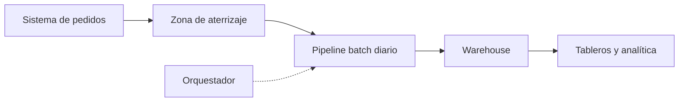
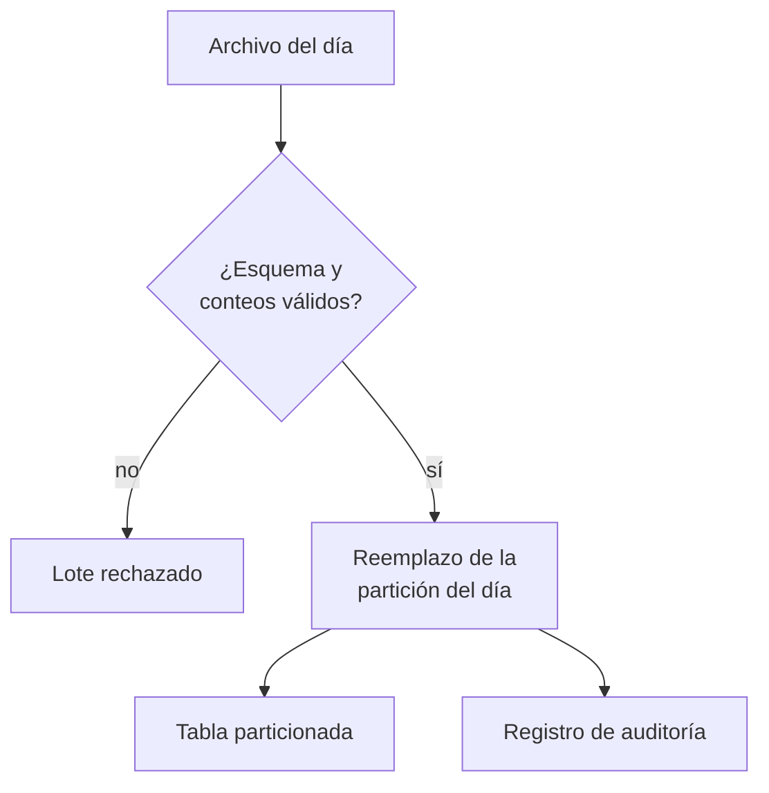
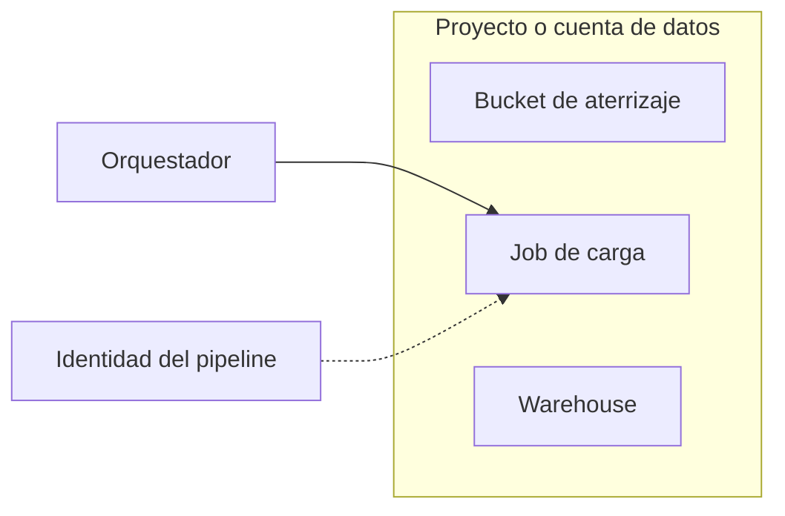

## 1. Resumen

Un pipeline batch mueve datos en lotes con una frecuencia fija: cada día (o cada hora) llega un archivo, se valida y se carga en el warehouse. La arquitectura que funciona en producción tiene una propiedad central: **cada lote reemplaza su partición completa en una sola operación**. Así, reintentar, corregir un día o rehacer un mes da el mismo resultado, sin duplicados.

Conviene cuando el negocio tolera latencia de horas, los orígenes entregan archivos o extractos, y el costo y la simplicidad pesan más que la frescura. No conviene cuando se necesitan datos en segundos (`streaming-pipeline-architecture`) o cuando cada lote es tan chico que el overhead del orquestador domina.

## 2. Escenario y requerimientos

Escenario: un e-commerce recibe cada noche un archivo de ventas por día desde su sistema de pedidos. Analítica necesita las ventas del día anterior a las 8:00.

| Requerimiento | Valor del escenario |
|---|---|
| Frescura | D+1, antes de las 8:00 |
| Volumen | Un archivo por día, de MB a GB |
| Correcciones | El proveedor puede reenviar un día completo |
| Reprocesos | Rehacer un rango de días tras un cambio de lógica |
| Restricción | Reintentar no puede duplicar ventas |

## 3. Vista de contexto



Fuera del alcance: cómo el sistema de pedidos genera el archivo y quién consume los tableros.

## 4. Componentes

| Componente | Responsabilidad | Por qué está |
|---|---|---|
| Zona de aterrizaje | Recibe el archivo del día sin cambios | Separa la entrega del procesamiento y permite reprocesar |
| Orquestador | Agenda una corrida por día, reintenta y lanza backfills | La frecuencia, los reintentos y el rango son responsabilidad suya, no del código de carga |
| Staging | Valida esquema y conteos del lote | Un lote inválido no toca la tabla final |
| Carga de partición | Reemplaza la partición del día en una transacción | Hace idempotente el reintento y el reproceso |
| Warehouse | Tabla particionada por día | Las consultas leen solo los días que piden |
| Auditoría | Registra corrida, día y filas | Permite responder qué se cargó y cuándo |

## 5. Vista de datos



La unidad de trabajo es el día: lo que se escribe es la partición entera, nunca filas sueltas agregadas a lo que ya había.

## 6. Vista de despliegue



El job corre con una identidad propia que solo lee el bucket y escribe en las tablas del pipeline; el orquestador no necesita leer los datos.

## 7. Seguridad y gobierno

- Una identidad técnica por pipeline, con lectura en el bucket de aterrizaje y escritura solo en su dataset o esquema.
- El bucket de aterrizaje no es un lugar de consulta: los analistas leen el warehouse.
- Los archivos con datos personales siguen la retención de su capa; la tabla de auditoría no guarda contenido, solo conteos.

## 8. Escalabilidad, observabilidad y operación

- **Escala:** crece con el tamaño del archivo; si un día no cabe en la ventana, se parte por hora o por clave, manteniendo una partición por unidad.
- **Qué se mide:** hora de llegada del archivo, duración de la carga, filas por día frente al promedio y la hora en que el día queda disponible (el SLO de frescura).
- **Runbook:** si un día falla, se reintenta el mismo día; si el proveedor reenvía, se recarga ese día; si cambia la lógica, se lanza un backfill del rango afectado.

## 9. Costos

Lo que mueve el costo es el volumen leído por las consultas y el cómputo de la carga. Particionar por día hace que una consulta de un rango lea solo esas particiones; en BigQuery, reducir los bytes leídos baja el costo de la consulta (*Introduction to partitioned tables*). Reemplazar una partición cuesta lo mismo que cargarla: no hay costo extra por la idempotencia.

## 10. Código y configuración

```python
# Python 3.12+, biblioteca estándar; sqlite3 hace de warehouse local. Pipeline batch diario de punta a punta:
# archivo del día → staging → reemplazo atómico de la partición del día → registro de auditoría. Re-ejecutar un día
# no duplica nada; una corrección del proveedor reprocesa solo ese día; un backfill es un rango de días.
import sqlite3
from datetime import date, timedelta

Row = tuple[str, str, int]   # (order_id, día, monto)
FILES: dict[date, list[Row]] = {   # archivos ficticios que llegan a la zona de aterrizaje, uno por día
    date(2026, 10, 1): [("o-1", "2026-10-01", 120), ("o-2", "2026-10-01", 80)],
    date(2026, 10, 2): [("o-3", "2026-10-02", 50)],
    date(2026, 10, 3): [("o-4", "2026-10-03", 70), ("o-5", "2026-10-03", 30)],
}


def setup(db: sqlite3.Connection) -> None:
    db.execute("CREATE TABLE sales (order_id TEXT PRIMARY KEY, day TEXT NOT NULL, amount INTEGER NOT NULL)")
    db.execute("CREATE TABLE audit (run TEXT, day TEXT, rows_loaded INTEGER)")


def load_day(db: sqlite3.Connection, day: date, rows: list[Row], run: str) -> None:
    with db:   # una transacción: la partición queda vieja o nueva, nunca a medias
        db.execute("DELETE FROM sales WHERE day = ?", (day.isoformat(),))
        db.executemany("INSERT INTO sales VALUES (?, ?, ?)", rows)
        db.execute("INSERT INTO audit VALUES (?, ?, ?)", (run, day.isoformat(), len(rows)))


def run_range(db: sqlite3.Connection, start: date, end: date, files: dict[date, list[Row]], run: str) -> None:
    day = start
    while day <= end:
        load_day(db, day, files.get(day, []), run)
        day += timedelta(days=1)


def totals(db: sqlite3.Connection) -> list[tuple[str, int, int]]:
    return db.execute("SELECT day, COUNT(*), SUM(amount) FROM sales GROUP BY day ORDER BY day").fetchall()


db = sqlite3.connect(":memory:")
setup(db)
run_range(db, date(2026, 10, 1), date(2026, 10, 3), FILES, "diaria")
print("tras la carga diaria:", totals(db))
load_day(db, date(2026, 10, 2), FILES[date(2026, 10, 2)], "reintento")   # el orquestador reintenta el día 2
print("tras reintentar el día 2:", totals(db))
corrected = {**FILES, date(2026, 10, 2): [*FILES[date(2026, 10, 2)], ("o-6", "2026-10-02", 40)]}
load_day(db, date(2026, 10, 2), corrected[date(2026, 10, 2)], "corrección")   # el proveedor reenvía el día 2
print("tras la corrección del día 2:", totals(db))
run_range(db, date(2026, 10, 1), date(2026, 10, 3), corrected, "backfill")
print("tras el backfill del rango:", totals(db))
print("filas únicas:", db.execute("SELECT COUNT(*), COUNT(DISTINCT order_id) FROM sales").fetchone())
print("auditoría del día 2:", db.execute("SELECT run, rows_loaded FROM audit WHERE day = '2026-10-02'").fetchall())
```

El script se **ejecuta en la CI** con la biblioteca estándar y pasa `mypy --strict`. Carga tres días, reintenta el día 2, recibe la corrección del día 2 y hace un backfill del rango:

```text
tras la carga diaria: [('2026-10-01', 2, 200), ('2026-10-02', 1, 50), ('2026-10-03', 2, 100)]
tras reintentar el día 2: [('2026-10-01', 2, 200), ('2026-10-02', 1, 50), ('2026-10-03', 2, 100)]
tras la corrección del día 2: [('2026-10-01', 2, 200), ('2026-10-02', 2, 90), ('2026-10-03', 2, 100)]
tras el backfill del rango: [('2026-10-01', 2, 200), ('2026-10-02', 2, 90), ('2026-10-03', 2, 100)]
filas únicas: (6, 6)
auditoría del día 2: [('diaria', 1), ('reintento', 1), ('corrección', 2), ('backfill', 2)]
```

El reintento no cambia nada; la corrección cambia solo el día 2; el backfill deja el mismo resultado; no hay duplicados. Lo que no ejecuta: la lectura real de un bucket, el orquestador y un warehouse en la nube.

## 11. GCP

| Pieza | Servicio | Detalle y diferencia |
|---|---|---|
| Aterrizaje | Cloud Storage | Archivos del día como objetos |
| Carga de partición | Carga de BigQuery con decorador de partición | Se carga en una partición concreta con `tabla$AAAAMMDD`; para reemplazar en vez de agregar, `bq load --replace=true` (*Load data into partitioned tables*) |
| Formato | Avro o Parquet | Avro se lee en paralelo aunque esté comprimido; Parquet suele comprimir mejor (*Batch load data*) |
| Orquestador | Managed Service for Apache Airflow | Antes Cloud Composer; admite plugins y dependencias de PyPI, con algunas opciones de Airflow bloqueadas (*Managed Airflow overview*) |

## 12. AWS

| Pieza | Servicio | Detalle y diferencia |
|---|---|---|
| Aterrizaje | Amazon S3 | Archivos del día como objetos |
| Carga | `COPY` de Redshift | Agrega filas a una tabla existente (*COPY*): el reemplazo de la partición se hace con un borrado del día y la carga en la misma transacción |
| Procesado incremental | AWS Glue job bookmarks | Guardan el estado de cada corrida para no reprocesar datos viejos (*Tracking processed data using job bookmarks*); un reproceso deliberado debe tenerlo en cuenta |
| Orquestador | Amazon MWAA o Glue workflows | No ejecutado; el diseño es el mismo |

## 13. Azure

| Pieza | Servicio | Detalle y diferencia |
|---|---|---|
| Aterrizaje | Azure Data Lake Storage | Archivos del día |
| Carga | Copy activity de Data Factory | Copia entre almacenes y corre en un integration runtime (*Copy activity in Azure Data Factory and Azure Synapse Analytics*) |
| Agenda y backfill | Tumbling window trigger | `startTime` y `endTime` pueden estar en el pasado y cada ventana dispara una ejecución (*Create a trigger that runs a pipeline on a tumbling window*) |

## 14. Riesgos y modos de falla

| Riesgo | Cómo se detecta | Cómo se recupera |
|---|---|---|
| El archivo no llega | Alerta por hora de llegada | Esperar con un sensor acotado y avisar al proveedor |
| Llega incompleto | Conteo frente al promedio del día | Rechazar el lote en staging; la partición anterior sigue intacta |
| Carga a medias | No ocurre si el reemplazo es transaccional | Reintentar el día |
| Cambio de esquema del proveedor | Validación de esquema en staging | Rechazar y versionar el contrato |

## 15. Errores frecuentes

| Error | Consecuencia |
|---|---|
| Agregar filas (`append`) en cada corrida | Un reintento duplica el día |
| Calcular «ayer» con el reloj del servidor | Un reproceso carga el día equivocado; el día viene del intervalo de la corrida |
| Un backfill con otra lógica que la carga diaria | Dos verdades para el mismo día |
| Bookmarks o watermarks que impiden reprocesar | El reproceso parece correr y no carga nada |

## 16. Trade-offs y alternativas

| Opción | Gana | Cuesta |
|---|---|---|
| Reemplazo de partición por día | Idempotencia simple | Reescribir el día completo aunque cambie una fila |
| Carga incremental con `MERGE` (`incremental-load`) | Escribe solo lo nuevo | Claves y deduplicación más delicadas |
| Pasar a streaming | Frescura en segundos | Más componentes y operación continua |

## 17. Conceptos relacionados

- `batch-ingestion`: la carga de archivos por lotes.
- `idempotency`: por qué reintentar no duplica.
- `backfill`: el reproceso de un rango.
- `incremental-load`: la alternativa que escribe solo lo nuevo.
- `pipeline-layers`: aterrizaje, staging y warehouse como capas.
- `medallion-architecture`: la evolución con varias fuentes y capas.
- `modern-data-warehouse-architecture`: el warehouse que recibe las cargas y lo que pasa dentro de él.
- `streaming-pipeline-architecture`: la evolución cuando D+1 deja de alcanzar.

## 18. Evolución

Se llega desde scripts manuales o cargas que agregan filas. Se pasa a `medallion-architecture` cuando hay varias fuentes y hace falta separar crudo, limpio y curado; a `streaming-pipeline-architecture` cuando D+1 deja de alcanzar. La señal: los reprocesos se vuelven frecuentes o la ventana nocturna no alcanza.

## 19. Laboratorio relacionado

F4: laboratorio en la nube con un bucket, una tabla particionada y una corrida diaria más un backfill, con `terraform apply` en sandbox, costo estimado con fuente, teardown verificado y evidencia de la corrida.

## 20. Fuentes

- Google Cloud: *Load data into partitioned tables*; *Introduction to partitioned tables*; *Batch load data*; *Managed Airflow overview*.
- Apache Airflow: *Backfill*; *Dag Runs*.
- AWS: *COPY*; *Tracking processed data using job bookmarks*.
- Microsoft Learn: *Copy activity in Azure Data Factory and Azure Synapse Analytics*; *Create a trigger that runs a pipeline on a tumbling window*.

El detalle de cada fuente está en `sources` del frontmatter.

## 21. Fecha de última verificación

2026-11-01: fichas de origen de cada cita revisadas; las páginas se consultaron en las fechas de `sources`. `review_required` hasta la revisión.

## 22. Historial de cambios importantes

- 2026-11-01: creación (lote 07a, ADR-028).
- 2026-11-02: lote 07b (regla del §17): relations y el §17 enlazan `streaming-pipeline-architecture`, que ya tiene ficha; antes figuraba como pendiente de ficha.
