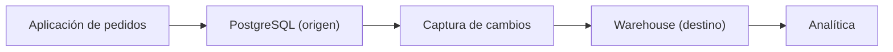
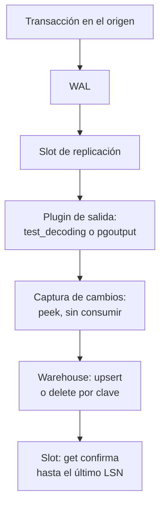
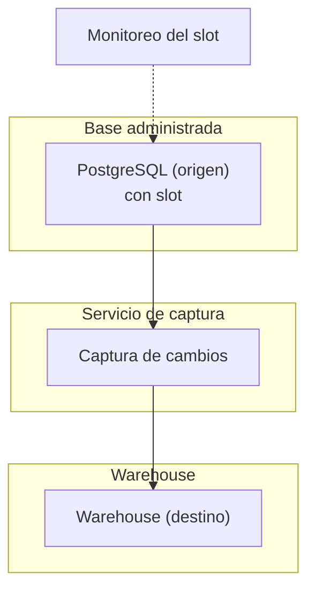

## 1. Resumen

Una arquitectura CDC copia al warehouse cada cambio de una base transaccional, sin consultas de extracción. En PostgreSQL, la **decodificación lógica** lee el WAL y un **slot de replicación** recuerda hasta dónde confirmó el consumidor: emite cada cambio una vez en operación normal, puede reenviarlos tras una caída e impide borrar el WAL que el consumidor todavía necesita (*Logical Decoding Concepts*).

Lo que hace confiable al pipeline es el orden: **leer, aplicar en el destino de forma idempotente y recién entonces confirmar**. Conviene cuando el destino necesita los cambios en minutos, incluidos los borrados, y la tabla es demasiado grande para copiarla entera. No conviene para tablas chicas que se recargan en segundos, o si nadie puede vigilar el slot: un slot abandonado retiene WAL en el origen.

## 2. Escenario y requerimientos

Escenario: la base de pedidos de una tienda en PostgreSQL. Analítica quiere en BigQuery el estado actual de cada pedido, con minutos de atraso, sin cargar la base con consultas.

| Requerimiento | Valor del escenario |
|---|---|
| Frescura | Minutos |
| Completitud | Inserts, updates y deletes |
| Reintentos | Una caída a mitad de lote no duplica ni pierde |
| Impacto en el origen | Sin consultas de extracción; solo lectura del WAL |
| Restricción | El WAL retenido no puede llenar el disco del origen |

## 3. Vista de contexto



## 4. Componentes

| Componente | Responsabilidad | Por qué está |
|---|---|---|
| PostgreSQL (origen) | WAL con `wal_level=logical` | Sin ese nivel no hay decodificación lógica |
| Slot de replicación | Posición confirmada del consumidor | Retoma tras una caída y retiene el WAL necesario |
| Plugin de salida | Convierte el WAL en cambios legibles | `pgoutput` en producción; `test_decoding` es un ejemplo |
| Captura de cambios | Lee, aplica y confirma, en ese orden | La confirmación va después de aplicar |
| Warehouse (destino) | Estado actual por clave, con upsert y delete | Reaplicar un lote no cambia el resultado |
| Monitoreo del slot | Atraso y WAL retenido | Un slot detenido llena el disco del origen |

## 5. Vista de datos



Con `pg_logical_slot_peek_changes` los cambios se leen sin consumirlos y la siguiente llamada devuelve los mismos; con `pg_logical_slot_get_changes` quedan consumidos (*Logical Decoding Examples*). Leer con peek, aplicar y recién después confirmar con get es lo que convierte una caída a mitad de lote en un reintento inofensivo, siempre que el destino aplique por clave.

## 6. Vista de despliegue



En una base administrada hay que activar la decodificación lógica con un parámetro y reiniciar: en Cloud SQL, la marca `cloudsql.logical_decoding` (*Configure a Cloud SQL for PostgreSQL database for CDC*); en RDS, `rds.logical_replication = 1`, que además aumenta la generación de WAL (*Performing logical replication for Amazon RDS for PostgreSQL*).

## 7. Seguridad y gobierno

- El usuario de captura necesita el atributo REPLICATION o ser superusuario (*29.11. Security*); conviene un usuario propio, sin otros permisos.
- La publicación o la selección de tablas limita qué sale del origen: Datastream recomienda una publicación solo con las tablas a replicar (*Configure a Cloud SQL for PostgreSQL database for CDC*).
- Los borrados del origen llegan como DELETE: si el warehouse debe conservar historia, se registra el cambio en una tabla aparte, no se ignora el borrado.

## 8. Escalabilidad, observabilidad y operación

- **Qué se mide:** `restart_lsn` y `confirmed_flush_lsn` de `pg_replication_slots` (*53.20. pg_replication_slots*), el WAL retenido, la frescura del destino y los cambios por minuto.
- **Slot detenido:** si el consumidor no confirma, el WAL se acumula. Un slot que ya no se usa se borra: si no, sigue consumiendo recursos del servidor (*Logical Decoding Examples*).
- **Cambios de esquema:** la decodificación lógica en Azure Database for PostgreSQL no replica cambios de DDL (*Logical replication and logical decoding in Azure Database for PostgreSQL flexible server*): un ALTER TABLE se coordina con el destino.
- **Runbook:** caída del consumidor → al volver, lee desde el slot y reaplica sin duplicar; slot perdido → carga completa y slot nuevo.

## 9. Costos

En el origen, la decodificación lógica genera más WAL (*Performing logical replication for Amazon RDS for PostgreSQL*) y el slot lo retiene mientras el consumidor no confirma: el riesgo de costo es el disco, no el cómputo. En el destino se paga la aplicación de cambios; en BigQuery, un MERGE exige que cada fila del destino coincida con a lo sumo una fila de origen (*Data manipulation language (DML) statements in GoogleSQL*), así que los cambios de un lote se compactan por clave antes de aplicarlos. Los montos de Datastream, DMS y BigQuery se calculan con la calculadora de cada nube.

## 10. Código y configuración

```python
# Python 3.12 y psycopg 3 contra PostgreSQL 17 con wal_level=logical (ejecutado en la CI): CDC de punta a punta con
# un slot de replicación lógica y el plugin test_decoding. Se leen los cambios sin consumirlos (peek), se aplican en
# orden de LSN sobre la tabla destino, en otra base (el slot es por base), con upsert y delete por clave (reaplicar el
# mismo lote no cambia nada) y recién entonces se confirman (get). El slot retiene el WAL hasta esa confirmación.
# Al final se borra el slot: uno abandonado retiene WAL sin límite.
import os
import re

import psycopg
from psycopg.conninfo import make_conninfo

LINE = re.compile(r"^table public\.orders: (INSERT|UPDATE|DELETE): (.*)$")
FIELD = re.compile(r"(\w+)\[\w+\]:('(?:[^']|'')*'|\S+)")


def parse(data: str) -> tuple[str, dict[str, str]] | None:
    match = LINE.match(data)
    if match is None:   # BEGIN y COMMIT
        return None
    fields = {k: v.strip("'").replace("''", "'") for k, v in FIELD.findall(match.group(2))}
    return match.group(1), fields


def apply(dwh: psycopg.Connection, changes: list[tuple[str, str]]) -> int:
    applied = 0
    for _, data in changes:   # ya vienen en orden de LSN
        parsed = parse(data)
        if parsed is None:
            continue
        op, row = parsed
        if op == "DELETE":
            dwh.execute("DELETE FROM dwh_orders WHERE id = %s", (int(row["id"]),))
        else:
            dwh.execute("INSERT INTO dwh_orders VALUES (%s, %s, %s) ON CONFLICT (id) DO UPDATE SET "
                        "status = excluded.status, amount = excluded.amount",
                        (int(row["id"]), row["status"], int(row["amount"])))
        applied += 1
    return applied


def pending(conn: psycopg.Connection) -> list[tuple[str, str]]:
    rows = conn.execute("SELECT lsn::text, data FROM pg_logical_slot_peek_changes('cdc_orders', NULL, NULL)")
    return [(lsn, data) for lsn, data in rows.fetchall()]


def target(dwh: psycopg.Connection) -> list[tuple[int, str, int]]:
    return [(i, s, a) for i, s, a in dwh.execute("SELECT * FROM dwh_orders ORDER BY id").fetchall()]


with psycopg.connect(os.environ["PG_DSN"], autocommit=True) as conn:
    conn.execute("CREATE DATABASE dwh")
    conn.execute("CREATE TABLE orders (id integer PRIMARY KEY, status text NOT NULL, amount integer NOT NULL)")
    dwh = psycopg.connect(make_conninfo(os.environ["PG_DSN"], dbname="dwh"), autocommit=True)
    dwh.execute("CREATE TABLE dwh_orders (id integer PRIMARY KEY, status text NOT NULL, amount integer NOT NULL)")
    conn.execute("SELECT pg_create_logical_replication_slot('cdc_orders', 'test_decoding')")
    try:
        with conn.transaction():
            conn.execute("INSERT INTO orders VALUES (1, 'new', 120), (2, 'new', 80)")
        conn.execute("UPDATE orders SET status = 'paid' WHERE id = 1")
        conn.execute("DELETE FROM orders WHERE id = 2")
        batch = pending(conn)
        print("en el slot:", len(batch), "líneas;", sum(parse(d) is not None for _, d in batch), "cambios")
        print("primer cambio:", batch[1][1])
        print("aplicados:", apply(dwh, batch), "->", target(dwh))
        apply(dwh, batch)   # reintento tras una caída antes de confirmar: el mismo lote otra vez
        print("reaplicado el mismo lote ->", target(dwh))
        last = batch[-1][0]
        conn.execute("SELECT count(*) FROM pg_logical_slot_get_changes('cdc_orders', %s::pg_lsn, NULL)", (last,))
        print("pendientes tras confirmar:", len(pending(conn)))
        conn.execute("INSERT INTO orders VALUES (3, 'new', 40)")
        print("cambio nuevo:", apply(dwh, pending(conn)), "->", target(dwh))
        retained = conn.execute("SELECT restart_lsn IS NOT NULL FROM pg_replication_slots "
                                "WHERE slot_name = 'cdc_orders'").fetchone()
        print("el slot retiene WAL desde restart_lsn:", retained[0] if retained else None)
    finally:
        dwh.close()
        conn.execute("SELECT pg_drop_replication_slot('cdc_orders')")
```

El script se **ejecuta en la CI** con psycopg contra un PostgreSQL 17 con `wal_level=logical`, levantado por el test en Docker con la imagen fijada por digest, y pasa `mypy --strict`:

```text
en el slot: 10 líneas; 4 cambios
primer cambio: table public.orders: INSERT: id[integer]:1 status[text]:'new' amount[integer]:120
aplicados: 4 -> [(1, 'paid', 120)]
reaplicado el mismo lote -> [(1, 'paid', 120)]
pendientes tras confirmar: 0
cambio nuevo: 1 -> [(1, 'paid', 120), (3, 'new', 40)]
el slot retiene WAL desde restart_lsn: True
```

Las 10 líneas del slot son tres transacciones (BEGIN y COMMIT) con 4 cambios. El destino queda igual al aplicar el lote dos veces: el reintento tras una caída antes de confirmar no duplica. Después de `get` no queda nada pendiente, y un insert nuevo llega solo. `test_decoding` es un plugin de ejemplo, un punto de partida para escribir uno propio (*F.43. test_decoding…*); en producción, Debezium y Datastream usan `pgoutput`. Lo que no ejecuta: Debezium, Datastream ni BigQuery; el destino es otra base del mismo servidor, porque el slot captura toda la base en la que vive.

## 11. GCP

| Pieza | Servicio | Detalle y diferencia |
|---|---|---|
| Captura y entrega | Datastream | Serverless, sin recursos que aprovisionar; PostgreSQL como origen y BigQuery como destino (*Datastream overview*). No ejecutado |
| Origen | Cloud SQL para PostgreSQL | Marca `cloudsql.logical_decoding`, usuario con REPLICATION, publicación y slot con `pgoutput`, uno por stream (*Configure a Cloud SQL for PostgreSQL database for CDC*) |
| Destino | BigQuery | MERGE con a lo sumo una fila de origen por fila del destino (*Data manipulation language (DML) statements in GoogleSQL*) |

## 12. AWS

| Pieza | Servicio | Detalle y diferencia |
|---|---|---|
| Origen | RDS para PostgreSQL | `rds.logical_replication = 1`, estático, con reinicio (*Performing logical replication for Amazon RDS for PostgreSQL*) |
| Captura | AWS DMS | Usa slots de replicación lógica con `test_decoding` o `pglogical`; al reiniciar la tarea (no reanudarla) el slot se recrea (*Using a PostgreSQL database as an AWS DMS source*). Su CDC no es replicación en tiempo real (*Creating tasks for ongoing replication using AWS DMS*). No ejecutado |
| Alternativa abierta | Debezium | Conector de PostgreSQL sobre decodificación lógica con `pgoutput` (*Debezium connector for PostgreSQL*); su ejecución queda para F4 |

## 13. Azure

| Pieza | Servicio | Detalle y diferencia |
|---|---|---|
| Origen | Azure Database for PostgreSQL | Replicación lógica nativa, `pglogical` y decodificación lógica, todas con slots y sin replicar DDL (*Logical replication and logical decoding…*) |
| Captura | Debezium sobre los slots del origen | Consume los slots de replicación lógica que describe la página del origen, con `pgoutput` (*Debezium connector for PostgreSQL*). No ejecutado |

## 14. Riesgos y modos de falla

| Riesgo | Cómo se detecta | Cómo se recupera |
|---|---|---|
| Slot abandonado | WAL retenido que crece y disco del origen que se llena | Alerta sobre el slot; borrarlo y rehacer la carga |
| Confirmar antes de aplicar | Cambios perdidos tras una caída | Confirmar después de aplicar, como en el §10 |
| Destino que inserta en vez de aplicar por clave | Duplicados al reintentar | Upsert y delete por clave, o MERGE |
| DDL en el origen | Errores de aplicación o columnas faltantes | Coordinar el cambio de esquema con el destino |

## 15. Errores frecuentes

| Error | Consecuencia |
|---|---|
| Usar `test_decoding` en producción | Es un plugin de ejemplo |
| Ignorar los DELETE | El warehouse conserva filas que ya no existen |
| Aplicar fuera de orden de LSN | Un update viejo pisa uno nuevo |
| Llamar «tiempo real» a cualquier CDC | DMS lo aclara para el suyo |

## 16. Trade-offs y alternativas

| Opción | Gana | Cuesta |
|---|---|---|
| CDC con slot | Borrados, minutos de atraso, sin consultas al origen | Operar el slot y el WAL retenido |
| Extracción incremental por `updated_at` | Simple, sin permisos de replicación | No ve borrados y depende de que la columna se actualice siempre |
| Carga completa (`batch-pipeline-architecture`) | Lo más simple | Costo y tiempo que crecen con la tabla |

## 17. Conceptos relacionados

- `change-data-capture`: el concepto.
- `sql-merge` e `idempotency`: aplicar sin duplicar.
- `schema-evolution`: los cambios de esquema en el origen.
- `postgresql-for-data-engineers`: WAL, slots y decodificación lógica.
- `rds-as-source`: el mismo origen en AWS.
- `streaming-pipeline-architecture`: los cambios como stream.
- `batch-pipeline-architecture`: la carga completa.

## 18. Evolución

Se llega desde una carga completa diaria cuando la tabla crece o se necesitan los borrados. Puede evolucionar a publicar los cambios en un broker para varios consumidores (`streaming-pipeline-architecture`). La señal para no adoptarla: la tabla se recarga entera en segundos y nadie puede vigilar el slot.

## 19. Laboratorio relacionado

F4: laboratorio en la nube con Cloud SQL para PostgreSQL, Datastream y BigQuery, o Debezium, con inserts, updates y deletes y una caída del consumidor, con `terraform apply` en sandbox, costo estimado con fuente, teardown verificado (incluido el borrado del slot) y evidencia de la corrida.

## 20. Fuentes

- PostgreSQL: *Logical Decoding Concepts*; *47.1. Logical Decoding Examples*; *F.43. test_decoding — SQL-based test/example module for WAL logical decoding*; *53.20. pg_replication_slots*; *29.11. Security*; *PostgreSQL: Documentation: 18: INSERT*.
- Debezium: *Debezium connector for PostgreSQL*.
- Google Cloud: *Datastream overview*; *Configure a Cloud SQL for PostgreSQL database for CDC*; *Data manipulation language (DML) statements in GoogleSQL*.
- AWS: *Performing logical replication for Amazon RDS for PostgreSQL*; *Using a PostgreSQL database as an AWS DMS source*; *Creating tasks for ongoing replication using AWS DMS*.
- Microsoft Learn: *Logical replication and logical decoding in Azure Database for PostgreSQL flexible server*.

El detalle de cada fuente está en `sources` del frontmatter.

## 21. Fecha de última verificación

2026-11-03: fichas de origen de cada cita revisadas; *47.1. Logical Decoding Examples* y *F.43. test_decoding* leídas hoy (H1 y contenido). `verified`: aprobada por Felipe el 2026-11-03 (`owner_approved_at`).

## 22. Historial de cambios importantes

- 2026-11-03: creación (lote 07c, ADR-028).
- 2026-11-03: revisión de 07c aplicada (docs/reviews/lote-07c.md): las citas nuevas del lote llevan su `url` (faltaba); el §5 tiene el nodo «Plugin de salida» del §4.
- 2026-11-03: `verification_status: verified`, aprobada por Felipe con lista explícita (`owner_approved_at: 2026-11-03`).
