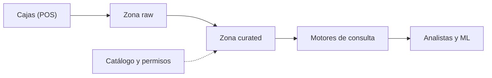
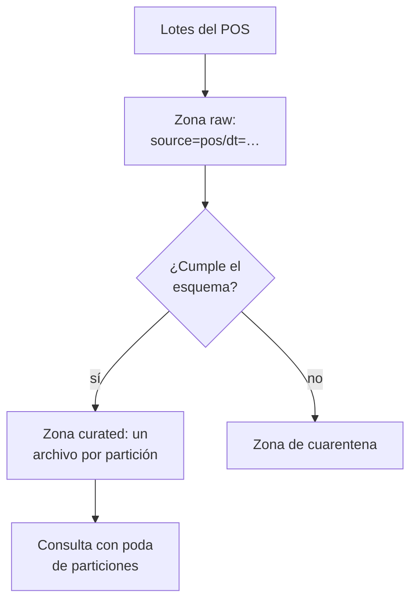
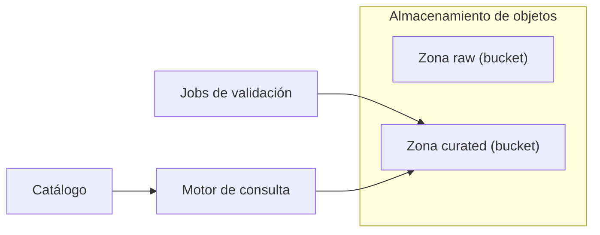

## 1. Resumen

Un data lake guarda datos de cualquier formato en **almacenamiento de objetos**, barato y durable, organizado en **zonas** (raw, curated y otras) y **particiones** por fecha o fuente. El esquema se aplica **al leer**, no al escribir: lo que llega se guarda tal cual, y cada consumidor lo interpreta. Sin catálogo ni permisos, un lake se vuelve un pantano: datos que nadie encuentra ni puede confiar.

Conviene para guardar crudo a bajo costo, datos semiestructurados y no estructurados, y para alimentar varios motores. No conviene como única capa de consumo cuando hacen falta transacciones, actualizaciones de filas o un modelo común (`lakehouse-architecture`, `modern-data-warehouse-architecture`).

## 2. Escenario y requerimientos

Escenario: una cadena de tiendas recibe eventos de sus cajas (POS) en lotes chicos durante el día y quiere conservarlos todos, consultarlos por día y descartar los que no cumplen el formato sin perderlos.

| Requerimiento | Valor del escenario |
|---|---|
| Conservación | Todo lo que llega, sin transformar |
| Consulta | Por día y por fuente, leyendo solo esa parte |
| Calidad | Lo inválido se separa, no se borra |
| Gobierno | Saber qué datasets hay y quién puede leerlos |
| Restricción | Costo de almacenamiento bajo para años de historia |

## 3. Vista de contexto



## 4. Componentes

| Componente | Responsabilidad | Por qué está |
|---|---|---|
| Zona raw | Guarda lo que llega, en su formato original | Permite reprocesar desde el origen |
| Zona de cuarentena | Guarda lo que no cumple el esquema | Lo inválido se revisa, no se pierde |
| Zona curated | Datos validados y compactados | Lectura eficiente y confiable |
| Particiones | Carpetas `clave=valor` por fuente y fecha | Las consultas leen solo lo que piden |
| Catálogo | Registra tablas, esquemas y ubicaciones | Sin catálogo, nadie encuentra los datos |
| Permisos | Control de acceso por zona y dataset | Raw puede tener datos sensibles |

## 5. Vista de datos



AWS Prescriptive Guidance recomienda al menos tres capas (Raw, Stage y Analytics), cada una en su propio bucket, y una landing zone adicional para enmascarar datos sensibles antes de la capa raw (*Recommended data layers*).

## 6. Vista de despliegue



Un bucket por zona permite permisos y políticas de ciclo de vida distintos por zona.

## 7. Seguridad y gobierno

- Raw es la zona más sensible: llega todo, sin limpiar. Acceso solo para los pipelines.
- En AWS, Lake Formation agrega control de acceso fino sobre los datos en S3 y sus metadatos en el Glue Data Catalog, con un modelo de permisos que complementa a IAM (*What is AWS Lake Formation?*).
- En GCP, las tablas BigLake separan el acceso a la tabla del acceso al almacén con delegación de acceso, y permiten seguridad por fila y columna (*Introduction to BigLake tables*).

## 8. Escalabilidad, observabilidad y operación

- **Escala:** el almacenamiento de objetos escala sin aprovisionar; el límite práctico es la cantidad de archivos chicos.
- **Qué se mide:** archivos por partición, tamaño medio de archivo, registros en cuarentena y antigüedad de lo que nadie lee.
- **Runbook:** compactar las particiones con muchos archivos chicos; revisar la cuarentena y reprocesar desde raw cuando se corrige el esquema.

## 9. Costos

El almacenamiento es barato; el costo lo mueven las lecturas y el cómputo. Particionar limita lo que escanea cada consulta y baja el costo (*Partition your data*, Athena). ADLS estima que en muchos casos el cómputo es más del 85 % del costo total, así que reducir la latencia baja el costo aunque el almacenamiento cueste más (*Azure Data Lake Storage hierarchical namespace*). Las reglas de ciclo de vida mueven o borran objetos viejos sin intervención (*Object Lifecycle Management*).

## 10. Código y configuración

```python
# Python 3.12+, biblioteca estándar. Un data lake en una carpeta local: zona raw con particiones estilo Hive
# (fuente=…/dt=…), esquema en lectura con validación, zona de cuarentena para lo que no cumple, zona curated
# compactada (un archivo por partición) y una lectura que poda particiones. La carpeta hace de bucket.
import json
import sys
import tempfile
from pathlib import Path

lake = Path(sys.argv[1] if len(sys.argv) > 1 else tempfile.mkdtemp())
EXPECTED = {"order_id": str, "store": str, "amount": int}   # esquema que se aplica al leer, no al escribir
EVENTS: dict[str, list[list[dict[str, object]]]] = {   # lotes ficticios de un POS: cada lote llega como un archivo chico
    "2026-10-01": [[{"order_id": "o-1", "store": "norte", "amount": 120}], [{"order_id": "o-2", "store": "sur", "amount": 80}]],
    "2026-10-02": [[{"order_id": "o-3", "store": "norte", "amount": "50"}],                     # monto como texto
                   [{"order_id": "o-4", "store": "sur", "amount": 70}, {"order_id": "o-5", "amount": 30}]],   # sin tienda
}

for dt, batches in EVENTS.items():   # 1. raw: se escribe tal como llega, sin transformar
    for i, batch in enumerate(batches):
        path = lake / "raw" / "source=pos" / f"dt={dt}" / f"part-{i:04d}.json"
        path.parent.mkdir(parents=True, exist_ok=True)
        path.write_text("\n".join(json.dumps(r) for r in batch), encoding="utf-8")


def valid(record: dict[str, object]) -> bool:
    return set(record) == set(EXPECTED) and all(isinstance(record[k], t) for k, t in EXPECTED.items())


for partition in sorted((lake / "raw" / "source=pos").iterdir()):   # 2. curated y cuarentena, por partición
    records = [json.loads(line) for f in sorted(partition.glob("*.json")) for line in f.read_text(encoding="utf-8").splitlines()]
    for zone, keep in (("curated", True), ("quarantine", False)):
        chosen = [r for r in records if valid(r) == keep]
        if chosen:
            out = lake / zone / "source=pos" / partition.name / "part-0000.json"   # compactado: un archivo
            out.parent.mkdir(parents=True, exist_ok=True)
            out.write_text("\n".join(json.dumps(r) for r in chosen), encoding="utf-8")

for zone in ("raw", "curated", "quarantine"):
    files = sorted(lake.glob(f"{zone}/source=pos/dt=*/*.json"))
    print(f"{zone}: archivos={len(files)}, registros={sum(len(f.read_text(encoding='utf-8').splitlines()) for f in files)}")
read = sorted(lake.glob("curated/source=pos/dt=2026-10-02/*.json"))   # 3. poda: solo la partición pedida
print("consulta dt=2026-10-02 lee:", [f.relative_to(lake).as_posix() for f in read])
quarantined = [json.loads(line) for f in lake.glob("quarantine/source=pos/dt=*/*.json") for line in f.read_text(encoding="utf-8").splitlines()]
print("en cuarentena:", sorted(r["order_id"] for r in quarantined))
```

El script se **ejecuta en la CI** con la biblioteca estándar y pasa `mypy --strict`. Escribe cuatro lotes chicos en raw, valida al leer y separa los dos registros que no cumplen (un monto como texto y un registro sin tienda):

```text
raw: archivos=4, registros=5
curated: archivos=2, registros=3
quarantine: archivos=1, registros=2
consulta dt=2026-10-02 lee: ['curated/source=pos/dt=2026-10-02/part-0000.json']
en cuarentena: ['o-3', 'o-5']
```

Raw conserva los cinco registros; curated queda con un archivo por partición; la consulta de un día lee solo esa partición. Lo que no ejecuta: un bucket real, un catálogo y un motor de consulta.

## 11. GCP

| Pieza | Servicio | Detalle y diferencia |
|---|---|---|
| Almacenamiento | Cloud Storage | Reglas de ciclo de vida por bucket; Delete tiene prioridad sobre SetStorageClass (*Object Lifecycle Management*) |
| Consulta | Tablas externas o BigLake de BigQuery | BigLake usa delegación de acceso y funciona con Cloud Storage, S3 y Azure Storage; las tablas externas no delegan acceso (*Introduction to external data sources*) |
| Catálogo | Knowledge Catalog | Entries creadas automáticamente desde fuentes de Google Cloud, o por los usuarios para fuentes propias y archivos (*About metadata in Knowledge Catalog*). No ejecutado |

## 12. AWS

| Pieza | Servicio | Detalle y diferencia |
|---|---|---|
| Almacenamiento | Amazon S3 | Consistencia fuerte de lectura después de escritura para PUT y DELETE (*What is Amazon S3?*) |
| Consulta | Amazon Athena | SQL directo sobre S3 sin infraestructura (*What is Amazon Athena?*); `MSCK REPAIR TABLE` solo con particiones estilo Hive (*Partition your data*) |
| Gobierno | AWS Lake Formation | Permisos finos sobre S3 y el Glue Data Catalog (*What is AWS Lake Formation?*) |

## 13. Azure

| Pieza | Servicio | Detalle y diferencia |
|---|---|---|
| Almacenamiento | Azure Data Lake Storage | Sobre Blob Storage, con semántica de sistema de archivos al habilitar el namespace jerárquico (*Introduction to Azure Data Lake Storage*) |
| Directorios | Namespace jerárquico | Renombrar o borrar un directorio es atómico; en un almacén de objetos plano, no (*Azure Data Lake Storage hierarchical namespace*) |
| Consulta y catálogo | Motores sobre ABFS | No ejecutado |

## 14. Riesgos y modos de falla

| Riesgo | Cómo se detecta | Cómo se recupera |
|---|---|---|
| Archivos chicos | Archivos por partición | Compactar por partición |
| Pantano de datos | Datasets sin dueño ni catálogo | Registro obligatorio en el catálogo |
| Esquema que cambia en silencio | Crece la cuarentena | Versionar el esquema y reprocesar desde raw |
| Datos sensibles expuestos en raw | Revisión de permisos por zona | Landing zone con enmascarado antes de raw |

## 15. Errores frecuentes

| Error | Consecuencia |
|---|---|
| Borrar lo que no cumple | No se puede reprocesar cuando se corrige el esquema |
| Particiones sin el estilo `clave=valor` | Algunos motores no las descubren solos (Athena las agrega con `ALTER TABLE ADD PARTITION`) |
| Un solo bucket para todo | Permisos y ciclo de vida iguales para raw y para consumo |
| Usar el lake como base transaccional | Sin transacciones, las actualizaciones concurrentes se pisan |

## 16. Trade-offs y alternativas

| Opción | Gana | Cuesta |
|---|---|---|
| Data lake | Cualquier formato, costo bajo | Sin transacciones ni modelo común |
| `lakehouse-architecture` | Transacciones y esquema sobre el mismo almacenamiento | Catálogo de tablas y mantenimiento |
| `modern-data-warehouse-architecture` | SQL y concurrencia | Formato del motor y costo de almacenamiento |

## 17. Conceptos relacionados

- `data-lake`: el concepto que esta arquitectura implementa.
- `file-ingestion`: los archivos que llegan a raw.
- `pipeline-layers`: las zonas como capas.
- `lakehouse-architecture`: lo que agrega una tabla transaccional.
- `medallion-architecture`: las mismas zonas con nombres bronze, silver y gold.
- `modern-data-warehouse-architecture`: la alternativa con SQL y el formato del motor.

## 18. Evolución

Se llega desde carpetas compartidas o exportaciones sueltas. Se pasa a `lakehouse-architecture` cuando hacen falta actualizaciones de filas, time travel o varias escrituras concurrentes sobre los mismos datos. La señal: jobs que reescriben carpetas enteras para cambiar unas pocas filas.

## 19. Laboratorio relacionado

Sin laboratorio en F4: no está entre las 6 arquitecturas de F4. El §10 corre en la CI.

## 20. Fuentes

- Google Cloud: *Introduction to external data sources*; *Introduction to BigLake tables*; *Object Lifecycle Management*; *About metadata in Knowledge Catalog*.
- AWS: *What is Amazon S3?*; *What is Amazon Athena?*; *Partition your data*; *What is AWS Lake Formation?*; *Recommended data layers*.
- Microsoft Learn: *Introduction to Azure Data Lake Storage*; *Azure Data Lake Storage hierarchical namespace*.

El detalle de cada fuente está en `sources` del frontmatter.

## 21. Fecha de última verificación

2026-11-01: fichas de origen de cada cita revisadas; las páginas se consultaron en las fechas de `sources`. `verified`: aprobada el 2026-11-03 (`owner_approved_at`).

## 22. Historial de cambios importantes

- 2026-11-01: creación (lote 07a, ADR-028).
- 2026-11-02: revisión de 07a aplicada (docs/reviews/lote-07a.md): la fila de catálogo del §11 cita *About metadata in Knowledge Catalog*; las vistas usan los nombres del §4 («Zona de cuarentena»).
- 2026-11-03: `verification_status: verified`, aprobada con lista explícita (`owner_approved_at: 2026-11-03`).
