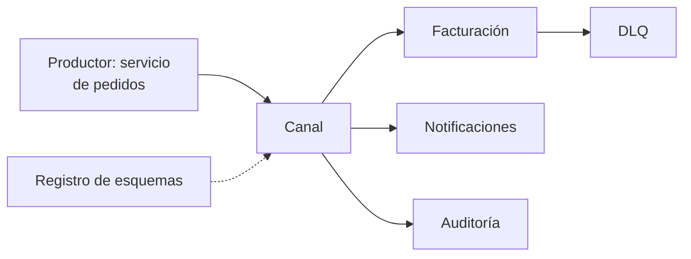
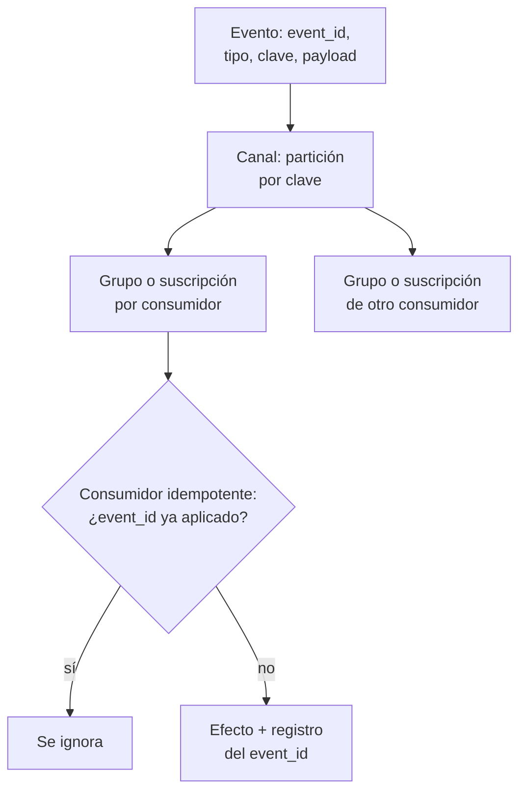
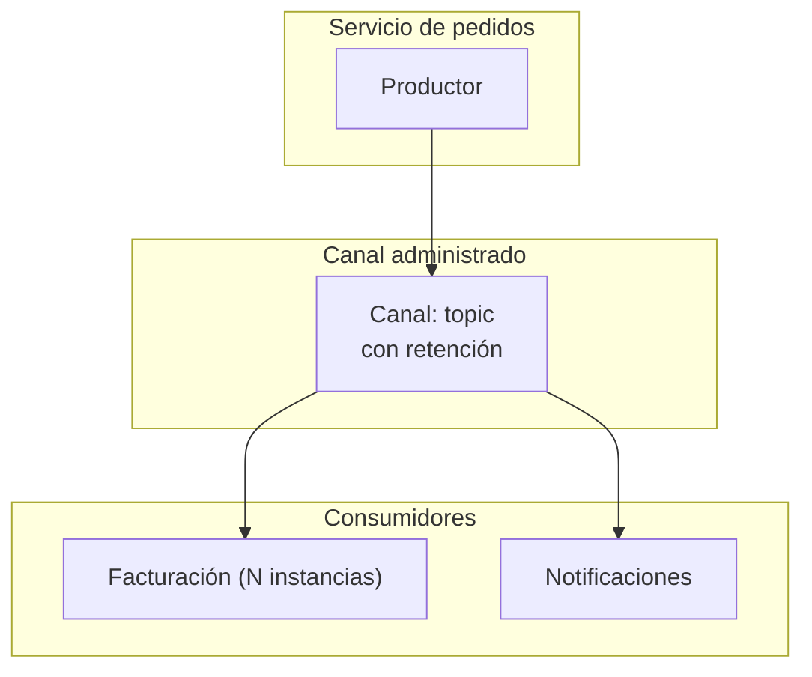

## 1. Resumen

En una arquitectura event-driven, los servicios publican **eventos de negocio** («pedido creado», «pedido pagado») en un canal, y otros servicios los consumen sin que el productor sepa quiénes son. Hay productores que generan eventos, consumidores que los escuchan y canales que los transfieren; un consumidor nuevo se agrega sin modificar al productor ni a los demás consumidores (*Event-driven architecture style*).

Reaccionar a eventos de negocio no es lo mismo que un pipeline de ingesta continua para analítica (`streaming-pipeline-architecture`), aunque compartan el broker. Conviene cuando varios subsistemas procesan los mismos eventos y necesitan escalar por separado. No conviene con flujos simples de request-response, con consistencia fuerte entre servicios o sin experiencia operando sistemas asíncronos (*Event-driven architecture style*).

## 2. Escenario y requerimientos

Escenario: el servicio de pedidos de una tienda en línea publica cada pedido creado y pagado. Facturación, notificaciones y, más adelante, auditoría reaccionan cada una a su manera.

| Requerimiento | Valor del escenario |
|---|---|
| Desacople | Pedidos no conoce a sus consumidores ni espera su respuesta |
| Independencia | Cada consumidor lee a su ritmo y con su propia posición |
| Reintentos | Un evento repetido no factura dos veces |
| Crecimiento | Auditoría se suma después y lee la historia completa |
| Errores | Un evento que un consumidor no puede procesar no bloquea a los demás |

## 3. Vista de contexto



## 4. Componentes

| Componente | Responsabilidad | Por qué está |
|---|---|---|
| Productor | Publica un hecho de negocio con `event_id` y clave | No llama a nadie: solo registra lo que pasó |
| Canal | Guarda y entrega los eventos | Desacopla productor y consumidores |
| Grupo o suscripción por consumidor | Posición propia de cada consumidor | Cada uno lee todo, a su ritmo |
| Consumidor idempotente | Procesa y recuerda los `event_id` ya aplicados | El canal entrega al menos una vez |
| DLQ | Eventos que el consumidor no pudo procesar | No bloquean al resto |
| Registro de esquemas | Versiones del formato del evento | Productores y consumidores se despliegan por separado |

## 5. Vista de datos



Cada consumidor (en el §10, facturación y auditoría) tiene su grupo con su propio offset. Con la misma clave, los eventos van a la misma partición, y todo consumidor de una partición los lee en el orden en que se escribieron (*Introduction*, Kafka 4.3). El payload puede llevar todos los atributos o solo claves para que el consumidor consulte la fuente: lo primero evita consultas, lo segundo mantiene un solo sistema de registro (*Event-driven architecture style*).

## 6. Vista de despliegue



Cada tipo de consumidor suele correr en varias instancias para no ser un punto único de falla; eso complica el orden y el procesamiento una sola vez si no hay lógica idempotente (*Event-driven architecture style*).

## 7. Seguridad y gobierno

- Permisos por rol: el productor solo publica en su topic; cada consumidor solo lee su suscripción o grupo.
- Los eventos suelen quedar visibles para muchos componentes: incluir solo lo necesario, con la mentalidad de «assume breach» (*Event-driven architecture style*).
- El esquema es un contrato: Pub/Sub rechaza la publicación de un mensaje que no cumple el esquema del tema (*Schema overview*) y Glue Schema Registry acepta una versión nueva solo si cumple su modo de compatibilidad (*AWS Glue Schema registry*).

## 8. Escalabilidad, observabilidad y operación

- **Escala:** cada consumidor escala por separado; en Kafka, cada partición la consume un solo consumidor de cada grupo (*Design*, Kafka 4.3).
- **Qué se mide:** lag por grupo, eventos en DLQ y tiempo entre la publicación y el efecto en cada consumidor (consistencia eventual).
- **Trazas:** un correlation ID en cada evento para unir el recorrido de una transacción por productores, canales y consumidores (*Event-driven architecture style*).
- **Runbook:** consumidor caído → al volver retoma desde su posición; evento en DLQ → corregir y reenviar al canal original, sabiendo que llega fuera de orden.

## 9. Costos

Cada consumidor nuevo lee de nuevo todos los eventos: el costo de entrega crece con la cantidad de consumidores, no solo con los eventos publicados. La retención del canal también se paga. Payloads grandes suben el costo de transporte y ancho de banda (*Event-driven architecture style*). Los montos dependen del servicio y se calculan con la calculadora de cada nube.

## 10. Código y configuración

```bash
# Bash y Kafka (ejecutado en la CI con un broker Kafka 4.3.1 en KRaft, en Docker; ADR-017): arquitectura event-driven
# de punta a punta. El servicio de pedidos publica eventos de negocio sin conocer a sus consumidores; facturación y
# notificaciones los leen cada una con su grupo; facturación descarta por event_id el reintento del productor; un
# consumidor nuevo (auditoría) se suscribe después y lee la historia completa sin tocar al productor.
set -euo pipefail
K="${KAFKA_CONTAINER:-dekh-kafka}"
kafka() { docker exec -i "$K" /opt/kafka/bin/"$1" --bootstrap-server localhost:9092 "${@:2}"; }
trap 'kafka kafka-topics.sh --delete --topic pedidos-eventos > /dev/null 2>&1 || true' EXIT

kafka kafka-topics.sh --create --topic pedidos-eventos --partitions 3 > /dev/null
printf '%s\n' \
  'p-1|{"event_id": "e-1", "tipo": "PedidoCreado", "pedido": "p-1", "monto": 120}' \
  'p-2|{"event_id": "e-2", "tipo": "PedidoCreado", "pedido": "p-2", "monto": 80}' \
  'p-2|{"event_id": "e-2", "tipo": "PedidoCreado", "pedido": "p-2", "monto": 80}' \
  'p-2|{"event_id": "e-3", "tipo": "PedidoPagado", "pedido": "p-2", "monto": 80}' |
  kafka kafka-console-producer.sh --topic pedidos-eventos --reader-property parse.key=true --reader-property 'key.separator=|'
echo "pedidos publicó 4 eventos (e-2 dos veces: un reintento del productor)"

consume() {   # lee con el grupo $1 lo que ese grupo todavía no leyó
  kafka kafka-console-consumer.sh --topic pedidos-eventos --group "$1" --from-beginning --timeout-ms 8000 2> /dev/null
}
consume facturacion > facturacion.log
echo "facturación recibe: $(wc -l < facturacion.log); procesa: $(grep -o '"event_id": "[^"]*"' facturacion.log | sort -u | wc -l)"
echo "notificaciones recibe: $(consume notificaciones | wc -l)"
echo "facturación vuelve a leer: $(consume facturacion | wc -l)"        # ya confirmó sus offsets
echo "auditoría, suscrita después, recibe: $(consume auditoria | wc -l)"  # nadie cambió el productor
```

El script se **ejecuta en la CI contra un broker Kafka 4.3.1 en KRaft, en Docker** (ADR-017):

```text
pedidos publicó 4 eventos (e-2 dos veces: un reintento del productor)
facturación recibe: 4; procesa: 3
notificaciones recibe: 4
facturación vuelve a leer: 0
auditoría, suscrita después, recibe: 4
```

Facturación recibe el evento `e-2` dos veces y lo procesa una, porque deduplica por `event_id`; notificaciones recibe los mismos 4 eventos con su propio grupo; auditoría se suscribe después y lee la historia completa sin que nadie cambie al productor. Lo que no ejecuta: el efecto real de cada consumidor (facturar, enviar un correo) ni una DLQ.

## 11. GCP

| Pieza | Servicio | Detalle y diferencia |
|---|---|---|
| Canal | Pub/Sub | Un topic con varias suscripciones; solo se reciben los mensajes publicados después de crear la suscripción y la entrega es at-least-once sin orden por defecto (*Subscription overview*). Un consumidor nuevo no lee la historia, a diferencia del §10 |
| Enrutamiento | Eventarc | Enruta eventos de forma asíncrona desde fuentes de Google Cloud, aplicaciones propias, SaaS y terceros hacia destinos (*Eventarc overview*) |

## 12. AWS

| Pieza | Servicio | Detalle y diferencia |
|---|---|---|
| Publish-subscribe | SNS con colas SQS | Fanout: cada publicación envía un mensaje a cada cola suscrita, donde persiste para procesarse después (*Fanout Amazon SNS notifications…*) |
| Eventos de servicios | Notificaciones de S3 | Destinos SNS, SQS, Lambda y EventBridge; entrega al menos una vez (*Amazon S3 Event Notifications*) |
| Event streaming | Amazon MSK | Kafka de código abierto administrado; las aplicaciones existentes funcionan sin cambiar el código (*Welcome to the Amazon MSK Developer Guide*) |
| Consumidor | Lambda | Escribir código idempotente, para tratar igual los eventos duplicados (*Best practices for working with AWS Lambda Event Functions*) |

## 13. Azure

| Pieza | Servicio | Detalle y diferencia |
|---|---|---|
| Publish-subscribe | Event Grid | Publicación y suscripción administrada, push o pull, con CloudEvents 1.0 (*What is Azure Event Grid?*) |
| Event streaming | Event Hubs | Grupos de consumidores como vistas independientes; el checkpoint lo guarda el consumidor (*Event Hubs features and terminology*) |
| DLQ | Service Bus | Cada cola y suscripción tiene su subcola DLQ (*Overview of Service Bus dead-letter queues*) |

## 14. Riesgos y modos de falla

| Riesgo | Cómo se detecta | Cómo se recupera |
|---|---|---|
| Consumidor no idempotente | Efectos duplicados (doble factura) | Registrar `event_id` aplicados en la misma transacción que el efecto |
| Cambio de esquema incompatible | Errores de deserialización o DLQ que crece | Registro de esquemas con modo de compatibilidad |
| Lag de un consumidor | Vistas desactualizadas entre servicios | Alerta por lag y escalado del consumidor |
| Transacción repartida sin coordinación | Estados que no cuadran entre servicios | Saga o transacción compensatoria |

## 15. Errores frecuentes

| Error | Consecuencia |
|---|---|
| Publicar comandos («factura esto») en vez de hechos | El productor vuelve a conocer a sus consumidores |
| Esperar orden global | Solo hay orden dentro de una partición o clave |
| Usar publish-subscribe y esperar replay | Un consumidor nuevo no ve eventos pasados |
| Eventos sin `event_id` ni correlation ID | No se puede deduplicar ni trazar |

## 16. Trade-offs y alternativas

| Opción | Gana | Cuesta |
|---|---|---|
| Event streaming (log) | Replay y consumidores tardíos | Operar retención y particiones |
| Publish-subscribe | Simple, sin posición que administrar | Sin historia para consumidores nuevos |
| Llamadas síncronas | Consistencia inmediata y depuración simple | Acoplamiento y fallas en cadena |

## 17. Conceptos relacionados

- `events` y `producers-and-consumers`: qué se publica y quién lo lee.
- `idempotency` y `dead-letter-queue`: reintentos y errores.
- `event-driven-pipelines`: pipelines de datos disparados por eventos.
- `message-brokers`: el canal.
- `replay`: releer la historia.
- `data-contracts`: el esquema del evento.
- `streaming-pipeline-architecture`: ingesta continua para analítica.
- `kappa-architecture`: el log como fuente de verdad.

## 18. Evolución

Se llega desde integraciones punto a punto cuando cada consumidor nuevo obliga a cambiar al productor. Si el log de eventos pasa a ser la fuente de verdad y las vistas se recalculan releyéndolo, evoluciona a `kappa-architecture`. La señal para no adoptarla: un solo consumidor que necesita la respuesta en el momento.

## 19. Laboratorio relacionado

F4: laboratorio en la nube con un topic, dos consumidores con suscripciones propias, un evento duplicado y un consumidor que se suma después, con `terraform apply` en sandbox, costo estimado con fuente, teardown verificado y evidencia de la corrida.

## 20. Fuentes

- Microsoft Learn: *Event-driven architecture style*; *What is Azure Event Grid?*; *Event Hubs features and terminology*; *Overview of Service Bus dead-letter queues*.
- Apache Kafka 4.3: *Introduction*; *Design*.
- Google Cloud: *Subscription overview*; *Schema overview*; *Eventarc overview*.
- AWS: *Amazon S3 Event Notifications*; *Fanout Amazon SNS notifications to Amazon SQS queues for asynchronous processing*; *Welcome to the Amazon MSK Developer Guide*; *Best practices for working with AWS Lambda Event Functions*; *AWS Glue Schema registry*.

El detalle de cada fuente está en `sources` del frontmatter.

## 21. Fecha de última verificación

2026-11-02: fichas de origen de cada cita revisadas y *Event-driven architecture style* leída hoy (H1 y contenido). `verified`: aprobada el 2026-11-03 (`owner_approved_at`).

## 22. Historial de cambios importantes

- 2026-11-02: creación (lote 07b, ADR-028).
- 2026-11-02: las tres vistas usan los nombres del §4 (criterio de la revisión de 07a).
- 2026-11-03: revisión de 07b aplicada (docs/reviews/lote-07b.md): las citas nuevas del lote llevan su `url` (faltaba); el §5 usa el nombre del §4, «Grupo o suscripción por consumidor».
- 2026-11-03: `verification_status: verified`, aprobada con lista explícita (`owner_approved_at: 2026-11-03`).
