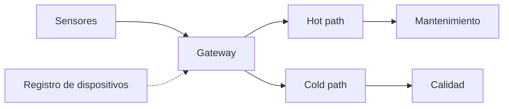
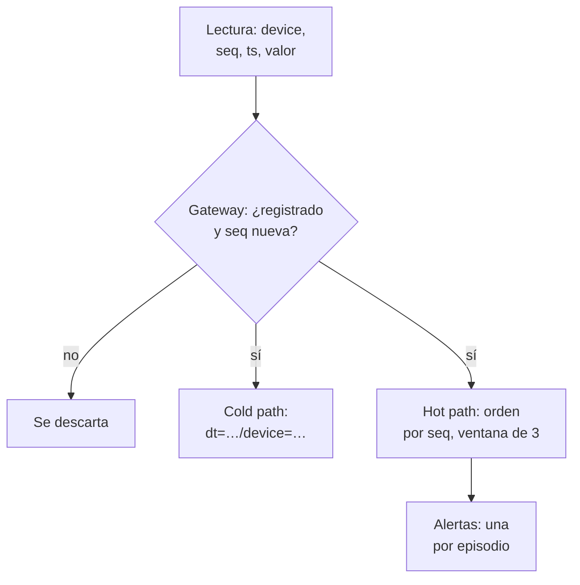
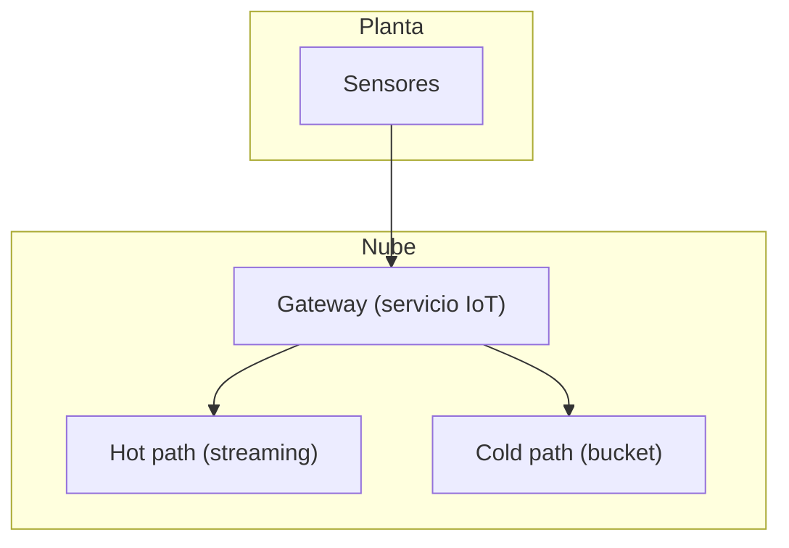

## 1. Resumen

Un pipeline IoT recibe telemetría de muchos dispositivos, la valida en la entrada y la reparte en dos caminos: un **hot path** que analiza en casi tiempo real (anomalías, ventanas, alertas) y un **cold path** que guarda todo para analítica batch. La guía de arquitecturas de Azure describe esa forma: un **cloud gateway** que ingiere en el límite de la nube, a veces un **field gateway** junto a los dispositivos, procesadores de stream y un **registro de dispositivos** (*Big data architectures*).

Es una variante de `streaming-pipeline-architecture`: lo propio es la identidad de cada dispositivo, sus reintentos y su conexión intermitente. Conviene con muchos dispositivos que envían lecturas periódicas. No conviene para pocos equipos que suben un archivo por día: ahí alcanza un `batch-pipeline-architecture`.

## 2. Escenario y requerimientos

Escenario: sensores de temperatura en las cámaras de frío de una planta. Mantenimiento quiere una alerta cuando el promedio sube; calidad quiere la historia completa.

| Requerimiento | Valor del escenario |
|---|---|
| Identidad | Solo dispositivos aprovisionados |
| Reintentos | Un dispositivo que reenvía una lectura no la cuenta dos veces |
| Orden | Por dispositivo, aunque las lecturas lleguen desordenadas |
| Alertas | Una por episodio, no una por lectura |
| Historia | Todas las lecturas aceptadas, particionadas por fecha y dispositivo |

## 3. Vista de contexto



## 4. Componentes

| Componente | Responsabilidad | Por qué está |
|---|---|---|
| Registro de dispositivos | Identidad y metadatos de cada dispositivo | Solo se acepta lo aprovisionado |
| Gateway | Autentica y descarta duplicados por (dispositivo, secuencia) | Los dispositivos reintentan |
| Hot path | Ordena por secuencia y calcula un promedio móvil por dispositivo | Alertas en segundos |
| Cold path | Todo lo aceptado, particionado por fecha y dispositivo | Analítica batch y auditoría |
| Alertas | Una por episodio | Evita ruido para mantenimiento |

## 5. Vista de datos



El orden que importa es por dispositivo. Pub/Sub ordena por ordering key (*Order messages*) y Kinesis manda la misma partition key al mismo shard (*Amazon Kinesis Data Streams Terminology and concepts*): el identificador del dispositivo es la clave natural. Las lecturas no llegan garantizadas en orden (*Streaming pipelines*), así que el hot path ordena por secuencia antes de calcular.

## 6. Vista de despliegue



## 7. Seguridad y gobierno

- Cada dispositivo tiene credencial propia: IoT Hub autentica con tokens SAS o certificados X.509 contra su registro de identidades (*What is Azure IoT Hub?*).
- Un dispositivo robado se revoca en el registro sin tocar a los demás.
- La telemetría puede ubicar personas (vehículos, medidores domésticos): se clasifica como cualquier dato personal.

## 8. Escalabilidad, observabilidad y operación

- **Escala:** muchos dispositivos con poco tráfico cada uno; el broker reparte por clave de dispositivo.
- **Qué se mide:** dispositivos que dejan de enviar, duplicados y desconocidos por minuto en el gateway, y atraso del hot path.
- **Fuera de orden:** Azure Stream Analytics hace explícita la decisión: las lecturas fuera de la tolerancia se descartan o se ajustan (*Understand time handling in Azure Stream Analytics*).
- **Runbook:** dispositivo silencioso → revisar conectividad antes que el pipeline; ráfaga de desconocidos → credenciales filtradas o un aprovisionamiento a medias.

## 9. Costos

El costo crece con la cantidad de mensajes, no con su tamaño: agregar en el field gateway (por ejemplo, una lectura por minuto en vez de una por segundo) baja el volumen antes de la nube. El cold path es almacenamiento barato y particionado; el hot path, un job siempre encendido. Los montos de cada servicio IoT se calculan con la calculadora de cada nube.

## 10. Código y configuración

```python
# Python 3.12+, biblioteca estándar (ejecutado en la CI): pipeline IoT de punta a punta. El gateway acepta solo
# dispositivos del registro y descarta duplicados por (device_id, seq); el hot path calcula un promedio móvil de 3
# lecturas por dispositivo, en orden de seq aunque lleguen desordenadas, y alerta una vez al cruzar el umbral; el cold
# path guarda todo lo aceptado en particiones por fecha y dispositivo para analítica batch.
import json
import sys
import tempfile
from collections import defaultdict, deque
from pathlib import Path

REGISTRY = {"sensor-a": "planta-1", "sensor-b": "planta-1"}   # dispositivos aprovisionados
THRESHOLD = 30.0
MESSAGES = [   # (device_id, seq, ts, temperatura)
    ("sensor-a", 1, "2026-11-03T10:00", 24.0), ("sensor-a", 2, "2026-11-03T10:01", 28.0),
    ("sensor-a", 2, "2026-11-03T10:01", 28.0),                                       # reintento del dispositivo
    ("sensor-a", 4, "2026-11-03T10:03", 36.0), ("sensor-a", 3, "2026-11-03T10:02", 33.0),   # 3 llega después de 4
    ("sensor-a", 5, "2026-11-03T10:04", 35.0),
    ("sensor-b", 1, "2026-11-03T10:00", 21.0), ("sensor-x", 1, "2026-11-03T10:00", 99.0),   # sensor-x no registrado
]

cold = Path(sys.argv[1] if len(sys.argv) > 1 else tempfile.mkdtemp()) / "cold"
seen: set[tuple[str, int]] = set()
buffers: dict[str, dict[int, float]] = defaultdict(dict)
next_seq: dict[str, int] = defaultdict(lambda: 1)
windows: dict[str, deque[float]] = defaultdict(lambda: deque(maxlen=3))
alerting: dict[str, bool] = defaultdict(bool)
stats = {"aceptados": 0, "duplicados": 0, "desconocidos": 0}
alerts: list[str] = []


def hot_path(device: str) -> None:   # procesa en orden de seq lo que ya está completo
    while next_seq[device] in buffers[device]:
        windows[device].append(buffers[device].pop(next_seq[device]))
        avg = sum(windows[device]) / len(windows[device])
        crossing = len(windows[device]) == 3 and avg > THRESHOLD
        if crossing and not alerting[device]:   # una alerta por episodio, no una por lectura
            alerts.append(f"{device} seq {next_seq[device]}: promedio {avg:.1f} > {THRESHOLD}")
        alerting[device] = crossing
        next_seq[device] += 1


for device, seq, ts, temp in MESSAGES:
    if device not in REGISTRY:
        stats["desconocidos"] += 1
        continue
    if (device, seq) in seen:
        stats["duplicados"] += 1
        continue
    seen.add((device, seq))
    stats["aceptados"] += 1
    partition = cold / f"dt={ts[:10]}" / f"device={device}"
    partition.mkdir(parents=True, exist_ok=True)
    with (partition / "part.jsonl").open("a", encoding="utf-8") as out:   # cold path: todo lo aceptado
        out.write(json.dumps({"seq": seq, "ts": ts, "temp": temp, "site": REGISTRY[device]}) + "\n")
    buffers[device][seq] = temp
    hot_path(device)

print("gateway:", stats)
print("alertas:", alerts)
print("cold path:", sorted(str(p.relative_to(cold)).replace("\\", "/") for p in cold.rglob("*.jsonl")),
      "-", sum(1 for p in cold.rglob("*.jsonl") for _ in p.open(encoding="utf-8")), "lecturas")
```

El script se **ejecuta en la CI** con la biblioteca estándar y pasa `mypy --strict`:

```text
gateway: {'aceptados': 6, 'duplicados': 1, 'desconocidos': 1}
alertas: ['sensor-a seq 4: promedio 32.3 > 30.0']
cold path: ['dt=2026-11-03/device=sensor-a/part.jsonl', 'dt=2026-11-03/device=sensor-b/part.jsonl'] - 6 lecturas
```

El gateway descarta la lectura repetida de `sensor-a` y la de `sensor-x`, que no está registrado. La lectura 3 llega después de la 4: el hot path la retiene y calcula en orden de secuencia. La alerta sale una vez, en la secuencia 4 (promedio de 28, 33 y 36), y no se repite en la 5 aunque el promedio siga alto. Lo que no ejecuta: un servicio IoT administrado ni autenticación de dispositivos.

## 11. GCP

| Pieza | Servicio | Detalle y diferencia |
|---|---|---|
| Ingesta | Pub/Sub | Los dispositivos o un gateway propio publican; orden por ordering key en la misma región (*Order messages*). El registro y la autenticación de dispositivos quedan a cargo del gateway propio. No ejecutado |
| Hot path | Dataflow | Ventanas por tiempo de evento y watermarks (*Streaming pipelines*). No ejecutado |

## 12. AWS

| Pieza | Servicio | Detalle y diferencia |
|---|---|---|
| Gateway | AWS IoT Core | Conecta dispositivos con MQTT, MQTT sobre WSS, HTTPS y LoRaWAN; su message broker admite publicar y suscribirse (*What is AWS IoT?*). No ejecutado |
| Stream | Kinesis Data Streams | Misma partition key, mismo shard (*Amazon Kinesis Data Streams Terminology and concepts*) |

## 13. Azure

| Pieza | Servicio | Detalle y diferencia |
|---|---|---|
| Gateway | Azure IoT Hub | Registro de identidades, mensajes de dispositivo a nube y de nube a dispositivo; endpoint integrado con retención de hasta siete días y enrutamiento a Storage, Event Hubs, Service Bus o Cosmos DB (*What is Azure IoT Hub?*). No ejecutado |
| Hot path | Azure Stream Analytics | Política explícita para lecturas fuera de orden (*Understand time handling in Azure Stream Analytics*) |
| Guía | Azure Architecture Center | Field gateway, cloud gateway, hot path y cold storage (*Big data architectures*) |

## 14. Riesgos y modos de falla

| Riesgo | Cómo se detecta | Cómo se recupera |
|---|---|---|
| Reintentos contados dos veces | Promedios inflados | Deduplicar por (dispositivo, secuencia) en el gateway |
| Secuencia con un hueco | El hot path queda esperando | Tiempo máximo de espera y avance con el hueco registrado |
| Alerta en cada lectura | Mantenimiento ignora las alertas | Estado por episodio, como en el §10 |
| Dispositivo con reloj atrasado | Lecturas en particiones equivocadas | Secuencia del dispositivo y hora de llegada como referencia |

## 15. Errores frecuentes

| Error | Consecuencia |
|---|---|
| Aceptar dispositivos sin registro | Cualquiera puede inyectar lecturas |
| Esperar orden global | Solo hay orden por dispositivo |
| Mandar cada lectura cruda a la nube | Costo por mensaje sin valor |
| Guardar solo agregados | No se puede recalcular cuando cambia una regla |

## 16. Trade-offs y alternativas

| Opción | Gana | Cuesta |
|---|---|---|
| Servicio IoT administrado | Identidad, protocolos y enrutamiento | Acoplamiento al proveedor |
| Broker genérico con gateway propio | Portabilidad | Identidad y protocolos a cargo propio |
| Agregación en el field gateway | Menos mensajes y costo | Se pierde el detalle |

## 17. Conceptos relacionados

- `streaming-ingestion` y `streaming-pipeline-architecture`: la base.
- `windowing`: ventanas por dispositivo.
- `late-arriving-data` y `event-ordering`: lecturas fuera de orden.
- `idempotency`: reintentos del dispositivo.
- `lambda-architecture`: hot path y cold path.
- `batch-pipeline-architecture`: dispositivos que suben archivos por lote.

## 18. Evolución

Se llega desde dispositivos que suben archivos por lote. Puede evolucionar a modelos en el borde (field gateway) para decidir sin la nube. La señal para no adoptarla: pocos dispositivos y nadie que actúe sobre la alerta en minutos.

## 19. Laboratorio relacionado

Sin laboratorio en F4: no está entre las 6 arquitecturas de F4. El §10 corre en la CI.

## 20. Fuentes

- Microsoft Learn: *Big data architectures*; *What is Azure IoT Hub?*; *Understand time handling in Azure Stream Analytics*.
- AWS: *What is AWS IoT?*; *Amazon Kinesis Data Streams Terminology and concepts*.
- Google Cloud: *Order messages*; *Streaming pipelines*.

El detalle de cada fuente está en `sources` del frontmatter.

## 21. Fecha de última verificación

2026-11-03: fichas de origen de cada cita revisadas; *What is AWS IoT?* y *What is Azure IoT Hub?* leídas hoy (H1 y contenido). `verified`: aprobada por Felipe el 2026-11-03 (`owner_approved_at`).

## 22. Historial de cambios importantes

- 2026-11-03: creación (lote 07c, ADR-028).
- 2026-11-03: revisión de 07c aplicada (docs/reviews/lote-07c.md): las citas nuevas del lote llevan su `url` (faltaba).
- 2026-11-03: `verification_status: verified`, aprobada por Felipe con lista explícita (`owner_approved_at: 2026-11-03`).
