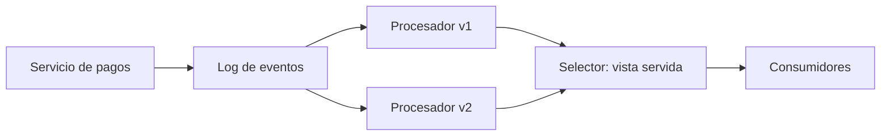
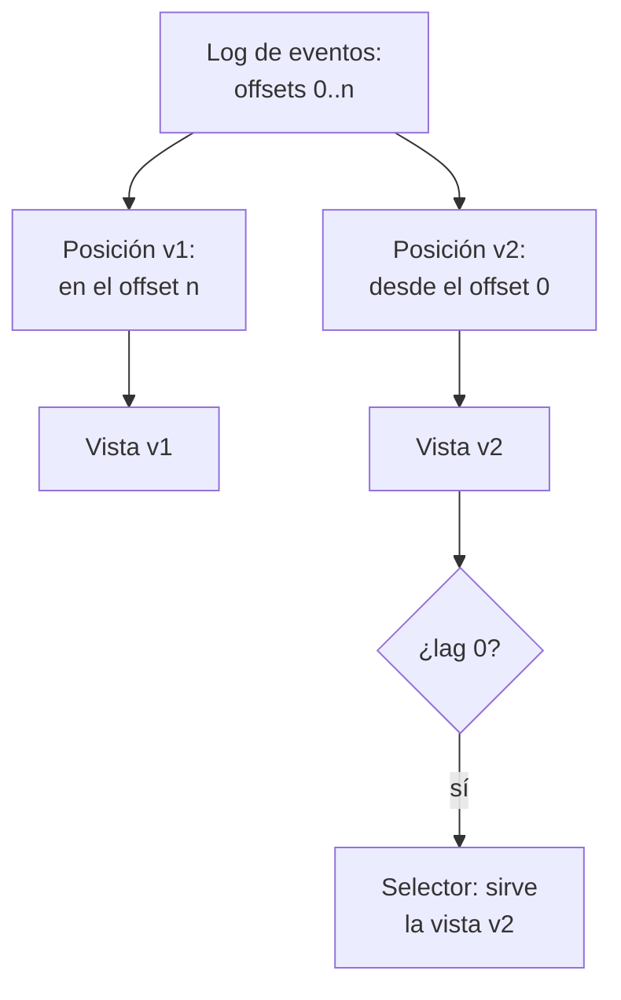
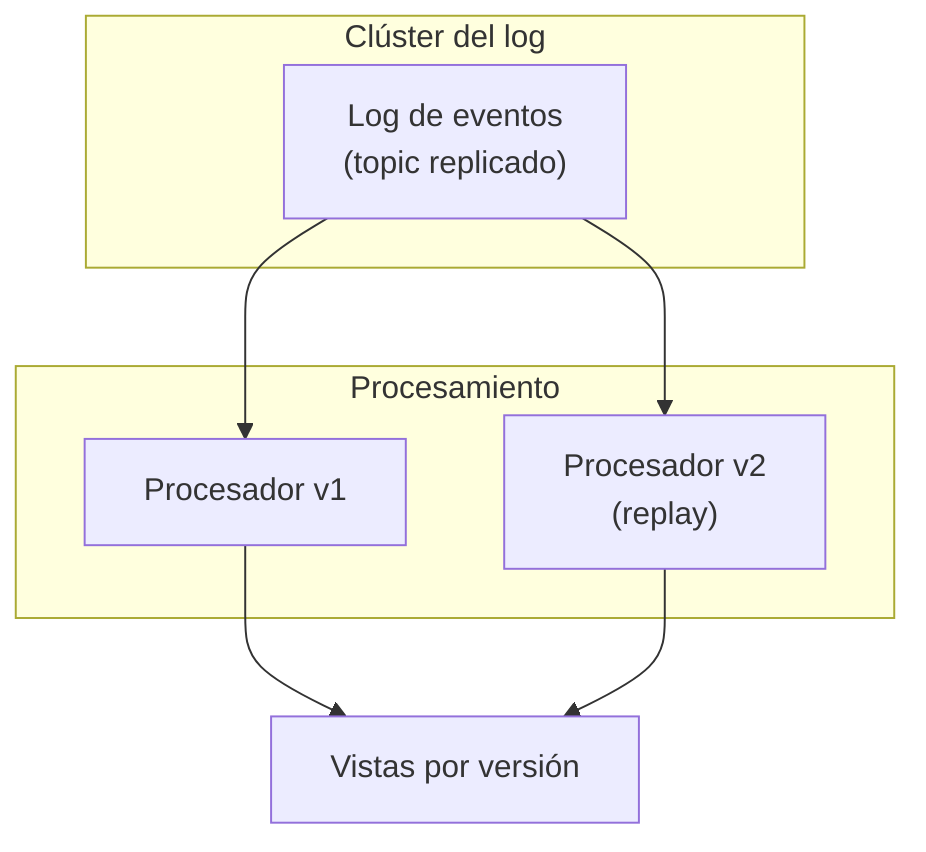

## 1. Resumen

La arquitectura Kappa tiene los mismos objetivos que Lambda, pero todo fluye por **un solo camino**: un sistema de stream processing sobre un **log unificado**, distribuido y tolerante a fallos, con eventos inmutables y ordenados. Si hay que recalcular todo, se hace **replay** del stream, normalmente en paralelo (*Big data architectures*).

Para cambiar una regla no hay capa batch: un consumidor nuevo relee el log desde el principio, arma su vista aparte y, cuando queda al día, pasa a ser la que se sirve. Conviene cuando la misma lógica sirve para lo histórico y lo nuevo, y el log puede retener la historia necesaria. No conviene si el recálculo exige releer años de eventos en poco tiempo, o si el log no puede retenerlos.

## 2. Escenario y requerimientos

Escenario: una billetera registra cada pago en un log. Una vista suma lo cobrado; un día se corrige la regla para excluir los pagos rechazados.

| Requerimiento | Valor del escenario |
|---|---|
| Fuente de verdad | El log de pagos, sin borrar por antigüedad |
| Una sola lógica | La misma para lo histórico y lo nuevo |
| Cambio de regla | La vista nueva se recalcula sin detener la actual |
| Corte | Se sirve la vista nueva solo cuando quedó al día |

## 3. Vista de contexto



## 4. Componentes

| Componente | Responsabilidad | Por qué está |
|---|---|---|
| Log de eventos | Eventos inmutables, ordenados por partición, con retención larga | Es la fuente de verdad y lo que se relee |
| Procesador | Una lógica streaming por versión | La misma para historia y presente |
| Posición por versión | Grupo de consumidores propio de cada versión | v2 relee desde el offset 0 sin mover a v1 |
| Vista por versión | Tabla de salida de cada procesador | Se compara antes de cambiar |
| Selector | Qué versión se sirve | El corte es un cambio de puntero, no una migración |

## 5. Vista de datos



En Kafka, los eventos no se borran al consumirlos sino según la retención de cada topic, y se pueden leer las veces que haga falta (*Introduction*, Kafka 4.3); con `retention.ms=-1` no hay límite de tiempo (*Topic Configs*). Si el log se compacta, queda al menos el último valor de cada clave (*Design*), lo que sirve para reconstruir estado, pero no para recalcular sobre cada evento.

## 6. Vista de despliegue



Durante el replay corren dos jobs a la vez: el v2 necesita capacidad extra hasta quedar al día. Cuando hay retención limitada, el log se completa con una copia en almacenamiento barato y el replay lee de ahí; la guía de Azure lo dibuja como eventos espejados a un almacenamiento de largo plazo (*Big data architectures*).

## 7. Seguridad y gobierno

- Un log retenido sin límite guarda datos personales para siempre: borrar un dato exige otra estrategia (seudonimizar al publicar, o compactar con un valor vacío por clave).
- Los eventos no se pueden borrar a mano en Event Hubs (*Event Hubs features and terminology*): la retención es la única forma de que salgan.
- Cada versión del procesador es código desplegado: con revisión, linaje y la vista que produce identificada por versión.

## 8. Escalabilidad, observabilidad y operación

- **Escala:** el replay se paraleliza por partición; dentro de un grupo, cada partición la lee un solo consumidor (`topics-and-partitions`).
- **Qué se mide:** lag del grupo v2 durante el replay (cuándo queda al día), diferencia entre vistas sobre el mismo período y retención disponible frente a la historia que se necesita releer.
- **Estado:** un procesador con estado se recupera combinando replay del stream y checkpointing (*Stateful Stream Processing*, Flink 2.3).
- **Runbook:** regla nueva → desplegar v2 con grupo nuevo desde el inicio, esperar lag 0, comparar, cambiar el selector y apagar v1.

## 9. Costos

El costo principal es la retención: guardar toda la historia en el broker es más caro que en almacenamiento de objetos, y por eso suele combinarse con una copia (Event Hubs Capture escribe en Blob Storage o ADLS en Avro, *Capture events through Azure Event Hubs…*). Cada replay es cómputo extra proporcional a la historia releída, más dos vistas en paralelo hasta el corte. En Pub/Sub, retener mensajes sin confirmar más de 24 horas tiene cargo adicional (*Subscription properties*). Los montos no se copian.

## 10. Código y configuración

```bash
# Bash y Kafka (ejecutado en la CI con un broker Kafka 4.3.1 en KRaft, en Docker; ADR-017): arquitectura Kappa de
# punta a punta. El log de pagos es la fuente de verdad (retention.ms=-1). La vista v1 suma todo; al corregir la regla
# (v2 excluye los rechazados) no hay capa batch: un grupo de consumidores nuevo relee el log desde el offset 0, arma
# su vista aparte y, cuando queda al día, pasa a ser la vista que se sirve.
set -euo pipefail
K="${KAFKA_CONTAINER:-dekh-kafka}"
kafka() { docker exec -i "$K" /opt/kafka/bin/"$1" --bootstrap-server localhost:9092 "${@:2}"; }
trap 'kafka kafka-topics.sh --delete --topic pagos-log > /dev/null 2>&1 || true' EXIT

kafka kafka-topics.sh --create --topic pagos-log --partitions 1 --config retention.ms=-1 > /dev/null
kafka kafka-configs.sh --entity-type topics --entity-name pagos-log --describe | grep -o 'retention.ms=-1' | sort -u
publish() { printf '%s\n' "$@" | kafka kafka-console-producer.sh --topic pagos-log; }
publish 'monto=1200 estado=ok' 'monto=800 estado=ok' 'monto=1200 estado=rechazado' 'monto=1500 estado=ok'

consume() {   # lee con el grupo $1 lo que ese grupo todavía no leyó
  kafka kafka-console-consumer.sh --topic pagos-log --group "$1" --from-beginning --timeout-ms 8000 2> /dev/null
}
view() { awk -v rule="$1" -F'[= ]' 'rule == "v1" || $4 == "ok" { n++; s += $2 } END { printf "%d pagos, total %d", n, s }'; }
consume vista-v1 >> v1.log   # cada vista guarda lo que procesó; la vista se calcula sobre eso
consume vista-v2 >> v2.log
echo "vista v1 (suma todo): $(view v1 < v1.log)"
echo "vista v2 (excluye rechazados), recalculada desde el offset 0: $(view v2 < v2.log)"
kafka kafka-consumer-groups.sh --describe --group vista-v2 2> /dev/null | awk '$2 == "pagos-log" { print "v2 al día: lag " $6 }'
publish 'monto=600 estado=ok'   # después del cambio, solo v2 sigue al día y se sirve
consume vista-v2 >> v2.log
echo "llega un pago nuevo; vista v2: $(view v2 < v2.log)"
```

El script se **ejecuta en la CI contra un broker Kafka 4.3.1 en KRaft, en Docker** (ADR-017):

```text
retention.ms=-1
vista v1 (suma todo): 4 pagos, total 4700
vista v2 (excluye rechazados), recalculada desde el offset 0: 3 pagos, total 3500
v2 al día: lag 0
llega un pago nuevo; vista v2: 4 pagos, total 4100
```

El topic retiene sin límite. La vista v1 suma los 4 pagos; v2, con la regla corregida, relee el log desde el offset 0 con su propio grupo y excluye el rechazado, sin mover a v1. Con lag 0, v2 está al día y pasa a servirse; el pago que llega después solo lo procesa v2. Lo que no ejecuta: un motor de stream processing (la vista se calcula con `awk`), particiones múltiples ni el selector de la vista servida.

## 11. GCP

| Pieza | Servicio | Detalle y diferencia |
|---|---|---|
| Log | Pub/Sub | No es un log con offsets: el replay se hace con seek a un snapshot o timestamp, y para reentregar mensajes ya confirmados hay que retenerlos (*Replay and purge messages with seek*). Retención de la suscripción de hasta 31 días (*Subscription properties*) |
| Log tipo Kafka | Kafka administrado | Alternativa cuando se necesitan offsets por grupo como en el §10. No ejecutado |

## 12. AWS

| Pieza | Servicio | Detalle y diferencia |
|---|---|---|
| Log | Amazon MSK | Kafka de código abierto administrado; el §10 aplica sin cambiar el código (*Welcome to the Amazon MSK Developer Guide*) |
| Log administrado | Kinesis Data Streams | Retención de 24 horas por defecto, hasta 365 días (*Change the data retention period*): más allá, el replay lee de una copia en S3 |

## 13. Azure

| Pieza | Servicio | Detalle y diferencia |
|---|---|---|
| Log | Event Hubs | Retención por nivel (Standard hasta 7 días; Premium y Dedicated hasta 90); los consumidores leen desde un offset, un timestamp o el inicio (*Event Hubs features and terminology*) |
| Historia larga | Event Hubs Capture | Copia el stream en Avro a Blob Storage o ADLS para releer lo que ya salió de la retención (*Capture events through Azure Event Hubs…*) |
| Guía | Azure Architecture Center | Describe Kappa como alternativa a Lambda, con replay del stream para recalcular (*Big data architectures*) |

## 14. Riesgos y modos de falla

| Riesgo | Cómo se detecta | Cómo se recupera |
|---|---|---|
| Retención menor que la historia necesaria | El replay empieza después del primer evento | Copia del log en almacenamiento de objetos |
| Replay que tarda días | Lag de v2 que baja lento | Más particiones y paralelismo, o recalcular solo un período |
| v2 sin `auto.offset.reset=earliest` | v2 arranca desde el final y queda vacía | Grupo nuevo leyendo desde el inicio (`--from-beginning` en el §10) |
| Efectos externos repetidos en el replay | Correos o pagos duplicados | Durante el replay, solo escribir la vista; nunca efectos externos |

## 15. Errores frecuentes

| Error | Consecuencia |
|---|---|
| Reusar el grupo de v1 para v2 | v2 empieza donde quedó v1 y no recalcula |
| Compactar el log y esperar replay completo | Solo queda el último valor por clave |
| Cambiar la vista servida antes de lag 0 | Cifras parciales en producción |
| Presentarla como reemplazo de todo batch | Algunos recálculos sobre años de historia son más baratos en batch |

## 16. Trade-offs y alternativas

| Opción | Gana | Cuesta |
|---|---|---|
| Kappa | Una sola lógica y un solo sistema | Retención larga y replays costosos |
| `lambda-architecture` | Recalcular con batch sobre almacenamiento barato | Dos caminos y lógica duplicada |
| Lakehouse con time travel (`lakehouse-architecture`) | Historia en tablas y recálculo con SQL | Latencia de minutos, no de segundos |

## 17. Conceptos relacionados

- `replay`: releer el log.
- `lambda-architecture`: la alternativa de dos caminos.
- `streaming-pipeline-architecture`: el único camino.
- `kafka-architecture`: el log particionado, replicado y retenido.
- `events`: eventos que no se borran al leerlos.
- `topics-and-partitions`: el paralelismo del replay.
- `stateful-stream-processing`: estado que se reconstruye releyendo.
- `event-driven-architecture`: el log de eventos de negocio.
- `lakehouse-architecture`: historia en tablas, recálculo con SQL.

## 18. Evolución

Se llega desde `lambda-architecture` cuando el motor streaming ya da la exactitud que daba el batch, o desde `event-driven-architecture` cuando el log de eventos pasa a ser la fuente de verdad. La señal para no adoptarla: la historia que hay que releer no cabe en la retención y no hay copia.

## 19. Laboratorio relacionado

Sin laboratorio en F4: no está entre las 6 arquitecturas de F4. El §10 corre en la CI.

## 20. Fuentes

- Microsoft Learn: *Big data architectures*; *Event Hubs features and terminology*; *Capture events through Azure Event Hubs in Azure Blob Storage or Azure Data Lake Storage*.
- Apache Kafka 4.3: *Introduction*; *Topic Configs*; *Design*; *Consumer and Share Consumer Configs*.
- Apache Flink 2.3: *Stateful Stream Processing*.
- Google Cloud: *Replay and purge messages with seek*; *Subscription properties*.
- AWS: *Change the data retention period*; *Welcome to the Amazon MSK Developer Guide*.

El detalle de cada fuente está en `sources` del frontmatter.

## 21. Fecha de última verificación

2026-11-02: fichas de origen de cada cita revisadas y *Big data architectures* leída hoy (H1 y contenido). `verified`: aprobada por Felipe el 2026-11-03 (`owner_approved_at`).

## 22. Historial de cambios importantes

- 2026-11-02: creación (lote 07b, ADR-028).
- 2026-11-02: las tres vistas usan los nombres del §4 (criterio de la revisión de 07a).
- 2026-11-03: el §19 ya no promete un laboratorio en F4: el ROADMAP lo deja para las 6 arquitecturas de F4, y esta no está entre ellas.
- 2026-11-03: revisión de 07b aplicada (docs/reviews/lote-07b.md): las citas nuevas del lote llevan su `url` (faltaba).
- 2026-11-03: `verification_status: verified`, aprobada por Felipe con lista explícita (`owner_approved_at: 2026-11-03`).
