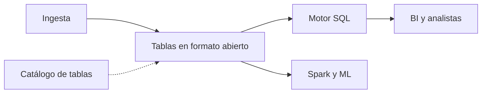
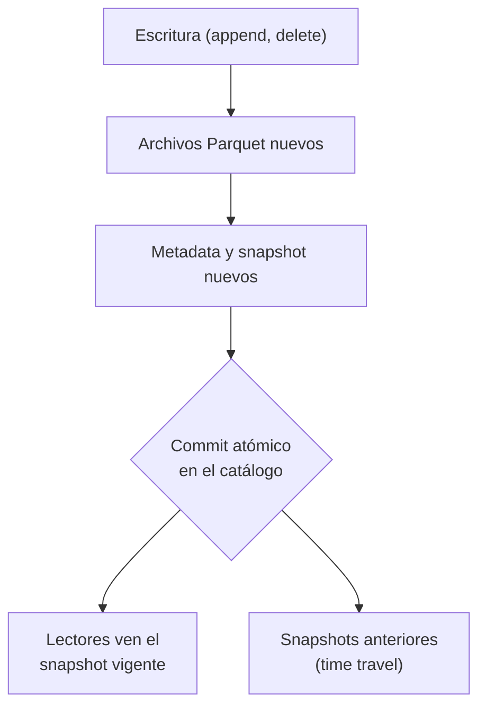
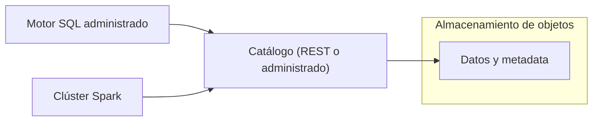

## 1. Resumen

Un lakehouse pone **tablas transaccionales en formato abierto** sobre el almacenamiento de objetos de un lake. Los archivos siguen siendo Parquet en un bucket, pero un formato de tabla (Iceberg, Delta o Hudi) y un **catálogo** les dan lo que el lake no tenía: commits atómicos, borrados y actualizaciones de filas, versiones con time travel y evolución del esquema. Como el formato es abierto, **varios motores** leen y escriben las mismas tablas.

Conviene cuando conviven SQL, Spark y ML sobre los mismos datos, o cuando se quiere evitar copiar datos entre un lake y un warehouse. No conviene si un solo motor SQL alcanza y el equipo no quiere operar catálogo y mantenimiento de tablas (`modern-data-warehouse-architecture`).

## 2. Escenario y requerimientos

Escenario: un retailer guarda pedidos en un lake; analítica los consulta con SQL, ciencia de datos entrena con Spark y legal pide borrar pedidos anulados sin reescribir todo.

| Requerimiento | Valor del escenario |
|---|---|
| Motores | SQL y Spark sobre las mismas tablas |
| Cambios | Borrar o actualizar filas puntuales |
| Auditoría | Ver la tabla como estaba antes de un cambio |
| Esquema | Agregar columnas sin reescribir la historia |
| Restricción | Formato abierto, sin depender de un motor |

## 3. Vista de contexto



## 4. Componentes

| Componente | Responsabilidad | Por qué está |
|---|---|---|
| Almacenamiento de objetos | Guarda los archivos Parquet y la metadata | Barato, durable y compartido |
| Formato de tabla | Snapshots, manifiestos y esquema | Transacciones y time travel sobre archivos |
| Catálogo de tablas | Apunta cada tabla a su metadata vigente | El commit atómico es cambiar ese puntero |
| Motores | Leen y escriben con el mismo formato | Un dato, varios usos sin copias |
| Mantenimiento | Compacta y expira snapshots | Sin él, crecen los archivos chicos y la historia |

## 5. Vista de datos



En Iceberg cada cambio de datos y metadatos es atómico; los lectores usan un snapshot consistente sin tomar un lock, y las escrituras concurrentes usan concurrencia optimista (*Reliability*).

## 6. Vista de despliegue



Los motores no listan carpetas: piden al catálogo la metadata vigente de cada tabla.

## 7. Seguridad y gobierno

- El catálogo es el punto de control: los permisos sobre tablas, filas y columnas se aplican ahí, no sobre el bucket.
- Borrar una fila no la saca de los snapshots anteriores: para datos personales hace falta expirar snapshots (ficha `retention-and-erasure`).
- Cada motor debe usar el mismo catálogo; un motor que lee archivos directo se salta los permisos.

## 8. Escalabilidad, observabilidad y operación

- **Escala:** los motores se escalan por separado del almacenamiento.
- **Qué se mide:** archivos por tabla, tamaño medio de archivo, snapshots retenidos y commits fallidos por concurrencia.
- **Runbook:** compactar las tablas con muchos archivos chicos; expirar snapshots según la política de retención; reintentar un commit que perdió la carrera de concurrencia.

## 9. Costos

Lo que mueve el costo es el cómputo de los motores y la cantidad de archivos que leen. El time travel cuesta almacenamiento: los archivos viejos se conservan hasta expirar sus snapshots. En AWS, S3 Tables hace el mantenimiento automático (compactación, gestión de snapshots y borrado de archivos sin referencia) (*Working with Amazon S3 Tables and table buckets*); con un catálogo propio, ese trabajo lo hace el equipo.

## 10. Código y configuración

```python
# Python 3.12, PyIceberg 0.12 y PyArrow (ejecutado en la CI en Linux; ADR-018): el núcleo de un lakehouse en local.
# Los datos son archivos Parquet en una carpeta (el «bucket»), y un catálogo SQL en SQLite guarda la tabla Iceberg:
# commits atómicos con snapshots, un borrado de filas como en un warehouse, time travel a antes del borrado y
# evolución del esquema sin reescribir archivos. Un motor SQL de la nube haría las mismas operaciones sobre la tabla.
from __future__ import annotations

import sys
import tempfile
from pathlib import Path

import pyarrow as pa  # type: ignore[import-untyped]  # pyarrow no publica stubs de tipos
from pyiceberg.catalog.sql import SqlCatalog
from pyiceberg.types import StringType

base = Path(sys.argv[1] if len(sys.argv) > 1 else tempfile.mkdtemp())
lake = base / "lake"
lake.mkdir(parents=True, exist_ok=True)
catalog = SqlCatalog("local", uri=f"sqlite:///{(base / 'catalog.db').as_posix()}", warehouse=lake.as_uri())
catalog.create_namespace("ventas")


def batch(ids: list[int], amounts: list[float]) -> pa.Table:
    return pa.table({"id": pa.array(ids, pa.int64()), "monto": pa.array(amounts, pa.float64())})


table = catalog.create_table("ventas.pedidos", schema=batch([], []).schema)
table.append(batch([1, 2], [120.0, 80.0]))       # commit 1: carga del lunes
table.append(batch([3, 4], [50.0, 70.0]))        # commit 2: carga del martes
table.delete("id = 2")                           # commit 3: un pedido anulado; se reescribe el archivo afectado
snapshots = [s.snapshot_id for s in table.metadata.snapshots]
print(f"snapshots: {len(snapshots)}")
print(f"ids hoy: {sorted(table.scan().to_arrow().column('id').to_pylist())}")
before_delete = table.scan(snapshot_id=snapshots[1]).to_arrow()           # time travel: antes del borrado
print(f"ids antes del borrado: {sorted(before_delete.column('id').to_pylist())}")

with table.update_schema() as update:            # evolución del esquema, sin reescribir los archivos
    update.add_column("canal", StringType())
table = catalog.load_table("ventas.pedidos")
print(f"columnas: {[f.name for f in table.schema().fields]}")
print(f"total vigente: {sum(table.scan().to_arrow().column('monto').to_pylist())}")
print(f"archivos Parquet en el lake: {len(list(lake.rglob('*.parquet')))}")   # los viejos siguen para time travel
```

El script se **ejecuta en la CI en Linux** con PyIceberg 0.12 y catálogo SQLite (ADR-018) y pasa `mypy --strict`. Hace dos cargas, borra un pedido, viaja al snapshot anterior al borrado y agrega una columna:

```text
snapshots: 3
ids hoy: [1, 3, 4]
ids antes del borrado: [1, 2, 3, 4]
columnas: ['id', 'monto', 'canal']
total vigente: 240.0
archivos Parquet en el lake: 3
```

PyIceberg accede a tablas Iceberg sin una JVM y trae un catálogo SQL sobre SQLite (*Getting started with PyIceberg*). El esquema evoluciona en el lugar, sin reescribir los datos (*Evolution*). Los tres archivos Parquet incluyen los que siguen vivos solo para el time travel. Lo que no ejecuta: un catálogo REST administrado, un motor SQL de la nube y Spark.

## 11. GCP

| Pieza | Servicio | Detalle y diferencia |
|---|---|---|
| Catálogo | Lakehouse runtime catalog | Antes BigLake metastore: «As of April 20th, 2026, BigLake is now called Lakehouse»; las API, bibliotecas, CLI e IAM siguen con el nombre BigLake (*Set up the Apache Iceberg REST catalog endpoint*) |
| Tablas Iceberg | Apache Iceberg managed tables de BigQuery | No admiten copias, clones ni snapshots de tabla de BigQuery (*Apache Iceberg managed tables*) |

## 12. AWS

| Pieza | Servicio | Detalle y diferencia |
|---|---|---|
| Almacenamiento de tablas | Amazon S3 Tables | Tablas Iceberg con mantenimiento automático (*Working with Amazon S3 Tables and table buckets*) |
| Motor SQL | Amazon Athena | Lecturas, time travel, escrituras y DDL sobre tablas Iceberg (*Query Apache Iceberg tables*) |

## 13. Azure

| Pieza | Servicio | Detalle y diferencia |
|---|---|---|
| Lakehouse | Lakehouse de Microsoft Fabric | Combina archivos y tablas en OneLake, con un endpoint SQL de solo lectura sobre sus tablas Delta (*What is a lakehouse in Microsoft Fabric?*) |
| Formato | Delta Lake | Formato estándar de Fabric: todas sus experiencias generan y consumen tablas Delta (*Delta Lake table format interoperability*); Iceberg es otro formato, no el mismo |

## 14. Riesgos y modos de falla

| Riesgo | Cómo se detecta | Cómo se recupera |
|---|---|---|
| Archivos chicos | Archivos por tabla | Compactación programada |
| Historia que crece sin límite | Snapshots retenidos | Expirar según la política |
| Dos catálogos para la misma tabla | Lectores que ven versiones distintas | Un catálogo por tabla, con dueño |
| Motor que no soporta la versión del formato | Error al leer | Fijar la versión de formato soportada por todos |

## 15. Errores frecuentes

| Error | Consecuencia |
|---|---|
| Creer que un DELETE borra el dato | Sigue en los snapshots anteriores hasta expirarlos |
| Leer archivos sin pasar por el catálogo | Datos a medio commit y permisos saltados |
| Tratar Iceberg y Delta como intercambiables | Motores y servicios distintos según la nube (§11–13) |
| No programar el mantenimiento | Consultas cada vez más lentas |

## 16. Trade-offs y alternativas

| Opción | Gana | Cuesta |
|---|---|---|
| Lakehouse | Formatos abiertos, varios motores, sin copias | Catálogo y mantenimiento |
| `modern-data-warehouse-architecture` | Menos piezas, SQL y concurrencia | Formato del motor |
| `data-lake-architecture` | Lo más simple y barato | Sin transacciones ni time travel |

## 17. Conceptos relacionados

- `lakehouse`: el concepto que esta arquitectura implementa.
- `open-table-formats`: Iceberg, Delta y Hudi.
- `table-format-comparison`: cómo elegir el formato.
- `data-lake-architecture`: la base de almacenamiento.
- `modern-data-warehouse-architecture`: la alternativa con el formato del motor.
- `medallion-architecture`: las capas sobre el lakehouse.
- `retention-and-erasure`: expirar snapshots para que un borrado sea efectivo.

## 18. Evolución

Se llega desde un `data-lake-architecture` cuando las reescrituras de carpetas y las lecturas inconsistentes se vuelven frecuentes, o desde un warehouse cuando aparecen otros motores. Se organiza por dentro con `medallion-architecture`. La señal para no adoptarlo: un solo motor y nadie para operar el catálogo y el mantenimiento.

## 19. Laboratorio relacionado

Sin laboratorio en F4: no está entre las 6 arquitecturas de F4. El §10 corre en la CI.

## 20. Fuentes

- Apache Iceberg: *Documentation*; *Reliability*; *Evolution*; *Getting started with PyIceberg*.
- Google Cloud: *Set up the Apache Iceberg REST catalog endpoint*; *Apache Iceberg managed tables*.
- AWS: *Working with Amazon S3 Tables and table buckets*; *Query Apache Iceberg tables*.
- Microsoft Learn: *What is a lakehouse in Microsoft Fabric?*; *Delta Lake table format interoperability*.

El detalle de cada fuente está en `sources` del frontmatter.

## 21. Fecha de última verificación

2026-11-01: fichas de origen de cada cita revisadas; las páginas se consultaron en las fechas de `sources`. `verified`: aprobada el 2026-11-03 (`owner_approved_at`).

## 22. Historial de cambios importantes

- 2026-11-01: creación (lote 07a, ADR-028).
- 2026-11-03: `verification_status: verified`, aprobada con lista explícita (`owner_approved_at: 2026-11-03`).
