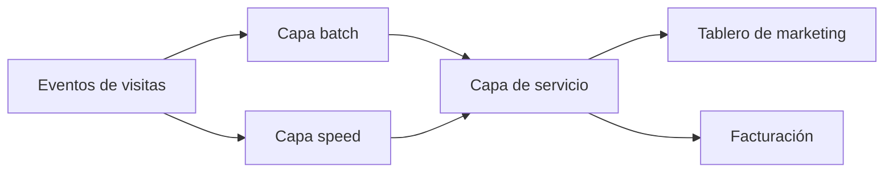
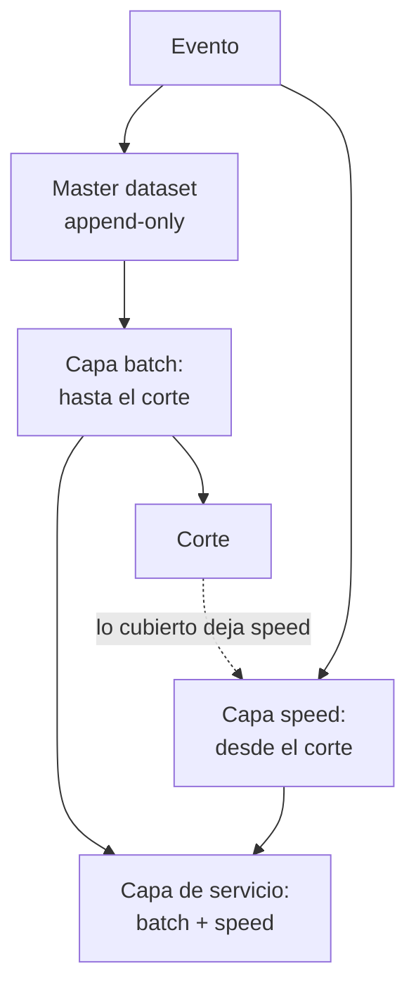
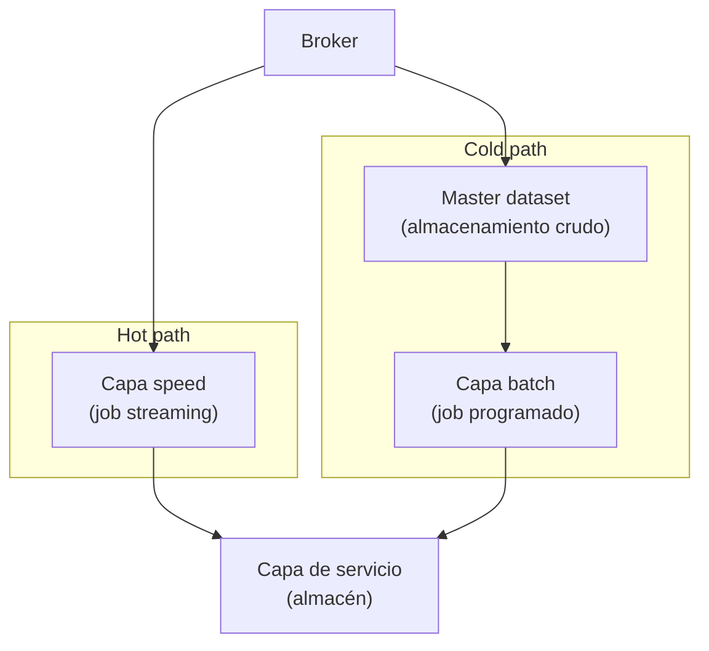

## 1. Resumen

La arquitectura Lambda procesa cada dato por **dos caminos**. La **capa batch** (cold path) guarda todo en crudo, inmutable, y recalcula periódicamente una vista exacta; la **capa speed** (hot path) procesa en tiempo real, con baja latencia a costa de exactitud; la **capa de servicio** indexa la vista batch y suma los incrementos de speed (*Big data architectures*).

Se estudia para reconocer el doble camino, no como diseño por defecto. Su costo es la complejidad: la lógica aparece en dos lugares, con frameworks distintos, y hay que mantenerla igual (*Big data architectures*). Hoy, motores que unifican batch y streaming en un mismo modelo, como Beam (*Programming model for Apache Beam*) o Structured Streaming (*Structured Streaming Programming Guide*), reducen ese costo; `kappa-architecture` lo elimina con un solo camino.

## 2. Escenario y requerimientos

Escenario: un sitio quiere visitas por página. Marketing mira un tablero en vivo; finanzas factura publicidad con la cifra exacta del día anterior, sin duplicados.

| Requerimiento | Valor del escenario |
|---|---|
| En vivo | Visitas de la última hora, aunque sean aproximadas |
| Exacto | Cifra diaria deduplicada por `event_id` y con los tardíos |
| Historia | Poder recalcular cualquier día si cambia la regla |
| Restricción | El dato crudo nunca se modifica |

## 3. Vista de contexto



## 4. Componentes

| Componente | Responsabilidad | Por qué está |
|---|---|---|
| Master dataset | Todos los eventos en crudo, append-only | Recalcular cualquier vista desde el origen |
| Capa batch | Recalcula la vista exacta hasta un corte | Exactitud: deduplica e incluye tardíos |
| Capa speed | Incrementos desde el corte | Latencia baja mientras corre el próximo batch |
| Capa de servicio | Une vista batch y vista speed | Una sola respuesta para el consumidor |
| Corte | Hasta dónde llega la última vista batch | Define qué parte sirve cada capa |

## 5. Vista de datos



El dato crudo de la capa batch es inmutable: lo nuevo se agrega y un cambio se guarda como otro evento con su timestamp, lo que permite recalcular en cualquier punto de la historia (*Big data architectures*). Cuando la capa batch avanza el corte, lo que cubre deja de servirse desde speed.

## 6. Vista de despliegue



Son dos despliegues, con dos ciclos de vida: el job streaming corre siempre y el batch por horario. En la nube, el cold path suele empezar con una copia del broker al almacenamiento: Event Hubs Capture escribe el stream en Blob Storage o ADLS en Avro (*Capture events through Azure Event Hubs…*) y Data Firehose entrega a S3 acumulando por tamaño o intervalo (*What is Amazon Data Firehose?*).

## 7. Seguridad y gobierno

- El master dataset guarda todo en crudo y para siempre: los datos personales necesitan una política de retención y de borrado que no rompa la inmutabilidad (por ejemplo, seudonimizar al ingerir).
- Dos caminos son dos superficies de acceso: los mismos permisos y la misma clasificación en ambos.
- El linaje tiene que mostrar de qué capa viene cada cifra servida.

## 8. Escalabilidad, observabilidad y operación

- **Escala:** la capa batch escala con el volumen histórico; la speed, con el tráfico del momento.
- **Qué se mide:** la diferencia entre speed y batch sobre el mismo período (si crece, las dos lógicas divergen), la antigüedad del corte y la duración del batch.
- **Runbook:** cambio de regla → cambiarla en **las dos** capas y recalcular batch desde el master; speed caída → la capa batch cubre el período en el siguiente corte.

## 9. Costos

Se paga dos veces el procesamiento del mismo dato (un job siempre encendido y otro que relee la historia), el almacenamiento del master dataset completo y, sobre todo, el trabajo de mantener dos implementaciones iguales. Una vista materializada que combina datos precalculados con los cambios recientes, como las de BigQuery, cubre algunos casos sin capa speed propia (*Introduction to materialized views*). Los montos dependen de los servicios elegidos y se calculan con la calculadora de cada nube.

## 10. Código y configuración

```python
# Python 3.12+, biblioteca estándar; sqlite3 hace de motor. Arquitectura Lambda de punta a punta: un master dataset
# append-only; la capa batch recalcula su vista desde todo el master hasta un corte; la capa speed suma lo que llegó
# después del corte; la capa de servicio une ambas. La regla vive dos veces, y aquí la de speed no deduplica por
# event_id: el error se ve hasta que la siguiente corrida batch cubre ese período y reemplaza a speed.
import sqlite3
from collections import Counter

db = sqlite3.connect(":memory:")
db.execute("CREATE TABLE master (event_id TEXT, ts TEXT, page TEXT)")   # append-only: nunca UPDATE ni DELETE
speed: Counter[str] = Counter()
cutoff = ""


def arrive(event_id: str, ts: str, page: str) -> None:
    db.execute("INSERT INTO master VALUES (?, ?, ?)", (event_id, ts, page))
    if ts >= cutoff:
        speed[page] += 1   # incremental y rápido, pero sin deduplicar: la segunda implementación de la regla


def batch_view() -> dict[str, int]:   # recalcula desde el master, deduplicando por event_id
    rows = db.execute("SELECT page, COUNT(DISTINCT event_id) FROM master WHERE ts < ? GROUP BY page ORDER BY page",
                      (cutoff,))
    return dict(rows.fetchall())


def run_batch(new_cutoff: str) -> dict[str, int]:
    global cutoff
    cutoff = new_cutoff
    speed.clear()   # lo que cubre el batch deja de servirse desde speed
    for _, ts, page in db.execute("SELECT * FROM master WHERE ts >= ?", (cutoff,)).fetchall():
        speed[page] += 1
    return batch_view()


def serve() -> dict[str, int]:
    merged = Counter(batch_view())
    merged.update(speed)
    return dict(sorted(merged.items()))


for event in [("e-1", "11:10", "home"), ("e-2", "11:20", "precios"), ("e-3", "11:40", "home"), ("e-4", "11:50", "home")]:
    arrive(*event)
print("batch hasta las 12:00:", run_batch("12:00"))
for event in [("e-5", "12:05", "home"), ("e-5", "12:05", "home"), ("e-6", "12:20", "precios")]:   # e-5 llega dos veces
    arrive(*event)
print("speed desde las 12:00:", dict(sorted(speed.items())))
print("servido (batch + speed):", serve())
print("batch hasta las 13:00:", run_batch("13:00"), "| speed:", dict(speed))
print("servido (batch + speed):", serve())
```

El script se **ejecuta en la CI** con la biblioteca estándar y pasa `mypy --strict`:

```text
batch hasta las 12:00: {'home': 3, 'precios': 1}
speed desde las 12:00: {'home': 2, 'precios': 1}
servido (batch + speed): {'home': 5, 'precios': 2}
batch hasta las 13:00: {'home': 4, 'precios': 2} | speed: {}
servido (batch + speed): {'home': 4, 'precios': 2}
```

La capa speed cuenta dos veces el evento `e-5`, que llegó repetido, y el servicio muestra `home: 5`. La corrida batch de las 13:00 recalcula desde el master con `COUNT(DISTINCT event_id)`, vacía speed y el servicio queda en `home: 4`. Es el costo de la arquitectura en pequeño: la misma regla implementada dos veces, y la segunda distinta. Lo que no ejecuta: motores distribuidos ni un broker; la lógica de capas y corte es la misma.

## 11. GCP

| Pieza | Servicio | Detalle y diferencia |
|---|---|---|
| Batch y speed | Dataflow (Apache Beam) | Beam es un modelo unificado para batch y streaming (*Programming model for Apache Beam*): con el mismo código en los dos caminos, la duplicación baja, pero siguen siendo dos jobs. No ejecutado |
| Servicio | BigQuery | Las vistas materializadas combinan lo precalculado con los cambios recientes de la tabla base (*Introduction to materialized views*) |

## 12. AWS

| Pieza | Servicio | Detalle y diferencia |
|---|---|---|
| Speed | Kinesis Data Streams | Retención de 24 horas por defecto, ampliable (*Change the data retention period*): no sirve de master dataset por sí solo |
| Cold path | Data Firehose hacia S3 | Copia el stream a S3 por tamaño o intervalo (*What is Amazon Data Firehose?*); el batch corre sobre S3. No ejecutado |

## 13. Azure

| Pieza | Servicio | Detalle y diferencia |
|---|---|---|
| Cold path | Event Hubs Capture | Escribe el stream en Blob Storage o ADLS en Avro (*Capture events through Azure Event Hubs…*) |
| Batch y speed | Azure Databricks | Structured Streaming expresa el cálculo como sobre datos estáticos y lo ejecuta en forma incremental (*Structured Streaming concepts*): el mismo motor en los dos caminos. No ejecutado |
| Guía | Azure Architecture Center | Describe Lambda, sus capas y su desventaja, la lógica duplicada (*Big data architectures*) |

## 14. Riesgos y modos de falla

| Riesgo | Cómo se detecta | Cómo se recupera |
|---|---|---|
| Lógicas que divergen | Salto en la cifra al avanzar el corte | Tests que comparan speed y batch sobre el mismo período |
| Batch que no termina antes del siguiente | El corte se atrasa y speed crece | Particionar el recálculo o ampliar el intervalo |
| Master dataset modificado | El recálculo no reproduce cifras pasadas | Append-only sin permisos de escritura humana |
| Speed que no tolera duplicados | Cifras en vivo infladas | Deduplicar también en speed, o aceptar y documentar la aproximación |

## 15. Errores frecuentes

| Error | Consecuencia |
|---|---|
| Adoptarla por defecto | Dos sistemas que operar para un caso que resuelve uno |
| Cambiar la regla solo en una capa | Cifras distintas según la hora de la consulta |
| Mostrar speed como exacto | Decisiones sobre cifras aproximadas |
| Presentarla como lo moderno frente a batch | Es un compromiso de latencia y exactitud, no un reemplazo |

## 16. Trade-offs y alternativas

| Opción | Gana | Cuesta |
|---|---|---|
| Lambda | Exactitud del batch y latencia del streaming | Dos caminos y lógica duplicada |
| `kappa-architecture` | Un solo camino y una sola lógica | Recalcular es releer el log entero |
| Solo batch (`batch-pipeline-architecture`) | Lo más simple | Sin cifras en vivo |
| Solo streaming con tardíos (`streaming-pipeline-architecture`) | Una lógica, cifras en minutos | Exactitud limitada por la watermark |

## 17. Conceptos relacionados

- `batch-vs-streaming`: los dos modos que combina.
- `kappa-architecture`: la alternativa de un solo camino.
- `batch-pipeline-architecture` y `streaming-pipeline-architecture`: sus dos capas.
- `idempotency` y `late-arriving-data`: lo que la capa batch corrige.
- `real-time-analytics-architecture`: la capa de servicio con baja latencia.

## 18. Evolución

Aparece cuando un `batch-pipeline-architecture` necesita cifras en vivo y el streaming disponible no da exactitud. Hoy suele evolucionar a `kappa-architecture`, o a un solo motor que unifica batch y streaming. La señal para no adoptarla: un streaming con watermark y deduplicación ya da la exactitud que se pide.

## 19. Laboratorio relacionado

Sin laboratorio en F4: no está entre las 6 arquitecturas de F4. El §10 corre en la CI.

## 20. Fuentes

- Microsoft Learn: *Big data architectures*; *Capture events through Azure Event Hubs in Azure Blob Storage or Azure Data Lake Storage*; *Structured Streaming concepts*.
- Google Cloud: *Programming model for Apache Beam*; *Streaming pipelines*; *Introduction to materialized views*.
- AWS: *Change the data retention period*; *What is Amazon Data Firehose?*.
- Apache Spark 4.2.0: *Structured Streaming Programming Guide* (Overview).

El detalle de cada fuente está en `sources` del frontmatter.

## 21. Fecha de última verificación

2026-11-02: fichas de origen de cada cita revisadas y *Big data architectures* leída hoy (H1 y contenido). `verified`: aprobada el 2026-11-03 (`owner_approved_at`).

## 22. Historial de cambios importantes

- 2026-11-02: creación (lote 07b, ADR-028).
- 2026-11-02: las tres vistas usan los nombres del §4 (criterio de la revisión de 07a).
- 2026-11-03: el §19 ya no promete un laboratorio en F4: el ROADMAP lo deja para las 6 arquitecturas de F4, y esta no está entre ellas.
- 2026-11-03: revisión de 07b aplicada (docs/reviews/lote-07b.md): las citas nuevas del lote llevan su `url` (faltaba); el §5 tiene el nodo «Corte» del §4.
- 2026-11-03: `verification_status: verified`, aprobada con lista explícita (`owner_approved_at: 2026-11-03`).
