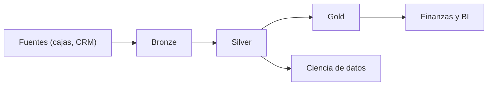
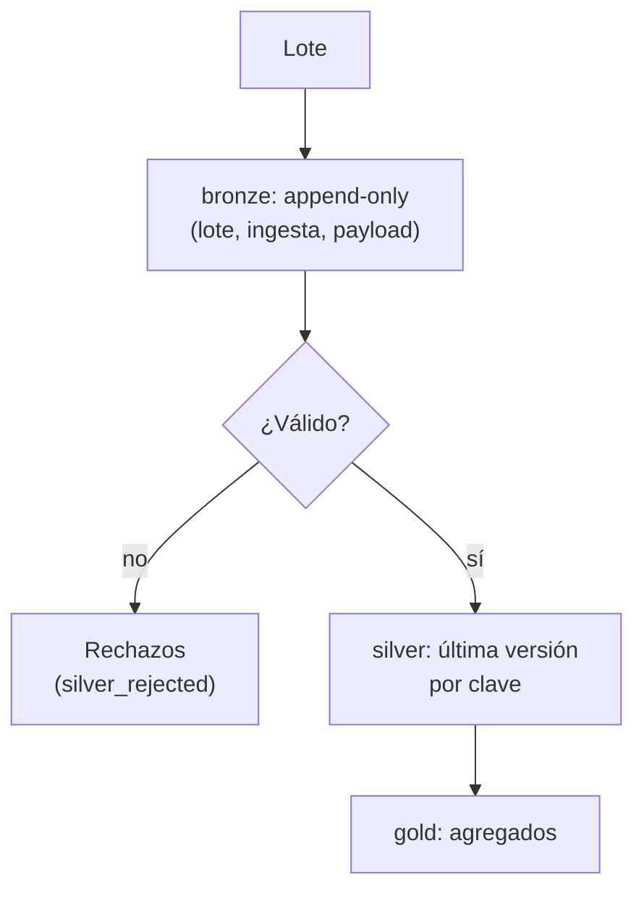
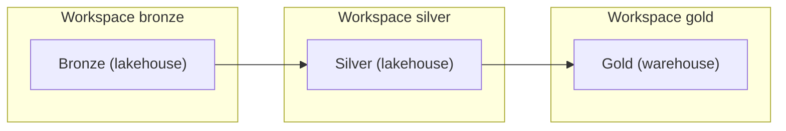

## 1. Resumen

Medallion organiza los datos de un lakehouse en tres capas: **bronze** guarda lo que llega, sin cambios; **silver** lo tipa, valida y deduplica; **gold** lo agrega para un uso de negocio. Cada capa sube la calidad un paso (*What is the medallion lakehouse architecture?*). Lo que la hace útil en producción es que **bronze es append-only y todo lo demás se reconstruye desde bronze**.

Bronze/silver/gold es una convención de capas, no un estándar formal: cada plataforma la nombra y la despliega a su manera (§11–13). Conviene con varias fuentes y consumidores que necesitan distinta calidad. No conviene para una sola fuente simple, donde tres capas son ceremonia (`batch-pipeline-architecture`).

## 2. Escenario y requerimientos

Escenario: una cadena recibe pagos de varias cajas en lotes; algunos llegan repetidos o corregidos, y otros con montos inválidos. Finanzas quiere ingresos por tienda; auditoría, el dato original.

| Requerimiento | Valor del escenario |
|---|---|
| Original | Conservar cada lote tal como llegó |
| Calidad | Un registro por pago, el más reciente; inválidos aparte |
| Consumo | Ingresos por tienda para finanzas |
| Reprocesos | Reprocesar un lote no duplica |
| Restricción | Poder reconstruir todo si se corrige una regla |

## 3. Vista de contexto



## 4. Componentes

| Componente | Responsabilidad | Por qué está |
|---|---|---|
| Bronze | Lotes tal como llegan, con lote y hora de ingesta | Auditoría y reconstrucción |
| Silver | Tipado, validación, deduplicación por clave | Una versión confiable de cada entidad |
| Rechazos | Registros que no pasan la validación, con el motivo | Lo inválido se revisa, no se pierde |
| Gold | Agregados y modelos por caso de uso | Consumo simple para el negocio |
| Reglas | Validaciones y criterio de deduplicación versionados | Si cambian, se reconstruye silver desde bronze |

## 5. Vista de datos



En Azure Databricks, silver es también donde se integran fuentes dispares para construir el warehouse, a menudo en 3NF o Data Vault (*Data warehousing architecture*).

## 6. Vista de despliegue



Fabric recomienda un workspace por lakehouse para tener más control y gobierno por capa, y plantea gold como lakehouse o como warehouse (*Understand medallion architecture for Fabric with OneLake*).

## 7. Seguridad y gobierno

- Bronze tiene el dato crudo, incluidos los datos personales: solo los pipelines lo leen.
- Con datos sensibles, AWS recomienda una landing zone donde se enmascaran antes de la capa raw (*Recommended data layers*).
- Gold expone solo lo que cada consumidor necesita; silver queda para equipos de datos.

## 8. Escalabilidad, observabilidad y operación

- **Escala:** cada capa se procesa por separado; gold puede ser incremental sobre silver.
- **Qué se mide:** filas por capa por lote, tasa de rechazos, duplicados absorbidos en silver y frescura de gold.
- **Runbook:** si una regla cambia, se reconstruye silver y gold desde bronze; si un lote llega dos veces, bronze lo ignora por (lote, contenido).

## 9. Costos

Tres capas son tres copias del dato, con distinto formato y retención. Lo que se paga de más en almacenamiento se recupera en lecturas: gold es chico y particionado, y las consultas del negocio no tocan bronze. Particionar por fecha reduce los bytes que lee cada consulta (*Introduction to partitioned tables*).

## 10. Código y configuración

```python
# Python 3.12+, biblioteca estándar; sqlite3 hace de motor. Medallion de punta a punta: bronze guarda lo que llega
# (append-only, con lote y hora de ingesta), silver tipa, valida, deduplica y separa lo inválido, y gold agrega para
# el negocio. Reprocesar el mismo lote no cambia gold, y gold se puede reconstruir desde bronze.
import json
import sqlite3

LOTE_1 = ['{"id": "p-1", "store": "norte", "amount": "120", "ts": "2026-10-01T10:00"}',
          '{"id": "p-2", "store": "sur", "amount": "80", "ts": "2026-10-01T11:00"}',
          '{"id": "p-2", "store": "sur", "amount": "85", "ts": "2026-10-01T12:00"}',   # corrección de p-2
          '{"id": "p-3", "store": "norte", "amount": "abc", "ts": "2026-10-01T12:30"}']   # monto inválido
LOTE_2 = ['{"id": "p-4", "store": "sur", "amount": "40", "ts": "2026-10-02T09:00"}']

db = sqlite3.connect(":memory:")
db.executescript("""
CREATE TABLE bronze (batch_id TEXT, ingested_at TEXT, payload TEXT, UNIQUE (batch_id, payload));
CREATE TABLE silver (id TEXT PRIMARY KEY, store TEXT, amount INTEGER, ts TEXT);
CREATE TABLE silver_rejected (batch_id TEXT, payload TEXT, reason TEXT, UNIQUE (batch_id, payload));
CREATE TABLE gold (store TEXT PRIMARY KEY, orders INTEGER, revenue INTEGER);
""")


def to_bronze(batch_id: str, lines: list[str]) -> None:   # idempotente por (lote, contenido)
    with db:
        db.executemany("INSERT OR IGNORE INTO bronze VALUES (?, '2026-10-02T00:00', ?)", [(batch_id, l) for l in lines])


def to_silver() -> None:   # se recalcula entero desde bronze: la versión más reciente de cada id
    with db:
        db.execute("DELETE FROM silver")
        for batch_id, payload in db.execute("SELECT batch_id, payload FROM bronze ORDER BY payload").fetchall():
            record = json.loads(payload)
            if not str(record["amount"]).isdigit():
                db.execute("INSERT OR IGNORE INTO silver_rejected VALUES (?, ?, 'amount no numérico')", (batch_id, payload))
                continue
            db.execute("INSERT INTO silver VALUES (:id, :store, :amount, :ts) ON CONFLICT (id) DO UPDATE SET "
                       "store = excluded.store, amount = excluded.amount, ts = excluded.ts WHERE excluded.ts > silver.ts",
                       {**record, "amount": int(record["amount"])})


def to_gold() -> None:
    with db:
        db.execute("DELETE FROM gold")
        db.execute("INSERT INTO gold SELECT store, COUNT(*), SUM(amount) FROM silver GROUP BY store")


def build(*batches: tuple[str, list[str]]) -> list[tuple[str, int, int]]:
    for batch_id, lines in batches:
        to_bronze(batch_id, lines)
    to_silver()
    to_gold()
    return db.execute("SELECT * FROM gold ORDER BY store").fetchall()


print("gold tras el lote 1:", build(("lote-1", LOTE_1)))
print("gold tras reprocesar el lote 1:", build(("lote-1", LOTE_1)))
print("gold tras el lote 2:", build(("lote-2", LOTE_2)))
print("bronze:", db.execute("SELECT COUNT(*) FROM bronze").fetchone()[0], "filas;",
      "silver:", db.execute("SELECT COUNT(*) FROM silver").fetchone()[0], "filas;",
      "rechazadas:", db.execute("SELECT payload FROM silver_rejected").fetchall())
before = db.execute("SELECT * FROM gold ORDER BY store").fetchall()
db.executescript("DELETE FROM silver; DELETE FROM gold;")   # se pierde silver y gold: se reconstruyen desde bronze
print("¿gold reconstruido desde bronze es igual?:", build() == before)
```

El script se **ejecuta en la CI** con la biblioteca estándar y pasa `mypy --strict`. Procesa un lote con una corrección y un monto inválido, lo reprocesa, agrega un segundo lote y reconstruye silver y gold desde bronze:

```text
gold tras el lote 1: [('norte', 1, 120), ('sur', 1, 85)]
gold tras reprocesar el lote 1: [('norte', 1, 120), ('sur', 1, 85)]
gold tras el lote 2: [('norte', 1, 120), ('sur', 2, 125)]
bronze: 5 filas; silver: 3 filas; rechazadas: [('{"id": "p-3", "store": "norte", "amount": "abc", "ts": "2026-10-01T12:30"}',)]
¿gold reconstruido desde bronze es igual?: True
```

Reprocesar el lote 1 no cambia gold; p-2 queda con su versión más reciente; p-3 queda en rechazos con su motivo; gold reconstruido desde bronze es igual. Lo que no ejecuta: tablas Delta o Iceberg y un motor distribuido; la lógica de capas es la misma.

## 11. GCP

| Pieza | Servicio | Detalle y diferencia |
|---|---|---|
| Capas | Datasets de BigQuery o tablas Iceberg sobre Cloud Storage | Las capas se arman con un dataset por capa y tablas particionadas por fecha (*Introduction to partitioned tables*) |
| Orquestación | Managed Service for Apache Airflow o Dataform | No ejecutado |

## 12. AWS

| Pieza | Servicio | Detalle y diferencia |
|---|---|---|
| Capas | Raw, Stage y Analytics en S3 | Nombres propios de AWS Prescriptive Guidance, cada capa en su bucket, con una landing zone si hay datos sensibles (*Recommended data layers*) |
| Proceso entre capas | AWS Glue | Un job que valida, convierte a Parquet y registra la tabla en el Glue Data Catalog (*Recommended data layers*) |

## 13. Azure

| Pieza | Servicio | Detalle y diferencia |
|---|---|---|
| Patrón | Azure Databricks | Bronze (crudo), silver (validado) y gold (enriquecido) (*What is the medallion lakehouse architecture?*) |
| Despliegue | Fabric con OneLake | Enfoque recomendado en Fabric; un lakehouse por capa, o gold como warehouse; bronze en su formato original, Parquet o Delta (*Understand medallion architecture for Fabric with OneLake*) |

## 14. Riesgos y modos de falla

| Riesgo | Cómo se detecta | Cómo se recupera |
|---|---|---|
| Bronze editado a mano | Diferencias al reconstruir | Bronze append-only y sin permisos de escritura humana |
| Deduplicación por orden de llegada | Versiones viejas que ganan | Deduplicar por una marca de tiempo del evento |
| Rechazos que nadie mira | Crece `silver_rejected` | Alerta por tasa de rechazos |
| Gold que lee de bronze | Cifras que no cuadran con silver | Gold solo lee de silver |

## 15. Errores frecuentes

| Error | Consecuencia |
|---|---|
| Limpiar en bronze | Se pierde el original y no se puede reconstruir |
| Descartar los inválidos | No se pueden recuperar cuando se corrige la regla |
| Una capa por equipo y no por calidad | Capas que no significan nada en común |
| Presentar medallion como estándar | Cada plataforma lo despliega distinto (§11–13) |

## 16. Trade-offs y alternativas

| Opción | Gana | Cuesta |
|---|---|---|
| Tres capas | Reconstrucción, auditoría y calidad por capa | Tres copias y más jobs |
| Dos capas (crudo y consumo) | Menos piezas | Limpieza repetida en cada consumo |
| `batch-pipeline-architecture` directo al warehouse | Lo más simple | Sin crudo para reconstruir |

## 17. Conceptos relacionados

- `pipeline-layers`: las capas como concepto.
- `lakehouse`: el lugar habitual de las capas.
- `lakehouse-architecture`: las tablas sobre las que se organizan.
- `data-lake-architecture`: las zonas raw y curated.
- `batch-pipeline-architecture`: las cargas que llenan bronze.
- `idempotency`: reprocesar sin duplicar.
- `data-mesh`: dominios con sus propias capas.

## 18. Evolución

Se llega desde un `batch-pipeline-architecture` cuando se suman fuentes, o desde un `data-lake-architecture` con zonas sin reglas claras. Puede evolucionar a dominios con sus propias capas (`data-mesh`). La señal para no adoptarlo: una sola fuente y un solo consumidor.

## 19. Laboratorio relacionado

F4: laboratorio en la nube con bronze, silver y gold, un lote repetido y una reconstrucción desde bronze, con `terraform apply` en sandbox, costo estimado con fuente, teardown verificado y evidencia de la corrida.

## 20. Fuentes

- Microsoft Learn: *What is the medallion lakehouse architecture?*; *Understand medallion architecture for Fabric with OneLake*; *Data warehousing architecture*.
- AWS: *Recommended data layers*.
- Google Cloud: *Introduction to partitioned tables*.

El detalle de cada fuente está en `sources` del frontmatter.

## 21. Fecha de última verificación

2026-11-01: fichas de origen de cada cita revisadas; las páginas se consultaron en las fechas de `sources`. `verified`: aprobada por Felipe el 2026-11-03 (`owner_approved_at`).

## 22. Historial de cambios importantes

- 2026-11-01: creación (lote 07a, ADR-028).
- 2026-11-02: revisión de 07a aplicada (docs/reviews/lote-07a.md): el §6 despliega un workspace por lakehouse, como recomienda la página (gold como warehouse en el suyo); el §5 usa «Rechazos»; sin la frase de clase de almacenamiento sin fuente. El `page_title` de Fabric se mantiene: el H1 leído el 2026-11-02 sigue siendo «Understand medallion architecture for Fabric with OneLake».
- 2026-11-03: `verification_status: verified`, aprobada por Felipe con lista explícita (`owner_approved_at: 2026-11-03`).
