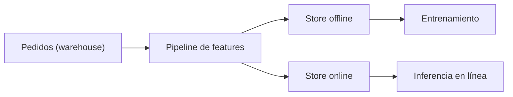
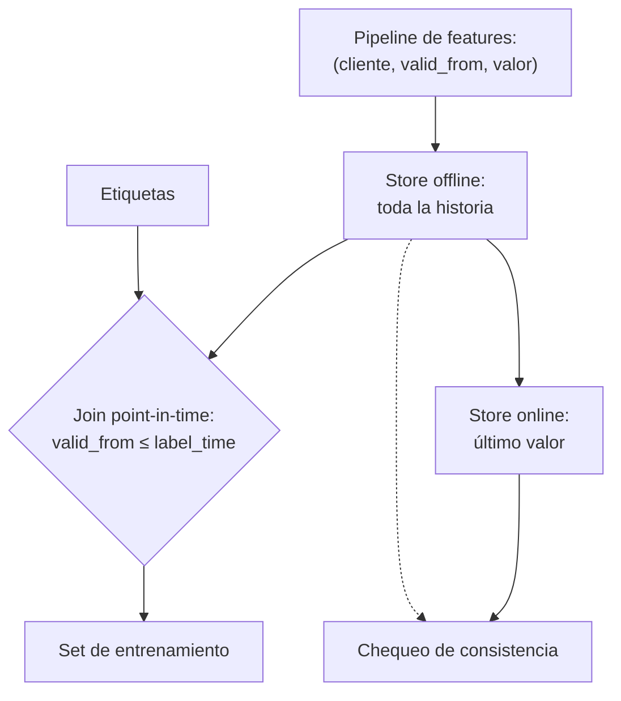
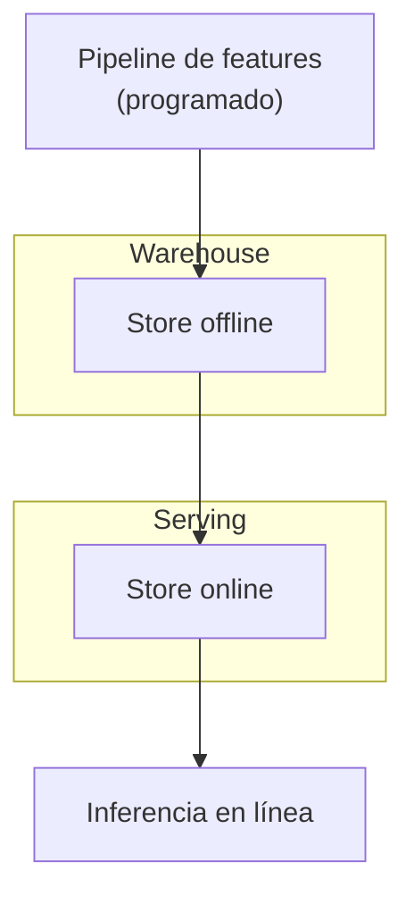

## 1. Resumen

Un ML feature pipeline calcula las features una sola vez y las sirve a dos consumidores: el **entrenamiento**, que necesita el valor que tenía cada feature en el momento de cada etiqueta, y la **inferencia**, que necesita el último valor con baja latencia. Por eso hay dos stores: el offline guarda toda la historia y el online solo el último registro (*Create, store, and share features with Feature Store*).

Los dos errores que evita: el **data leakage**, cuando el entrenamiento usa valores posteriores a la etiqueta (la solución es un join point-in-time), y el **training/serving skew**, cuando el entrenamiento y la inferencia calculan la feature distinto (la solución es una sola definición para los dos) (*What is managed feature store?*). Conviene cuando varios modelos comparten features o se sirven en línea. No conviene para un modelo único entrenado en batch: una tabla en el warehouse alcanza.

## 2. Escenario y requerimientos

Escenario: un modelo de abandono de clientes usa los pedidos de los últimos 30 días. Se entrena con etiquetas históricas y se consulta en línea cuando el cliente entra a la app.

| Requerimiento | Valor del escenario |
|---|---|
| Entrenamiento | Feature vigente al momento de cada etiqueta, sin futuro |
| Inferencia | Último valor por cliente, en milisegundos |
| Consistencia | La misma definición para entrenar y servir |
| Historia | Todas las versiones de cada feature, con su vigencia |

## 3. Vista de contexto



## 4. Componentes

| Componente | Responsabilidad | Por qué está |
|---|---|---|
| Pipeline de features | Calcula cada feature con una sola definición | Evita el training/serving skew |
| Store offline | Historia completa, con vigencia por registro | Joins point-in-time para entrenar |
| Store online | Último valor por entidad | Lecturas de baja latencia |
| Join point-in-time | La feature vigente en la hora de cada etiqueta | Evita el data leakage |
| Chequeo de consistencia | Compara online con offline a la fecha | Detecta stores desalineados |

## 5. Vista de datos



En SageMaker AI, cada registro lleva un event time obligatorio, el store online solo tiene el registro del último event time y el offline todos (*Feature Store concepts*): el event time es lo que hace posible el join point-in-time.

## 6. Vista de despliegue



## 7. Seguridad y gobierno

- Las features derivan de datos personales: misma clasificación, y el store online expone solo lo que el modelo usa.
- Los feature sets versionados e inmutables permiten que un modelo nuevo use una versión nueva sin romper el anterior (*What is managed feature store?*).
- El linaje de cada feature hasta su fuente es lo que permite responder por qué un modelo vio un valor.

## 8. Escalabilidad, observabilidad y operación

- **Escala:** el offline crece con la historia; el online, con la cantidad de entidades.
- **Qué se mide:** frescura de cada feature, diferencia entre online y offline a la misma fecha, y filas de entrenamiento con valores posteriores a su etiqueta (debe ser cero).
- **Runbook:** feature mal calculada → corregir la definición, recalcular el offline y republicar el online; store online atrasado → servir con el último valor conocido y alertar.

## 9. Costos

Se pagan dos stores: el offline en almacenamiento barato y el online en una base de baja latencia. En Azure Machine Learning, el costo principal del feature store son los jobs de materialización en Spark administrado (*What is managed feature store?*). Materializar al online solo las features que se sirven en línea evita pagar latencia baja para lo que solo se usa en entrenamiento. Los montos se calculan con la calculadora de cada nube.

## 10. Código y configuración

```python
# Python 3.12+, biblioteca estándar; sqlite3 hace de motor (ejecutado en la CI): ML feature pipeline de punta a punta.
# Las features se guardan con su vigencia (valid_from) en el store offline; el set de entrenamiento se arma con un
# join point-in-time (la feature vigente en el momento de cada etiqueta), no con el último valor, que filtra
# el futuro. El store online guarda el último valor por entidad y sale de la misma tabla: training y serving
# coinciden.
import sqlite3

db = sqlite3.connect(":memory:")
db.executescript("""
CREATE TABLE features (customer TEXT, valid_from TEXT, orders_30d INTEGER, PRIMARY KEY (customer, valid_from));
CREATE TABLE labels (customer TEXT, label_time TEXT, churned INTEGER);
INSERT INTO features VALUES
  ('c1', '2026-10-01', 5), ('c1', '2026-10-15', 1), ('c1', '2026-11-01', 0),
  ('c2', '2026-10-01', 2), ('c2', '2026-10-20', 7);
INSERT INTO labels VALUES ('c1', '2026-10-10', 0), ('c1', '2026-10-20', 1), ('c2', '2026-10-10', 0);
""")

latest = db.execute("""
SELECT l.customer, l.label_time, f.orders_30d, l.churned FROM labels l
JOIN features f ON f.customer = l.customer
 AND f.valid_from = (SELECT MAX(valid_from) FROM features WHERE customer = l.customer)
ORDER BY l.customer, l.label_time""").fetchall()
point_in_time = db.execute("""
SELECT l.customer, l.label_time, f.orders_30d, l.churned FROM labels l
JOIN features f ON f.customer = l.customer
 AND f.valid_from = (SELECT MAX(valid_from) FROM features WHERE customer = l.customer AND valid_from <= l.label_time)
ORDER BY l.customer, l.label_time""").fetchall()
print("join con el último valor:", latest)
print("join point-in-time:      ", point_in_time)
leaks = sum(a != b for a, b in zip(latest, point_in_time))
print("filas con información del futuro en el join ingenuo:", leaks, "de", len(latest))

db.execute("""CREATE TABLE online AS SELECT customer, orders_30d FROM features f
WHERE valid_from = (SELECT MAX(valid_from) FROM features WHERE customer = f.customer)""")
online = dict(db.execute("SELECT * FROM online ORDER BY customer").fetchall())
as_of_now = dict(db.execute("""SELECT customer, orders_30d FROM features f WHERE valid_from =
  (SELECT MAX(valid_from) FROM features WHERE customer = f.customer AND valid_from <= '2026-11-03')""").fetchall())
print("store online:", online, "| igual al offline al 2026-11-03:", online == as_of_now)
```

El script se **ejecuta en la CI** con la biblioteca estándar y pasa `mypy --strict`:

```text
join con el último valor: [('c1', '2026-10-10', 0, 0), ('c1', '2026-10-20', 0, 1), ('c2', '2026-10-10', 7, 0)]
join point-in-time:       [('c1', '2026-10-10', 5, 0), ('c1', '2026-10-20', 1, 1), ('c2', '2026-10-10', 2, 0)]
filas con información del futuro en el join ingenuo: 3 de 3
store online: {'c1': 0, 'c2': 7} | igual al offline al 2026-11-03: True
```

El join con el último valor le da a cada etiqueta un valor que todavía no existía (por ejemplo, 0 pedidos para `c1` el 10 de octubre, cuando eran 5): las 3 filas filtran el futuro. El join point-in-time usa el valor vigente. El store online sale de la misma tabla y coincide con el offline a la fecha. Lo que no ejecuta: un feature store administrado ni un store online de baja latencia.

## 11. GCP

| Pieza | Servicio | Detalle y diferencia |
|---|---|---|
| Feature store | Feature Store de Gemini Enterprise Agent Platform | Capa de metadatos sobre una tabla o vista de BigQuery, que sirve los últimos valores online desde esa fuente (*About Feature Store on Gemini Enterprise Agent Platform*). La plataforma es el nombre nuevo de Vertex AI Platform (*Gemini Enterprise Agent Platform name changes*). No ejecutado |

## 12. AWS

| Pieza | Servicio | Detalle y diferencia |
|---|---|---|
| Feature store | SageMaker AI Feature Store | Store online con el último registro y offline con todo el historial en S3; event time obligatorio (*Feature Store concepts*). SageMaker pasó a llamarse SageMaker AI el 3 de diciembre de 2024 (*What is Amazon SageMaker AI?*). No ejecutado |

## 13. Azure

| Pieza | Servicio | Detalle y diferencia |
|---|---|---|
| Feature store | Feature store administrado de Azure Machine Learning | Joins point-in-time («time travel») para evitar leakage; materialización offline en ADLS Gen2 y online en Redis; el mismo pipeline para entrenar e inferir evita el skew (*What is managed feature store?*). No ejecutado |

## 14. Riesgos y modos de falla

| Riesgo | Cómo se detecta | Cómo se recupera |
|---|---|---|
| Join con el último valor | Métricas de entrenamiento que no se repiten en producción | Join point-in-time con la hora de la etiqueta |
| Dos definiciones de la feature | Predicciones distintas a las esperadas | Una sola definición para offline y online |
| Store online atrasado | Frescura que crece | Alerta y republicación |
| Feature sin event time | No se puede reconstruir el pasado | Vigencia obligatoria en cada registro |

## 15. Errores frecuentes

| Error | Consecuencia |
|---|---|
| Sobrescribir la feature en el offline | Se pierde la historia para entrenar |
| Calcular la feature de inferencia en la aplicación | Training/serving skew |
| Usar la hora de carga como vigencia | Filtra el futuro cuando hay reprocesos |
| Montar un feature store para un solo modelo batch | Infraestructura sin uso |

## 16. Trade-offs y alternativas

| Opción | Gana | Cuesta |
|---|---|---|
| Feature store administrado | Join point-in-time, online y offline listos | Servicio y costo de materialización |
| Tablas en el warehouse con vigencia | Simple y barato | Online y consistencia a cargo propio |
| Features calculadas en el modelo | Sin pipeline aparte | Skew y nada reutilizable |

## 17. Conceptos relacionados

- `batch-pipeline-architecture`: el cálculo programado de las features.
- `vertex-ai-for-data-engineers` y `sagemaker-for-data-engineers`: los feature stores de cada nube.
- `slowly-changing-dimensions`: la vigencia de un valor.
- `idempotency`: recalcular sin duplicar.
- `streaming-pipeline-architecture`: features frescas para el online.

## 18. Evolución

Se llega desde features calculadas dentro de cada notebook cuando un segundo modelo las necesita o cuando hay que servir en línea. Puede evolucionar a features calculadas en streaming para el store online. La señal para no adoptarla: un único modelo batch.

## 19. Laboratorio relacionado

Sin laboratorio en F4: no está entre las 6 arquitecturas de F4. El §10 corre en la CI.

## 20. Fuentes

- Microsoft Learn: *What is managed feature store?*.
- AWS: *Create, store, and share features with Feature Store*; *Feature Store concepts*; *What is Amazon SageMaker AI?*.
- Google Cloud: *About Feature Store on Gemini Enterprise Agent Platform*; *Gemini Enterprise Agent Platform name changes*.

El detalle de cada fuente está en `sources` del frontmatter.

## 21. Fecha de última verificación

2026-11-03: fichas de origen de cada cita revisadas y *What is managed feature store?* leída hoy (H1 y contenido). `review_required` hasta la revisión.

## 22. Historial de cambios importantes

- 2026-11-03: creación (lote 07c, ADR-028).
- 2026-11-03: revisión de 07c aplicada (docs/reviews/lote-07c.md): las citas nuevas del lote llevan su `url` (faltaba); el §5 tiene el nodo «Chequeo de consistencia» del §4; la cita de *Gemini Enterprise Agent Platform name changes* se releyó hoy: nota con las dos filas que usa la ficha y sin la fecha de actualización, que no se pudo confirmar.
