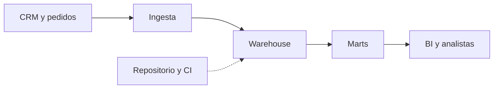
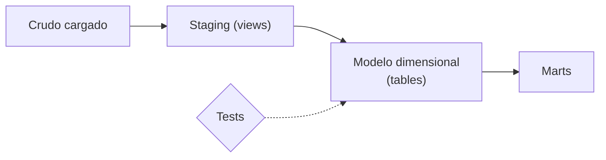
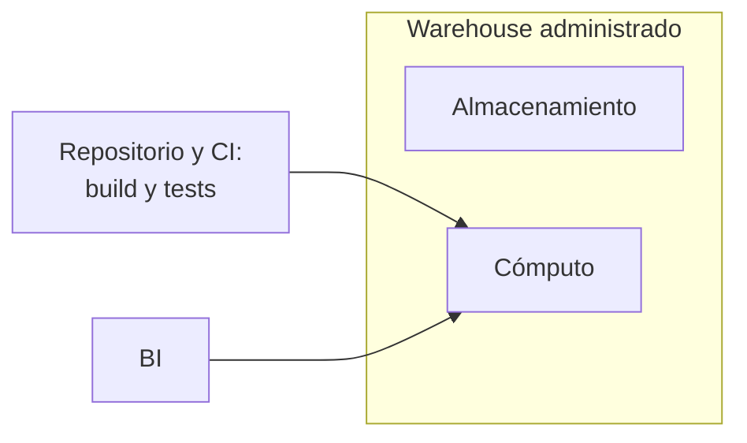

## 1. Resumen

Un Modern Data Warehouse (MDW) es un warehouse administrado en la nube donde **el almacenamiento y el cómputo escalan por separado**, los datos se cargan casi crudos y **se transforman dentro del warehouse** con SQL versionado (ELT). El modelo final es dimensional (dimensiones y hechos) y alimenta marts por área de negocio. Los tests de calidad corren en el mismo grafo que las transformaciones.

Conviene para analítica estructurada con SQL, muchos lectores concurrentes y un equipo que trabaja como en software (Git, revisión, CI). No conviene como único almacén cuando dominan los datos no estructurados o el ML sobre archivos (`lakehouse-architecture`, `data-lake-architecture`).

## 2. Escenario y requerimientos

Escenario: una empresa con un CRM y un sistema de pedidos quiere un tablero de ventas por segmento de cliente, con definiciones comunes para finanzas y comercial.

| Requerimiento | Valor del escenario |
|---|---|
| Consumo | SQL, BI y muchos lectores a la vez |
| Definiciones | Una sola definición de «venta» y de «cliente activo» |
| Calidad | Ningún pedido sin cliente en el modelo final |
| Cambio | Las transformaciones se revisan y se versionan como código |
| Restricción | Los sistemas transaccionales no se consultan para analítica |

## 3. Vista de contexto



Los sistemas transaccionales quedan fuera: el warehouse está optimizado para muchas lecturas y pocas escrituras, y se modela para el análisis sin afectar a esos sistemas (*Online analytical processing*).

## 4. Componentes

| Componente | Responsabilidad | Por qué está |
|---|---|---|
| Ingesta | Copia los datos de origen al warehouse sin transformarlos | ELT: transformar donde está el cómputo |
| Staging | Una vista por fuente: nombres, tipos y limpieza mínima | Aísla los cambios de la fuente del modelo |
| Modelo dimensional | Dimensiones y hechos con claves | Une las fuentes con definiciones comunes |
| Marts | Tablas para un área o un tablero | Consultas simples y rápidas para BI |
| Tests | Unicidad, no nulos y relaciones | La puerta de calidad dentro del grafo |
| Repositorio y CI | Versiona el SQL y corre el build | Cambios revisados, como en software |

## 5. Vista de datos



Las vistas de staging no copian datos; las dimensiones, hechos y marts se materializan como tablas. dbt trae cinco materializaciones: table, view, incremental, ephemeral y materialized view (*Materializations*).

## 6. Vista de despliegue



En BigQuery, la capa de almacenamiento y la de cómputo operan de forma independiente y no se aprovisionan a mano (*BigQuery overview*). La CI construye y prueba el grafo antes de publicar.

## 7. Seguridad y gobierno

- Permisos por dataset o esquema: staging solo para el pipeline; marts para consumidores. En BigQuery, los datasets son contenedores lógicos que afectan permisos, cuotas y facturación (*Overview of BigQuery storage*).
- Datos personales: se minimizan en staging y no llegan a los marts que no los necesitan.
- Las definiciones viven en el repositorio: el linaje modelo a modelo sale del propio grafo de transformaciones.

## 8. Escalabilidad, observabilidad y operación

- **Escala:** el cómputo crece con la concurrencia y el almacenamiento con los datos, por separado.
- **Qué se mide:** duración del build, tests que fallan, frescura de cada mart y consultas más caras.
- **Runbook:** si un test falla, el build se detiene y el mart sigue con la versión anterior; se corrige el dato o el modelo y se vuelve a construir.

## 9. Costos

El costo lo mueven los datos leídos por las consultas y el cómputo de los builds. En BigQuery on-demand, *maximum bytes billed* hace que una consulta que leería más que el límite falle sin generar cargo (*Estimate and control costs*), y la facturación de almacenamiento es lógica o física por dataset (*Overview of BigQuery storage*). En Redshift Serverless se paga solo la capacidad usada (*Amazon Redshift Serverless*). Materializar como vista ahorra almacenamiento y cuesta cómputo en cada lectura.

## 10. Código y configuración

```python
# Python 3.12, dbt Core 1.12 y dbt-postgres 1.11 contra PostgreSQL 17 (ejecutado en la CI con el servicio postgres:17;
# ADR-018). Un Modern Data Warehouse en pequeño: los datos ya cargados (seeds) se transforman dentro del warehouse
# en staging (views), un modelo dimensional (dim y fct, tables) y un mart, con tests en el mismo grafo. Un pedido de
# un cliente que no existe rompe el test de relación y dbt build falla: la puerta de calidad queda en el warehouse.
# PG_HOST, PG_PORT, PG_USER, PG_PASSWORD y PG_DB apuntan a una base vacía que el test crea y borra.
from __future__ import annotations

import os
import sys
import tempfile
from pathlib import Path

import psycopg
from dbt.artifacts.schemas.run import RunExecutionResult
from dbt.cli.main import dbtRunner

FILES = {
    "dbt_project.yml": "name: mdw\nversion: \"1.0.0\"\nprofile: mdw\nmodels:\n  mdw:\n    staging: {+materialized: view}\n"
                       "    core: {+materialized: table}\n    marts: {+materialized: table}\n",
    "profiles.yml": """
mdw:
  target: ci
  outputs:
    ci:
      type: postgres
      host: "{{ env_var('PG_HOST') }}"
      port: "{{ env_var('PG_PORT') | int }}"
      user: "{{ env_var('PG_USER') }}"
      password: "{{ env_var('PG_PASSWORD') }}"
      dbname: "{{ env_var('PG_DB') }}"
      schema: dwh
      threads: 1
""",
    "seeds/raw_clientes.csv": "id,nombre,segmento\n1,Ana,pyme\n2,Bruno,corporativo\n",
    "seeds/raw_pedidos.csv": "id,cliente_id,monto,fecha\n10,1,120,2026-10-01\n11,2,300,2026-10-01\n12,1,80,2026-10-02\n",
    "models/staging/stg_clientes.sql": "select id as cliente_id, nombre, lower(segmento) as segmento from {{ ref('raw_clientes') }}\n",
    "models/staging/stg_pedidos.sql": "select id as pedido_id, cliente_id, monto::numeric(10, 2) as monto, fecha::date as fecha "
                                      "from {{ ref('raw_pedidos') }}\n",
    "models/core/dim_clientes.sql": "select cliente_id, nombre, segmento from {{ ref('stg_clientes') }}\n",
    "models/core/fct_pedidos.sql": "select pedido_id, cliente_id, fecha, monto from {{ ref('stg_pedidos') }}\n",
    "models/marts/ventas_por_segmento.sql": "select d.segmento, count(*) as pedidos, sum(f.monto) as total from {{ ref('fct_pedidos') }} f "
                                            "join {{ ref('dim_clientes') }} d using (cliente_id) group by d.segmento\n",
    "models/schema.yml": """
version: 2
models:
  - name: dim_clientes
    columns:
      - name: cliente_id
        data_tests: [unique, not_null]
  - name: fct_pedidos
    columns:
      - name: pedido_id
        data_tests: [unique, not_null]
      - name: cliente_id
        data_tests:
          - relationships: {arguments: {to: ref('dim_clientes'), field: cliente_id}}
""",
}

project = Path(sys.argv[1] if len(sys.argv) > 1 else tempfile.mkdtemp())
for name, text in FILES.items():
    (project / name).parent.mkdir(parents=True, exist_ok=True)
    (project / name).write_text(text.lstrip("\n"), encoding="utf-8")
args = ["--project-dir", str(project), "--profiles-dir", str(project), "--log-level", "none"]
runner = dbtRunner()


def build(label: str) -> None:
    result = runner.invoke(["build", *args])
    assert isinstance(result.result, RunExecutionResult), result.exception
    failed = sorted(r.node.name for r in result.result.results if str(r.status) in ("fail", "error"))
    print(f"{label}: {len(result.result.results)} nodos, {'ok' if result.success else 'falla ' + str(failed)}")


build("build 1")
build("build 2")   # idempotente: rehace lo mismo
with psycopg.connect(host=os.environ["PG_HOST"], port=os.environ["PG_PORT"], user=os.environ["PG_USER"],
                     password=os.environ["PG_PASSWORD"], dbname=os.environ["PG_DB"]) as conn:
    rows = conn.execute("SELECT segmento, pedidos, total::float FROM dwh.ventas_por_segmento ORDER BY segmento").fetchall()
print("ventas_por_segmento:", rows)
seed = project / "seeds" / "raw_pedidos.csv"
seed.write_text(seed.read_text(encoding="utf-8") + "13,99,50,2026-10-02\n", encoding="utf-8")   # cliente inexistente
build("build con un pedido huérfano")
```

El script se **ejecuta en la CI** contra el servicio postgres:17, con dbt Core y dbt-postgres en versión fija (ADR-018), y pasa `mypy --strict`. Construye dos veces el mismo grafo y después agrega un pedido de un cliente que no existe:

```text
build 1: 12 nodos, ok
build 2: 12 nodos, ok
ventas_por_segmento: [('corporativo', 1, 300.0), ('pyme', 2, 200.0)]
build con un pedido huérfano: 12 nodos, falla ['relationships_fct_pedidos_cliente_id__cliente_id__ref_dim_clientes_']
```

Data tests como `unique`, `not_null` y `relationships` vienen incorporados en dbt (*Add data tests to your DAG*). El cuarto build falla en el test de relación y deja el error en el grafo, antes de que el dato llegue al tablero. Lo que no ejecuta: un warehouse en la nube y la ingesta.

## 11. GCP

| Pieza | Servicio | Detalle y diferencia |
|---|---|---|
| Warehouse | BigQuery | Serverless; almacenamiento y cómputo independientes; soporta formatos abiertos como Iceberg, Delta y Hudi (*BigQuery overview*) |
| Transformaciones | Dataform | SQLX compilado a SQL que se ejecuta en BigQuery, con control de versiones (*Dataform overview*); dbt también es una opción |
| Control de costo | maximum bytes billed | Corta consultas caras antes de ejecutarlas (*Estimate and control costs*) |

## 12. AWS

| Pieza | Servicio | Detalle y diferencia |
|---|---|---|
| Warehouse | Amazon Redshift | Data warehouse administrado a escala de petabytes (*What is Amazon Redshift?*) |
| Capacidad | Redshift Serverless | Aprovisiona y escala la capacidad automáticamente; se paga lo usado (*Amazon Redshift Serverless*), frente a un clúster aprovisionado |
| Transformaciones | dbt sobre Redshift | No ejecutado; el grafo del §10 es el mismo |

## 13. Azure

| Pieza | Servicio | Detalle y diferencia |
|---|---|---|
| Warehouse | Fabric Data Warehouse | Indicado para esquemas estrella o snowflake, data marts curados y modelos semánticos gobernados (*What is Fabric Data Warehouse?*) |
| Transformaciones | dbt o SQL en Fabric | No ejecutado |
| Capa semántica | Modelo semántico sobre el warehouse | Tradicionalmente va sobre el data warehouse (*Online analytical processing*) |

## 14. Riesgos y modos de falla

| Riesgo | Cómo se detecta | Cómo se recupera |
|---|---|---|
| Cambio de esquema en la fuente | Falla el staging o un test | Ajustar staging; el modelo no cambia |
| Dato huérfano o duplicado | Tests `relationships` y `unique` | Corregir el origen o el join; reconstruir |
| Costos que crecen sin control | Consultas más caras por usuario | Límite de bytes, particiones y marts |
| Definiciones duplicadas | Dos marts con cifras distintas | Una dimensión común y revisión de código |

## 15. Errores frecuentes

| Error | Consecuencia |
|---|---|
| Transformar fuera y cargar solo el resultado | Se pierde el crudo para reconstruir |
| Marts que leen directamente del crudo | Cada tablero repite la limpieza y diverge |
| Tests fuera del grafo | El dato malo llega al tablero antes de que alguien lo mire |
| Todo como vista | Cada lectura recalcula y el costo sube |

## 16. Trade-offs y alternativas

| Opción | Gana | Cuesta |
|---|---|---|
| MDW administrado | SQL, concurrencia y poca operación | Formato propietario del motor |
| `lakehouse-architecture` | Formatos abiertos y varios motores | Más piezas que operar (catálogo, compactación) |
| `data-lake-architecture` | Cualquier formato, almacenamiento barato | Sin transacciones ni modelo común |

## 17. Conceptos relacionados

- `data-warehouse`: el almacén analítico.
- `etl-vs-elt`: transformar dentro del warehouse.
- `dbt-core-concepts`: transformaciones y tests como código.
- `bigquery-architecture`: almacenamiento y cómputo separados.
- `batch-pipeline-architecture`: las cargas que lo alimentan.
- `lakehouse-architecture`: la alternativa sobre formatos abiertos.
- `data-lake-architecture`: la alternativa con cualquier formato y almacenamiento barato.

## 18. Evolución

Se llega desde un warehouse en servidor propio o desde réplicas de la base transaccional usadas para reportes. Se pasa a `lakehouse-architecture` cuando aparecen varios motores sobre los mismos datos, datos no tabulares o ML sobre archivos. La señal: copiar datos del warehouse al lake (o al revés) para cada caso de uso.

## 19. Laboratorio relacionado

Sin laboratorio en F4: no está entre las 6 arquitecturas de F4. El §10 corre en la CI.

## 20. Fuentes

- Google Cloud: *BigQuery overview*; *Overview of BigQuery storage*; *Estimate and control costs*; *Dataform overview*.
- AWS: *What is Amazon Redshift?*; *Amazon Redshift Serverless*.
- Microsoft Learn: *What is Fabric Data Warehouse?*; *Online analytical processing*.
- dbt: *What is dbt?*; *Add data tests to your DAG*; *Materializations*.

El detalle de cada fuente está en `sources` del frontmatter.

## 21. Fecha de última verificación

2026-11-01: fichas de origen de cada cita revisadas; las páginas se consultaron en las fechas de `sources`. `verified`: aprobada por Felipe el 2026-11-03 (`owner_approved_at`).

## 22. Historial de cambios importantes

- 2026-11-01: creación (lote 07a, ADR-028).
- 2026-11-02: revisión de 07a aplicada (docs/reviews/lote-07a.md): la nota de *BigQuery overview* dice lo que dice la página (gobierno y búsqueda semántica con Knowledge Catalog, sin linaje); las vistas usan los nombres del §4.
- 2026-11-03: `verification_status: verified`, aprobada por Felipe con lista explícita (`owner_approved_at: 2026-11-03`).
