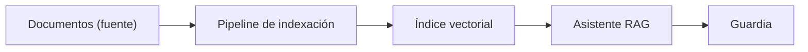
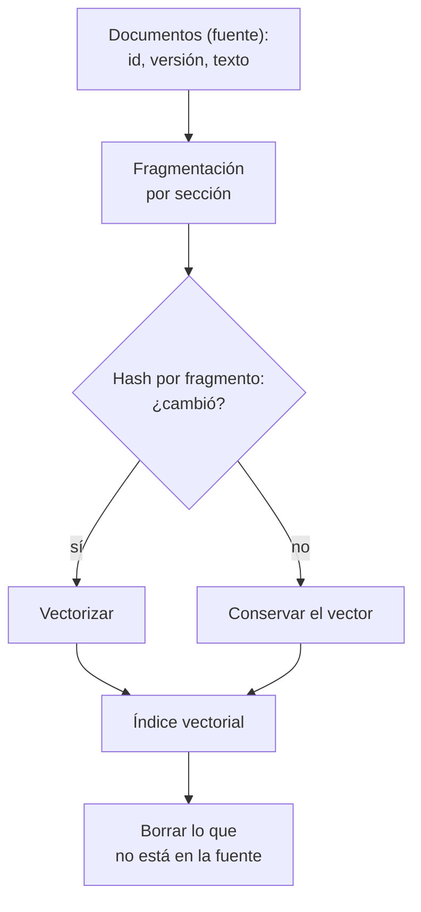
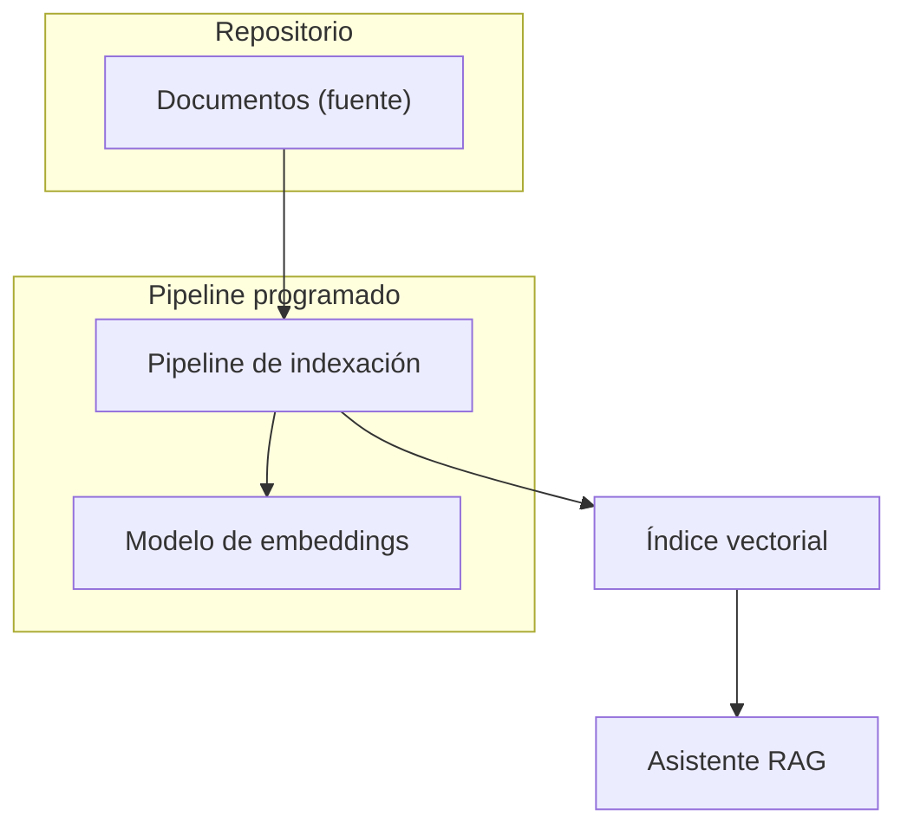

## 1. Resumen

Un RAG responde con fragmentos de documentos propios; esta ficha trata el **pipeline de datos** que mantiene esos fragmentos al día, no el patrón de retrieval (`rag`). Los servicios administrados hacen lo mismo al ingerir: dividen los documentos en fragmentos, los vectorizan y los escriben en un índice vectorial, conservando el vínculo con el documento original (*How content chunking works for knowledge bases*).

Lo que lo hace confiable es tratar el índice como una **tabla derivada de la fuente**: un hash por fragmento para vectorizar solo lo que cambió, borrado de lo que ya no está en la fuente y una cita con documento, sección y versión en cada resultado. Es una práctica **emergente**: componentes y servicios cambian rápido, y no reemplaza al warehouse para preguntas sobre datos tabulares.

## 2. Escenario y requerimientos

Escenario: el equipo de datos publica runbooks y políticas en Markdown. Un asistente responde preguntas de guardia con esos documentos.

| Requerimiento | Valor del escenario |
|---|---|
| Frescura | Un runbook editado se refleja en la siguiente sincronización |
| Retiros | Una política retirada no se puede citar más |
| Costo | Solo se vectoriza lo que cambió |
| Trazabilidad | Cada respuesta cita documento, sección y versión |
| Sin contexto | Si nada supera el umbral, no se responde |

## 3. Vista de contexto



## 4. Componentes

| Componente | Responsabilidad | Por qué está |
|---|---|---|
| Documentos (fuente) | Markdown versionado | El índice es derivado: la verdad está aquí |
| Pipeline de indexación | Partir, calcular hash, vectorizar y borrar | Mantiene el índice igual a la fuente |
| Fragmentación por sección | Un fragmento por sección, con su id | Un procedimiento no queda partido |
| Hash por fragmento | Detecta qué cambió | Vectorizar solo lo nuevo |
| Índice vectorial | Vector, texto y metadatos de cada fragmento | Búsqueda por similitud con cita |
| Asistente RAG | Recupera con umbral y cita | No responde sin contexto |

## 5. Vista de datos



El tamaño del fragmento es una decisión con costo: en RAG Engine, uno más chico da embeddings más precisos y uno más grande, más generales que pueden perder detalles (*Fine-tune RAG transformations*); Azure AI Search sugiere empezar con 512 tokens y 25 % de solape (*Chunk large documents for RAG and vector search in Azure AI Search*). Aquí se parte por sección para no cortar un procedimiento.

## 6. Vista de despliegue



## 7. Seguridad y gobierno

- El índice hereda los permisos de la fuente: un documento restringido no se indexa en un índice abierto, o se filtra por metadatos al recuperar.
- Retirar un documento de la fuente tiene que borrarlo del índice; si no, el asistente sigue citando una política derogada (§10).
- Los fragmentos pueden contener datos personales: ver `privacy-in-ai-rag-llm`.

## 8. Escalabilidad, observabilidad y operación

- **Escala:** el modelo de embeddings tiene límites por solicitud; en Agent Platform, hasta 250 textos y 20 000 tokens por solicitud, y el texto que pasa de 2048 tokens se trunca en silencio salvo `autoTruncate=false` (*Get text embeddings*).
- **Qué se mide:** fragmentos vectorizados y borrados por sincronización, documentos en la fuente frente a documentos en el índice y preguntas sin contexto.
- **Índice aproximado:** con HNSW o IVFFlat la búsqueda cambia algo de recall por velocidad y puede dar resultados distintos que la búsqueda exacta (*pgvector*).
- **Runbook:** cambio de modelo de embeddings → reindexar todo (los vectores de dos modelos no se comparan); índice con documentos de más → reconciliar contra la fuente.

## 9. Costos

El costo por sincronización es proporcional a lo que se vectoriza: con hash por fragmento, una edición de una sección cuesta un embedding y no un documento entero. El índice vectorial tiene límites de almacenamiento propios del servicio (*Vector indexes in Azure AI Search*). Cambiar de modelo obliga a pagar el reindexado completo. Los montos de cada servicio se calculan con su calculadora.

## 10. Código y configuración

```python
# Python 3.12 y numpy (ejecutado en la CI; ADR-025, opción A): el pipeline de datos de un RAG de punta a punta.
# Parte los documentos por sección, calcula el hash de cada fragmento y solo vuelve a vectorizar lo que cambió; borra
# del índice los fragmentos de documentos eliminados o secciones que ya no están; y cada resultado trae su cita
# (documento, sección y versión); sin contexto sobre el umbral, no hay respuesta. Los vectores son léxicos (hashing
# de n-gramas), no semánticos.
import hashlib
import re
import zlib

import numpy as np
import numpy.typing as npt

Vector = npt.NDArray[np.float64]
index: dict[str, tuple[str, Vector, str]] = {}   # chunk_id -> (hash, vector, texto)
embedded = 0


def vectorize(text: str, dims: int = 256) -> Vector:
    clean = f" {text.lower()} "
    v = np.zeros(dims)
    for i in range(len(clean) - 2):
        v[zlib.crc32(clean[i:i + 3].encode()) % dims] += 1.0
    return v / np.linalg.norm(v)


def chunks(doc_id: str, version: str, text: str) -> dict[str, str]:
    parts = re.split(r"^## ", text, flags=re.M)[1:]
    return {f"{doc_id}#{p.splitlines()[0].strip().lower()}@{version}": p.strip() for p in parts}


def sync(source: dict[str, tuple[str, str]]) -> tuple[int, int]:
    """Lleva el índice al estado de la fuente: vectoriza lo nuevo o cambiado y borra lo que ya no está."""
    global embedded
    wanted = {cid: text for doc, (version, body) in source.items() for cid, text in chunks(doc, version, body).items()}
    by_key = {cid.rsplit("@", 1)[0]: cid for cid in index}
    before = embedded
    for cid, text in wanted.items():
        digest = hashlib.sha256(text.encode()).hexdigest()
        old = by_key.get(cid.rsplit("@", 1)[0])
        if old is not None and index[old][0] == digest:   # mismo contenido: se conserva el vector
            if old != cid:
                index[cid] = index.pop(old)
            continue
        if old is not None:
            del index[old]
        index[cid] = (digest, vectorize(text), text)
        embedded += 1
    removed = [cid for cid in index if cid not in wanted]
    for cid in removed:
        del index[cid]
    return embedded - before, len(removed)


def search(question: str, k: int = 1, threshold: float = 0.35) -> list[tuple[str, float]]:
    """Fragmentos con su cita; vacío si nada supera el umbral (no se responde sin contexto)."""
    ids = sorted(index)
    scores = np.vstack([index[i][1] for i in ids]) @ vectorize(question)
    return [(ids[i], round(float(scores[i]), 2)) for i in np.argsort(-scores)[:k] if scores[i] >= threshold]


SOURCE = {
    "runbook-ventas": ("v1", "## Timeout\nSi ventas_diarias falla por timeout, reintenta una vez.\n"
                             "## Dueño\nEl equipo de ventas es dueño del job ventas_diarias."),
    "politica-retencion": ("v1", "## Bronze\nLas tablas bronze se conservan 90 días.\n"
                                 "## Silver\nLas tablas silver se conservan 2 años."),
}
print("carga inicial (vectorizados, borrados):", sync(SOURCE), "| fragmentos:", len(index))
print("sin cambios:", sync(SOURCE))
SOURCE["runbook-ventas"] = ("v2", "## Timeout\nSi ventas_diarias falla por timeout, reintenta dos veces y escala.\n"
                                  "## Dueño\nEl equipo de ventas es dueño del job ventas_diarias.")
del SOURCE["politica-retencion"]   # el documento se retira
print("v2 del runbook y política retirada:", sync(SOURCE), "| fragmentos:", sorted(index))
print("pregunta sobre timeout ->", search("qué hago si ventas_diarias falla por timeout"))
print("pregunta sobre bronze (documento retirado) ->", search("cuántos días se conservan las tablas bronze"))
```

El script se **ejecuta en la CI** con numpy (ADR-025, opción A) y pasa `mypy --strict`:

```text
carga inicial (vectorizados, borrados): (4, 0) | fragmentos: 4
sin cambios: (0, 0)
v2 del runbook y política retirada: (1, 2) | fragmentos: ['runbook-ventas#dueño@v2', 'runbook-ventas#timeout@v2']
pregunta sobre timeout -> [('runbook-ventas#timeout@v2', 0.67)]
pregunta sobre bronze (documento retirado) -> []
```

La carga inicial vectoriza 4 fragmentos; sin cambios, ninguno. En la v2 del runbook solo cambió la sección Timeout: se vectoriza 1 fragmento, el de Dueño conserva su vector con la versión nueva, y los 2 fragmentos de la política retirada se borran. La pregunta sobre timeout cita `runbook-ventas#timeout@v2`; la de bronze ya no encuentra contexto y no se responde. Lo que no ejecuta: un modelo de embeddings semántico ni un índice administrado; los vectores son léxicos.

## 11. GCP

| Pieza | Servicio | Detalle y diferencia |
|---|---|---|
| Pipeline e índice | RAG Engine de Gemini Enterprise Agent Platform | Marco de datos para aplicaciones con contexto aumentado (*RAG Engine on Gemini Enterprise Agent Platform overview*); fragmentación con `chunk_size` 1024 y `chunk_overlap` 256 por defecto (*Fine-tune RAG transformations*). No ejecutado |
| Embeddings | Modelos de embeddings de Agent Platform | Límites por solicitud y truncado silencioso (*Get text embeddings*) |

## 12. AWS

| Pieza | Servicio | Detalle y diferencia |
|---|---|---|
| Pipeline e índice | Bedrock Knowledge Bases | Al ingerir, divide, vectoriza y escribe en un índice vectorial manteniendo el vínculo con el documento original (*How content chunking works for knowledge bases*); integra información propia en aplicaciones de IA generativa (*Retrieve data and generate AI responses with Amazon Bedrock Knowledge Bases*). No ejecutado |

## 13. Azure

| Pieza | Servicio | Detalle y diferencia |
|---|---|---|
| Fragmentación | Azure AI Search | 512 tokens y 25 % de solape como punto de partida (*Chunk large documents for RAG and vector search in Azure AI Search*) |
| Índice | Índices vectoriales de Azure AI Search | HNSW o KNN exhaustivo, con límites de almacenamiento vectorial (*Vector indexes in Azure AI Search*). No ejecutado |

## 14. Riesgos y modos de falla

| Riesgo | Cómo se detecta | Cómo se recupera |
|---|---|---|
| Documento retirado que sigue en el índice | Citas a versiones derogadas | Borrar lo que no está en la fuente, como en el §10 |
| Reindexar todo en cada corrida | Costo de embeddings que crece con el corpus | Hash por fragmento |
| Truncado silencioso del texto | Fragmentos que no responden lo que contienen | Fragmentos bajo el límite del modelo |
| Mezcla de vectores de dos modelos | Resultados sin sentido | Reindexar completo al cambiar de modelo |

## 15. Errores frecuentes

| Error | Consecuencia |
|---|---|
| Tratar el índice como fuente | No se puede reconstruir ni auditar |
| Fragmentos sin id estable | No se puede borrar ni citar |
| Responder sin umbral | Respuestas con contexto ajeno |
| Usar RAG para preguntas sobre tablas | El warehouse responde mejor y exacto |

## 16. Trade-offs y alternativas

| Opción | Gana | Cuesta |
|---|---|---|
| Pipeline propio con índice propio | Control de fragmentos, hash y borrados | Código y operación |
| Servicio administrado (RAG Engine, Knowledge Bases) | Ingesta y fragmentación listas | Menos control del ciclo de vida de cada fragmento |
| Búsqueda por palabras clave | Simple y exacta para términos | No encuentra paráfrasis |

## 17. Conceptos relacionados

- `rag`: el patrón de retrieval (dominio 21).
- `chunking`, `embeddings` y `vector-databases`: las piezas del pipeline.
- `file-ingestion`: la llegada de los documentos.
- `idempotency`: sincronizar sin duplicar.
- `privacy-in-ai-rag-llm`: datos personales en el índice.
- `data-lake-architecture`: dónde aterrizan los documentos.

## 18. Evolución

Se llega desde un índice cargado una vez a mano, cuando los documentos empiezan a cambiar. Puede evolucionar a sincronización por eventos (un documento publicado dispara su reindexado). La señal para no adoptarla: las preguntas son sobre datos tabulares, que se responden mejor en el warehouse.

## 19. Laboratorio relacionado

Sin laboratorio en F4: no está entre las 6 arquitecturas de F4. El §10 corre en la CI.

## 20. Fuentes

- Google Cloud: *RAG Engine on Gemini Enterprise Agent Platform overview*; *Fine-tune RAG transformations*; *Get text embeddings*.
- AWS: *How content chunking works for knowledge bases*; *Retrieve data and generate AI responses with Amazon Bedrock Knowledge Bases*.
- Microsoft Learn: *Chunk large documents for RAG and vector search in Azure AI Search*; *Vector indexes in Azure AI Search*.
- pgvector: *pgvector* (README, v0.8.7).

El detalle de cada fuente está en `sources` del frontmatter.

## 21. Fecha de última verificación

2026-11-03: fichas de origen de cada cita revisadas; las páginas se consultaron en las fechas de `sources`. `verified`: aprobada el 2026-11-03 (`owner_approved_at`).

## 22. Historial de cambios importantes

- 2026-11-03: creación (lote 07c, ADR-028).
- 2026-11-03: `verification_status: verified`, aprobada con lista explícita (`owner_approved_at: 2026-11-03`).
