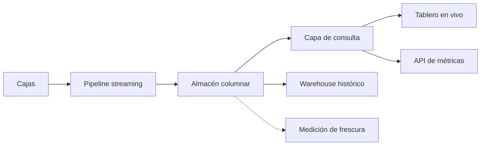
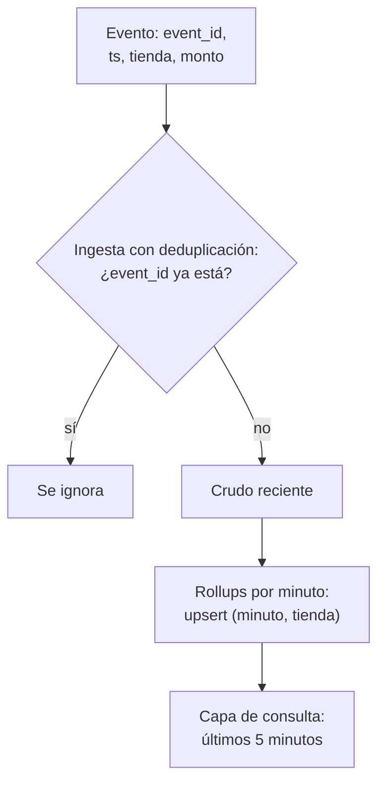
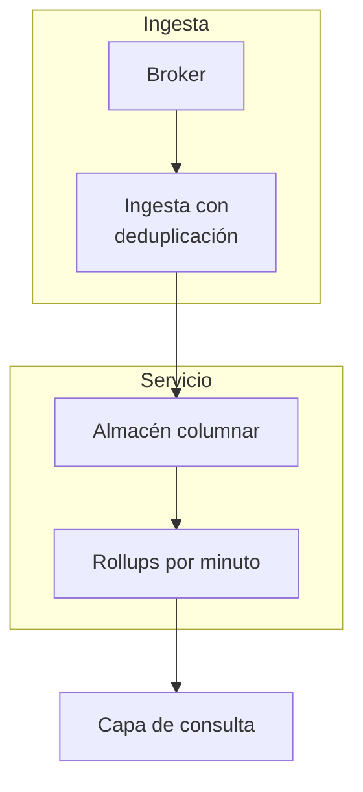

## 1. Resumen

Real-time analytics es la **consulta de baja latencia sobre datos frescos**: un tablero o una API que responde en segundos sobre lo que pasó hace segundos o minutos. No es el pipeline de streaming que trae esos datos (`streaming-pipeline-architecture`), sino el almacén y el modelo que los sirven.

Lo que la hace funcionar es **pre-agregar al escribir** (rollups por minuto, vistas materializadas) para que cada consulta lea pocas filas, guardar en un formato columnar, y medir y publicar la **frescura**. Conviene cuando alguien decide con el dato del último minuto. No conviene para reportes diarios: un warehouse con cargas por lote es más barato y más simple.

## 2. Escenario y requerimientos

Escenario: el tablero de operaciones de una cadena muestra los ingresos de los últimos 5 minutos por tienda y se refresca cada pocos segundos.

| Requerimiento | Valor del escenario |
|---|---|
| Latencia de consulta | Segundos, con muchos refrescos concurrentes |
| Frescura | El último evento visible en menos de un minuto |
| Tardíos | Corrigen el minuto al que pertenecen |
| Duplicados | Un reintento del productor no cuenta dos veces |
| Restricción | El tablero no consulta la base transaccional |

## 3. Vista de contexto



## 4. Componentes

| Componente | Responsabilidad | Por qué está |
|---|---|---|
| Ingesta con deduplicación | Escribe cada evento una vez por `event_id` | El canal entrega al menos una vez |
| Crudo reciente | Eventos de las últimas horas | Recalcular un rollup y auditar |
| Rollups por minuto | Pre-agregados que se actualizan al escribir | La consulta lee pocas filas |
| Almacén columnar | Lee pocas columnas de muchas filas | Consultas analíticas rápidas |
| Medición de frescura | Distancia entre ahora y el último evento | Se promete y se alerta |
| Capa de consulta | Tablero y API con caché corta | Muchos lectores sin saturar el almacén |

## 5. Vista de datos



El rollup es un agregado por minuto y tienda que se suma al escribir; un evento tardío actualiza el minuto al que pertenece, así que **los minutos recientes son provisionales**. Azure Stream Analytics hace explícita esa decisión: los eventos fuera de la tolerancia de desorden se descartan o se ajustan, y hay que balancear oportunidad y tolerancia (*Understand time handling in Azure Stream Analytics*).

## 6. Vista de despliegue



## 7. Seguridad y gobierno

- El tablero lee pre-agregados, no el crudo: menos datos personales expuestos y menos permisos.
- Una identidad de solo lectura por consumidor (tablero, API), con cuotas para que uno no deje sin capacidad a los demás.
- La frescura es parte del contrato del dato: una regla de calidad de frescura comprueba que el activo se actualizó dentro del tiempo esperado (*Create data quality rules*).

## 8. Escalabilidad, observabilidad y operación

- **Escala:** las consultas leen pocas filas pre-agregadas; el almacenamiento columnar lee solo las columnas de la consulta (*Columnar storage*; *Overview of BigQuery storage*).
- **Qué se mide:** frescura (ahora menos el último evento), latencia p95 de la consulta, filas leídas por consulta y diferencia entre el rollup y el crudo para un minuto cerrado.
- **Runbook:** frescura que crece → revisar el lag del pipeline antes que el almacén; rollup que no cuadra con el crudo → recalcular ese minuto desde el crudo.

## 9. Costos

El costo crece con la cantidad de consultas: un tablero que se refresca cada pocos segundos multiplica las lecturas. En BigQuery on-demand, cada consulta se paga por bytes leídos y en tablas sin clustering `LIMIT` no baja ese costo (*Estimate and control costs*); por eso conviene que el tablero lea pre-agregados y no el crudo. Las vistas materializadas bajan el costo de consultas frecuentes y predecibles (*Introduction to materialized views*), y su refresco también se paga. Los montos no se copian.

## 10. Código y configuración

```python
# Python 3.12+, biblioteca estándar; sqlite3 hace de almacén de servicio. Analítica en tiempo real de punta a punta:
# cada evento actualiza al escribir un rollup por minuto y tienda (pre-agregación), así el tablero de los últimos 5
# minutos lee pocas filas en vez de todo el crudo. Un evento tardío corrige su minuto y un reintento con el mismo
# event_id no cuenta dos veces. La frescura es la distancia entre ahora y el último evento recibido.
import sqlite3
from datetime import datetime, timedelta

db = sqlite3.connect(":memory:")
db.executescript("""
CREATE TABLE raw (event_id TEXT PRIMARY KEY, ts TEXT, store TEXT, amount INTEGER);
CREATE TABLE rollup (minute TEXT, store TEXT, orders INTEGER, revenue INTEGER, PRIMARY KEY (minute, store));
""")
START = datetime(2026, 11, 2, 10, 0)


def ingest(event_id: str, ts: datetime, store: str, amount: int) -> None:
    with db:
        if db.execute("INSERT OR IGNORE INTO raw VALUES (?, ?, ?, ?)", (event_id, f"{ts:%H:%M:%S}", store, amount)).rowcount:
            db.execute("INSERT INTO rollup VALUES (?, ?, 1, ?) ON CONFLICT (minute, store) DO UPDATE SET "
                       "orders = orders + 1, revenue = revenue + excluded.revenue", (f"{ts:%H:%M}", store, amount))


def dashboard(now: datetime) -> tuple[int, int]:   # ingresos de los últimos 5 minutos y filas leídas
    since = f"{now - timedelta(minutes=5):%H:%M}"
    rows = db.execute("SELECT revenue FROM rollup WHERE minute >= ?", (since,)).fetchall()
    return sum(r for (r,) in rows), len(rows)


for i in range(600):   # 10 minutos, un evento por segundo, alternando dos tiendas
    ingest(f"e-{i}", START + timedelta(seconds=i), "norte" if i % 2 else "sur", i % 7 + 1)
now = START + timedelta(minutes=10, seconds=20)
revenue, read = dashboard(now)
raw_rows = db.execute("SELECT COUNT(*) FROM raw").fetchone()[0]
raw_revenue = db.execute("SELECT SUM(amount) FROM raw WHERE ts >= '10:05:00'").fetchone()[0]
print(f"crudo: {raw_rows} eventos; rollup: {db.execute('SELECT COUNT(*) FROM rollup').fetchone()[0]} filas")
print(f"tablero, últimos 5 minutos: {revenue} leyendo {read} filas del rollup; sobre el crudo, {raw_revenue} leyendo {raw_rows}")
last = db.execute("SELECT MAX(ts) FROM raw").fetchone()[0]
print("frescura:", now - datetime.combine(now.date(), datetime.strptime(last, "%H:%M:%S").time()))
before = db.execute("SELECT revenue FROM rollup WHERE minute = '10:07' AND store = 'sur'").fetchone()[0]
ingest("e-tardio", START + timedelta(minutes=7, seconds=30), "sur", 50)   # llega tarde: corrige su minuto
ingest("e-tardio", START + timedelta(minutes=7, seconds=30), "sur", 50)   # reintento del productor: se ignora
after = db.execute("SELECT revenue FROM rollup WHERE minute = '10:07' AND store = 'sur'").fetchone()[0]
print(f"evento tardío de las 10:07 (y su reintento): sur 10:07 pasa de {before} a {after}; tablero: {dashboard(now)[0]}")
```

El script se **ejecuta en la CI** con la biblioteca estándar y pasa `mypy --strict`:

```text
crudo: 600 eventos; rollup: 20 filas
tablero, últimos 5 minutos: 1198 leyendo 10 filas del rollup; sobre el crudo, 1198 leyendo 600
frescura: 0:00:21
evento tardío de las 10:07 (y su reintento): sur 10:07 pasa de 116 a 166; tablero: 1248
```

El tablero obtiene el mismo total leyendo 10 filas del rollup que leyendo los 600 eventos crudos (la tabla cruda no tiene índice por hora). El evento tardío de las 10:07 corrige su minuto y el tablero sube; su reintento, con el mismo `event_id`, no cambia nada. Lo que no ejecuta: un almacén columnar distribuido, concurrencia de lectores ni caché.

## 11. GCP

| Pieza | Servicio | Detalle y diferencia |
|---|---|---|
| Escritura | BigQuery Storage Write API | El default stream deja los datos disponibles de inmediato con semántica at-least-once; los streams de la aplicación dan exactly-once con offsets (*Introduction to the Storage Write API (gRPC)*) |
| Ingesta sin código | Suscripción de BigQuery en Pub/Sub | Escribe los mensajes del topic en una tabla; el dataset y la tabla deben existir (*Create BigQuery subscriptions*) |
| Pre-agregados | Vistas materializadas | Combinan lo precalculado con los cambios recientes para dar resultados frescos (*Introduction to materialized views*); el refresco automático ocurre por defecto entre 5 y 30 minutos después del cambio (*Manage materialized views*) |

## 12. AWS

| Pieza | Servicio | Detalle y diferencia |
|---|---|---|
| Ingesta | Data Firehose hacia Redshift | Entrega primero a S3 y luego ejecuta COPY, acumulando por tamaño o intervalo (*What is Amazon Data Firehose?*): la frescura queda limitada por ese buffer |
| Desde bases operacionales | Zero-ETL integrations | Replicación administrada desde Aurora, RDS o DynamoDB hacia Redshift, sin pipeline propio (*Zero-ETL integrations*) |
| Almacén | Redshift | Almacenamiento columnar para consultas analíticas (*Columnar storage*). No ejecutado |

## 13. Azure

| Pieza | Servicio | Detalle y diferencia |
|---|---|---|
| Desde bases operacionales | Mirroring en Fabric | Replica en casi tiempo real datos y metadatos hacia OneLake, con analítica integrada (*What is Mirroring in Fabric?*) |
| Ventanas y tardíos | Azure Stream Analytics | Política explícita para eventos fuera de orden: descartar o ajustar (*Understand time handling in Azure Stream Analytics*) |
| Analítica operacional | Columnstore en SQL Server y Azure SQL | Un columnstore no agrupado sobre una tabla rowstore permite analítica en tiempo real sobre la base operacional (*Columnstore indexes: overview*) |

## 14. Riesgos y modos de falla

| Riesgo | Cómo se detecta | Cómo se recupera |
|---|---|---|
| Tablero sobre la base transaccional | Latencia de la aplicación que sube con los refrescos | Réplica, mirroring o almacén de servicio aparte |
| Doble conteo por reintentos | Rollup mayor que el crudo deduplicado | Deduplicar por `event_id` antes de sumar |
| Frescura sin medir | Nadie nota un pipeline detenido | Alerta por frescura frente al objetivo |
| Consultas sobre el crudo | Costo y latencia que crecen con el volumen | Pre-agregados y particiones por tiempo |

## 15. Errores frecuentes

| Error | Consecuencia |
|---|---|
| Llamar real-time al pipeline de streaming | Se optimiza la ingesta y la consulta sigue lenta |
| Presentar el último minuto como definitivo | Cifras que cambian sin aviso con los tardíos |
| Refresco del tablero más rápido que la frescura | Costo de consultas sin dato nuevo |
| Prometer segundos sin medir | Un objetivo que nadie verifica |

## 16. Trade-offs y alternativas

| Opción | Gana | Cuesta |
|---|---|---|
| Pre-agregar al escribir | Consultas baratas y rápidas | Solo responde las preguntas previstas |
| Consultar el crudo columnar | Cualquier pregunta | Costo y latencia por consulta |
| Vistas materializadas del motor | Sin código de rollup | Frescura según el refresco del motor |
| Warehouse con cargas por lote | Lo más simple | Frescura de horas |

## 17. Conceptos relacionados

- `streaming-pipeline-architecture`: lo que trae los datos frescos.
- `oltp-vs-olap` y `row-vs-columnar-formats`: dónde y cómo se guarda.
- `bigquery-materialized-views`: pre-agregados del motor.
- `data-freshness`: lo que se promete y se mide.
- `late-arriving-data` e `idempotency`: por qué los minutos recientes cambian y no se duplican.
- `lambda-architecture`: su capa de servicio cumple este papel.

## 18. Evolución

Se llega desde un warehouse con cargas por lote cuando el negocio pide el dato del último minuto, o desde un tablero sobre la base transaccional que empezó a afectarla. La señal para no adoptarla: nadie actúa sobre el dato antes de la reunión del día siguiente.

## 19. Laboratorio relacionado

Sin laboratorio en F4: no está entre las 6 arquitecturas de F4. El §10 corre en la CI.

## 20. Fuentes

- Microsoft Learn: *Online analytical processing*; *What is Mirroring in Fabric?*; *Understand time handling in Azure Stream Analytics*; *Columnstore indexes: overview*; *Create data quality rules*.
- Google Cloud: *Overview of BigQuery storage*; *Introduction to the Storage Write API (gRPC)*; *Create BigQuery subscriptions*; *Introduction to materialized views*; *Manage materialized views*; *Estimate and control costs*.
- AWS: *Columnar storage*; *What is Amazon Data Firehose?*; *Zero-ETL integrations*.

El detalle de cada fuente está en `sources` del frontmatter.

## 21. Fecha de última verificación

2026-11-02: fichas de origen de cada cita revisadas; las páginas se consultaron en las fechas de `sources`. `verified`: aprobada el 2026-11-03 (`owner_approved_at`).

## 22. Historial de cambios importantes

- 2026-11-02: creación (lote 07b, ADR-028).
- 2026-11-02: las tres vistas usan los nombres del §4 (criterio de la revisión de 07a).
- 2026-11-03: el §19 ya no promete un laboratorio en F4: el ROADMAP lo deja para las 6 arquitecturas de F4, y esta no está entre ellas.
- 2026-11-03: revisión de 07b aplicada (docs/reviews/lote-07b.md): el §3 tiene el nodo «Medición de frescura» del §4.
- 2026-11-03: `verification_status: verified`, aprobada con lista explícita (`owner_approved_at: 2026-11-03`).
