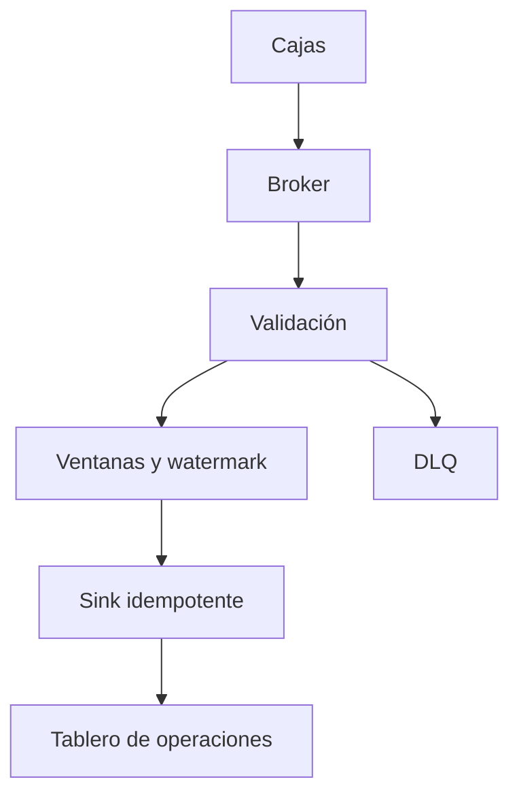
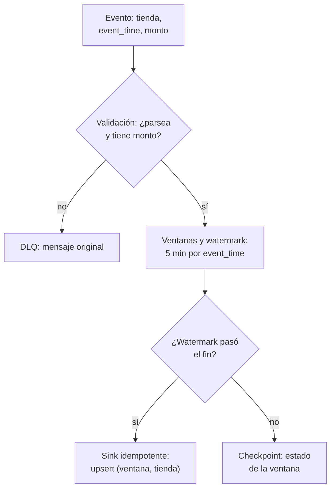
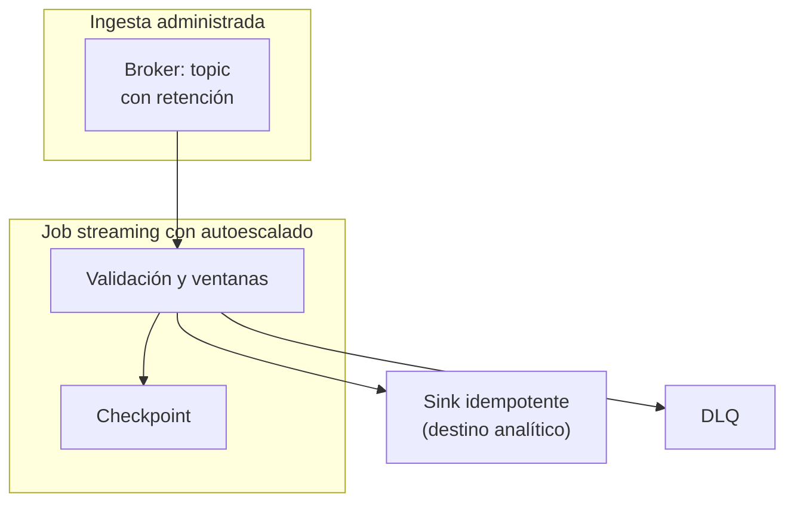

## 1. Resumen

Un pipeline streaming lee eventos de un broker en forma continua, separa lo inválido en una DLQ, agrega por **tiempo de evento** en ventanas que se cierran con una **watermark** y escribe cada resultado en el destino de forma **idempotente**. Un **checkpoint** guarda hasta dónde se leyó y el estado de las ventanas abiertas, así un reinicio retoma sin perder ni duplicar.

Conviene cuando el negocio necesita resultados en segundos o minutos y los eventos llegan sin parar. No conviene si un resultado por hora alcanza: un `batch-pipeline-architecture` es más simple de operar. Tampoco reemplaza a la consulta de baja latencia, que es otra pieza (`real-time-analytics-architecture`).

## 2. Escenario y requerimientos

Escenario: las cajas de una cadena publican cada pago al momento. Operaciones quiere ventas por tienda cada 5 minutos; algunos pagos llegan tarde o mal formados.

| Requerimiento | Valor del escenario |
|---|---|
| Latencia | Ventana de 5 minutos visible pocos minutos después de cerrar |
| Tiempo | Por hora del pago (tiempo de evento), no por hora de llegada |
| Tardíos | Se aceptan hasta 5 minutos de atraso; después se descartan |
| Inválidos | No detienen el pipeline; quedan en una DLQ para revisar |
| Fallas | Un reinicio no pierde ni duplica ventanas |

## 3. Vista de contexto



## 4. Componentes

| Componente | Responsabilidad | Por qué está |
|---|---|---|
| Broker | Guarda los eventos con retención y los entrega a los consumidores | Desacopla cajas y pipeline; permite releer |
| Validación | Parsea y separa lo ilegible o incompleto | Un evento malo no detiene el resto |
| DLQ | Guarda los rechazados con el mensaje original | Se revisan y se pueden reinyectar |
| Ventanas y watermark | Agregan por tiempo de evento y deciden cuándo cerrar | Resultados correctos aunque lleguen desordenados |
| Checkpoint | Offsets leídos y estado de las ventanas abiertas | Reinicio sin pérdida ni duplicados |
| Sink idempotente | Upsert por (ventana, tienda) | Un micro-batch repetido no duplica |

## 5. Vista de datos



Los datos no llegan garantizados en orden; la watermark es el umbral en el que se espera que hayan llegado todos los datos de una ventana, y lo que llega después con un timestamp dentro de ella es dato tardío (*Streaming pipelines*). En Spark, con `withWatermark` el motor acepta tardíos mientras el máximo tiempo de evento visto menos el umbral no supere el fin de la ventana, y en modo append emite cada ventana una vez, cuando la watermark la pasa (*Structured Streaming Programming Guide*).

## 6. Vista de despliegue



El job corre siempre; los checkpoints viven en almacenamiento durable fuera del job. Borrar los archivos del checkpoint o cambiar su ubicación hace que la siguiente corrida empiece de cero (*Structured Streaming checkpoints*).

## 7. Seguridad y gobierno

- Una identidad por pipeline, con permiso de lectura sobre su suscripción o grupo y de escritura solo sobre su destino y su DLQ.
- La DLQ guarda el mensaje original: tiene los mismos datos personales que la fuente y la misma retención y control de acceso.
- El esquema del evento es un contrato con los productores (`data-contracts`): un cambio incompatible llena la DLQ en vez de romper el destino.

## 8. Escalabilidad, observabilidad y operación

- **Escala:** el paralelismo lo limitan las particiones o shards del broker; en Kinesis, cada shard admite hasta 1 MB/s y 1.000 registros por segundo de escritura (*Amazon Kinesis Data Streams Terminology and concepts*).
- **Qué se mide:** lag del consumidor (offsets pendientes), antigüedad de la watermark frente al reloj, mensajes por minuto en la DLQ y ventanas emitidas por minuto.
- **Cambios de código:** en Dataflow, un job de reemplazo transfiere el estado intermedio si pasa el chequeo de compatibilidad (*Update an existing pipeline*). Para detenerlo, drain termina lo que está en buffer y deja de ingerir; cancel descarta lo que está en buffer (*Stop a running Dataflow pipeline*).
- **Runbook:** DLQ que crece → revisar el último cambio del productor, corregir y reinyectar; lag que crece → más workers o más particiones; watermark detenida → una partición sin datos o un productor con reloj atrasado.

## 9. Costos

El job corre las 24 horas, así que el costo base es el cómputo encendido aunque haya poco tráfico; el autoescalado lo ajusta. El broker se paga por throughput y por retención: Pub/Sub cobra throughput de publicación y entrega y el almacenamiento de mensajes retenidos (*Pub/Sub pricing*), y Kinesis Data Streams cobra por modo de capacidad, datos escritos y leídos, retención extendida y enhanced fan-out (*Amazon Kinesis Data Streams pricing*). En Dataflow, el modo at-least-once puede bajar mucho el costo y la latencia si la carga tolera duplicados (*Set the pipeline streaming mode*). Los montos no se copian: se calculan con la calculadora de cada nube.

## 10. Código y configuración

```python
# Python 3.12 y PySpark 4.2.0 en modo local (ejecutado en la CI con Java 17): pipeline streaming de punta a punta.
# Los archivos JSON hacen de broker. Una consulta valida y manda lo ilegible o sin monto a una DLQ; otra suma por
# tienda en ventanas de 5 minutos por tiempo de evento, con watermark de 5 minutos, y escribe cada ventana cerrada con
# un upsert en la tabla de servicio (SQLite), así un micro-batch repetido tras una caída no duplica. La segunda corrida
# retoma desde los checkpoints; el pago de las 10:03 llega después de cerrada su ventana y se descarta.
import json
import os
import sqlite3
import sys
import tempfile
from pathlib import Path

from pyspark.sql import DataFrame, SparkSession
from pyspark.sql import functions as F

base = Path(sys.argv[1] if len(sys.argv) > 1 else tempfile.mkdtemp())
src, dlq, serving = base / "pagos", base / "dlq", base / "serving.db"
src.mkdir(parents=True, exist_ok=True)
with sqlite3.connect(serving) as db:
    db.execute("CREATE TABLE IF NOT EXISTS ventas (ventana TEXT, tienda TEXT, total REAL, PRIMARY KEY (ventana, tienda))")


def land(name: str, lines: list[str]) -> None:
    (src / name).write_text("\n".join(lines), encoding="utf-8")
    stamp = 1_800_000_000 + len(list(src.iterdir()))   # la fuente procesa por fecha de modificación
    os.utime(src / name, (stamp, stamp))


def pay(store: str, hhmm: str, amount: float | None) -> str:
    return json.dumps({"tienda": store, "event_time": f"2026-11-02 {hhmm}:00", "monto": amount})


def upsert(batch: DataFrame, batch_id: int) -> None:   # foreachBatch: idempotente por (ventana, tienda)
    rows = [(f"{r.ventana:%H:%M}", r.tienda, r.total) for r in batch.collect()]
    with sqlite3.connect(serving) as db:
        db.executemany("INSERT INTO ventas VALUES (?, ?, ?) ON CONFLICT (ventana, tienda) DO UPDATE SET "
                       "total = excluded.total", rows)


spark = (SparkSession.builder.master("local[2]").config("spark.sql.shuffle.partitions", "2")
         .config("spark.ui.showConsoleProgress", "false").getOrCreate())
spark.sparkContext.setLogLevel("ERROR")


def run() -> None:
    raw = spark.readStream.option("maxFilesPerTrigger", 1).text(str(src))
    parsed = raw.withColumn("p", F.from_json("value", "tienda STRING, event_time TIMESTAMP, monto DOUBLE"))
    valid = F.col("p.monto").isNotNull() & F.col("p.event_time").isNotNull()
    to_dlq = (parsed.where(~valid | F.col("p").isNull()).select("value").writeStream.format("text")
              .option("path", str(dlq)).option("checkpointLocation", str(base / "chk-dlq"))
              .trigger(availableNow=True).start())
    windows = (parsed.where(valid).select("p.*").withWatermark("event_time", "5 minutes")
               .groupBy("tienda", F.window("event_time", "5 minutes")).agg(F.sum("monto").alias("total"))
               .select(F.col("window.start").alias("ventana"), "tienda", "total"))
    to_serving = (windows.writeStream.outputMode("append").foreachBatch(upsert)
                  .option("checkpointLocation", str(base / "chk-ventas")).trigger(availableNow=True).start())
    to_dlq.awaitTermination()
    to_serving.awaitTermination()
    with sqlite3.connect(serving) as db:
        closed = db.execute("SELECT COUNT(*) FROM ventas").fetchone()[0]
    print(f"ventanas cerradas en servicio: {closed}; mensajes en la DLQ: {spark.read.text(str(dlq)).count()}")


land("1.json", [pay("norte", "10:01", 30.0), pay("sur", "10:02", 12.5), "{malformado", pay("norte", "10:04", None)])
land("2.json", [pay("norte", "10:06", 20.0), pay("sur", "10:12", 5.0)])
run()
land("3.json", [pay("norte", "10:03", 99.0), pay("norte", "10:22", 7.0)])   # 10:03 llega tarde; 10:22 avanza la watermark
run()
with sqlite3.connect(serving) as db:
    for ventana, tienda, total in db.execute("SELECT * FROM ventas ORDER BY ventana, tienda"):
        print(f"{ventana} {tienda}: {total}")
spark.stop()
```

El script se **ejecuta en la CI con PySpark 4.2.0 en modo local y Java 17**. Los mensajes de arranque de Spark van a stderr; la salida es:

```text
ventanas cerradas en servicio: 2; mensajes en la DLQ: 2
ventanas cerradas en servicio: 4; mensajes en la DLQ: 2
10:00 norte: 30.0
10:00 sur: 12.5
10:05 norte: 20.0
10:10 sur: 5.0
```

La primera corrida cierra la ventana de las 10:00 (la watermark llega a 10:07) y manda a la DLQ la línea ilegible y el pago sin monto. La segunda retoma desde los checkpoints: el pago de las 10:03 llega cuando su ventana ya se emitió y no cambia `10:00 norte: 30.0`; la ventana de las 10:15 sigue abierta. El sink es `foreachBatch`, que solo garantiza at-least-once (*Use foreachBatch to write to arbitrary data sinks*): el upsert por (ventana, tienda) es lo que hace que reprocesar un micro-batch no duplique. Lo que no ejecuta: un broker real (los archivos hacen de broker; Kafka real está en `kappa-architecture` y `event-driven-architecture`) ni un job administrado en la nube.

## 11. GCP

| Pieza | Servicio | Detalle y diferencia |
|---|---|---|
| Broker | Pub/Sub | Entrega al menos una vez; la DLQ es un dead-letter topic, con 5 a 100 intentos de entrega y conteo aproximado (*Dead-letter topics*) |
| Procesamiento | Dataflow (Apache Beam) | Exactly-once por defecto en streaming: los registros se procesan al menos una vez y los resultados se confirman una vez; los efectos fuera del pipeline pueden repetirse (*Exactly-once in Dataflow*). No ejecutado |
| Destino | BigQuery con la Storage Write API | El default stream es at-least-once; los streams de la aplicación dan exactly-once con offsets (*Introduction to the Storage Write API (gRPC)*) |

## 12. AWS

| Pieza | Servicio | Detalle y diferencia |
|---|---|---|
| Broker | Kinesis Data Streams | Shards con límites por shard; retención por defecto de 24 horas, ampliable (*Amazon Kinesis Data Streams Terminology and concepts*) |
| Procesamiento | Managed Service for Apache Flink | Flink administrado, con escalado, checkpoints y snapshots a cargo del servicio (*What is Amazon Managed Service for Apache Flink?*). No ejecutado |
| Entrega sin código | Amazon Data Firehose | Entrega a S3, Redshift, OpenSearch o Iceberg acumulando por tamaño o intervalo; no hace ventanas por tiempo de evento (*What is Amazon Data Firehose?*) |

## 13. Azure

| Pieza | Servicio | Detalle y diferencia |
|---|---|---|
| Broker | Event Hubs | Particiones con offsets; el checkpoint lo guarda el consumidor (*Event Hubs features and terminology*); Capture copia el stream a Blob Storage o ADLS en Avro (*Capture events through Azure Event Hubs…*) |
| Procesamiento | Structured Streaming en Azure Databricks | El mismo motor del §10; `foreachBatch` da at-least-once y el `batchId` sirve para deduplicar (*Use foreachBatch to write to arbitrary data sinks*). No ejecutado |

## 14. Riesgos y modos de falla

| Riesgo | Cómo se detecta | Cómo se recupera |
|---|---|---|
| Checkpoint borrado o movido | El job reprocesa desde el inicio o desde el final | Checkpoint en almacenamiento durable y versionado con el código |
| Watermark que no avanza | Ventanas que no se emiten | Revisar particiones vacías y relojes de productores |
| DLQ que nadie mira | Crece sin alertas | Alerta por mensajes por minuto en la DLQ |
| Sink no idempotente | Ventanas duplicadas tras un reinicio | Upsert por clave o escritura transaccional |
| Umbral de tardíos muy corto | Totales que no cuadran con el batch del día | Medir el atraso real y ajustar la watermark |

## 15. Errores frecuentes

| Error | Consecuencia |
|---|---|
| Agrupar por hora de llegada | Un pago tardío cae en la ventana equivocada |
| Fallar el job ante un evento malo | Todo el pipeline se detiene por un mensaje |
| Asumir exactly-once de punta a punta | Duplicados en un sink que no participa del checkpoint |
| Cambiar la consulta sin revisar el checkpoint | El reinicio falla o pierde el estado |

## 16. Trade-offs y alternativas

| Opción | Gana | Cuesta |
|---|---|---|
| Pipeline streaming | Resultados en minutos | Job siempre encendido, estado y watermarks que operar |
| Micro-batch frecuente (`batch-pipeline-architecture`) | Operación simple | Latencia del intervalo |
| Entrega sin código (Firehose, export de Pub/Sub) | Sin job propio | Sin ventanas por tiempo de evento ni lógica |

## 17. Conceptos relacionados

- `streaming-ingestion`: la entrada continua.
- `watermarks` y `windowing`: cuándo cerrar y cómo agrupar.
- `dead-letter-queue`: lo inválido aparte.
- `checkpoints`: retomar sin pérdida.
- `exactly-once-semantics` e `idempotency`: qué garantiza cada pieza.
- `spark-structured-streaming` y `dataflow-streaming-pipelines`: los motores.
- `batch-pipeline-architecture`: la versión por lotes.
- `real-time-analytics-architecture`: la consulta de baja latencia.
- `kappa-architecture`: un solo camino streaming, también para reprocesar.
- `data-contracts`: el esquema acordado con los productores.
- `event-driven-architecture`: reaccionar a eventos de negocio.

## 18. Evolución

Se llega desde un `batch-pipeline-architecture` cuando el intervalo del lote ya no alcanza. Si además hay que recalcular historia con la misma lógica, evoluciona a `kappa-architecture`; si la salida se consulta con baja latencia, se le suma `real-time-analytics-architecture`. La señal para no adoptarlo: nadie mira el resultado antes del día siguiente.

## 19. Laboratorio relacionado

F4: laboratorio en la nube con un topic, un job streaming con ventanas y DLQ, una caída provocada y un reinicio desde el checkpoint, con `terraform apply` en sandbox, costo estimado con fuente, teardown verificado y evidencia de la corrida.

## 20. Fuentes

- Google Cloud: *Streaming pipelines*; *Set the pipeline streaming mode*; *Exactly-once in Dataflow*; *Update an existing pipeline*; *Stop a running Dataflow pipeline*; *Dead-letter topics*; *Introduction to the Storage Write API (gRPC)*; *Pub/Sub pricing*.
- Apache Spark 4.2.0: *Structured Streaming Programming Guide* (Getting Started; APIs on DataFrames and Datasets).
- AWS: *Amazon Kinesis Data Streams Terminology and concepts*; *What is Amazon Managed Service for Apache Flink?*; *What is Amazon Data Firehose?*; *Amazon Kinesis Data Streams pricing*.
- Microsoft Learn: *Event Hubs features and terminology*; *Capture events through Azure Event Hubs in Azure Blob Storage or Azure Data Lake Storage*; *Use foreachBatch to write to arbitrary data sinks*; *Structured Streaming checkpoints*.

El detalle de cada fuente está en `sources` del frontmatter.

## 21. Fecha de última verificación

2026-11-02: fichas de origen de cada cita revisadas; las páginas se consultaron en las fechas de `sources`. `review_required` hasta la revisión.

## 22. Historial de cambios importantes

- 2026-11-02: creación (lote 07b, ADR-028).
- 2026-11-02: las tres vistas usan los nombres del §4 (criterio de la revisión de 07a).
