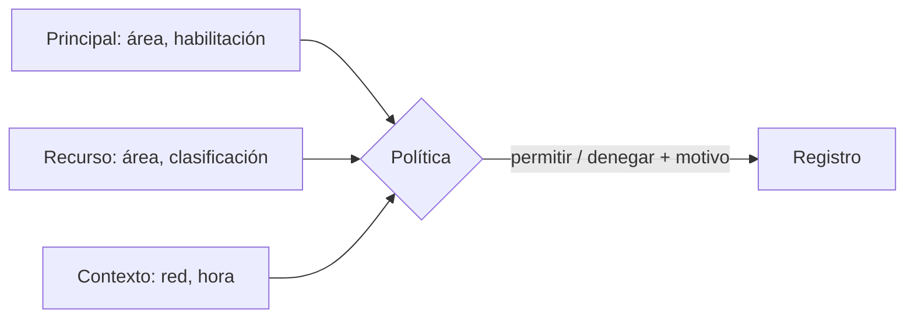

## 1. Resumen

**ABAC** (attribute-based access control) decide comparando **atributos**:

- del **principal:** área, habilitación, tipo de cuenta;
- del **recurso:** área dueña, clasificación;
- del **contexto:** red, hora, dispositivo.

Una sola política («se puede leer si la clasificación no supera la habilitación, el área coincide y, si es confidencial, desde la red corporativa») reemplaza decenas de roles. Las nubes lo implementan sobre sus roles: IAM Conditions, tags en AWS, condiciones de asignación en Azure.

## 2. Qué es

- **Atributo:** un dato con nombre y valor (`area=finanzas`, `clasificacion=confidencial`); en AWS, un tag.
- **Política:** una expresión sobre atributos que devuelve permitir o denegar.
- **Contexto:** atributos de la solicitud, no de quien la hace ni del recurso.

## 3. Problema que resuelve

Hay 12 áreas y 3 niveles de clasificación. Con RBAC harían falta 36 roles, y uno más por cada área nueva. Con ABAC, una política compara el área y el nivel; un área nueva es un valor de atributo, no un rol.

## 4. Cómo funciona

1. Se etiquetan principales y recursos con atributos (desde el proveedor de identidad y el catálogo).
2. Se escribe la política sobre esos atributos.
3. En cada solicitud se evalúa con los atributos del principal, del recurso y del contexto.
4. El resultado y su motivo quedan registrados.

## 5. Cuándo utilizarlo

- Cuando el acceso depende de propiedades que se repiten (área, clasificación) y los roles se multiplican.
- Junto con la clasificación de datos (`data-classification`).

## 6. Cuándo no utilizarlo

- Con atributos que nadie mantiene: una etiqueta equivocada abre o cierra el acceso.
- Para pocos casos estables: RBAC es más simple de leer.

## 7. Ejemplo sencillo

| Quién | Qué | Red | Resultado | Motivo |
|---|---|---|---|---|
| ana (finanzas, confidencial) | `finanzas.margen` (confidencial) | corporativa | permitido | atributos compatibles |
| ana | `finanzas.margen` | externa | denegado | confidencial fuera de la red corporativa |
| luis (ventas, interno) | `finanzas.margen` | corporativa | denegado | clasificación > habilitación |
| ana | `ventas.pedidos` (interno) | corporativa | denegado | área distinta |
| luis | `catalogo.paises` (público) | externa | permitido | público |

## 8. Ejemplo de producción

- Atributos de personas desde el proveedor de identidad (área, habilitación).
- Atributos de tablas desde el catálogo (dominio, clasificación).
- Políticas declaradas como código y probadas con casos.
- Decisiones registradas con el atributo que decidió.

## 9. Arquitectura



## 10. Código

```python
"""ABAC: una sola política que compara atributos del principal, del recurso y del contexto, en lugar de un rol por caso."""
from dataclasses import dataclass

NIVEL = {"publico": 0, "interno": 1, "confidencial": 2}


@dataclass(frozen=True)
class Principal:
    nombre: str
    area: str
    habilitacion: str


@dataclass(frozen=True)
class Recurso:
    nombre: str
    area: str
    clasificacion: str


def politica(p: Principal, r: Recurso, red: str) -> tuple[bool, str]:
    if NIVEL[r.clasificacion] > NIVEL[p.habilitacion]:
        return False, f"clasificación {r.clasificacion} > habilitación {p.habilitacion}"
    if r.clasificacion != "publico" and p.area != r.area:
        return False, f"área {p.area} ≠ {r.area}"
    if r.clasificacion == "confidencial" and red != "corporativa":
        return False, "confidencial fuera de la red corporativa"
    return True, "atributos compatibles"


ana = Principal("ana", "finanzas", "confidencial")
luis = Principal("luis", "ventas", "interno")
tablas = [Recurso("finanzas.margen", "finanzas", "confidencial"), Recurso("ventas.pedidos", "ventas", "interno"),
          Recurso("catalogo.paises", "datos", "publico")]

for p, r, red in [(ana, tablas[0], "corporativa"), (ana, tablas[0], "externa"), (luis, tablas[0], "corporativa"),
                  (luis, tablas[1], "corporativa"), (ana, tablas[1], "corporativa"), (luis, tablas[2], "externa")]:
    ok, porque = politica(p, r, red)
    print(f"{p.nombre} -> {r.nombre} desde red {red}: {'permitido' if ok else 'denegado'} ({porque})")
```

El script se **ejecuta en la CI** y pasa `mypy --strict`. Imprime las seis decisiones con su motivo; por ejemplo, `ana -> finanzas.margen desde red externa: denegado (confidencial fuera de la red corporativa)`.

## 11. GCP

En GCP, **IAM Conditions**. Según *Overview of IAM Conditions* (no ejecutado):

| | Política propia (este ejemplo) | IAM Conditions |
|---|---|---|
| Atributos | Principal, recurso y contexto | Del recurso pedido (tipo, nombre) o de la solicitud (hora, IP de destino) |
| Lenguaje | Python | Un subconjunto de CEL |

## 12. AWS

En AWS, **ABAC con tags** en IAM y **LF-Tags** en Lake Formation. Según *Define permissions based on attributes with ABAC authorization* y *Lake Formation tag-based access control* (no ejecutado):

| | Política propia (este ejemplo) | IAM con tags | Lake Formation (LF-TBAC) |
|---|---|---|---|
| Atributos | Área, clasificación, red | Tags en entidades de IAM y en recursos | LF-Tags en recursos del Data Catalog |
| Regla típica | Comparar atributos | Permitir cuando el tag del principal coincide con el del recurso | Se permite cuando el valor de tag concedido coincide con el del recurso |

## 13. Azure

En Azure, **Azure ABAC**. Según *What is Azure attribute-based access control (Azure ABAC)?* (no ejecutado):

| | Política propia (este ejemplo) | Azure ABAC |
|---|---|---|
| Dónde vive | Una función | Condiciones en una asignación de rol |
| Denegar | La política puede denegar | Las condiciones filtran permisos; no permiten denegar explícitamente |

## 14. Buenas prácticas

- Pocos atributos, con dueño y valores controlados.
- Atributos del recurso desde el catálogo, no a mano en cada política.
- Casos de prueba para cada política.
- **Seguridad:** el valor por defecto es denegar si falta un atributo.
- **Observabilidad:** registrar el atributo que decidió cada acceso.
- **Costo:** menos roles que mantener; más disciplina en las etiquetas.

## 15. Errores frecuentes

- Atributos libres (texto escrito a mano) que no coinciden.
- Permitir cuando falta un atributo.
- Políticas que nadie puede leer.

## 16. Trade-offs

ABAC escala con menos roles y exige atributos correctos; un error de etiqueta es un error de acceso. RBAC es más fácil de auditar a simple vista.

## 17. Conceptos relacionados

- `rbac`: roles.
- `data-classification`: la clasificación como atributo.
- `row-level-security`: atributos aplicados a filas.
- `lake-formation-permissions`: LF-Tags.

## 18. Preguntas técnicas abiertas

1. ¿Cuántos de tus roles existen solo por una combinación de área y nivel?
2. ¿Tus tablas tienen clasificación en el catálogo?
3. ¿Qué pasa hoy si a un recurso le falta una etiqueta?

## 19. Laboratorio relacionado

Pendiente (F4).

## 20. Fuentes

- Google Cloud: *Overview of IAM Conditions*.
- AWS: *Define permissions based on attributes with ABAC authorization* y *Lake Formation tag-based access control*.
- Microsoft Learn: *What is Azure attribute-based access control (Azure ABAC)?*.

El detalle de cada fuente está en `sources` del frontmatter.

## 21. Fecha de última verificación

2026-10-21. Pasa a `verified`: revisión B-F3.1 del lote F3b-18a aplicada y CI en verde (run 39677322697).

## 22. Historial de cambios importantes

- 2026-10-21: creación (lote F3b-18a).
- 2026-10-21: `verification_status: verified` (revisión aplicada; CI en verde, run 39677322697).
