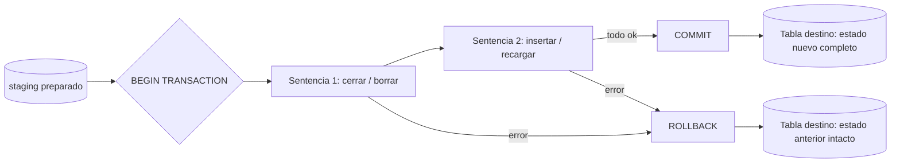

## 1. Resumen

ACID son las cuatro garantías de una transacción:

- **Atomicidad:** todo o nada.
- **Consistencia:** se respetan las reglas de la base.
- **Aislamiento (*Isolation*):** las transacciones concurrentes no se ven a medias.
- **Durabilidad:** lo confirmado no se pierde.

En OLTP protegen cada operación de negocio. En ingeniería de datos se usan sobre todo para que una carga de varias sentencias (cerrar versiones e insertar las nuevas, borrar un período y recargarlo) se aplique entera o no se aplique. Los motores analíticos las ofrecen con diferencias que conviene conocer: niveles de aislamiento, conflictos y bloqueos.

## 2. Qué es

Es un concepto consolidado de bases de datos:

- **Atomicidad:** la transacción es una unidad; si un paso falla, ninguno queda aplicado.
- **Consistencia:** la transacción lleva la base de un estado válido a otro (restricciones, claves, `CHECK`).
- **Aislamiento:** los estados intermedios no son visibles para otras transacciones. El **nivel** de aislamiento define qué anomalías se permiten: lecturas sucias, no repetibles, fantasmas o de serialización.
- **Durabilidad:** una vez confirmada (`COMMIT`), la transacción sobrevive a una caída.

## 3. Problema que resuelve

Una carga que hace varias cosas puede fallar en el medio: por ejemplo, borrar el día y recargarlo, o cerrar versiones SCD2 e insertar las nuevas. Sin atomicidad, queda un estado a medias, como el día borrado y no recargado, o versiones cerradas sin reemplazo, que nadie detecta hasta que un reporte da cero. Sin aislamiento, un tablero puede leer la tabla justo entre los dos pasos.

## 4. Cómo funciona

1. **Delimitar:** `BEGIN` / `BEGIN TRANSACTION` … `COMMIT`; `ROLLBACK` descarta. Sin delimitación, cada sentencia es su propia transacción (en PostgreSQL, implícitamente).
2. **Fallar en bloque:** si una sentencia falla, la transacción no se confirma. En BigQuery, sin manejador de excepciones, la consulta falla y la transacción se revierte. La documentación recomienda un `EXCEPTION WHEN ERROR THEN ROLLBACK TRANSACTION` para liberar recursos cuanto antes.
3. **Aislamiento por motor:**
   - PostgreSQL: *Read Committed* por defecto; se puede pedir *Serializable*.
   - BigQuery: *snapshot*; las lecturas ven un estado consistente de las tablas.
   - Redshift: *SNAPSHOT* por defecto o *SERIALIZABLE*, ambos serializables.
   - Fabric Warehouse: *snapshot* en todas las transacciones.
4. **Concurrencia:** en BigQuery, dos transacciones que modifican la misma tabla no corren a la vez: la que entra en conflicto se cancela. En Fabric, el bloqueo es a nivel de tabla. Las cargas concurrentes sobre la misma tabla deben serializarse en el orquestador.

## 5. Cuándo utilizarlo

- Cargas de varias sentencias que deben verse como una sola: borrar y recargar un período, cerrar e insertar versiones SCD2, actualizar varias tablas relacionadas.
- Operaciones de negocio en OLTP (pagos, inventario).
- Cuando un consumidor puede leer mientras se carga y no debe ver estados intermedios.

## 6. Cuándo no utilizarlo

- Para una sola sentencia que ya es atómica (un `MERGE` o un load job): envolverla en una transacción no agrega nada.
- Transacciones largas que abarcan pasos lentos o externos (una llamada a una API en el medio): retienen bloqueos y recursos. Mejor preparar todo en staging y abrir la transacción solo para aplicar.
- Como sustituto de la idempotencia: una transacción evita estados a medias, pero no evita que reintentar la carga completa la duplique.

## 7. Ejemplo sencillo

Transferir 150 de Ana a Luis cuando Ana tiene 100: el débito viola la regla `saldo >= 0`, la transacción falla y el crédito a Luis tampoco queda aplicado. Los saldos quedan como estaban.

## 8. Ejemplo de producción

La carga diaria de una dimensión SCD2 en BigQuery cierra las versiones vigentes que cambiaron e inserta las nuevas, en una transacción con manejador de excepciones. Un día, el `INSERT` falla por un cambio de schema en staging: la transacción se revierte, la dimensión queda como el día anterior, y la tarea falla con el mensaje del error. Como el orquestador no lanza dos cargas de la misma tabla a la vez, no hay conflictos. Tras corregir el schema, el reintento aplica todo.

## 9. Arquitectura



## 10. Código

```sql
-- BigQuery (ejecutable adaptando nombres): recargar un día de forma atómica.
-- Si cualquier sentencia falla, el manejador revierte y el día queda como estaba.
BEGIN
  BEGIN TRANSACTION;

  DELETE FROM `proyecto.core.fact_venta_linea` WHERE fecha = '2026-10-04';

  INSERT INTO `proyecto.core.fact_venta_linea`
  SELECT * FROM `proyecto.staging.venta_linea` WHERE fecha = '2026-10-04';

  COMMIT TRANSACTION;
EXCEPTION WHEN ERROR THEN
  SELECT @@error.message;     -- deja el motivo en el resultado del job
  ROLLBACK TRANSACTION;
  RAISE;                      -- relanza el error original: la tarea del orquestador debe fallar
END;
```

```sql
-- PostgreSQL: atomicidad y consistencia. El CHECK hace fallar el débito y la transacción entera
-- se aborta: el crédito a 'luis' tampoco queda aplicado.
CREATE TABLE cuentas (id TEXT PRIMARY KEY, saldo NUMERIC NOT NULL CHECK (saldo >= 0));
INSERT INTO cuentas VALUES ('ana', 100), ('luis', 0);

BEGIN;
UPDATE cuentas SET saldo = saldo + 150 WHERE id = 'luis';
UPDATE cuentas SET saldo = saldo - 150 WHERE id = 'ana';   -- error: viola el CHECK
COMMIT;                                                       -- no confirma nada: la transacción falló
```

## 11. GCP

**BigQuery** admite transacciones de varias sentencias con garantías ACID y aislamiento por snapshot. Dos rasgos a tener en cuenta:

- si una transacción modifica una tabla, otras transacciones que modifican la misma tabla se cancelan por conflicto, y el DML fuera de transacción se encola;
- sin manejador de excepciones, un error hace fallar la consulta y revierte la transacción.

La documentación recomienda el manejador con `ROLLBACK TRANSACTION`. Un load job o un `MERGE` sueltos ya son atómicos por sí solos.

## 12. AWS

**Redshift** ofrece dos niveles, ambos serializables: **SNAPSHOT**, el valor por defecto en clústeres aprovisionados y workgroups serverless nuevos, que procesa más volumen en menos tiempo; y **SERIALIZABLE**, más estricto con las operaciones concurrentes y más lento. A diferencia de PostgreSQL, cuyo valor por defecto es *Read Committed*, Redshift no ofrece niveles más débiles que el serializable.

## 13. Azure

**Fabric Data Warehouse** admite transacciones ACID con aislamiento por **snapshot** en todas ellas: si una sentencia falla, se revierte toda la transacción. Su diferencia operativa es el **bloqueo a nivel de tabla**, aunque la consulta toque una sola fila: cargas concurrentes sobre la misma tabla se bloquean entre sí, así que conviene serializarlas desde el orquestador.

## 14. Buenas prácticas

- Envolver en una transacción toda carga de varias sentencias que deba verse como una.
- Preparar los datos antes (staging) y abrir la transacción solo para aplicarlos: transacciones cortas.
- En BigQuery, usar manejador de excepciones con `ROLLBACK` y volver a lanzar el error para que la tarea falle.
- No lanzar en paralelo cargas que modifican la misma tabla.
- Combinar atomicidad con idempotencia: reintentar debe dar el mismo resultado.
- **Seguridad:** las transacciones no reemplazan los permisos: la cuenta de carga necesita permisos de escritura solo sobre las tablas que modifica.
- **Observabilidad:** registrar las transacciones revertidas y su motivo; un aumento de cancelaciones por conflicto indica cargas concurrentes sobre la misma tabla.
- **Costo:** en BigQuery on-demand se cobra lo que procesa cada sentencia de la transacción; una transacción revertida no devuelve ese costo, así que conviene validar el staging antes de abrirla.

## 15. Errores frecuentes

- `DELETE` y luego `INSERT` sin transacción: si el `INSERT` falla, el período queda vacío.
- Un manejador de excepciones que revierte pero no vuelve a lanzar el error: la tarea "termina bien" sin haber cargado nada.
- Transacciones largas con pasos lentos adentro.
- Suponer que todos los motores aíslan igual y ejecutar cargas concurrentes sobre la misma tabla.
- Creer que una transacción hace idempotente una carga.

## 16. Trade-offs

Las transacciones dan cargas atómicas y lecturas consistentes, a cambio de bloqueos o cancelaciones por conflicto y de algo de costo de coordinación. Niveles de aislamiento más estrictos evitan más anomalías, pero reducen la concurrencia (en Redshift, *SERIALIZABLE* es más lento que *SNAPSHOT*). Reemplazar un período con una sola sentencia atómica, como un load job con `WRITE_TRUNCATE` sobre la partición, evita la transacción cuando es posible.

## 17. Conceptos relacionados

- `oltp-vs-olap`: dónde se usa ACID y para qué.
- `idempotency`: la otra mitad de una carga segura.
- `sql-merge`: una sentencia atómica de upsert.
- `scd-type-2`: dos sentencias que van en la misma transacción.

## 18. Preguntas técnicas abiertas

1. ¿Cómo recargarías un día en BigQuery sin transacción y con el mismo efecto atómico?
2. Dos tareas del orquestador escriben en la misma tabla de Fabric a la vez y una queda esperando. ¿Qué cambiarías?
3. ¿Qué anomalía podría ver un reporte en PostgreSQL con *Read Committed* durante una carga de varias sentencias sin transacción?

## 19. Laboratorio relacionado

Pendiente (F4).

## 20. Fuentes

- PostgreSQL: *Transactions* (tutorial) y *Transaction Isolation*.
- Google Cloud: *Multi-statement transactions* y *Procedural language* (BigQuery).
- AWS: *Isolation levels in Amazon Redshift*.
- Microsoft Learn: *Transactions in Fabric Data Warehouse* y *Online transaction processing (OLTP)*.

El detalle de cada fuente está en `sources` del frontmatter.

## 21. Fecha de última verificación

2026-10-05. Pasa a `verified`: revisión B-F3.1 del lote 6 aplicada, sin VERIFY pendientes.

## 22. Historial de cambios importantes

- 2026-10-05: creación (lote 6 de F3).
- 2026-10-05: revisión B-F3.1 del lote 6 aplicada (docs/reviews/cards-lote6.md), sin cambios pedidos. `verification_status: verified` (sin VERIFY pendientes).
- 2026-10-13: `page_title` en cada cita, con el título de la página citada (ADR-012); sin cambios de contenido.
