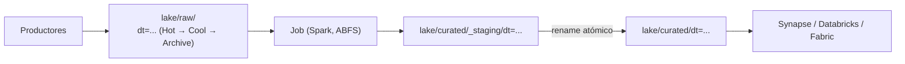

## 1. Resumen

**Azure Data Lake Storage (ADLS Gen2)** no es un servicio aparte: según su documentación, es un conjunto de capacidades para analítica construido sobre **Azure Blob Storage**, que se habilita con el **namespace jerárquico** de la cuenta. Con él:

- los directorios son reales y **renombrar o borrar un directorio es una sola operación atómica**, no una copia objeto por objeto;
- Hadoop y Spark acceden con el driver **ABFS**, y las API REST están en el endpoint **`dfs.core.windows.net`**;
- además de Azure RBAC, hay **ACL tipo POSIX** por directorio y archivo.

Los **niveles de acceso** (Hot, Cool, Cold, Archive) bajan el costo de lo que se lee poco, con duraciones mínimas, y el **lifecycle** mueve o borra por reglas.

## 2. Qué es

- **Cuenta con namespace jerárquico:** una cuenta de almacenamiento con la opción activada. Los contenedores pasan a ser sistemas de archivos con directorios.
- **Endpoints:** `blob.core.windows.net` (API de Blob) y `dfs.core.windows.net` (API de Data Lake).
- **Seguridad:** Azure RBAC sobre la cuenta o el contenedor, y ACL tipo POSIX sobre directorios y archivos.
- **Niveles de acceso**, según su página al 2026-10-13:

| Nivel | Duración mínima | Observaciones |
|---|---|---|
| Hot | ninguna | más costo de almacenamiento, menos de acceso |
| Cool | 30 días | acceso poco frecuente |
| Cold | 90 días | acceso raro, recuperación rápida |
| Archive | 180 días | offline; recuperación en horas |

  Smart tier mueve los datos entre Hot, Cool y Cold según el uso.
- **Lifecycle:** reglas por cuenta, contenedor o prefijo que mueven a niveles más fríos o borran.

## 3. Problema que resuelve

Un lake sobre almacenamiento de objetos simula directorios con barras en el nombre: renombrar o borrar un «directorio» es mover o borrar cada objeto. ADLS Gen2 da directorios reales y atómicos, que los motores de analítica usan para publicar resultados y para reorganizar datos sin copias.

## 4. Cómo funciona

1. La cuenta se crea con namespace jerárquico.
2. Cada lote se escribe en su partición: `raw/<tabla>/dt=<día>/`.
3. Para publicar un día procesado, el job escribe en un directorio de staging y lo **renombra** de una vez: los lectores no ven el día a medio escribir.
4. Spark y otros motores leen con ABFS por el endpoint `dfs`.
5. El lifecycle mueve `raw/` a niveles fríos y borra `tmp/`.

## 5. Cuándo utilizarlo

- Data lake en Azure leído por Spark, Synapse, Databricks o Fabric.
- Cargas que renombran o borran directorios completos.
- Permisos por directorio con ACL.

## 6. Cuándo no utilizarlo

- Almacenamiento de objetos simple sin analítica: Blob Storage sin namespace jerárquico alcanza.
- Datos de lectura frecuente en Archive: es un nivel offline, con recuperación en horas.
- Miles de archivos pequeños por partición: la página recomienda archivos de 256 MB a 100 GB.

## 7. Ejemplo sencillo

Las ventas del 1 de octubre se escriben en `raw/ventas/dt=2026-10-01/part-0000.jsonl`. Si el job se reintenta, sobrescribe el mismo nombre y el día queda con un solo archivo. Un listado con delimitador devuelve los prefijos `dt=...`.

## 8. Ejemplo de producción

Una cuenta `StorageV2` con namespace jerárquico y redundancia de zona tiene el sistema de archivos `lake`:

- `raw/`: JSON tal como llega; a los 30 días pasa a Cool y a los 180 a Archive;
- `curated/`: Parquet por día, publicado por renombre desde `_staging/`;
- `tmp/`: el lifecycle lo borra a los 7 días.

Los analistas tienen ACL de lectura sobre `curated/`, y los jobs una identidad administrada con escritura solo en sus directorios.

## 9. Arquitectura



## 10. Código

```python
# Python 3.12 y azure-storage-blob (ejecutado en la CI contra Azurite, el emulador de Blob Storage; no se corrió
# contra Azure). Escribe un lote en una partición estilo Hive (dt=AAAA-MM-DD/) con la API de Blob y lista las
# particiones con un delimitador. Reescribir el mismo lote reemplaza el blob: re-ejecutar no duplica.
# Azurite no soporta ADLS Gen2 (namespace jerárquico ni endpoint dfs): esta parte usa solo la API de Blob.
from __future__ import annotations

import datetime as dt
import json

from azure.storage.blob import BlobServiceClient, ContainerClient


def partition_prefix(table: str, day: dt.date) -> str:
    return f"raw/{table}/dt={day.isoformat()}/"


def write_batch(container: ContainerClient, table: str, day: dt.date, rows: list[dict[str, object]]) -> str:
    """Escribe el lote como JSON Lines en un nombre fijo por día; overwrite=True hace que un reintento reemplace."""
    name = partition_prefix(table, day) + "part-0000.jsonl"
    body = "".join(json.dumps(r, ensure_ascii=False) + "\n" for r in rows).encode("utf-8")
    container.upload_blob(name, body, overwrite=True)
    return name


def list_partitions(container: ContainerClient, table: str) -> list[str]:
    """Particiones de la tabla: los prefijos dt=... que devuelve el listado jerárquico con delimitador."""
    prefixes = container.walk_blobs(name_starts_with=f"raw/{table}/", delimiter="/")
    return sorted(p.name.rstrip("/").rsplit("/", 1)[-1] for p in prefixes)


def count_blobs(container: ContainerClient, prefix: str) -> int:
    return sum(1 for _ in container.list_blobs(name_starts_with=prefix))


if __name__ == "__main__":
    # Contra Azure (no ejecutado): cadena de conexión del entorno y un contenedor existente.
    import os

    service = BlobServiceClient.from_connection_string(os.environ["AZURE_STORAGE_CONNECTION_STRING"])
    lake = service.get_container_client("lake")
    write_batch(lake, "ventas", dt.date(2026, 10, 1), [{"id": 1, "monto": 120}])
    print(list_partitions(lake, "ventas"))
```

```python
# Python 3.12 y azure-storage-file-datalake (no ejecutado: Azurite no soporta ADLS Gen2, y no se corrió contra Azure).
# Con namespace jerárquico, publicar un día es renombrar un directorio: _staging/dt=... pasa a dt=... de una vez,
# así los lectores nunca ven el día a medio escribir.
from azure.identity import DefaultAzureCredential
from azure.storage.filedatalake import DataLakeServiceClient

service = DataLakeServiceClient("https://dekhlakeprod.dfs.core.windows.net", credential=DefaultAzureCredential())
fs = service.get_file_system_client("lake")
staging = fs.get_directory_client("curated/ventas/_staging/dt=2026-10-01")
staging.create_directory()
staging.get_file_client("part-0000.parquet").upload_data(b"...", overwrite=True)
# Rename del directorio completo (operación sobre el directorio, no copia de cada objeto).
staging.rename_directory(new_name="lake/curated/ventas/dt=2026-10-01")
```

```hcl
# Terraform (validado en la CI con terraform validate, sin credenciales; no se aplicó): cuenta de almacenamiento con
# namespace jerárquico (ADLS Gen2), un sistema de archivos para el lake y reglas de lifecycle por prefijo.
# Requiere: provider hashicorp/azurerm ~> 5.0; un grupo de recursos existente.
terraform {
  required_providers {
    azurerm = {
      source  = "hashicorp/azurerm"
      version = "~> 5.0"
    }
  }
}

provider "azurerm" {
  features {}
}

variable "resource_group_name" {
  type = string
}

variable "location" {
  type    = string
  default = "eastus2"
}

resource "azurerm_storage_account" "lake" {
  name                     = "dekhlakeprod"
  resource_group_name      = var.resource_group_name
  location                 = var.location
  account_tier             = "Standard"
  account_replication_type = "ZRS"
  account_kind             = "StorageV2"
  is_hns_enabled           = true # namespace jerárquico: ADLS Gen2
}

resource "azurerm_storage_data_lake_gen2_filesystem" "lake" {
  name               = "lake"
  storage_account_id = azurerm_storage_account.lake.id
}

resource "azurerm_storage_management_policy" "lake" {
  storage_account_id = azurerm_storage_account.lake.id

  rule {
    name    = "raw-a-frio"
    enabled = true
    filters {
      prefix_match = ["lake/raw/"]
      blob_types   = ["blockBlob"]
    }
    actions {
      base_blob {
        tier_to_cool_after_days_since_modification_greater_than    = 30
        tier_to_archive_after_days_since_modification_greater_than = 180
      }
    }
  }

  rule {
    name    = "tmp-borrar"
    enabled = true
    filters {
      prefix_match = ["lake/tmp/"]
      blob_types   = ["blockBlob"]
    }
    actions {
      base_blob {
        delete_after_days_since_modification_greater_than = 7
      }
    }
  }
}
```

El primer script, en Python 3.12 con `azure-storage-blob`, se **ejecuta en la CI contra Azurite** (ADR-013) y pasa `mypy --strict`. **No se corrió contra Azure.** Usa solo la API de Blob: según *Use the Azurite emulator for local Azure Storage development*, Azurite no soporta ADLS Gen2, así que el namespace jerárquico y el endpoint `dfs` no se prueban. El test escribe tres lotes (el segundo día dos veces) y comprueba que quedan dos particiones y dos blobs.

El segundo script, con `azure-storage-file-datalake`, **no se ejecutó**: el renombre de directorio necesita el namespace jerárquico, que Azurite no emula, y no se corrió contra Azure.

El bloque de Terraform se valida en la CI con `terraform validate`, sin credenciales (`make validate-terraform`), y **no se aplicó**.

## 11. GCP

No aplica de forma específica: esta ficha describe ADLS Gen2. El equivalente es Cloud Storage (ver `gcs-buckets-and-objects`). Las diferencias, según sus páginas:

| | ADLS Gen2 | Cloud Storage |
|---|---|---|
| Namespace jerárquico | Opción de la cuenta de almacenamiento | Opción del bucket, al crearlo; no se puede cambiar después |
| Niveles o clases y mínimos | Cool 30 días, Cold 90, Archive 180 | Nearline 30 días, Coldline 90, Archive 365 |
| Acceso para analítica | Driver ABFS y endpoint `dfs.core.windows.net` | Su propia API; carpetas atómicas con namespace jerárquico |

## 12. AWS

No aplica de forma específica. El equivalente es Amazon S3 (ver `s3-data-lake`). Las diferencias, según sus páginas:

| | ADLS Gen2 | Amazon S3 |
|---|---|---|
| Namespace | Jerárquico, si se activa en la cuenta | Plano en los buckets de propósito general; jerárquico en los directory buckets |
| Niveles o clases y mínimos | Cool 30 días, Cold 90, Archive 180 | Standard-IA 30 días, Glacier Instant y Flexible 90, Deep Archive 180 |
| Mover entre niveles por uso | Smart tier (Hot, Cool, Cold) | Intelligent-Tiering |

## 13. Azure

**Azure Data Lake Storage.** El namespace jerárquico, ABFS, el endpoint `dfs`, las ACL, los niveles (consultados el 2026-10-13), el lifecycle y las buenas prácticas son los de sus páginas. Los precios por capacidad, nivel, redundancia y operaciones se consultan en la página de precios.

## 14. Buenas prácticas

- Namespace jerárquico activado desde la creación de la cuenta del lake.
- Particiones por fecha y archivos de 256 MB a 100 GB, no miles de archivos pequeños.
- Publicar resultados por renombre de directorio desde staging.
- Lifecycle por prefijo, revisado como código.
- **Seguridad:** identidades administradas para los jobs, RBAC para la administración y ACL por directorio para el acceso a datos; nada de claves de cuenta en el código.
- **Observabilidad:** seguir la capacidad por nivel, las operaciones y la cantidad de archivos por partición.
- **Costo:** los niveles fríos bajan el costo en reposo y suben el de acceso, con duración mínima y penalidad por eliminación anticipada. Los montos se consultan en la página de precios.

## 15. Errores frecuentes

- Crear la cuenta sin namespace jerárquico y descubrirlo al querer renombrar directorios.
- Escribir cada reintento con un nombre nuevo y duplicar el día.
- Mover a Archive datos que se leen cada semana.
- Dar acceso con la clave de la cuenta en lugar de identidades y ACL.

## 16. Trade-offs

El namespace jerárquico da operaciones atómicas de directorio y ACL finas, a cambio de configurarlo al crear la cuenta. Los niveles fríos ahorran en reposo y encarecen el acceso, con mínimos. Smart tier evita reglas manuales, sin el control fino de un lifecycle explícito.

## 17. Conceptos relacionados

- `data-lake`: el patrón.
- `s3-data-lake` y `gcs-buckets-and-objects`: los equivalentes en AWS y GCP.
- `partitioning` e `idempotency`: cómo se escriben los lotes.
- `fabric-onelake-and-workloads` y `azure-databricks-lakehouse`: lo que se construye encima del lake en Azure.

## 18. Preguntas técnicas abiertas

1. ¿Qué operaciones de tu pipeline renombran o borran directorios completos?
2. ¿Qué prefijos de tu lake podrían pasar a Cool o Cold sin afectar a nadie?
3. ¿Cómo separarías permisos con ACL entre equipos?

## 19. Laboratorio relacionado

Pendiente (F4).

## 20. Fuentes

- Microsoft Learn, Azure Storage: *Introduction to Azure Data Lake Storage*, *Azure Data Lake Storage hierarchical namespace*, *Access control lists (ACLs) in Azure Data Lake Storage*, *Access tiers for blob data*, *Azure Blob Storage lifecycle management overview*, *Best practices for using Azure Data Lake Storage* y *Use the Azurite emulator for local Azure Storage development*; *Azure Data Lake Storage pricing*.
- Google Cloud, Cloud Storage: *Storage classes* y *Hierarchical namespace*.
- AWS, Amazon S3: *What is Amazon S3?* y *Understanding and managing Amazon S3 storage classes*.

El detalle de cada fuente está en `sources` del frontmatter.

## 21. Fecha de última verificación

2026-10-13. `review_required`: pendiente de revisión B-F3.1 del lote F3b-10a.

## 22. Historial de cambios importantes

- 2026-10-13: creación (lote F3b-10a).
