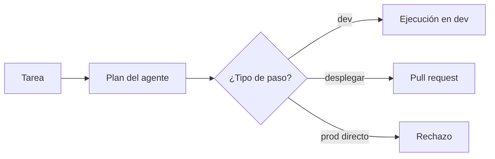

## 1. Resumen

`ai-pipeline-generation` propone un pipeline que una persona revisa. **Agentic data engineering** da un paso más: el agente **ejecuta** tareas (crear un modelo, escribir sus tests, comparar volúmenes) siguiendo un **plan revisable**. BigQuery lo describe así: el Data Engineering Agent genera un plan que se revisa antes de continuar y valida la compilación del código que genera (*Data Engineering Agent overview*). Fabric tiene su data engineering agent (Project Osmos), que su página marca como preview y no pensado para producción.

Es emergente y **no reemplaza** el ciclo de desarrollo: lo recorre más rápido. La plataforma fija el marco: qué hace el agente solo (en desarrollo), qué pasa por aprobación (`code-review`, `environment-promotion`) y qué no puede hacer.

## 2. Qué es

- **Plan revisable:** la lista de pasos que el agente propone antes de ejecutar.
- **Alcance autónomo:** crear y probar en desarrollo.
- **Punto de aprobación:** desplegar a producción, por pull request.
- **Fuera de alcance:** borrar o modificar producción directo.
- **Ejecución simulada:** el plan corre primero en desarrollo y deja evidencia para la revisión.

## 3. Problema que resuelve

Incorporar una fuente nueva toma días de pasos repetitivos: crear el modelo de staging, escribir tests, comparar con la versión anterior. Un agente puede hacerlos en minutos, pero también podría proponer borrar la tabla vieja en producción. Revisando el plan paso a paso, lo repetitivo se automatiza y lo riesgoso queda en manos de una persona.

## 4. Cómo funciona

1. Se describe la tarea al agente con el contexto del repositorio.
2. El agente propone un plan.
3. La plataforma clasifica cada paso: autónomo, con aprobación o rechazado.
4. Los autónomos corren en desarrollo y dejan evidencia.
5. Los que requieren aprobación entran por pull request.

## 5. Cuándo utilizarlo

- Tareas repetitivas con convenciones claras: staging, tests, comparaciones.
- Equipos con ambientes separados y CI.
- Como experimento acotado a desarrollo.

## 6. Cuándo no utilizarlo

- Con acceso directo a producción.
- Sin ambientes separados ni revisión.
- Con funciones en preview para cargas productivas: Fabric aclara que su agente en preview no es para producción.

## 7. Ejemplo sencillo

| Paso del plan | Decisión |
|---|---|
| Crear `stg_pedidos_v2` | Simulado en dev |
| Escribir tests | Simulado en dev |
| Comparar volumen con `pedidos_v1` | Simulado en dev |
| Desplegar a producción | Requiere aprobación (pull request) |
| Borrar `pedidos_v1` en producción | Rechazado: fuera del alcance del agente |

## 8. Ejemplo de producción

Incorporación de fuentes:

- agente con permisos solo en desarrollo;
- plan revisado antes de ejecutar;
- validación del pipeline como en `ai-pipeline-generation`;
- pull request para desplegar, con la evidencia del desarrollo;
- en la nube (no ejecutado): Data Engineering Agent de BigQuery, SageMaker Data Agent o Fabric data engineering agent (preview).

## 9. Arquitectura



## 10. Código

```python
# Python 3.12, biblioteca estándar (ejecutado en la CI): agentic data engineering como plan revisable. Un agente
# propone un plan para «incorporar la fuente pedidos_v2» (respuesta fija); la plataforma revisa cada paso contra lo
# que el agente puede hacer solo (crear en desarrollo, escribir tests), lo que necesita aprobación (desplegar) y lo
# que no puede hacer (tocar producción directo). El plan se ejecuta en modo simulado y queda listo para revisión.
PLAN = [
    {"paso": "crear modelo stg_pedidos_v2", "ambiente": "dev", "tipo": "crear"},
    {"paso": "escribir tests de unicidad y no nulos", "ambiente": "dev", "tipo": "crear"},
    {"paso": "comparar volumen con pedidos_v1", "ambiente": "dev", "tipo": "leer"},
    {"paso": "desplegar a producción", "ambiente": "prod", "tipo": "desplegar"},
    {"paso": "borrar pedidos_v1 en producción", "ambiente": "prod", "tipo": "borrar"},
]


def decidir(p: dict[str, str]) -> str:
    if p["tipo"] == "borrar" or (p["ambiente"] == "prod" and p["tipo"] != "desplegar"):
        return "rechazado: fuera del alcance del agente"
    if p["tipo"] == "desplegar":
        return "requiere aprobación (pull request)"
    return "simulado en dev"


for p in PLAN:
    print(f"{p['paso']}: {decidir(p)}")
autonomos = sum(decidir(p) == "simulado en dev" for p in PLAN)
print(f"pasos autónomos: {autonomos} de {len(PLAN)}; el resto lo decide una persona")
```

El script se **ejecuta en la CI** con la biblioteca estándar y pasa `mypy --strict`. Imprime la decisión de cada paso del §7 y `pasos autónomos: 3 de 5`. El plan del agente es fijo.

## 11. GCP

En GCP, el **Data Engineering Agent**. Según *Data Engineering Agent overview* (no ejecutado):

| | Este concepto | Data Engineering Agent |
|---|---|---|
| Plan | Revisable | Resume su razonamiento y genera un plan para revisar antes de continuar |
| Código | Validado | Valida y corrige errores de compilación del código generado |
| Dónde | Desarrollo | Repositorios y workspaces de Dataform |

## 12. AWS

En AWS, el **SageMaker Data Agent**. Según *SageMaker Data Agent* (no ejecutado):

| | Este concepto | SageMaker Data Agent |
|---|---|---|
| Plan | Revisable | Genera código y planes de ejecución desde lenguaje natural |
| Dónde | Desarrollo | Notebooks y Query Editor |

## 13. Azure

En Azure, el **Fabric data engineering agent (Project Osmos)**. Según *What is Fabric data engineering agent (Project Osmos)? (preview)* (no ejecutado):

| | Este concepto | Project Osmos |
|---|---|---|
| Estado | — | «The Data engineering agent (Project Osmos) is in preview» |
| Uso | Desarrollo | La página dice que las funciones en preview no están pensadas para producción |

## 14. Buenas prácticas

- Permisos del agente solo en desarrollo.
- Plan revisado antes de ejecutar.
- Despliegue por pull request, con evidencia.
- **Seguridad:** el agente nunca tiene credenciales de producción.
- **Observabilidad:** plan, pasos ejecutados y decisiones registrados.
- **Costo:** límites de cómputo en el ambiente de desarrollo del agente.

## 15. Errores frecuentes

- Dar al agente acceso a producción «para ir más rápido».
- Aprobar el plan sin leerlo.
- Usar funciones en preview en cargas productivas.
- No guardar la evidencia de lo que el agente hizo.

## 16. Trade-offs

El agente acelera lo repetitivo y concentra la revisión en el plan. Más autonomía ahorra pasos y aumenta el riesgo. Es emergente: varias de estas funciones están en preview.

## 17. Conceptos relacionados

- `data-agents`: agentes que consultan.
- `agentic-workflows`: el workflow.
- `ai-pipeline-generation`: validar lo generado.
- `environment-promotion` y `code-review`: aprobación y despliegue.

## 18. Preguntas técnicas abiertas

1. ¿Qué tarea repetitiva delegarías primero?
2. ¿Qué pasos nunca harías sin aprobación?
3. ¿Cómo revisarías el plan del agente?

## 19. Laboratorio relacionado

Pendiente (F4).

## 20. Fuentes

- Google Cloud: *Data Engineering Agent overview*.
- AWS: *SageMaker Data Agent*.
- Microsoft Learn: *What is Fabric data engineering agent (Project Osmos)? (preview)*.

El detalle de cada fuente está en `sources` del frontmatter.

## 21. Fecha de última verificación

2026-10-27. `review_required`: pendiente de revisión B-F3.1 del lote F3b-23a.

## 22. Historial de cambios importantes

- 2026-10-27: creación (lote F3b-23a).
