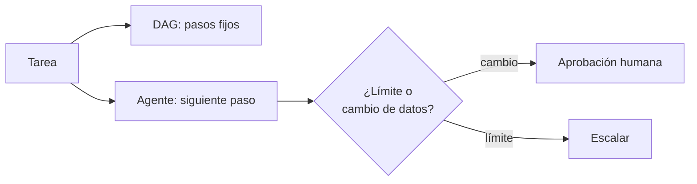

## 1. Resumen

Un pipeline orquestado (`data-orchestration`) ejecuta siempre los mismos pasos en el mismo orden: es repetible y auditable. Un **workflow agéntico** deja que un modelo decida el siguiente paso según lo que observa. Los frameworks mezclan ambas cosas: Microsoft Agent Framework arma un grafo de executors y edges (*Workflow Builder & Execution*); en ADK, las plantillas de workflow son deterministas y no consultan al modelo para orquestar, y desde ADK 2.0 para Python y Go fueron «superseded» por workflows basados en grafos y dinámicos (*Template agent workflows*).

Es emergente y **no reemplaza** la orquestación determinista. La pregunta para un data engineer es dónde vale la pena que el modelo decida y qué controles necesita ahí: límite de pasos y aprobación humana antes de cambiar datos (`guardrails`).

## 2. Qué es

- **DAG determinista:** el orden lo fija el código; cada corrida hace lo mismo.
- **Bucle agéntico:** el modelo propone el siguiente paso; puede repetir, saltar o insistir.
- **Grafo híbrido:** pasos deterministas con nodos donde decide un agente.
- **Límite de pasos:** corta un bucle que no converge.
- **Aprobación humana:** pausa antes de una acción que cambia datos.

## 3. Problema que resuelve

Ante una partición fallida, el runbook dice: revisar, recargar, avisar. Un DAG lo hace igual cada vez. Un agente puede ayudar cuando la causa varía, pero también puede insistir en recargar en bucle. Con límite de pasos y aprobación, el agente decide dentro de un marco y la persona decide lo que cambia datos.

## 4. Cómo funciona

1. Se separan los pasos fijos de los que dependen de lo que se observa.
2. Los fijos van al orquestador.
3. Los variables van a un nodo agéntico con herramientas acotadas.
4. Toda acción que cambia datos pide aprobación.
5. Un límite de pasos corta el bucle y escala a una persona.

## 5. Cuándo utilizarlo

- Diagnósticos con pasos que dependen de lo que se encuentra.
- Tareas de soporte con muchas variantes.
- Como nodo dentro de un DAG, no como reemplazo del DAG.

## 6. Cuándo no utilizarlo

- Para cargas productivas que deben repetirse igual cada día.
- Cuando el orden de los pasos ya se conoce: un DAG es más simple y auditable.
- Sin límites ni aprobación.

## 7. Ejemplo sencillo

| Versión | Pasos ejecutados |
|---|---|
| DAG | revisar, recargar, avisar |
| Bucle agéntico | revisar, recargar (aprobado), recargar (espera aprobación), recargar (espera aprobación), corte en el paso 5 por el límite de 4 |

## 8. Ejemplo de producción

Soporte de cargas:

- DAG para la carga diaria (`data-orchestration`);
- nodo agéntico para el diagnóstico de fallas, con herramientas de lectura;
- aprobación humana para recargar o modificar;
- límite de pasos y escalamiento;
- en la nube (no ejecutado): workflows de Microsoft Agent Framework, workflows de ADK o el patrón de AWS Prescriptive Guidance.

## 9. Arquitectura



## 10. Código

```python
# Python 3.12, biblioteca estándar (ejecutado en la CI): la misma tarea, «recargar la partición fallida y avisar»,
# como DAG determinista y como bucle agéntico. El DAG ejecuta siempre los mismos pasos en el mismo orden. El bucle
# decide el siguiente paso según lo que observa (decisiones fijas del «modelo»), con límite de pasos y aprobación
# humana antes de la acción que cambia datos. La diferencia es qué se puede auditar y repetir.
from collections.abc import Callable

LOG: list[str] = []


def revisar_estado() -> str:
    LOG.append("revisar_estado")
    return "partición 2026-10-26 fallida"


def recargar(particion: str) -> str:
    LOG.append(f"recargar({particion})")
    return "recargada"


def avisar(mensaje: str) -> str:
    LOG.append(f"avisar({mensaje})")
    return "avisado"


# 1. DAG determinista: el orden lo fija el código.
LOG.clear()
revisar_estado()
recargar("2026-10-26")
avisar("partición recargada")
print("DAG:", LOG)

# 2. Bucle agéntico: el modelo propone el siguiente paso; la plataforma aplica límite y aprobación.
DECISIONES = ["revisar_estado", "recargar", "recargar", "recargar", "avisar"]   # el modelo insiste en recargar
REQUIERE_APROBACION = {"recargar"}
MAX_PASOS = 4
aprobado = {"recargar": True}                                                   # la persona aprueba una vez
acciones: dict[str, Callable[[], str]] = {"revisar_estado": revisar_estado,
                                          "recargar": lambda: recargar("2026-10-26"),
                                          "avisar": lambda: avisar("partición recargada")}
LOG.clear()
for paso, decision in enumerate(DECISIONES, start=1):
    if paso > MAX_PASOS:
        print(f"bucle: corte en el paso {paso}, límite de {MAX_PASOS}")
        break
    if decision in REQUIERE_APROBACION:
        if not aprobado.pop(decision, False):
            LOG.append(f"{decision}: espera aprobación")
            continue
    acciones[decision]()
print("bucle:", LOG)
```

El script se **ejecuta en la CI** con la biblioteca estándar y pasa `mypy --strict`. Imprime el DAG, el corte por límite y el registro del bucle, donde la segunda y tercera recarga esperan aprobación. Las decisiones del modelo son fijas.

## 11. GCP

En GCP, **ADK** (Agent Development Kit). Según *Template agent workflows* (no ejecutado):

| | Este concepto | ADK |
|---|---|---|
| Determinista | DAG | Plantillas secuencial, paralela y loop, sin consultar al modelo para orquestar |
| Estado | — | «Starting in ADK 2.0 for Python and Go, template workflows have been superseded by … graph-based workflows and dynamic workflows» |

## 12. AWS

En AWS, el patrón de **workflow orchestration agents**. Según *Workflow orchestration agents* (no ejecutado):

| | Este concepto | AWS Prescriptive Guidance |
|---|---|---|
| Qué coordina | Pasos y aprobación | Agentes y herramientas llamados en secuencia o de forma condicional |
| Inicio | Una tarea | Entrada del usuario o evento del sistema |

## 13. Azure

En Azure, los **workflows de Microsoft Agent Framework**. Según *Workflow Builder & Execution* (no ejecutado):

| | Este concepto | Agent Framework |
|---|---|---|
| Estructura | DAG o bucle | Grafo dirigido de executors y edges |
| Ejecución | Pasos | Modelo Pregel modificado con supersteps |

## 14. Buenas prácticas

- Lo repetible, en el orquestador; lo variable, en un nodo agéntico.
- Límite de pasos y escalamiento.
- Aprobación para todo lo que cambia datos.
- **Seguridad:** herramientas de lectura por defecto en el nodo agéntico.
- **Observabilidad:** registrar cada decisión del modelo y su motivo (`llm-observability`).
- **Costo:** cada paso agéntico es una llamada al modelo; el límite también acota el costo.

## 15. Errores frecuentes

- Reemplazar un DAG estable por un agente.
- Bucles sin límite.
- Aprobar automáticamente las acciones del agente.
- No registrar por qué el modelo eligió cada paso.

## 16. Trade-offs

El agente se adapta a casos imprevistos y pierde repetibilidad; el DAG es predecible y rígido. Un grafo híbrido suma lo mejor de ambos a cambio de más piezas. Es emergente: los frameworks cambian de modelo de workflow entre versiones, como ADK 2.0.

## 17. Conceptos relacionados

- `llm-agents`: el bucle.
- `data-orchestration`: la orquestación determinista.
- `multi-agent-systems`: varios agentes.
- `guardrails` y `llm-observability`: límites y registro.

## 18. Preguntas técnicas abiertas

1. ¿Qué parte de tus runbooks depende de lo que se encuentra?
2. ¿Qué acción nunca dejarías sin aprobación?
3. ¿Cuántos pasos permitirías antes de escalar?

## 19. Laboratorio relacionado

Pendiente (F4).

## 20. Fuentes

- Microsoft Learn: *Workflow Builder & Execution* (Agent Framework).
- ADK: *Template agent workflows*.
- AWS: *Workflow orchestration agents* (Prescriptive Guidance).

El detalle de cada fuente está en `sources` del frontmatter.

## 21. Fecha de última verificación

2026-10-27. `review_required`: pendiente de revisión B-F3.1 del lote F3b-23a.

## 22. Historial de cambios importantes

- 2026-10-27: creación (lote F3b-23a).
