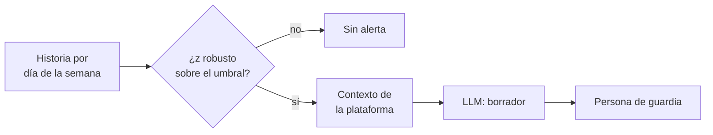

## 1. Resumen

«IA» en la detección de anomalías tiene dos sentidos distintos, y conviene separarlos. **Detectar** es un problema estadístico o de pronóstico: comparar el valor real con lo esperado. BigQuery lo hace con TimesFM, que pronostica desde la historia y compara (*The AI.DETECT_ANOMALIES function*); Glue Data Quality aprende la tendencia y marca lo que cae fuera del rango (*Anomaly detection in AWS Glue Data Quality*). **Explicar** es redactar qué pasó con el contexto disponible, y ahí un LLM puede ayudar, como borrador.

Para un data engineer, la detección tiene que ser medible y auditable (`volume-anomalies`). El LLM no decide si hay anomalía: recibe la anomalía ya detectada y el contexto de la plataforma (cambios de esquema, retrasos aguas arriba) y escribe un borrador para la persona de guardia.

## 2. Qué es

- **Línea base:** lo esperado; por ejemplo, el mismo día de la semana en semanas anteriores.
- **Z-score robusto:** distancia a la mediana medida con la MAD; resiste valores extremos en la historia.
- **Modelo de pronóstico:** TimesFM en BigQuery; un modelo aprendido en Glue.
- **Observación:** en Glue, la anomalía detectada con su rango predicho.
- **Borrador de explicación:** texto del LLM con el contexto, revisado por una persona.

## 3. Problema que resuelve

A las 7 AM la carga de pedidos trae 410 filas. Un umbral fijo no sabe que los martes la carga baja a unas 640; uno comparado con el mismo día sí lo detecta. La persona de guardia tarda 20 minutos en juntar el contexto: un cambio de esquema en la fuente y una carga de órdenes que llegó tarde. Con el contexto armado, un borrador ahorra esa búsqueda.

## 4. Cómo funciona

1. Se calcula la línea base del mismo día de la semana.
2. Se mide la distancia robusta del valor actual; sobre el umbral, es anomalía.
3. Se junta el contexto de la plataforma para ese día: cambios de esquema, retrasos, despliegues.
4. El LLM recibe la anomalía y el contexto, y redacta un borrador.
5. La persona de guardia confirma o descarta; la decisión alimenta la línea base.

## 5. Cuándo utilizarlo

- Volúmenes, frescura y distribuciones con estacionalidad semanal.
- Cuando el contexto está disperso en varias herramientas y armarlo toma tiempo.

## 6. Cuándo no utilizarlo

- El LLM como detector: no se mide, no se audita y cambia entre corridas.
- Sin historia suficiente: Glue pide al menos tres puntos, y una semana no muestra la estacionalidad.
- Para disparar acciones automáticas sobre la base de la explicación.

## 7. Ejemplo sencillo

| Día | Filas | Mismo día anteriores | z robusto | Resultado |
|---|---|---|---|---|
| 2026-10-20 (mar) | 410 | 640, 630 | −30.4 | Anomalía, con contexto y borrador |

## 8. Ejemplo de producción

Monitoreo diario de las cargas:

- detección por tabla con línea base semanal (`data-observability`);
- contexto desde el catálogo de cambios de esquema y los tiempos de llegada de las fuentes;
- borrador del LLM en la alerta, marcado como borrador (`llm-observability` registra la llamada);
- en la nube (no ejecutado): `AI.DETECT_ANOMALIES` en BigQuery, Glue Data Quality o `series_decompose_anomalies` en KQL.

## 9. Arquitectura



## 10. Código

```python
# Python 3.12, biblioteca estándar (ejecutado en la CI): detectar la anomalía con estadística y usar el modelo solo
# para redactar la explicación. La detección es determinista (z-score robusto con mediana y MAD sobre el mismo día de
# la semana); el contexto que se le daría al modelo sale de la plataforma (cambios de esquema y retrasos aguas
# arriba). La redacción del modelo es fija aquí: en producción es un borrador para la persona de guardia.
import statistics
from datetime import date, timedelta

DIAS = ["lun", "mar", "mié", "jue", "vie", "sáb", "dom"]
HISTORIA = {date(2026, 10, 1) + timedelta(days=i): v for i, v in enumerate(
    [1010, 1022, 998, 1005, 1015, 640, 655, 1012, 1001, 1019, 995, 1008, 630, 650, 1004, 1011, 1003, 1009, 997, 410])}
EVENTOS = {date(2026, 10, 20): ["schema: columna canal agregada en la fuente", "carga de órdenes llegó 3 h tarde"]}


def z_robusto(valor: float, referencia: list[float]) -> float:
    mediana = statistics.median(referencia)
    mad = statistics.median(abs(x - mediana) for x in referencia) or 1.0
    return 0.6745 * (valor - mediana) / mad


dia = max(HISTORIA)
mismo_dia = [v for d, v in HISTORIA.items() if d.weekday() == dia.weekday() and d < dia]
z = z_robusto(HISTORIA[dia], [float(v) for v in mismo_dia])
print(f"{dia} ({DIAS[dia.weekday()]}): {HISTORIA[dia]} filas; mismo día anteriores {mismo_dia}; z robusto {z:.1f}")
if abs(z) > 3.5:
    contexto = EVENTOS.get(dia, [])
    print("anomalía: sí; contexto para el modelo:", contexto)
    print("borrador (respuesta fija del modelo): «La carga cayó a 410 filas; coincide con la llegada tardía de"
          " órdenes. Revisar si la carga quedó parcial antes de reprocesar.»")
else:
    print("anomalía: no")
```

El script se **ejecuta en la CI** con la biblioteca estándar y pasa `mypy --strict`. Imprime el día, las 410 filas contra 640 y 630 de los martes anteriores, `z robusto -30.4`, el contexto y el borrador. La redacción del modelo es fija; la detección no usa el modelo.

## 11. GCP

En GCP, **AI.DETECT_ANOMALIES** de BigQuery. Según *The AI.DETECT_ANOMALIES function* (no ejecutado):

| | Este concepto | AI.DETECT_ANOMALIES |
|---|---|---|
| Técnica | Z-score robusto | Pronóstico con TimesFM y comparación |
| Umbral | 3.5 | `anomaly_prob_threshold` |

## 12. AWS

En AWS, **AWS Glue Data Quality**. Según *Anomaly detection in AWS Glue Data Quality* (no ejecutado):

| | Este concepto | Glue Data Quality |
|---|---|---|
| Historia mínima | Varias semanas | Al menos tres puntos |
| Técnica | Z-score robusto | Aprendizaje automático sobre las tendencias |
| Resultado | Alerta con contexto | Anomaly Observation con valor real, tendencia y límites |

## 13. Azure

En Azure, **series_decompose_anomalies()** de KQL en Microsoft Fabric. Según *series_decompose_anomalies()* (no ejecutado):

| | Este concepto | KQL |
|---|---|---|
| Técnica | Línea base por día | Descomposición de la serie y puntaje de anomalía |
| Umbral | 3.5 | 1.5 por defecto (valor k) |

## 14. Buenas prácticas

- Detección estadística o de pronóstico, medible; el LLM solo redacta.
- Línea base con la estacionalidad real de la tabla.
- Contexto armado por la plataforma, no buscado por el modelo.
- El borrador siempre marcado como borrador.
- **Seguridad:** el contexto enviado al modelo no lleva datos de filas, solo metadata.
- **Observabilidad:** anomalías detectadas, confirmadas y descartadas por tabla.
- **Costo:** una llamada al modelo por anomalía, no por tabla y día.

## 15. Errores frecuentes

- Pedirle al LLM que decida si un número es anómalo.
- Umbrales fijos que ignoran el día de la semana.
- Dejar que las anomalías confirmadas entren a la línea base sin marcarlas.
- Automatizar el reproceso a partir del borrador.

## 16. Trade-offs

Un modelo de pronóstico captura estacionalidades complejas y es menos transparente que un z-score; un z-score robusto es simple y explicable. Un borrador ahorra tiempo de guardia y puede sonar seguro sin serlo: por eso es un borrador.

## 17. Conceptos relacionados

- `volume-anomalies`: la detección sin IA.
- `data-observability`: el contexto.
- `prompt-engineering`: el prompt del borrador.
- `llm-observability`: la llamada al modelo.

## 18. Preguntas técnicas abiertas

1. ¿Qué estacionalidad tiene tu tabla más importante?
2. ¿Qué contexto necesitaría la persona de guardia en la alerta?
3. ¿Cómo marcarías una anomalía confirmada para que no entre a la línea base?

## 19. Laboratorio relacionado

Pendiente (F4).

## 20. Fuentes

- Google Cloud: *The AI.DETECT_ANOMALIES function*.
- AWS: *Anomaly detection in AWS Glue Data Quality*.
- Microsoft Learn: *series_decompose_anomalies()* (KQL, Microsoft Fabric).

El detalle de cada fuente está en `sources` del frontmatter.

## 21. Fecha de última verificación

2026-10-26. `review_required`: pendiente de revisión B-F3.1 del lote F3b-21d.

## 22. Historial de cambios importantes

- 2026-10-26: creación (lote F3b-21d).
