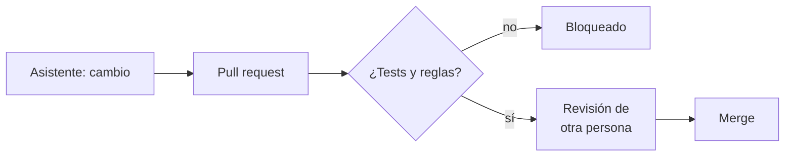

## 1. Resumen

Los asistentes de código escriben funciones, tests y SQL desde un comentario, explican código heredado y, como agentes, abren pull requests. Google lo dice sin rodeos: Gemini Code Assist puede generar salidas que parecen plausibles y son incorrectas, y recomienda validar todo antes de usarlo (*Gemini Code Assist Standard and Enterprise overview*). GitHub incluye la revisión humana antes del merge entre los controles de sus agentes (*Application card: GitHub Copilot Agents*).

Es emergente en sus formas agénticas, y **no reemplaza** la revisión ni la CI (`code-review`, `ci-cd-for-data`): el código generado pasa por las mismas puertas. Los nombres cambian rápido: en AWS, «The Q CLI has become the Kiro CLI» (*Using Amazon Q Developer on the command line*).

## 2. Qué es

- **Completar y generar:** funciones, tests y SQL desde contexto.
- **Explicar:** resumir código o consultas heredadas.
- **Agente:** abre ramas y pull requests a partir de una tarea.
- **Puerta de la CI:** tests, compilación y reglas del repositorio.
- **Revisión ajena:** la aprueba otra persona, no quien pidió el cambio.

## 3. Problema que resuelve

Escribir tests y transformaciones repetitivas consume horas. Un asistente lo acelera, pero también puede proponer un `DROP TABLE` en una migración o un test que no prueba nada. Con la puerta de la CI y la revisión ajena, se gana velocidad sin bajar el estándar.

## 4. Cómo funciona

1. El asistente propone el cambio.
2. La CI corre los tests y la compilación.
3. Reglas del repositorio bloquean SQL destructivo y secretos.
4. Otra persona revisa y aprueba.
5. El cambio se mergea como cualquier otro.

## 5. Cuándo utilizarlo

- Código repetitivo: tests, transformaciones simples, documentación.
- Explicar código heredado antes de modificarlo.
- Con CI y revisión ya establecidas.

## 6. Cuándo no utilizarlo

- Para saltarse la revisión.
- En cambios de permisos o datos productivos sin una persona que entienda el cambio.
- Copiando código sin entenderlo.

## 7. Ejemplo sencillo

| Revisión | Resultado |
|---|---|
| Test del cambio | Ok |
| `migracion.sql` con `DROP TABLE` | Falla: SQL destructivo |
| Aprobación de quien pidió el cambio | Falla: falta otra persona |
| Resultado | No se mergea |

## 8. Ejemplo de producción

Repositorio de transformaciones:

- el asistente en el editor para tests y SQL repetitivo;
- agente que abre pull requests en una rama propia;
- CI con tests, tipado y reglas contra SQL destructivo;
- revisión de otra persona obligatoria;
- en la nube (no ejecutado): Gemini Code Assist, Kiro (antes Amazon Q Developer CLI) o GitHub Copilot.

## 9. Arquitectura



## 10. Código

```python
# Python 3.12, biblioteca estándar (ejecutado en la CI): la puerta de la CI para código escrito con un asistente.
# El cambio propuesto (fijo) trae una función y su test; la puerta corre el test, compila, busca SQL destructivo y
# exige la revisión de una persona distinta del autor. El asistente acelera la escritura; la puerta y la revisión son
# las mismas que para cualquier código.
import re
import subprocess
import sys
import tempfile
from pathlib import Path

CAMBIO = {
    "transform.py": "def normalizar_region(r: str) -> str:\n    return r.strip().lower()\n",
    "test_transform.py": ("from transform import normalizar_region\n\n\ndef test_normaliza() -> None:\n"
                          "    assert normalizar_region(' Norte ') == 'norte'\n"),
    "migracion.sql": "DROP TABLE ventas_historicas;\n",
}
REVISORES = {"autor": "asistente+ana", "aprobado_por": "ana"}


def puerta(workdir: Path) -> list[str]:
    fallas: list[str] = []
    for nombre, texto in CAMBIO.items():
        (workdir / nombre).write_text(texto, encoding="utf-8")
    test = subprocess.run([sys.executable, "-c", "import test_transform as t; t.test_normaliza()"], cwd=workdir,
                          capture_output=True, text=True)
    if test.returncode != 0:
        fallas.append("el test falla")
    for nombre, texto in CAMBIO.items():
        if nombre.endswith(".sql") and re.search(r"\b(DROP|TRUNCATE)\b", texto, re.I):
            fallas.append(f"SQL destructivo en {nombre}")
    if REVISORES["aprobado_por"] in REVISORES["autor"]:
        fallas.append("la aprobación es de quien pidió el cambio; falta otra persona")
    return fallas


fallas = puerta(Path(tempfile.mkdtemp()))
print("test: ok" if "el test falla" not in fallas else "test: falla")
for f in fallas:
    print("FALLA", f)
print("resultado:", "no se mergea" if fallas else "listo para mergear")
```

El script se **ejecuta en la CI** con la biblioteca estándar y pasa `mypy --strict`. Imprime el test en verde, las dos fallas del §7 y `no se mergea`. El cambio propuesto es fijo.

## 11. GCP

En GCP, **Gemini Code Assist**. Según *Gemini Code Assist Standard and Enterprise overview* (no ejecutado):

| | Este concepto | Gemini Code Assist |
|---|---|---|
| Validación | Puerta de la CI | «We recommend that you validate all output from Gemini Code Assist before you use it» |
| Riesgo | Código plausible e incorrecto | «can generate output that seems plausible but is factually incorrect» |

## 12. AWS

En AWS, **Kiro** (antes Amazon Q Developer). Según *Upgrade to Kiro* y *Using Amazon Q Developer on the command line* (no ejecutado):

| | Este concepto | AWS |
|---|---|---|
| Nombre | — | «The Amazon Q Developer CLI has been rebranded to Kiro»; «The Q CLI has become the Kiro CLI» |
| Consola | — | La consola de Kiro es un rebrand de la consola de Amazon Q Developer |

## 13. Azure

En el ecosistema de Microsoft, **GitHub Copilot**. Según *Application card: GitHub Copilot Agents* (no ejecutado):

| | Este concepto | GitHub Copilot |
|---|---|---|
| Agente | Pull request | Copilot cloud agent crea ramas, escribe código y abre pull requests |
| Revisión | Otra persona | «Human review before merge» entre los controles |

## 14. Buenas prácticas

- El código generado pasa por la misma CI.
- Revisión de otra persona, siempre.
- Reglas contra SQL destructivo y secretos en el repositorio.
- **Seguridad:** el asistente no recibe credenciales ni datos productivos en el contexto.
- **Observabilidad:** marcar los cambios generados para medir su tasa de defectos.
- **Costo:** licencias por usuario; medir si el tiempo ahorrado lo justifica (`llm-evaluation`).

## 15. Errores frecuentes

- Mergear lo generado porque «pasó los tests» sin leerlo.
- Tests generados que no prueban el comportamiento.
- Aprobar un cambio propio pedido al asistente.
- Seguir usando un nombre de producto que ya cambió.

## 16. Trade-offs

El asistente acelera la escritura y traslada el esfuerzo a la revisión. Más autonomía (agentes que abren pull requests) da más volumen de cambios que revisar. Es emergente: productos y nombres cambian en meses.

## 17. Conceptos relacionados

- `code-review`: la revisión.
- `ai-assisted-sql-generation`: el control del SQL.
- `ci-cd-for-data`: la puerta.
- `llm-evaluation`: medir el beneficio.

## 18. Preguntas técnicas abiertas

1. ¿Qué parte de tu código es repetitiva?
2. ¿Qué regla de la CI bloquearía un cambio peligroso?
3. ¿Cómo medirías si el asistente ayuda?

## 19. Laboratorio relacionado

Pendiente (F4).

## 20. Fuentes

- Google Cloud: *Gemini Code Assist Standard and Enterprise overview*.
- AWS: *Upgrade to Kiro* y *Using Amazon Q Developer on the command line*.
- GitHub: *Application card: GitHub Copilot Agents*.

El detalle de cada fuente está en `sources` del frontmatter.

## 21. Fecha de última verificación

2026-10-27. `review_required`: pendiente de revisión B-F3.1 del lote F3b-23a.

## 22. Historial de cambios importantes

- 2026-10-27: creación (lote F3b-23a).
