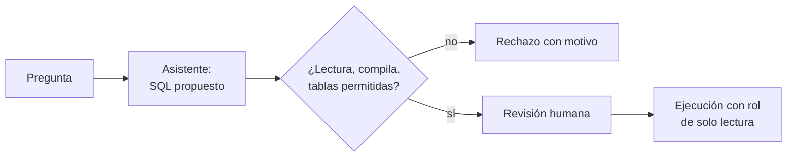

## 1. Resumen

Un asistente traduce una pregunta («ventas por región del último mes») a SQL usando el **esquema**: nombres de tablas, columnas y claves. Copilot en Fabric Data Warehouse lo describe así y aclara que no usa los datos de las tablas (*What is Copilot in the Data Warehouse workload (preview)?*). Las tres nubes lo ofrecen, y las tres piden lo mismo: **revisar** el SQL generado antes de ejecutarlo. AWS advierte que puede tener errores (*Interacting with Amazon Q generative SQL*).

Para un data engineer, la pregunta no es si el asistente acierta, sino **qué deja ejecutar la plataforma**. Antes de correr cualquier SQL generado: una sola sentencia, solo lectura, `EXPLAIN` contra el esquema real, solo tablas permitidas y un `LIMIT`. Eso se valida en código, igual que cualquier SQL que llega a producción (`sql-quality-checks`).

## 2. Qué es

- **Generación de SQL:** desde lenguaje natural más el esquema; en BigQuery, desde comentarios o la herramienta de generación de SQL (*Gemini in BigQuery overview*).
- **Revisión humana:** quien pregunta lee la consulta antes de ejecutarla.
- **Validación de la plataforma:** sentencia única, de lectura, que compila contra el esquema y toca solo tablas permitidas.
- **Transacción de solo lectura:** en PostgreSQL, `READ ONLY` rechaza escrituras y DDL (*SET TRANSACTION*).
- **EXPLAIN:** el plan de la consulta sin ejecutarla; muestra qué tablas lee (*EXPLAIN*).

## 3. Problema que resuelve

Un analista pide «borra los pedidos de prueba» y el asistente devuelve un `DELETE`. Otro pide un cruce con la tabla de clientes y la consulta lee RUTs que no debería. Sin validación, se ejecuta lo que el modelo propuso; con validación, ninguna de las dos llega a correr.

## 4. Cómo funciona

1. El asistente propone la consulta.
2. Se rechaza si tiene más de una sentencia o si no empieza con `SELECT` o `WITH`.
3. Si no tiene `LIMIT`, se envuelve con uno.
4. Se corre `EXPLAIN (FORMAT JSON)` dentro de una transacción `READ ONLY`: si el esquema no calza, falla aquí.
5. Se recorren los nodos del plan: si lee una tabla fuera de la lista permitida, se rechaza.
6. Solo entonces se ejecuta, con un rol de solo lectura.

## 5. Cuándo utilizarlo

- Para que analistas exploren datos sin escribir SQL desde cero.
- Para acelerar consultas exploratorias de quien ya sabe SQL y revisa el resultado.
- Con una lista explícita de tablas que el asistente puede usar.

## 6. Cuándo no utilizarlo

- Para generar SQL de pipelines productivos sin revisión ni tests.
- Para escrituras, DDL o permisos.
- Sobre tablas con datos personales sin control de acceso por usuario.

## 7. Ejemplo sencillo

| Consulta propuesta | Resultado |
|---|---|
| Ventas por región con `LIMIT 10` | Aceptada, con su `LIMIT` |
| `SELECT *` sin `LIMIT` | Aceptada, con `LIMIT 100` agregado |
| `DELETE FROM pedidos …` | Rechazada: no es una consulta de lectura |
| Columna `descuento` | Rechazada: `UndefinedColumn` en `EXPLAIN` |
| Join con `clientes_pii` | Rechazada: tabla no permitida |

## 8. Ejemplo de producción

Un asistente de consultas sobre el warehouse:

- contexto con el esquema y descripciones de las tablas del dominio;
- validación del §10 antes de mostrar la consulta como ejecutable;
- ejecución con un rol de solo lectura y cuota de bytes o tiempo;
- registro de pregunta, consulta, validación y resultado (`llm-observability`, sin datos personales);
- en la nube (no ejecutado): Gemini en BigQuery, Amazon Q generative SQL en Redshift o Copilot en Fabric.

## 9. Arquitectura



## 10. Código

```python
# Python 3.12 y psycopg 3 contra el PostgreSQL de la CI (ejecutado en la CI): validar SQL generado por un modelo antes
# de ejecutarlo. Las consultas son fijas (lo que propuso el asistente); la validación es la que corre en producción:
# una sola sentencia, solo lectura, EXPLAIN contra el esquema real, solo tablas permitidas y un LIMIT obligatorio.
# PG_DSN: base vacía temporal de la CI.
import os
import re
from typing import Any

import psycopg

PERMITIDAS = {"pedidos"}
LIMITE = 100
CANDIDATAS = [
    "SELECT region, sum(monto) AS total FROM pedidos GROUP BY region ORDER BY total DESC LIMIT 10",
    "SELECT * FROM pedidos WHERE monto > 100",
    "DELETE FROM pedidos WHERE region = 'norte'",
    "SELECT region, sum(descuento) FROM pedidos GROUP BY region LIMIT 10",
    "SELECT p.region, c.rut FROM pedidos p JOIN clientes_pii c ON c.id = p.cliente_id LIMIT 10",
]


def tablas_del_plan(nodo: dict[str, Any]) -> set[str]:
    propias = {nodo["Relation Name"]} if "Relation Name" in nodo else set()
    return propias.union(*(tablas_del_plan(h) for h in nodo.get("Plans", [])))


def validar(conn: psycopg.Connection[Any], sql: str) -> tuple[str, str]:
    sql = sql.strip().rstrip(";")
    if ";" in sql:
        return "rechazada", "más de una sentencia"
    if not re.match(r"(?is)^\s*(select|with)\b", sql):
        return "rechazada", "no es una consulta de lectura"
    agregado = not re.search(r"(?i)\blimit\s+\d+\s*$", sql)
    if agregado:
        sql = f"SELECT * FROM ({sql}) AS consulta LIMIT {LIMITE}"
    try:
        with conn.transaction():
            conn.execute("SET TRANSACTION READ ONLY")
            fila = conn.execute(f"EXPLAIN (FORMAT JSON) {sql}").fetchone()
    except psycopg.Error as error:
        return "rechazada", f"{type(error).__name__}: {str(error).splitlines()[0]}"
    assert fila is not None
    fuera = tablas_del_plan(fila[0][0]["Plan"]) - PERMITIDAS
    if fuera:
        return "rechazada", f"tablas no permitidas: {sorted(fuera)}"
    return "aceptada", f"LIMIT {LIMITE} agregado" if agregado else "con su LIMIT"


with psycopg.connect(os.environ["PG_DSN"], autocommit=True) as conn:
    conn.execute("CREATE TABLE pedidos (id int, cliente_id int, region text, monto numeric)")
    conn.execute("CREATE TABLE clientes_pii (id int, rut text)")
    for sql in CANDIDATAS:
        estado, detalle = validar(conn, sql)
        print(f"{estado}: {sql[:48]}… → {detalle[:70]}")
```

El script se **ejecuta en la CI** contra el PostgreSQL de la CI (una base temporal) y pasa `mypy --strict`. Imprime las cinco líneas del §7: dos aceptadas y tres rechazadas, con el motivo. Las consultas son fijas: lo que se muestra es la validación.

## 11. GCP

En GCP, **Gemini en BigQuery**. Según *Gemini in BigQuery overview* (no ejecutado):

| | Este concepto | Gemini en BigQuery |
|---|---|---|
| Entrada | Pregunta y esquema | Comentarios en el código o la herramienta de generación de SQL |
| Validación | La del §10 | La revisión y la ejecución quedan en quien usa la consola |

## 12. AWS

En AWS, **Amazon Q generative SQL** en el query editor v2 de Redshift. Según *Interacting with Amazon Q generative SQL* (no ejecutado):

| | Este concepto | Amazon Q generative SQL |
|---|---|---|
| Entrada | Pregunta y esquema | Preguntas y esquema de la base conectada |
| Errores | Se validan | La página advierte posibles errores y pide revisar antes de ejecutar |
| Contexto | El del dominio | Contexto propio definido por el administrador |

## 13. Azure

En Azure, **Copilot en Fabric Data Warehouse**. Según *What is Copilot in the Data Warehouse workload (preview)?* (no ejecutado):

| | Este concepto | Copilot en Fabric Data Warehouse |
|---|---|---|
| Entrada | Esquema | Nombres de tablas, vistas y columnas, y claves primarias y foráneas |
| Datos | No se envían | No usa los datos de las tablas para generar T-SQL |

## 14. Buenas prácticas

- Validar en código todo SQL generado antes de ejecutarlo.
- Lista explícita de tablas por dominio.
- Rol de solo lectura y cuotas de ejecución.
- Medir el asistente con preguntas y consultas esperadas (`llm-evaluation`).
- **Seguridad:** el control de acceso lo aplica la base con el rol del usuario, no el prompt.
- **Observabilidad:** consultas propuestas, rechazadas por motivo y ejecutadas.
- **Costo:** `LIMIT` y cuotas evitan que una consulta generada recorra tablas enteras.

## 15. Errores frecuentes

- Ejecutar el SQL generado sin validar.
- Confiar en el prompt para impedir escrituras.
- Un rol con permisos de escritura para el asistente.
- No registrar qué consulta se ejecutó a partir de qué pregunta.

## 16. Trade-offs

El asistente acelera la exploración a cambio de consultas que hay que revisar y validar. Más tablas en el contexto dan más alcance y más riesgo de cruces indebidos. Una validación estricta rechaza consultas válidas raras; una laxa deja pasar errores.

## 17. Conceptos relacionados

- `sql-quality-checks`: la calidad del SQL.
- `guardrails`: los controles alrededor del modelo.
- `llm-evaluation`: medir el asistente.
- `tool-calling`: la ejecución como herramienta.
- `llm-observability`: el registro de cada consulta.

## 18. Preguntas técnicas abiertas

1. ¿Qué tablas dejarías consultar a un asistente en tu warehouse?
2. ¿Qué rol ejecutaría las consultas generadas?
3. ¿Cómo medirías si el asistente acierta?

## 19. Laboratorio relacionado

Pendiente (F4).

## 20. Fuentes

- Google Cloud: *Gemini in BigQuery overview*.
- AWS: *Interacting with Amazon Q generative SQL*.
- Microsoft Learn: *What is Copilot in the Data Warehouse workload (preview)?*.
- PostgreSQL 17: *EXPLAIN* y *SET TRANSACTION*.

El detalle de cada fuente está en `sources` del frontmatter.

## 21. Fecha de última verificación

2026-10-26. `review_required`: pendiente de revisión B-F3.1 del lote F3b-21d.

## 22. Historial de cambios importantes

- 2026-10-26: creación (lote F3b-21d).
