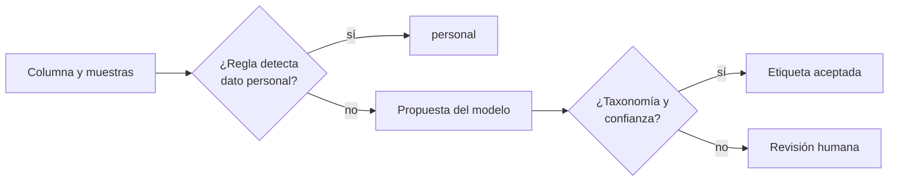

## 1. Resumen

Clasificar miles de columnas a mano no escala, y las reglas solas no ven el contexto: una columna `obs` con texto libre o una `diagnostico` sin un formato fijo. Un modelo puede **proponer** una etiqueta mirando el nombre, la descripción y muestras. La plataforma **decide**: la propuesta solo vale si usa la taxonomía (`data-classification`), las reglas deterministas ganan cuando encuentran un dato personal, y lo dudoso va a revisión humana.

Los servicios de las nubes ya combinan técnicas: Macie usa aprendizaje automático y coincidencia de patrones (*Using managed data identifiers*); Sensitive Data Protection perfila los recursos en forma continua (*Overview of sensitive data discovery*); Purview Data Map clasifica durante el escaneo (*Data classification in Data Map*).

## 2. Qué es

- **Taxonomía cerrada:** `personal`, `sensible` y `no_personal`; cualquier otra etiqueta se rechaza.
- **Regla determinista:** RUT con dígito verificador válido o correo en las muestras: `personal`, sin consultar al modelo (`pii-identification`).
- **Propuesta del modelo:** etiqueta y confianza, con salida estructurada (`structured-outputs`).
- **Umbral:** por debajo, revisión humana.
- **Revisión humana:** el dueño de los datos confirma; la decisión queda registrada.

## 3. Problema que resuelve

Un catálogo de 3 000 tablas tiene la clasificación vacía en la mitad de las columnas. Reglas por nombre fallan con `id_cliente_txt`, que trae RUTs con puntos; un modelo solo clasifica `comuna` como no personal con poca seguridad. La combinación clasifica lo claro y concentra la revisión en lo dudoso.

## 4. Cómo funciona

1. Para cada columna se toman nombre, descripción y una muestra (seudonimizada si corresponde).
2. Las reglas deterministas corren primero: si detectan un dato personal, esa es la etiqueta.
3. El modelo propone etiqueta y confianza con un esquema que solo admite la taxonomía.
4. Etiqueta fuera de la taxonomía o confianza bajo el umbral: revisión.
5. Lo aceptado se escribe en el catálogo con el origen (regla, modelo o persona).

## 5. Cuándo utilizarlo

- Catálogos grandes con clasificación incompleta.
- Columnas de texto libre o nombres poco informativos.
- Como primer paso de una revisión humana, no como su reemplazo.

## 6. Cuándo no utilizarlo

- Como única fuente para datos sensibles: la regla y la revisión siguen siendo necesarias.
- Enviando muestras con datos personales a un modelo externo sin resolver ese flujo.
- Con una taxonomía abierta que el modelo pueda ampliar.

## 7. Ejemplo sencillo

| Columna | Resultado | Por qué |
|---|---|---|
| `id_cliente_txt` | personal | Regla: RUT válido en las muestras (el modelo decía no personal) |
| `diagnostico` | sensible | Modelo, confianza 0.93 |
| `comuna` | revisión | Confianza 0.55 bajo el umbral 0.8 |
| `canal` | no_personal | Modelo, confianza 0.97 |
| `obs` | revisión | «confidencial» no está en la taxonomía |

## 8. Ejemplo de producción

Clasificación inicial del catálogo:

- reglas deterministas de RUT, correo y teléfono sobre muestras;
- propuesta del modelo con salida estructurada y taxonomía cerrada;
- cola de revisión para el dueño de cada dominio;
- el servicio de la nube como segunda señal: Sensitive Data Protection, Macie o Purview (no ejecutado);
- reclasificación cuando cambia el esquema.

## 9. Arquitectura



## 10. Código

```python
# Python 3.12, biblioteca estándar (ejecutado en la CI): clasificar columnas combinando reglas deterministas con la
# propuesta de un modelo. El modelo propone una etiqueta y una confianza por columna (respuestas fijas); la
# aplicación acepta solo etiquetas de la taxonomía, deja que la regla gane si encuentra un dato personal en las
# muestras y manda a revisión humana lo dudoso. La regla del RUT valida el dígito verificador.
import re
from dataclasses import dataclass

TAXONOMIA = {"personal", "sensible", "no_personal"}
UMBRAL = 0.8
RUT = re.compile(r"^(\d{7,8})-([\dkK])$")
CORREO = re.compile(r"^[^@\s]+@[^@\s]+\.[a-z]{2,}$", re.I)


def rut_valido(valor: str) -> bool:
    m = RUT.match(valor.replace(".", ""))
    if not m:
        return False
    suma, factor = 0, 2
    for d in reversed(m.group(1)):
        suma += int(d) * factor
        factor = 2 if factor == 7 else factor + 1
    dv = {10: "K", 11: "0"}.get(11 - suma % 11, str(11 - suma % 11))
    return dv == m.group(2).upper()


@dataclass(frozen=True)
class Columna:
    nombre: str
    muestras: list[str]
    propuesta: tuple[str, float]  # (etiqueta, confianza) que devolvió el modelo


def clasificar(c: Columna) -> tuple[str, str]:
    if any(rut_valido(m) or CORREO.match(m) for m in c.muestras):
        return "personal", "regla (RUT o correo en las muestras)"
    etiqueta, confianza = c.propuesta
    if etiqueta not in TAXONOMIA:
        return "revisión", f"etiqueta fuera de la taxonomía: {etiqueta}"
    if confianza < UMBRAL:
        return "revisión", f"confianza {confianza} < {UMBRAL}"
    return etiqueta, f"modelo ({confianza})"


COLUMNAS = [
    Columna("id_cliente_txt", ["12.345.678-5", "11.111.111-1"], ("no_personal", 0.6)),
    Columna("diagnostico", ["hipertensión", "diabetes"], ("sensible", 0.93)),
    Columna("comuna", ["Maipú", "Ñuñoa"], ("no_personal", 0.55)),
    Columna("canal", ["web", "tienda"], ("no_personal", 0.97)),
    Columna("obs", ["llamar en la tarde"], ("confidencial", 0.9)),
]
for c in COLUMNAS:
    resultado, motivo = clasificar(c)
    print(f"{c.nombre}: {resultado} — {motivo}")
```

El script se **ejecuta en la CI** con la biblioteca estándar y pasa `mypy --strict`. Imprime las cinco líneas del §7. Las propuestas del modelo son fijas; la regla del RUT valida el dígito verificador.

## 11. GCP

En GCP, **Sensitive Data Protection** (discovery). Según *Overview of sensitive data discovery* (no ejecutado):

| | Este concepto | Sensitive Data Protection |
|---|---|---|
| Cuándo | En cada carga del catálogo | Monitoreo continuo de los recursos |
| Resultado | Etiqueta por columna | Perfiles de datos, enviables a Security Command Center y Knowledge Catalog |

## 12. AWS

En AWS, **Amazon Macie**. Según *Using managed data identifiers* (no ejecutado):

| | Este concepto | Amazon Macie |
|---|---|---|
| Técnica | Reglas más modelo | Aprendizaje automático y coincidencia de patrones |
| Alcance | Columnas del catálogo | Objetos de S3 |
| Falsos positivos | Revisión | Algunos identificadores exigen palabras clave cercanas |

## 13. Azure

En Azure, **Microsoft Purview Data Map**. Según *Data classification in Data Map* (no ejecutado):

| | Este concepto | Purview Data Map |
|---|---|---|
| Etiquetas | Taxonomía propia | Clasificaciones lógicas según el contexto de negocio |
| Cuándo | En cada carga | Clasificación automática durante el escaneo |

## 14. Buenas prácticas

- Taxonomía cerrada y versionada.
- Reglas deterministas antes que el modelo para lo que se puede detectar con certeza.
- Umbral de confianza y revisión humana para lo dudoso.
- Registrar el origen de cada etiqueta.
- **Seguridad:** seudonimizar las muestras antes de enviarlas a un modelo externo.
- **Observabilidad:** tasa de revisión por dominio y discrepancias entre regla y modelo.
- **Costo:** clasificar por muestras, no por tablas completas.

## 15. Errores frecuentes

- Dejar que el modelo invente etiquetas.
- Aceptar la propuesta sin umbral.
- Enviar columnas enteras con datos personales al modelo.
- No reclasificar cuando cambia el esquema.

## 16. Trade-offs

El modelo cubre lo que las reglas no ven y se equivoca con seguridad; las reglas son exactas y estrechas. Un umbral alto manda más a revisión y protege; uno bajo ahorra revisión y deja pasar errores.

## 17. Conceptos relacionados

- `data-classification`: la taxonomía.
- `pii-identification`: qué es dato personal.
- `structured-outputs`: la propuesta con esquema.
- `guardrails`: validar la salida.

## 18. Preguntas técnicas abiertas

1. ¿Qué porcentaje de tus columnas no tiene clasificación?
2. ¿Qué umbral de confianza aceptarías para datos sensibles?
3. ¿Quién revisa las propuestas en cada dominio?

## 19. Laboratorio relacionado

Pendiente (F4).

## 20. Fuentes

- Google Cloud: *Overview of sensitive data discovery*.
- AWS: *Using managed data identifiers*.
- Microsoft Learn: *Data classification in Data Map*.

El detalle de cada fuente está en `sources` del frontmatter.

## 21. Fecha de última verificación

2026-10-26. Pasa a `verified`: revisión B-F3.1 del lote F3b-21d sin hallazgos (docs/reviews/cards-f3b-21d.md) y CI en verde (run 40353973732).

## 22. Historial de cambios importantes

- 2026-10-26: creación (lote F3b-21d).
- 2026-10-26: `verification_status: verified` (revisión sin hallazgos; CI en verde, run 40353973732).
