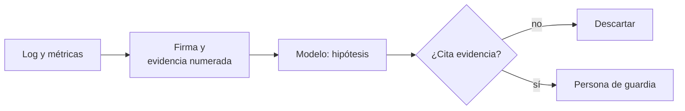

## 1. Resumen

Cuando un job Spark falla a las 3 AM, la persona de guardia lee logs, métricas y configuración hasta encontrar la causa. Las tres nubes ofrecen un asistente que hace esa primera lectura y propone **hipótesis**. Gemini Cloud Assist muestra observaciones e hipótesis con arreglos recomendados (*Investigate workloads with AI-powered Gemini Cloud Assist*, en preview); Glue genera un análisis de causa raíz desde los logs y métricas asociados a la firma del error (*Generative AI troubleshooting for Apache Spark in AWS Glue*); Copilot en Fabric resume el error de un pipeline fallido.

Es emergente: **no reemplaza** el análisis de causa raíz (`root-cause-analysis`) ni decide qué hacer. La plataforma aporta lo determinista: clasificar el error por firma, numerar la evidencia y **descartar** las hipótesis que no se apoyan en ella. La acción la decide una persona.

## 2. Qué es

- **Firma del error:** patrón conocido (memoria, permisos, throttling) que se detecta con reglas sobre el log.
- **Evidencia numerada:** las líneas de advertencia y error, con su número, que el modelo debe citar.
- **Hipótesis:** causa probable con las líneas que la sostienen.
- **Descarte:** una hipótesis que cita líneas que no existen o no son evidencia no se muestra.
- **Diagnóstico, no acción:** el resultado va a la persona de guardia (`incident-response`).

## 3. Problema que resuelve

`ventas_diarias` falla con `ExecutorLostFailure`. El log tiene miles de líneas; la causa (un ejecutor que derrama 38 GiB a disco y se queda sin memoria por sesgo en el join) está en tres. Un modelo puede encontrarlas rápido, y también puede inventar una credencial vencida que no aparece en ninguna parte. Exigir que cite la evidencia deja la primera hipótesis y descarta la segunda.

## 4. Cómo funciona

1. Se toma el log y las métricas de la corrida fallida.
2. Reglas de firma clasifican el error.
3. Se numeran las líneas de evidencia.
4. El modelo propone hipótesis citando líneas; se descartan las que no se apoyan en la evidencia.
5. El diagnóstico llega a la persona de guardia, con el runbook relacionado (`rag-over-technical-docs`).

## 5. Cuándo utilizarlo

- Fallas frecuentes con logs largos (Spark, pipelines con muchas actividades).
- Como primera lectura de guardia, junto a los runbooks.
- Cuando el equipo ya clasifica errores por firma.

## 6. Cuándo no utilizarlo

- Para aplicar arreglos automáticamente: el diagnóstico puede equivocarse y la acción la decide una persona.
- Sin logs completos: la hipótesis se apoya en lo que el modelo no ve.
- Como reemplazo de un postmortem.

## 7. Ejemplo sencillo

| Hipótesis | Resultado |
|---|---|
| Sesgo en la clave del join; un ejecutor sin memoria (líneas 2 y 3) | Se mantiene |
| La credencial del bucket expiró (línea 9) | Se descarta: la línea no existe |
| El clúster se apagó por mantenimiento (línea 5) | Se descarta: no es evidencia |

Categoría por firma: `OUT_OF_MEMORY`. Acción: ninguna automática.

## 8. Ejemplo de producción

Diagnóstico de jobs fallidos:

- firmas de error del equipo como reglas versionadas;
- evidencia numerada desde los logs del job;
- hipótesis del modelo, filtradas por evidencia, en la alerta (`llm-observability` registra la llamada);
- enlace al runbook de la categoría;
- en la nube (no ejecutado): Gemini Cloud Assist en Managed Service for Apache Spark, troubleshooting con IA de Glue o Copilot en Data Factory.

## 9. Arquitectura



## 10. Código

```python
# Python 3.12, biblioteca estándar (ejecutado en la CI): analizar un error de un job con evidencia antes que con
# texto libre. La plataforma clasifica el error por firma (regex sobre el log) y numera las líneas de evidencia; el
# modelo propone hipótesis que deben citar esas líneas (respuestas fijas). Una hipótesis que cita líneas que no
# existen o que no son evidencia se descarta. El resultado es un diagnóstico para la persona de guardia, no una acción.
import re
from dataclasses import dataclass

LOG = """\
2026-10-26 03:10:02 INFO  Stage 4 started: join pedidos x clientes
2026-10-26 03:14:40 WARN  Executor 7: spill to disk 38.2 GiB
2026-10-26 03:15:11 ERROR Executor 7: java.lang.OutOfMemoryError: Java heap space
2026-10-26 03:15:12 ERROR Job ventas_diarias failed: ExecutorLostFailure (executor 7 exited)
2026-10-26 03:15:12 INFO  Shutting down"""

FIRMAS = {
    "OUT_OF_MEMORY": re.compile(r"OutOfMemoryError|ExecutorLostFailure"),
    "PERMISSION": re.compile(r"AccessDenied|Permission denied"),
    "THROTTLING": re.compile(r"SlowDown|Throttl"),
}


@dataclass(frozen=True)
class Hipotesis:
    causa: str
    lineas: tuple[int, ...]  # líneas del log que cita el modelo


HIPOTESIS = [
    Hipotesis("Sesgo en la clave del join: un ejecutor recibe la mayor parte y se queda sin memoria", (2, 3)),
    Hipotesis("La credencial del bucket expiró", (9,)),
    Hipotesis("El clúster se apagó por mantenimiento", (5,)),
]


lineas = LOG.splitlines()
categorias = sorted({c for c, rx in FIRMAS.items() for linea in lineas if rx.search(linea)})
evidencia = {i for i, linea in enumerate(lineas, start=1) if " WARN " in linea or " ERROR " in linea}
print(f"categoría por firma: {categorias}; líneas de evidencia: {sorted(evidencia)}")
for h in HIPOTESIS:
    if set(h.lineas) <= evidencia:
        print(f"se mantiene: {h.causa} (líneas {list(h.lineas)})")
    else:
        print(f"se descarta: {h.causa} (cita líneas sin evidencia: {sorted(set(h.lineas) - evidencia)})")
print("acción: ninguna automática; diagnóstico para la persona de guardia")
```

El script se **ejecuta en la CI** con la biblioteca estándar y pasa `mypy --strict`. Imprime la categoría `OUT_OF_MEMORY`, las líneas de evidencia `[2, 3, 4]`, una hipótesis que se mantiene, dos que se descartan y `acción: ninguna automática`. Las hipótesis son fijas.

## 11. GCP

En GCP, **Gemini Cloud Assist** en Managed Service for Apache Spark, en preview. Según *Investigate workloads with AI-powered Gemini Cloud Assist* (no ejecutado):

| | Este concepto | Gemini Cloud Assist |
|---|---|---|
| Evidencia | Líneas numeradas | Observaciones relevantes desde logs y métricas |
| Hipótesis | Con líneas citadas | Hipótesis de causa raíz con arreglos recomendados |
| Acción | Persona de guardia | Aplicar arreglos y volver a ejecutar, o abrir un caso de soporte |

## 12. AWS

En AWS, el **troubleshooting con IA generativa** de AWS Glue. Según *Generative AI troubleshooting for Apache Spark in AWS Glue* (no ejecutado):

| | Este concepto | Glue |
|---|---|---|
| Entrada | Log de la corrida | Metadata del job, métricas y logs asociados a la firma del error |
| Alcance | Cualquier job | Jobs Spark fallidos en Glue 4.0 o superior |
| Resultado | Hipótesis filtradas | Análisis de causa raíz y recomendaciones en la pestaña Troubleshooting analysis |

## 13. Azure

En Azure, **Copilot en Data Factory** de Microsoft Fabric. Según *Get started with Copilot in Fabric in the Data Factory workload* (no ejecutado):

| | Este concepto | Copilot en Data Factory |
|---|---|---|
| Dónde | La alerta | Página Monitor o edición del pipeline |
| Resultado | Hipótesis con evidencia | Resumen del error, recomendaciones y enlaces de troubleshooting |

## 14. Buenas prácticas

- Firmas de error deterministas antes que el modelo.
- Hipótesis que citan evidencia; descartar las que no.
- Ninguna acción automática desde el diagnóstico.
- **Seguridad:** los logs pueden traer datos personales o secretos; enmascararlos antes de enviarlos (`guardrails`).
- **Observabilidad:** hipótesis mostradas, descartadas y confirmadas por la guardia.
- **Costo:** una llamada por corrida fallida, no por corrida.

## 15. Errores frecuentes

- Mostrar hipótesis sin evidencia.
- Reintentar o cambiar configuración desde la sugerencia, sin revisión.
- Enviar logs sin enmascarar.
- Dar por cerrado el incidente con la hipótesis del modelo.

## 16. Trade-offs

El modelo encuentra rápido la evidencia en logs largos y puede sonar seguro sin serlo; exigir citas reduce ese riesgo y descarta también hipótesis útiles sin línea exacta. Es emergente: Gemini Cloud Assist en Managed Service for Apache Spark está en preview según su página; las funciones de Glue y de Copilot en Data Factory pueden cambiar, aunque sus páginas no las declaran en preview.

## 17. Conceptos relacionados

- `root-cause-analysis`: el análisis que esto no reemplaza.
- `incident-response`: la guardia.
- `rag-over-technical-docs`: los runbooks.
- `ai-anomaly-detection`: el mismo patrón.
- `guardrails` y `llm-observability`: enmascarar y trazar.

## 18. Preguntas técnicas abiertas

1. ¿Qué firmas de error ya reconoce tu equipo?
2. ¿Qué datos sensibles pueden aparecer en tus logs?
3. ¿Cómo medirías si las hipótesis acortan el tiempo de diagnóstico?

## 19. Laboratorio relacionado

Pendiente (F4).

## 20. Fuentes

- Google Cloud: *Investigate workloads with AI-powered Gemini Cloud Assist*.
- AWS: *Generative AI troubleshooting for Apache Spark in AWS Glue*.
- Microsoft Learn: *Get started with Copilot in Fabric in the Data Factory workload*.

El detalle de cada fuente está en `sources` del frontmatter.

## 21. Fecha de última verificación

2026-10-26. Pasa a `verified`: revisión B-F3.1 del lote F3b-21e aplicada (docs/reviews/cards-f3b-21e.md; preview solo en Gemini Cloud Assist) y CI en verde (run 40375774081).

## 22. Historial de cambios importantes

- 2026-10-26: creación (lote F3b-21e).
- 2026-10-26: revisión B-F3.1 aplicada (docs/reviews/cards-f3b-21e.md): el §16 deja «preview» solo para Gemini Cloud Assist, la única de las tres páginas que lo declara.
- 2026-10-26: `verification_status: verified` (revisión aplicada; CI en verde, run 40375774081).
