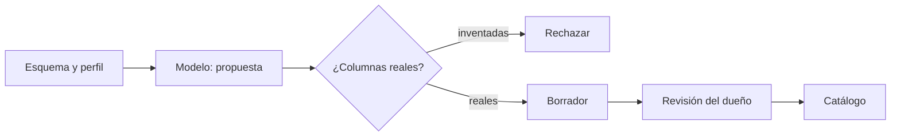

## 1. Resumen

La mitad de las tablas de un catálogo (`data-catalog`) suele no tener descripción. Un modelo puede **proponer** descripciones de tabla y columnas a partir del esquema y de un **perfil** de los datos. Google lo dice con todas las letras: el perfil reduce alucinaciones porque ancla la salida en valores reales (*Generate table insights*). La plataforma valida la propuesta y el **dueño** la aprueba antes de publicarla.

Las nubes lo ofrecen con revisión: SageMaker Unified Studio marca las sugerencias para editar, aceptar o rechazar (*Using machine learning and generative AI…*); BigQuery separa «generar y publicar» de «generar sin publicar». En la application card de Purview Unified Catalog revisada, la IA sugiere activos y reglas de calidad, pero la generación de descripciones de tablas **no lo trata**.

## 2. Qué es

- **Entrada:** esquema (nombres y tipos) y perfil (distintos, nulos, rangos).
- **Propuesta:** descripción de tabla y de cada columna, con salida estructurada (`structured-outputs`).
- **Validación:** solo columnas que existen; las que faltan quedan marcadas.
- **Borrador:** nada se publica sin revisión del dueño.
- **Origen:** cada descripción guarda si la escribió una persona o un modelo, y quién la aprobó.

## 3. Problema que resuelve

Un analista no encuentra qué tabla usar porque ninguna tiene descripción. El equipo de datos no tiene tiempo para escribir 3 000. Con propuestas validadas, el dueño revisa en minutos lo que tomaría horas escribir, y el catálogo deja de estar vacío.

## 4. Cómo funciona

1. Se toma el esquema y un perfil de la tabla.
2. El modelo propone descripciones con un esquema de salida.
3. Se rechazan las columnas que no existen en el esquema real.
4. Se marcan las columnas sin descripción.
5. El borrador va al dueño; lo aprobado se publica en el catálogo con su origen.

## 5. Cuándo utilizarlo

- Catálogos grandes con descripciones vacías.
- Como primer borrador que el dueño corrige.
- Junto con un perfil de datos, que ancla la propuesta.

## 6. Cuándo no utilizarlo

- Publicar sin revisión: una descripción plausible y equivocada es peor que ninguna.
- Para reglas de negocio que solo conoce el dueño: el modelo las inventa.
- Enviando muestras con datos personales a un modelo externo.

## 7. Ejemplo sencillo

| Resultado | Columnas |
|---|---|
| Aceptadas | 4 |
| Inventada y rechazada | `descuento` |
| Sin descripción | `creado` |
| Estado | Borrador: requiere revisión del dueño |

## 8. Ejemplo de producción

Documentación del dominio de ventas:

- esquema y perfil de cada tabla nueva o cambiada;
- propuesta del modelo con salida estructurada;
- validación contra el esquema y cola de revisión del dueño;
- publicación en el catálogo con origen «modelo, aprobado por X»;
- en la nube (no ejecutado): table insights en BigQuery con Knowledge Catalog o descripciones en SageMaker Unified Studio.

## 9. Arquitectura



## 10. Código

```python
# Python 3.12, biblioteca estándar (ejecutado en la CI): documentación generada como borrador validado. El modelo
# recibe el esquema y un perfil de la tabla y propone descripciones (respuesta fija); la aplicación rechaza columnas
# que no existen, marca las que faltan y no publica nada sin revisión del dueño.
import json

ESQUEMA = {"tabla": "silver.pedidos", "columnas": {"id": "INT64", "cliente_id": "INT64", "region": "STRING",
                                                   "monto": "NUMERIC", "creado": "TIMESTAMP"}}
PERFIL = {"region": {"distintos": 5, "nulos": 0}, "monto": {"min": 0, "max": 98000, "nulos": 0.002}}
PROPUESTA = json.loads("""{
  "tabla": "Pedidos confirmados, una fila por pedido.",
  "columnas": {
    "id": "Identificador del pedido.",
    "cliente_id": "Identificador del cliente que hizo el pedido.",
    "region": "Región de despacho; 5 valores distintos.",
    "monto": "Monto total del pedido en pesos.",
    "descuento": "Descuento aplicado al pedido."
  }
}""")  # respuesta fija del "modelo": inventó «descuento» y omitió «creado»


def validar(propuesta: dict[str, object]) -> dict[str, object]:
    propuestas = propuesta["columnas"]
    assert isinstance(propuestas, dict)
    reales = set(ESQUEMA["columnas"])
    inventadas = sorted(set(propuestas) - reales)
    faltantes = sorted(reales - set(propuestas))
    aceptadas = {c: d for c, d in propuestas.items() if c in reales}
    return {"estado": "borrador: requiere revisión del dueño", "aceptadas": len(aceptadas),
            "inventadas_rechazadas": inventadas, "sin_descripcion": faltantes}


print(f"esquema: {len(ESQUEMA['columnas'])} columnas; perfil con {len(PERFIL)} columnas")
print(validar(PROPUESTA))
```

El script se **ejecuta en la CI** con la biblioteca estándar y pasa `mypy --strict`. Imprime el tamaño del esquema y del perfil y el resultado de la validación del §7. La propuesta del modelo es fija.

## 11. GCP

En GCP, **table insights** de BigQuery y **data insights** de Knowledge Catalog (antes Dataplex Universal Catalog). Según *Generate table insights* y *About data insights for structured data* (no ejecutado):

| | Este concepto | BigQuery y Knowledge Catalog |
|---|---|---|
| Publicar | Tras la revisión del dueño | «Generate and publish» guarda en Knowledge Catalog; «Generate without publishing» no publica |
| Anclaje | Perfil de la tabla | Data profile scans contra alucinaciones |
| Además | Descripciones | Grafos de relaciones y consultas SQL |

## 12. AWS

En AWS, **Amazon SageMaker Unified Studio**. Según *Using machine learning and generative AI in Amazon SageMaker Unified Studio* (no ejecutado):

| | Este concepto | SageMaker Unified Studio |
|---|---|---|
| Qué genera | Descripciones | Descripciones, términos de glosario y nombres de negocio |
| Revisión | Del dueño | Editar, aceptar o rechazar cada sugerencia |

## 13. Azure

En Azure, **Microsoft Purview Unified Catalog**. Según *Application card: Microsoft Purview Unified Catalog* (no ejecutado):

| | Este concepto | Purview Unified Catalog |
|---|---|---|
| Descripciones de tablas | Propuestas del modelo | No lo trata la página revisada |
| IA descrita | — | Búsqueda en lenguaje natural, sugerencia de activos y de reglas de calidad (preview), con selección humana |

## 14. Buenas prácticas

- Siempre con perfil de datos y esquema real.
- Validar contra el esquema antes de mostrar el borrador.
- Revisión del dueño y registro del origen.
- **Seguridad:** el perfil se envía como estadísticas, no como filas.
- **Observabilidad:** borradores generados, aprobados y corregidos por dominio.
- **Costo:** documentar tablas nuevas o cambiadas, no todo el catálogo cada vez.

## 15. Errores frecuentes

- Publicar sin revisión.
- Aceptar columnas que no existen.
- Generar sin perfil y obtener descripciones genéricas.
- No registrar que la descripción vino de un modelo.

## 16. Trade-offs

El modelo llena el catálogo rápido con descripciones que hay que revisar; escribirlas a mano es lento y más exacto. Publicar directo ahorra revisión y arriesga errores visibles para todos.

## 17. Conceptos relacionados

- `data-catalog` y `metadata-management`: dónde vive la documentación.
- `structured-outputs`: la propuesta con esquema.
- `llm-evaluation`: medir la calidad.

## 18. Preguntas técnicas abiertas

1. ¿Qué porcentaje de tus tablas tiene descripción?
2. ¿Quién aprobaría las propuestas en cada dominio?
3. ¿Qué perfil de datos enviarías al modelo?

## 19. Laboratorio relacionado

Pendiente (F4).

## 20. Fuentes

- Google Cloud: *Generate table insights* y *About data insights for structured data*.
- AWS: *Using machine learning and generative AI in Amazon SageMaker Unified Studio*.
- Microsoft Learn: *Application card: Microsoft Purview Unified Catalog*.

El detalle de cada fuente está en `sources` del frontmatter.

## 21. Fecha de última verificación

2026-10-26. Pasa a `verified`: revisión B-F3.1 del lote F3b-21d sin hallazgos (docs/reviews/cards-f3b-21d.md) y CI en verde (run 40353973732).

## 22. Historial de cambios importantes

- 2026-10-26: creación (lote F3b-21d).
- 2026-10-26: `verification_status: verified` (revisión sin hallazgos; CI en verde, run 40353973732).
