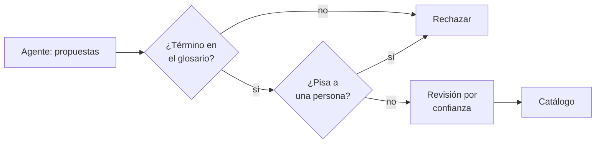

## 1. Resumen

`ai-generated-documentation` propone descripciones cuando alguien lo pide. El paso **emergente** es que un agente lo haga **en forma continua**. Google describe las enrichment tasks como agentes autónomos que analizan esquemas, leen la documentación de la empresa y generan descripciones propuestas; los data stewards solo revisan y aprueban (*About enrichment tasks*, en preview). AWS propone nombres de negocio y términos del glosario; Purview sugiere términos para un dominio de gobierno.

Es emergente y está en preview en Google: **no reemplaza** la gestión de metadata con dueños (`metadata-management`). Lo que la plataforma aporta es el control: términos solo del glosario, nada que pise lo escrito por una persona, revisión con la menor confianza primero y aplicación idempotente.

## 2. Qué es

- **Propuesta continua:** descripción, término del glosario o nombre de negocio para un activo, con confianza.
- **Glosario cerrado:** un término que no existe se rechaza; crear términos es una decisión del dueño.
- **Sin sobrescritura:** lo que escribió una persona no se reemplaza; la página de Google pide revisar las sobrescrituras de atributos en la vista de cambios (*Evaluate and approve enrichment proposals*).
- **Revisión por confianza:** primero las de confianza baja, que Google asocia a contexto faltante o alucinaciones.
- **Aplicación idempotente:** aplicar dos veces lo mismo no cambia nada (`idempotency`).

## 3. Problema que resuelve

Tras integrar una unidad de negocio llegan miles de columnas sin descripción ni términos. Documentarlas a mano no termina nunca, y documentarlas una vez no basta: el esquema cambia. Un agente que propone en forma continua mantiene la cola llena de candidatos; la plataforma evita que una propuesta pise el trabajo del dueño o invente un término.

## 4. Cómo funciona

1. El agente lee esquemas, perfiles y documentación, y propone por activo.
2. Se rechazan términos fuera del glosario.
3. Se rechaza todo lo que pisaría un valor escrito por una persona.
4. El resto entra a la cola de revisión, ordenado por confianza ascendente.
5. Lo aprobado se aplica con su origen; reaplicar no cambia nada.

## 5. Cuándo utilizarlo

- Catálogos grandes que cambian seguido, con dueños que ya revisan.
- Cuando existe un glosario de negocio que acota las propuestas.
- Como experimento acotado a un dominio, con métricas de aprobación.

## 6. Cuándo no utilizarlo

- Con publicación automática: Google permite auto-publish; activarlo quita la revisión.
- Sin glosario ni dueños: el agente llena el catálogo de propuestas que nadie revisa.
- Como reemplazo del trabajo de gobierno de datos.

## 7. Ejemplo sencillo

| Columna | Resultado |
|---|---|
| `id_cliente` | Rechazada: ya tiene descripción de una persona |
| `flag_x` | Rechazada: «pedido de prueba» no está en el glosario |
| `canal` (0.62) | Primera en la cola; el dueño la corrige a mano |
| `monto_neto` (0.91) | Aprobada y aplicada |
| Aplicar otra vez | 0 cambios |

## 8. Ejemplo de producción

Enriquecimiento del dominio de ventas:

- agente sobre el dominio, con el glosario de ventas como límite;
- cola de revisión del dueño con la menor confianza primero;
- métricas de aprobación, corrección y rechazo por semana (`llm-evaluation`);
- publicación en el catálogo con origen «modelo, aprobado por X» (`data-catalog`);
- en la nube (no ejecutado): enrichment tasks de Knowledge Catalog, recomendaciones de SageMaker Unified Studio o términos sugeridos de Purview.

## 9. Arquitectura



## 10. Código

```python
# Python 3.12, biblioteca estándar (ejecutado en la CI): enriquecer metadata con propuestas de un modelo sin perder
# el control. El modelo propone, por columna, una descripción y un término del glosario con su confianza (respuestas
# fijas). La plataforma rechaza términos que no están en el glosario, no pisa lo que escribió una persona, ordena la
# revisión con la menor confianza primero y aplica lo aprobado de forma idempotente.
from dataclasses import dataclass

GLOSARIO = {"venta neta", "cliente", "canal de venta"}


@dataclass(frozen=True)
class Propuesta:
    columna: str
    descripcion: str
    termino: str
    confianza: float


CATALOGO: dict[str, dict[str, str]] = {
    "monto_neto": {},
    "id_cliente": {"descripcion": "Identificador interno del cliente (escrito por el dueño)."},
    "canal": {},
    "flag_x": {},
}

PROPUESTAS = [
    Propuesta("monto_neto", "Monto de la venta después de descuentos e impuestos.", "venta neta", 0.91),
    Propuesta("id_cliente", "Número de cliente.", "cliente", 0.88),
    Propuesta("canal", "Canal por el que entró el pedido.", "canal de venta", 0.62),
    Propuesta("flag_x", "Indica si el pedido es de prueba.", "pedido de prueba", 0.40),
]


def revisar(propuestas: list[Propuesta]) -> tuple[list[Propuesta], list[str]]:
    """Devuelve la cola de revisión (menor confianza primero) y los rechazos automáticos con su motivo."""
    cola, rechazos = [], []
    for p in propuestas:
        if p.termino not in GLOSARIO:
            rechazos.append(f"{p.columna}: término fuera del glosario: {p.termino}")
        elif "descripcion" in CATALOGO[p.columna]:
            rechazos.append(f"{p.columna}: ya tiene descripción de una persona; no se pisa")
        else:
            cola.append(p)
    return sorted(cola, key=lambda p: p.confianza), rechazos


def aplicar(aprobadas: list[Propuesta]) -> int:
    """Escribe lo aprobado con su origen; devuelve cuántas columnas cambiaron (0 si ya estaba aplicado)."""
    cambios = 0
    for p in aprobadas:
        nuevo = {"descripcion": p.descripcion, "termino": p.termino, "origen": "modelo, aprobado por el dueño"}
        if CATALOGO[p.columna] != nuevo:
            CATALOGO[p.columna] = nuevo
            cambios += 1
    return cambios


cola, rechazos = revisar(PROPUESTAS)
for r in rechazos:
    print("rechazada:", r)
print("cola de revisión:", [(p.columna, p.confianza) for p in cola])
aprobadas = [p for p in cola if p.columna != "canal"]  # el dueño corrige «canal» a mano y aprueba el resto
print("aplicadas:", aplicar(aprobadas))
print("aplicadas otra vez:", aplicar(aprobadas))
```

El script se **ejecuta en la CI** con la biblioteca estándar y pasa `mypy --strict`. Imprime los dos rechazos, la cola `[('canal', 0.62), ('monto_neto', 0.91)]`, `aplicadas: 1` y `aplicadas otra vez: 0`. Las propuestas del modelo son fijas.

## 11. GCP

En GCP, **enrichment tasks** de Knowledge Catalog (antes Dataplex Universal Catalog), en preview. Según *About enrichment tasks* y *Evaluate and approve enrichment proposals* (no ejecutado):

| | Este concepto | Enrichment tasks |
|---|---|---|
| Quién propone | Un modelo | Agentes autónomos que leen esquemas y documentación |
| Publicación | Tras revisión | Propuestas por aprobar, salvo auto-publish |
| Revisión | Menor confianza primero | Filtrar por confianza y revisar primero las bajas |
| Estado | — | Preview; Knowledge Studio en gated preview |

## 12. AWS

En AWS, **Amazon SageMaker Unified Studio**. Según *Using machine learning and generative AI in Amazon SageMaker Unified Studio* (no ejecutado):

| | Este concepto | SageMaker Unified Studio |
|---|---|---|
| Qué propone | Descripción y término | Nombres, descripciones y términos del glosario |
| Cuándo | Continuo | «Generate terms» por activo; nombres de negocio automáticos por fuente |
| Alcance | Global | Disponibilidad por región según la función |

## 13. Azure

En Azure, **Microsoft Purview Unified Catalog**. Según *Sample setup for data governance* (no ejecutado):

| | Este concepto | Purview Unified Catalog |
|---|---|---|
| Términos | Del glosario existente | «Get suggested terms» propone términos nuevos desde el nombre y la descripción del dominio |
| Activos | Columnas del catálogo | «Get suggestions» ayuda a elegir activos para un data product |

## 14. Buenas prácticas

- Glosario cerrado y versionado; los términos nuevos los crea el dueño.
- Nada de publicación automática.
- Revisión con la menor confianza primero.
- Origen de cada valor y quién lo aprobó.
- **Seguridad:** el agente lee con un rol de solo metadata; no necesita las filas.
- **Observabilidad:** propuestas, aprobadas, corregidas y rechazadas por dominio.
- **Costo:** acotar el agente a dominios con dueños activos.

## 15. Errores frecuentes

- Activar auto-publish para vaciar la cola.
- Dejar que el agente cree términos del glosario.
- Pisar descripciones escritas por personas.
- Medir solo cuántas propuestas se generan y no cuántas se aprueban.

## 16. Trade-offs

Un agente continuo mantiene la metadata al día a cambio de una cola de revisión permanente. Aceptar más propuestas llena el catálogo antes y arriesga errores que todos leen. Es emergente: la función y sus nombres pueden cambiar.

## 17. Conceptos relacionados

- `metadata-management`: la gestión con dueños.
- `ai-generated-documentation`: el caso consolidado.
- `data-catalog`: dónde se publica.
- `idempotency`: aplicar sin duplicar.
- `llm-evaluation`: medir la tasa de aprobación.

## 18. Preguntas técnicas abiertas

1. ¿Qué dominio tiene un glosario lo bastante completo para acotar las propuestas?
2. ¿Quién revisaría la cola y cuántas propuestas por semana puede revisar?
3. ¿Qué tasa de aprobación justificaría seguir con el agente?

## 19. Laboratorio relacionado

Pendiente (F4).

## 20. Fuentes

- Google Cloud: *About enrichment tasks* y *Evaluate and approve enrichment proposals*.
- AWS: *Using machine learning and generative AI in Amazon SageMaker Unified Studio*.
- Microsoft Learn: *Sample setup for data governance*.

El detalle de cada fuente está en `sources` del frontmatter.

## 21. Fecha de última verificación

2026-10-26. Pasa a `verified`: revisión B-F3.1 del lote F3b-21e sin hallazgos en esta ficha (docs/reviews/cards-f3b-21e.md) y CI en verde (run 40375774081).

## 22. Historial de cambios importantes

- 2026-10-26: creación (lote F3b-21e).
- 2026-10-26: `verification_status: verified` (revisión sin hallazgos en esta ficha; CI en verde, run 40375774081).
