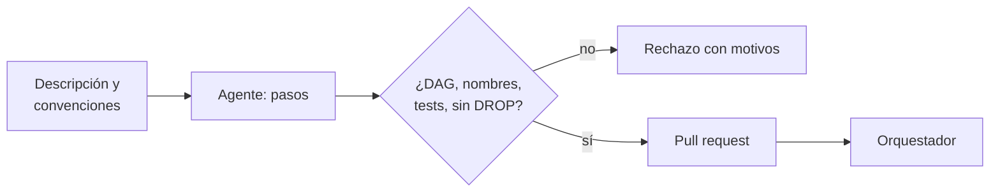

## 1. Resumen

`ai-assisted-sql-generation` propone una consulta. El paso **emergente** es proponer un **pipeline completo**: pasos, SQL, dependencias. El Data Engineering Agent de BigQuery genera un borrador de pipeline con nodos SQLX que se revisan antes de aplicarlo, y la página aclara que el agente **no ejecuta** pipelines (*Use the Data Engineering Agent to build and modify data pipelines*). Amazon Q en Glue genera scripts PySpark para revisar antes de desplegar; Copilot en Fabric genera actividades de un pipeline.

Es emergente: **no reemplaza** el diseño ni la revisión de pipelines (`data-pipeline`). Lo que la plataforma aporta es tratar la propuesta como cualquier código: validar el DAG, las convenciones y los tests, y entrar por pull request (`code-review`).

## 2. Qué es

- **Propuesta estructurada:** pasos con nombre, SQL, dependencias y tests, como JSON o como archivos del repositorio.
- **Validación del DAG:** sin ciclos y sin dependencias que no existen.
- **Convenciones:** prefijos de capa (`stg_`, `int_`, `fct_`, `dim_`) y un test por paso; Google permite fijarlas como instrucciones persistentes del agente.
- **Operaciones prohibidas:** nada de `DROP` ni `TRUNCATE` en una propuesta.
- **Borrador:** el resultado es un pull request; la ejecución la hace el orquestador tras la revisión (`data-orchestration`).

## 3. Problema que resuelve

Un pipeline nuevo de staging a hechos toma un día de código repetitivo. Un agente lo propone en minutos, pero puede depender de una tabla que no existe, crear un ciclo o colar un `DROP TABLE`. Con validación automática, lo que llega al revisor ya compila como DAG y cumple las convenciones; el revisor se concentra en la lógica de negocio.

## 4. Cómo funciona

1. Se describe el pipeline en lenguaje natural, con el contexto del repositorio y las convenciones.
2. El agente devuelve los pasos como estructura.
3. La plataforma valida nombres, tests, operaciones prohibidas, dependencias y ciclos.
4. Si falla, la propuesta se rechaza con todos los motivos.
5. Si pasa, se abre un pull request; tras la revisión, el orquestador lo ejecuta.

## 5. Cuándo utilizarlo

- Pipelines repetitivos con convenciones claras (staging, capas de hechos y dimensiones).
- Equipos con revisión de código y CI ya establecidas.
- Como acelerador de un primer borrador.

## 6. Cuándo no utilizarlo

- Para desplegar sin revisión: BigQuery aclara que el agente no ejecuta pipelines y AWS pide revisar el código antes de desplegarlo.
- Para lógica de negocio compleja o sin especificación.
- Sin CI que valide lo generado.

## 7. Ejemplo sencillo

| Propuesta | Resultado |
|---|---|
| A: `stg_pedidos`, `stg_clientes` → `fct_ventas` | Borrador para pull request, en orden topológico |
| B | Rechazada: paso sin tests, nombre fuera de convención, `DROP`, dependencia inexistente `stg_envios` y ciclo `stg_pedidos → fct_ventas → stg_pedidos` |

## 8. Ejemplo de producción

Generación de pipelines de staging:

- instrucciones persistentes con las convenciones del repositorio;
- validación del §10 como paso de la CI del pull request;
- revisión humana de la lógica y ejecución por el orquestador;
- métricas: propuestas aceptadas sin cambios, con cambios y rechazadas;
- en la nube (no ejecutado): Data Engineering Agent en BigQuery o Dataform, Amazon Q data integration en Glue o Copilot en Data Factory.

## 9. Arquitectura



## 10. Código

```python
# Python 3.12, biblioteca estándar (ejecutado en la CI): validar un pipeline propuesto por un modelo antes de que
# llegue a un pull request. El modelo devuelve los pasos como JSON (respuestas fijas); la plataforma exige un DAG sin
# ciclos y con dependencias que existen, la convención de nombres, un test por paso y nada de DROP ni TRUNCATE. Lo
# aceptado es un borrador para revisar: el validador no despliega ni ejecuta nada.
import json
import re
from graphlib import CycleError, TopologicalSorter

PREFIJOS = ("stg_", "int_", "fct_", "dim_")
PROHIBIDO = re.compile(r"\b(DROP|TRUNCATE)\b", re.I)

PROPUESTA_A = json.loads("""[
  {"nombre": "stg_pedidos", "sql": "SELECT * FROM raw.pedidos", "depende_de": [], "tests": ["not_null(id)"]},
  {"nombre": "stg_clientes", "sql": "SELECT * FROM raw.clientes", "depende_de": [], "tests": ["unique(id)"]},
  {"nombre": "fct_ventas", "sql": "SELECT p.id, c.region, p.monto FROM stg_pedidos p JOIN stg_clientes c USING (id)",
   "depende_de": ["stg_pedidos", "stg_clientes"], "tests": ["not_null(monto)"]}
]""")

PROPUESTA_B = json.loads("""[
  {"nombre": "stg_pedidos", "sql": "SELECT * FROM raw.pedidos", "depende_de": ["fct_ventas"], "tests": []},
  {"nombre": "ventas_tmp", "sql": "DROP TABLE IF EXISTS ventas; SELECT 1", "depende_de": [], "tests": ["x"]},
  {"nombre": "fct_ventas", "sql": "SELECT * FROM stg_pedidos", "depende_de": ["stg_pedidos", "stg_envios"],
   "tests": ["not_null(id)"]}
]""")


def validar(pasos: list[dict[str, object]]) -> list[str]:
    errores: list[str] = []
    nombres = {str(p["nombre"]) for p in pasos}
    grafo: dict[str, list[str]] = {}
    for p in pasos:
        nombre, deps = str(p["nombre"]), [str(d) for d in p["depende_de"]]  # type: ignore[attr-defined]
        if not nombre.startswith(PREFIJOS):
            errores.append(f"{nombre}: no sigue la convención de nombres")
        if not p["tests"]:
            errores.append(f"{nombre}: sin tests")
        if PROHIBIDO.search(str(p["sql"])):
            errores.append(f"{nombre}: DROP o TRUNCATE no permitido")
        errores += [f"{nombre}: depende de un paso inexistente: {d}" for d in deps if d not in nombres]
        grafo[nombre] = [d for d in deps if d in nombres]
    try:
        tuple(TopologicalSorter(grafo).static_order())
    except CycleError as exc:
        errores.append(f"ciclo: {' → '.join(exc.args[1])}")
    return errores


for etiqueta, pasos in (("A", PROPUESTA_A), ("B", PROPUESTA_B)):
    errores = validar(pasos)
    if errores:
        print(f"propuesta {etiqueta}: rechazada")
        for e in errores:
            print("  -", e)
    else:
        orden = list(TopologicalSorter({str(p["nombre"]): p["depende_de"] for p in pasos}).static_order())
        print(f"propuesta {etiqueta}: borrador para pull request, orden {orden}")
```

El script se **ejecuta en la CI** con la biblioteca estándar (`graphlib`) y pasa `mypy --strict`. Imprime el orden de la propuesta A y los cinco motivos de rechazo de la B. Las propuestas son fijas; el validador no despliega ni ejecuta nada.

## 11. GCP

En GCP, el **Data Engineering Agent** de BigQuery. Según *Use the Data Engineering Agent to build and modify data pipelines* (no ejecutado):

| | Este concepto | Data Engineering Agent |
|---|---|---|
| Salida | Pasos como JSON | Borrador con nodos SQLX, en pipelines de BigQuery o Dataform |
| Ejecución | El orquestador, tras la revisión | El agente no ejecuta; hay que revisar y ejecutar o programar |
| Convenciones | Validador en la CI | Instrucciones persistentes (GEMINI.MD) |

## 12. AWS

En AWS, **Amazon Q data integration in AWS Glue**. Según *Amazon Q data integration in AWS Glue* (no ejecutado):

| | Este concepto | Amazon Q en Glue |
|---|---|---|
| Salida | Pasos SQL | Script ETL en PySpark |
| Revisión | Pull request | La página pide revisar el código antes de desplegarlo como job |
| Contexto | Repositorio y convenciones | Cada conversación es independiente |

## 13. Azure

En Azure, **Copilot en Data Factory** de Microsoft Fabric. Según *What is Copilot in Fabric in the Data Factory workload?* (no ejecutado):

| | Este concepto | Copilot en Data Factory |
|---|---|---|
| Salida | Pasos SQL | Actividades del pipeline |
| Errores | Validación automática | La página advierte que son posibles sorpresas y errores |

## 14. Buenas prácticas

- Validar lo generado en la CI, como cualquier código.
- Convenciones escritas y entregadas al agente.
- Revisión humana y ejecución por el orquestador.
- **Seguridad:** el agente no tiene permisos de escritura en producción.
- **Observabilidad:** propuestas aceptadas, corregidas y rechazadas por motivo.
- **Costo:** el pipeline generado pasa por las mismas cuotas y revisiones de costo que uno escrito a mano.

## 15. Errores frecuentes

- Desplegar el borrador directo.
- Aceptar dependencias a tablas que no existen.
- No exigir tests en los pasos generados.
- Dejar que el agente defina convenciones distintas en cada propuesta.

## 16. Trade-offs

Generar acelera el código repetitivo y traslada el esfuerzo a revisar. Más autonomía para el agente ahorra pasos y arriesga cambios que nadie entiende. Es emergente: las funciones y sus límites cambian seguido.

## 17. Conceptos relacionados

- `data-pipeline`: lo que se genera.
- `code-review`: la revisión.
- `ai-assisted-sql-generation`: el caso consolidado.
- `data-orchestration`: la ejecución.
- Pendiente de ficha: `agentic-data-engineering` (dominio 23).

## 18. Preguntas técnicas abiertas

1. ¿Qué pipelines de tu equipo son lo bastante repetitivos para generarlos?
2. ¿Qué convenciones tendrías que escribir para el agente?
3. ¿Qué validación de la CI ya existe y cuál faltaría?

## 19. Laboratorio relacionado

Pendiente (F4).

## 20. Fuentes

- Google Cloud: *Use the Data Engineering Agent to build and modify data pipelines*.
- AWS: *Amazon Q data integration in AWS Glue*.
- Microsoft Learn: *What is Copilot in Fabric in the Data Factory workload?*.

El detalle de cada fuente está en `sources` del frontmatter.

## 21. Fecha de última verificación

2026-10-26. Pasa a `verified`: revisión B-F3.1 del lote F3b-21e sin hallazgos en esta ficha (docs/reviews/cards-f3b-21e.md) y CI en verde (run 40375774081).

## 22. Historial de cambios importantes

- 2026-10-26: creación (lote F3b-21e).
- 2026-10-26: `verification_status: verified` (revisión sin hallazgos en esta ficha; CI en verde, run 40375774081).
