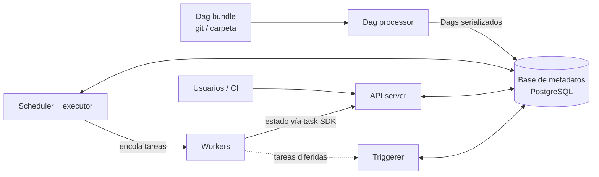

## 1. Resumen

Airflow no es un proceso, sino varios componentes que se coordinan a través de una **base de metadatos**:

- el **scheduler** decide qué ejecutar y lo entrega al **executor**;
- el **Dag processor** lee el código de los Dags;
- el **API server** sirve la interfaz y la API;
- los **workers** y el **triggerer** son opcionales y ejecutan tareas.

Entender la división explica la mayoría de los problemas operativos: Dags que no aparecen, tareas en cola que no arrancan, una base de metadatos que se vuelve cuello de botella. Cloud Composer, MWAA y Fabric administran estos componentes, cada uno con límites distintos.

## 2. Qué es

Es la arquitectura de Apache Airflow, un orquestador open source de workflows definidos como Dags en Python. Esta ficha describe **Airflow 3** (la documentación estable es la 3.3.2 al 2026-10-02). El cambio central frente a Airflow 2: el **API server** es el único punto de acceso a la base de metadatos para tareas y workers (que se comunican con él mediante el **task SDK**), y concentra la REST API y la API de la interfaz. En Airflow 2, los workers se conectaban directamente a la base, lo que generaba un exceso de conexiones y problemas de escala. Los servicios administrados no siempre corren la misma versión mayor, así que la arquitectura concreta depende del servicio.

## 3. Problema que resuelve

Un cron ejecuta comandos, pero no conoce dependencias, reintentos, estados ni historia. Airflow separa responsabilidades:

- decidir **qué** corre y **cuándo** (scheduler);
- entender el **código** de los Dags (Dag processor);
- **ejecutar** (executor y workers);
- **mostrar y controlar** (API server);
- **recordar** el estado (base de metadatos).

Esa separación permite escalar cada parte y aislar el código de los autores de los componentes críticos.

## 4. Cómo funciona

**Componentes requeridos:**

| Componente | Responsabilidad |
|---|---|
| Scheduler | Dispara los Dag runs según su schedule y envía tareas al executor |
| Executor | Propiedad de configuración del scheduler, no un proceso aparte; `LocalExecutor` por defecto |
| Dag processor | Parsea los Dag files del Dag bundle y los guarda serializados en la base de metadatos |
| Dag bundle | Origen de los Dag files (por defecto, una carpeta local) y versión que usan los workers |
| API server | REST API y UI; recibe el estado que reportan las tareas mediante el task SDK |
| Base de metadatos | Estado de Dags, runs, tareas y variables; PostgreSQL o MySQL en producción (SQLite solo para desarrollo) |

**Componentes opcionales:** workers (procesos de Celery o pods de Kubernetes, según el executor), triggerer (tareas diferidas en un event loop asyncio) y plugins.

**Flujo de una tarea:**

1. El Dag processor serializa el Dag en la base.
2. El scheduler crea el Dag run y encola las tareas listas en el executor.
3. Un worker (o el propio scheduler, con `LocalExecutor`) ejecuta la tarea.
4. La tarea informa su estado al API server.
5. Una tarea diferida libera el worker y queda esperando en el triggerer.

**Seguridad por separación:** separar el Dag processor del scheduler hace que el scheduler no acceda a los Dag bundles ni ejecute código escrito por los autores de Dags.

## 5. Cuándo utilizarlo

Este conocimiento es necesario para:

- dimensionar o diagnosticar un entorno (tareas encoladas sin avanzar, Dags que tardan en aparecer, scheduler lento);
- elegir entre Airflow auto-hospedado y un servicio administrado;
- decidir el executor: `LocalExecutor` para una máquina, executors remotos para varias.

## 6. Cuándo no utilizarlo

- Auto-hospedar todos los componentes cuando un servicio administrado cubre las necesidades: la operación de la base de metadatos, las actualizaciones y el escalado es trabajo continuo.
- Asumir que el diagrama de Airflow 3 aplica igual a un servicio administrado: Composer, MWAA y Fabric deciden dónde corre cada componente y qué se puede configurar.

## 7. Ejemplo sencillo

Instalación local mínima: un `airflow standalone` con SQLite y `LocalExecutor`. Las tareas corren dentro del proceso del scheduler. Sirve para aprender y desarrollar Dags. **No** es una arquitectura de producción: SQLite es solo para desarrollo y las tareas compiten por recursos con el scheduler.

## 8. Ejemplo de producción

Un equipo opera Airflow 3 en Kubernetes:

- PostgreSQL administrado como base de metadatos;
- 2 schedulers con `KubernetesExecutor` (un pod por tarea);
- un Dag processor separado que lee los Dags de un bundle versionado en git;
- un API server detrás del balanceador corporativo;
- un triggerer para sensores diferidos.

Se monitorean la latencia del scheduler, las tareas encoladas y las conexiones a la base, y una tarea de mantenimiento purga la historia antigua de la base de metadatos.

## 9. Arquitectura



## 10. Código

```bash
# Airflow 3: cada componente es un proceso que se arranca por separado (aquí, en la misma máquina).
# Requiere: Airflow instalado y una base PostgreSQL accesible.
export AIRFLOW__DATABASE__SQL_ALCHEMY_CONN="postgresql://airflow:CAMBIAR@db:5432/airflow"
export AIRFLOW__CORE__EXECUTOR="LocalExecutor"   # por defecto; para varias máquinas, un executor remoto

airflow db migrate          # crea o actualiza el esquema de la base de metadatos

airflow api-server --port 8080 &   # REST API y UI
airflow scheduler &                # crea Dag runs y encola tareas en el executor
airflow dag-processor &            # parsea los Dag files del bundle
airflow triggerer &                # solo si hay tareas diferidas
wait
```

En producción, la contraseña de la URL viene de un gestor de secretos, no del script. Cada componente corre en su propio servicio o contenedor, de modo que se reinicia y se escala por separado.

## 11. GCP

**Cloud Composer** (la documentación de Gen 3 lo nombra *Managed Airflow*) reparte el entorno entre dos proyectos:

- **proyecto del cliente:** el **bucket del entorno** (DAGs, plugins, dependencias y logs); subir un archivo a `/dags` lo sincroniza con los componentes;
- **tenant project** administrado por Google: todos los componentes de Airflow, incluida la base de metadatos en **Cloud SQL**, a la que solo accede la cuenta de servicio del entorno.

En Gen 3, los DAG processors son componentes separados y la cantidad de workers varía con la cola. El equipo no administra la base ni los procesos, pero tampoco tiene acceso directo a ellos.

## 12. AWS

En **Amazon MWAA**, schedulers y workers corren en contenedores de **Fargate**, y la base de metadatos la administra AWS detrás de un VPC endpoint privado. A diferencia de Composer, el entorno vive en la VPC del cliente: CloudWatch, S3, SQS y KMS deben ser accesibles desde los contenedores. Por eso la red (subredes privadas, endpoints) es parte del diseño. Varios schedulers requieren Airflow v2 o posterior.

## 13. Azure

El **Workflow Orchestration Manager** de Azure Data Factory ya no permite crear instancias nuevas desde el 1 de enero de 2026. Microsoft recomienda migrar a **Apache Airflow jobs en Microsoft Fabric**, presentados como su siguiente generación. Al 2026-10-02, esos jobs soportan Airflow **2.10.5** con Python 3.12: es decir, la arquitectura de Airflow 2, no la de Airflow 3 descrita arriba. No se puede cambiar la versión de un job existente, y las redes privadas y virtuales todavía no están soportadas.

## 14. Buenas prácticas

- PostgreSQL o MySQL como base de metadatos; nunca SQLite fuera de desarrollo.
- Dag processor separado del scheduler, para aislar el código de los autores.
- Dag files livianos al parsear: nada de consultas ni llamadas a APIs a nivel de módulo, porque el Dag processor los ejecuta continuamente.
- Purgar periódicamente la historia antigua de la base de metadatos (`airflow db clean`).
- Elegir el executor según la escala: `LocalExecutor` para una máquina, remoto para varias.
- **Seguridad:** credenciales en un backend de secretos o en las conexiones de Airflow, nunca en los Dag files; restringir quién puede escribir en el Dag bundle, porque eso equivale a ejecutar código en el entorno.
- **Observabilidad:** vigilar los tiempos de parseo del Dag processor, las tareas encoladas sin empezar, la salud del scheduler y del triggerer y el tamaño de la base de metadatos; alertar por Dag runs fallidos o que superan su duración esperada.
- **Costo:** en servicios administrados, el entorno cobra aunque no haya tareas; ajustar el mínimo de workers y apagar entornos de desarrollo ociosos.

## 15. Errores frecuentes

- Código pesado a nivel de módulo en los Dag files: el Dag processor se vuelve lento y los Dags tardan en aparecer.
- `LocalExecutor` en una carga grande: las tareas compiten con el scheduler por CPU y memoria.
- Tratar la base de metadatos como inagotable: crece con cada run y degrada el scheduler.
- Suponer que un servicio administrado corre la última versión de Airflow (Fabric, por ejemplo, ofrece 2.10.5).
- Escribir credenciales en variables de entorno de los Dag files.

## 16. Trade-offs

Auto-hospedar da control total (versión, executor, red) a cambio de operar la base, las actualizaciones y el escalado. Los servicios administrados quitan esa carga, pero imponen versiones, límites de configuración y un costo fijo por entorno. Composer aísla la base en un tenant project; MWAA integra el entorno en la VPC del cliente; Fabric lo integra en su plataforma, con una versión de Airflow 2.

## 17. Conceptos relacionados

- `scheduler`: el concepto general, del que el scheduler de Airflow es una implementación.
- `dag`: lo que el Dag processor serializa.
- `catchup` y `backfill`: cómo el scheduler crea runs pasados.
- Del blueprint, pendientes de ficha: `open-source-vs-managed-orchestration`, `airflow-operators-and-hooks`.

## 18. Preguntas técnicas abiertas

1. Las tareas quedan en estado *queued* durante minutos. ¿Qué componentes revisarías y en qué orden?
2. ¿Qué cambia en tu diseño de Dags si el Dag processor tarda 2 minutos en parsear cada archivo?
3. ¿Qué criterios usarías para elegir entre Composer, MWAA y Airflow auto-hospedado en Kubernetes?

## 19. Laboratorio relacionado

Pendiente (F4).

## 20. Fuentes

- Apache Airflow: *Architecture Overview*, *Executor*, *Set up a Database Backend*, *Command Line Interface and Environment Variables Reference*, *Upgrading to Airflow 3* y *Best Practices*.
- Google Cloud: *Environment architecture* (Cloud Composer 3).
- AWS: *What is Amazon MWAA?*
- Microsoft Learn: *What is Workflow Orchestration Manager?* y *Apache Airflow jobs concepts* (Fabric).

El detalle de cada fuente está en `sources` del frontmatter.

## 21. Fecha de última verificación

2026-10-04. Pasa a `verified`: revisión B-F3.1 del lote 5 aplicada, sin VERIFY pendientes.

## 22. Historial de cambios importantes

- 2026-10-02: creación (lote 5 de F3).
- 2026-10-04: revisión B-F3.1 del lote 5 aplicada (docs/reviews/cards-lote5.md): viñeta de Observabilidad en §14.
- 2026-10-04: `verification_status: verified` (revisión B-F3.1 del lote 5 aplicada; sin VERIFY pendientes).
