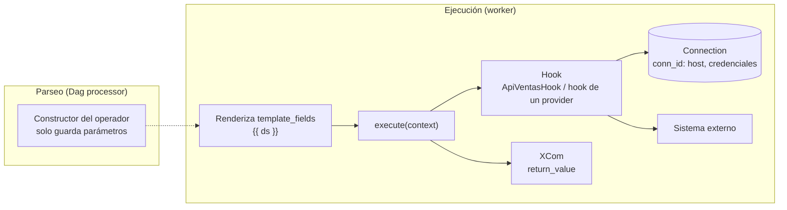

## 1. Resumen

En Airflow, cada tarea que habla con otro sistema se arma con dos piezas:

- **Operador:** plantilla de tarea (*qué* hacer). Hay del núcleo, como `BashOperator`, y de *providers*, como `SQLExecuteQueryOperator`.
- **Hook:** interfaz con un sistema externo (*cómo* hablar con él). Toma host y credenciales de una **Connection**, identificada por su `conn_id`.

Cuando no hay operador para un caso, se escribe uno propio: se extiende `BaseOperator`, se guardan los parámetros en el constructor y el trabajo va en `execute`. La regla clave de la documentación es crear el hook **en `execute`**, nunca en el constructor, porque el constructor corre cada vez que se parsea el Dag.

## 2. Qué es

- **Operador:** plantilla predefinida de tarea. Del núcleo, `BashOperator` y `PythonOperator`. Los providers (paquetes aparte) agregan muchos más, por ejemplo para SQL, HTTP, Docker o Slack.
- **`@task`:** el equivalente TaskFlow de `PythonOperator`. No renderiza plantillas Jinja en sus argumentos.
- **Connection:** parámetros y credenciales de un sistema (usuario, contraseña, host) con un nombre único, el `conn_id`. Se administra por la UI, la CLI o un backend de secretos.
- **Hook:** interfaz de alto nivel con un sistema externo, construida sobre una Connection. Muchos tienen un `conn_id` por defecto; `PostgresHook`, por ejemplo, busca `postgres_default`. En el Task SDK, `BaseHook` es la clase base, con `get_conn()` abstracto y `get_connection(conn_id)`.
- **Operador propio:** subclase de `BaseOperator` con dos partes:
  - el constructor, con los parámetros propios;
  - `execute(context)`, con el trabajo; su valor de retorno queda en XCom.
- **`template_fields`:** los atributos que Jinja renderiza antes de `execute`, como una fecha `{{ ds }}`.

## 3. Problema que resuelve

Sin operadores ni hooks, cada Dag repetiría el código para conectarse a cada sistema, con credenciales copiadas en el código. Con ellos:

- la conexión a un sistema se escribe una vez (hook) y se reutiliza en varios operadores;
- las credenciales viven en una Connection o un gestor de secretos, no en el Dag;
- el Dag queda declarativo: qué tareas hay y con qué parámetros.

## 4. Cómo funciona

1. El Dag processor parsea el Dag file y llama al **constructor** de cada operador. Por eso el constructor solo guarda parámetros: corre en cada parseo.
2. Al ejecutar la tarea en un worker, Airflow renderiza los `template_fields` con Jinja y llama a `execute(context)`.
3. Dentro de `execute`, el operador crea el hook con su `conn_id`. El hook pide la Connection a Airflow y abre la conexión.
4. Lo que devuelve `execute` queda en XCom (`return_value`).
5. Si `execute` lanza una excepción, la tarea falla y aplican sus reintentos.

## 5. Cuándo utilizarlo

- **Operador de un provider:** cuando ya existe uno para el sistema y la operación.
- **Hook dentro de `@task`:** cuando la lógica es propia, pero la conexión es estándar.
- **Operador propio:** cuando la misma operación se repite en muchos Dags o equipos y conviene un componente con parámetros claros.
- **Hook propio:** cuando un sistema interno no tiene hook y varios operadores lo necesitan.

## 6. Cuándo no utilizarlo

- No escribir un operador propio para una lógica que se usa una vez: basta una función `@task`.
- No abrir conexiones, leer archivos ni llamar APIs en el constructor de un operador ni en el nivel superior del Dag file.
- No guardar en el hook estado de una operación (como un id de job); la documentación lo ubica en el operador.

## 7. Ejemplo sencillo

`SQLExecuteQueryOperator(task_id="registrar_carga", conn_id="almacen", sql=[...])`:

- el operador del provider `common.sql` ejecuta las sentencias;
- la Connection `almacen` define a qué base se conecta y con qué credenciales;
- el Dag no contiene ni host ni contraseña.

## 8. Ejemplo de producción

Varios equipos exportan datos de la API de ventas interna. En vez de repetir el código en cada Dag, la plataforma publica dos piezas:

- **`ApiVentasHook`:** obtiene host y credenciales de la Connection `api_ventas`;
- **`ExportarVentasOperator`:** recibe `conn_id` y `fecha` (un `template_field`, para usar `{{ ds }}`), crea el hook en `execute` y devuelve la ruta exportada.

Después, `SQLExecuteQueryOperator` registra la carga en una tabla de control. Borra y vuelve a insertar la fila del día, así un reintento no la duplica. Los equipos usan el operador con parámetros, sin tocar el código de conexión.

## 9. Arquitectura



## 10. Código

```python
# Airflow 3.3.2 (cargado en la CI con DagBag, sin errores de import; las tareas no se ejecutan): un operador de un
# provider, un hook propio y un operador propio que lo usa. El hook se crea en execute, no en el constructor:
# el constructor corre cada vez que se parsea el Dag.
import datetime
from collections.abc import Sequence
from typing import Any

from airflow.providers.common.sql.operators.sql import SQLExecuteQueryOperator
from airflow.sdk import DAG, BaseHook, BaseOperator


class ApiVentasHook(BaseHook):
    """Interfaz con la API de ventas; host y credenciales salen de una Connection, no del código."""

    def __init__(self, conn_id: str) -> None:
        super().__init__()
        self.conn_id = conn_id

    def get_conn(self) -> str:
        conexion = self.get_connection(self.conn_id)
        return f"https://{conexion.host}"


class ExportarVentasOperator(BaseOperator):
    """Operador propio: qué hacer (exportar un día) sobre el hook que sabe cómo hablar con la API."""

    template_fields: Sequence[str] = ("fecha",)      # se renderiza con Jinja antes de execute

    def __init__(self, *, conn_id: str, fecha: str, **kwargs: Any) -> None:
        super().__init__(**kwargs)
        self.conn_id = conn_id                       # solo guardar parámetros: nada costoso aquí
        self.fecha = fecha

    def execute(self, context: Any) -> str:
        base = ApiVentasHook(self.conn_id).get_conn()   # el hook se crea al ejecutar
        destino = f"crudo/ventas/fecha={self.fecha}"
        self.log.info("exportando %s/ventas?fecha=%s hacia %s", base, self.fecha, destino)
        return destino                               # el valor de retorno queda en XCom (return_value)


with DAG(
    dag_id="exportar_ventas",
    start_date=datetime.datetime(2026, 10, 1),
    schedule="@daily",
    catchup=False,
):
    exportar = ExportarVentasOperator(task_id="exportar", conn_id="api_ventas", fecha="{{ ds }}")
    # Operador del provider common.sql: la Connection "almacen" define a qué base se conecta. Borra y vuelve a
    # insertar la fila del día, así un reintento no la duplica.
    registrar = SQLExecuteQueryOperator(
        task_id="registrar_carga",
        conn_id="almacen",
        sql=[
            "DELETE FROM control.cargas WHERE fecha = '{{ ds }}'",
            "INSERT INTO control.cargas (fecha, estado) VALUES ('{{ ds }}', 'exportado')",
        ],
    )
    exportar >> registrar
```

Este Dag es de **Airflow 3.3.2**. La CI lo carga con `DagBag` en cada push (`make check-airflow-dag`, entorno aparte con la versión fijada). La prueba verifica:

- que no haya errores de import;
- la clase del operador propio, su `template_fields` y su `conn_id`;
- que `registrar_carga` sea un `SQLExecuteQueryOperator` y dependa de `exportar`.

Las tareas no se ejecutan: no existen la API de ventas ni las Connections `api_ventas` y `almacen`, ni la tabla `control.cargas`. El Dag no se cargó en local.

En un proyecto real, el hook y el operador viven en un módulo o plugin aparte, y el Dag los importa.

## 11. GCP

**Managed Service for Apache Airflow.** Según su página de introducción, se pueden instalar plugins propios (operadores, hooks, sensores) y dependencias de Python desde PyPI o un repositorio privado, como Artifact Registry. Algunas opciones de configuración de Airflow están bloqueadas. La página que compara Workflows con Managed Airflow cuenta más de 150 operadores solo para Google Cloud.

## 12. AWS

**Amazon MWAA.** Su documentación menciona integraciones open source con servicios de AWS como Athena, Batch, EMR o EKS. Según la misma página, los workers de Airflow asumen políticas de IAM para acceder a los servicios de AWS.

## 13. Azure

**Apache Airflow job (Fabric).** En su tabla de funciones, instalar un paquete privado como requisito y usar Azure Key Vault como backend figuran como disponibles: permiten llevar paquetes propios (por ejemplo, con hooks y operadores) y guardar secretos fuera del código.

## 14. Buenas prácticas

- Primero un operador existente de un provider; después un hook dentro de `@task`; al final, un operador propio.
- Constructor sin efectos: solo guardar parámetros.
- Hook creado en `execute`.
- `template_fields` para lo que cambia por corrida (fechas, rutas).
- Operadores propios idempotentes y con pruebas, en un paquete versionado.
- **Seguridad:** credenciales en Connections respaldadas por un gestor de secretos, nunca en el Dag ni en los argumentos del operador; en la nube, identidades del servicio (IAM) en lugar de claves fijas.
- **Observabilidad:** el operador escribe con `self.log` lo que hizo y contra qué recurso, sin imprimir secretos.
- **Costo:** un constructor costoso se paga cada vez que se parsea cada Dag que usa el operador; con muchos Dags, ese trabajo se repite sin parar.

## 15. Errores frecuentes

- Crear el hook o abrir una conexión en el constructor.
- Credenciales en el código del Dag o en `default_args`.
- Un operador propio para algo que hacía un operador existente.
- Olvidar `template_fields` y recibir el texto `{{ ds }}` sin renderizar.
- Operadores que agregan filas y duplican datos al reintentarse.

## 16. Trade-offs

Los operadores de providers ahorran código y siguen buenas prácticas, a cambio de depender de lo que exponen y de su versión. Un operador propio da control y reutilización, pero hay que mantenerlo, probarlo y distribuirlo en cada entorno (plugins o paquetes). Una función `@task` con un hook es lo más flexible, aunque cada Dag repite algo de lógica.

## 17. Conceptos relacionados

- `orchestration-task`: tipos de tarea y estados.
- `airflow-architecture`: Dag processor y workers.
- `sensors`: operadores que esperan.
- `open-source-vs-managed-orchestration`: cómo se instalan plugins y paquetes en cada servicio.

## 18. Preguntas técnicas abiertas

1. ¿Qué código de conexión se repite en tus Dags y podría ser un hook?
2. ¿Hay operadores en tu entorno que hacen trabajo en el constructor?
3. ¿Dónde viven hoy las credenciales que usan tus tareas?

## 19. Laboratorio relacionado

Pendiente (F4).

## 20. Fuentes

- Apache Airflow 3.3.2: *Operators*, *Connections & Hooks* y *Creating a custom Operator*; Task SDK 1.3.2: `BaseHook`.
- Provider common.sql 2.1.1: *SQL Operators*.
- Google Cloud: *Managed Airflow overview* y *Choose Workflows or Managed Airflow*.
- AWS: *What Is Amazon Managed Workflows for Apache Airflow?*
- Microsoft Learn: *What is an Apache Airflow job?* (Fabric).

El detalle de cada fuente está en `sources` del frontmatter.

## 21. Fecha de última verificación

2026-10-11. Pasa a `verified`: revisión B-F3.1 del lote F3b-06a aplicada, sin VERIFY pendientes.

## 22. Historial de cambios importantes

- 2026-10-11: creación (lote F3b-06a).
- 2026-10-11: revisión B-F3.1 del lote F3b-06a aplicada (docs/reviews/cards-f3b-06a.md): filas aprobadas sin cambios en esta ficha.
- 2026-10-11: `verification_status: verified` (sin VERIFY pendientes).
