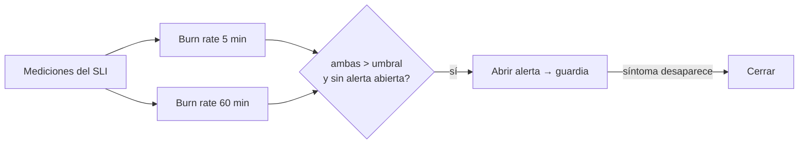

## 1. Resumen

Una **alerta** pide la atención de una persona. Por eso conviene que avise de **síntomas que afectan al consumidor**, no de cada causa posible: «la tabla `pedidos` está consumiendo su error budget de frescura diez veces más rápido de lo permitido» y no «la CPU del worker pasó el 80 %».

Tres reglas de diseño:

- **por síntoma**, ligado a un SLO (`data-slo`), con **burn rate** (*Alerting on your burn rate*);
- **dos ventanas**, una corta y una larga, para que un pico breve no dispare;
- **una alerta abierta por problema**, que no vuelve a disparar hasta que se resuelve (las alertas stateful de Azure Monitor funcionan así, *What are Azure Monitor alerts?*).

## 2. Qué es

- **Regla de alerta:** condición sobre una métrica o un log.
- **Síntoma:** lo que ve el consumidor (atraso, datos faltantes).
- **Burn rate:** velocidad de consumo del error budget; 1 es el ritmo que lo agota justo al final del período.
- **Estados:** abierta, reconocida (acknowledged), cerrada.
- **Destino:** quién recibe la alerta y por qué canal (en Azure, action groups).

## 3. Problema que resuelve

Un equipo recibe 200 alertas por semana: CPU, memoria, reintentos, cada tarea fallida. Las silencia todas, y el día que la tabla de finanzas se atrasa cuatro horas nadie se entera. Con alertas por síntoma y burn rate, recibe pocas alertas y cada una significa que un consumidor está afectado.

## 4. Cómo funciona

1. Cada pocos minutos se calcula el burn rate en dos ventanas (aquí, 5 y 60 minutos).
2. Si las dos superan el umbral y no hay una alerta abierta, se abre una.
3. Mientras está abierta, no se abren otras por el mismo problema.
4. Cuando el síntoma desaparece en la ventana corta, se cierra.
5. La alerta abre la respuesta a un incidente (`incident-response`).

El umbral (aquí, 10) y las ventanas son decisiones del equipo según su SLO.

## 5. Cuándo utilizarlo

- Para síntomas con un SLO detrás.
- Para fallas que requieren acción humana pronto.
- Con un destino claro (la guardia, un canal).

## 6. Cuándo no utilizarlo

- Para causas que no afectan al consumidor: van a un tablero.
- Para información que nadie va a actuar: va a un reporte.
- Con una sola ventana corta: alerta por cualquier pico.

## 7. Ejemplo sencillo

Ocho horas de mediciones por minuto, con un pico de 6 minutos (min 100) y un problema sostenido de 90 minutos (min 300):

| Minuto | Evento |
|---|---|
| 100–106 | Pico: burn rate alto en 5 min, bajo en 60 min → no alerta |
| 310 | ABRE alerta (burn 5 min 100, 60 min 17) |
| 395 | Cierra alerta |

Una sola alerta en total.

## 8. Ejemplo de producción

- Un SLO de frescura por tabla crítica.
- Dos reglas por SLO: burn rate alto en ventanas cortas (urgente, a la guardia) y moderado en ventanas largas (a un canal, para el día siguiente).
- Alertas stateful: una por problema, con su estado.
- Cada alerta trae enlace al tablero, a los logs de la corrida y al runbook.

## 9. Arquitectura



## 10. Código

```python
"""Alertar por síntoma con burn rate en dos ventanas, y no abrir una alerta nueva mientras la anterior sigue abierta."""
SLO = 0.99
# Por minuto: 1 si la tabla estaba atrasada en ese minuto. Un pico de 6 minutos y un problema sostenido de 90.
MALOS = set(range(100, 106)) | set(range(300, 390))
UMBRAL = 10.0   # burn rate a partir del cual se alerta (decisión del equipo)


def burn(fin: int, ventana: int) -> float:
    errores = sum(fin - ventana <= m < fin for m in MALOS)
    return (errores / ventana) / (1 - SLO)


abierta, eventos = False, []
for minuto in range(0, 480, 5):                           # se evalúa cada 5 minutos
    corta, larga = burn(minuto, 5), burn(minuto, 60)
    if not abierta and corta > UMBRAL and larga > UMBRAL:  # las dos ventanas: un pico breve no alcanza
        abierta = True
        eventos.append(f"min {minuto}: ABRE alerta (burn 5 min {corta:.0f}, 60 min {larga:.0f})")
    elif abierta and corta == 0:                           # se cierra cuando el síntoma desaparece
        abierta = False
        eventos.append(f"min {minuto}: cierra alerta")
print("\n".join(eventos))
print(f"alertas abiertas en total: {sum('ABRE' in e for e in eventos)}")
```

El script se **ejecuta en la CI** y pasa `mypy --strict`. Imprime `min 310: ABRE alerta (burn 5 min 100, 60 min 17)`, `min 395: cierra alerta` y `alertas abiertas en total: 1`: el pico del minuto 100 no alerta porque la ventana de 60 minutos no supera el umbral.

## 11. GCP

En GCP, **Cloud Monitoring**. Según *Alerting on your burn rate* y *Alerts for metric-based alerting policies* (no ejecutado):

| | Alerta por burn rate (este concepto) | Cloud Monitoring |
|---|---|---|
| Burn rate | Calculado en dos ventanas | Políticas sobre el burn rate de un SLO; el lookback es también el período de cumplimiento |
| Estados | Abierta y cerrada | Abierta, Acknowledged y Closed (también se cierra sola a los 7 días sin observar la condición) |

## 12. AWS

En AWS, **CloudWatch alarms**. Según *Alerting on your burn rate* y *Using Amazon CloudWatch alarms* (no ejecutado):

| | Dos ventanas (este concepto) | CloudWatch |
|---|---|---|
| Combinar condiciones | Las dos ventanas deben superar el umbral | Alarma compuesta: pasa a ALARM solo si se cumplen todas las condiciones de su regla |
| Ruido | Evita alertar por picos breves | La página dice que las alarmas compuestas pueden reducir el ruido |

## 13. Azure

En Azure, **Azure Monitor alerts**. Según *What are Azure Monitor alerts?* y *Action groups* (no ejecutado):

| | Una alerta por problema (este concepto) | Azure Monitor |
|---|---|---|
| Repetición | No se abre otra mientras está abierta | Alertas stateful: no vuelven a disparar hasta que la condición se resuelve; las stateless disparan cada vez |
| A quién avisar | Destino configurado | Action groups: voz, SMS, push, correo, y acciones como webhook, Azure Function o Logic Apps |
| Respuesta | Reconocer y cerrar | New, Acknowledged o Closed |

## 14. Buenas prácticas

- Alertar por síntomas ligados a un SLO.
- Dos ventanas para las alertas urgentes.
- Cada alerta con dueño, canal y runbook.
- Revisar cada mes las alertas que nadie actuó.
- **Seguridad:** las alertas no deben llevar datos sensibles en el texto; enlazan a donde están protegidos.
- **Observabilidad:** guardar cuándo se abrió, reconoció y cerró cada alerta.
- **Costo:** cada alerta interrumpe a una persona; menos alertas y más precisas cuestan menos que muchas ignoradas.

## 15. Errores frecuentes

- Alertar por causas (CPU, memoria) que no afectan al consumidor.
- Una alerta por cada tarea fallida.
- Alertas sin dueño.
- Un umbral copiado sin relación con el SLO.

## 16. Trade-offs

Umbrales sensibles detectan antes y despiertan más gente por nada. Ventanas largas reducen el ruido y avisan más tarde. Pocas alertas por síntoma pueden dejar pasar causas que más tarde darán síntomas; un tablero de causas complementa.

## 17. Conceptos relacionados

- `data-slo`: el SLO y su budget.
- `incident-response`: qué pasa después de la alerta.
- `pipeline-health`: salud de pipelines.
- `volume-anomalies`: otra señal.

## 18. Preguntas técnicas abiertas

1. ¿Cuántas alertas recibió tu equipo la semana pasada y cuántas requirieron acción?
2. ¿Cuáles de tus alertas son síntomas y cuáles causas?
3. ¿Cada alerta tiene un runbook?

## 19. Laboratorio relacionado

Pendiente (F4).

## 20. Fuentes

- Google Cloud: *Alerting on your burn rate* y *Alerts for metric-based alerting policies*.
- Google, *Site Reliability Engineering*: *Embracing Risk*.
- AWS: *Using Amazon CloudWatch alarms*.
- Microsoft Learn: *What are Azure Monitor alerts?* y *Action groups*.

El detalle de cada fuente está en `sources` del frontmatter.

## 21. Fecha de última verificación

2026-10-20. `review_required`: pendiente de revisión B-F3.1 del lote F3b-16b.

## 22. Historial de cambios importantes

- 2026-10-20: creación (lote F3b-16b).
