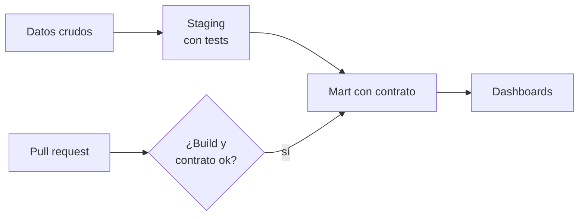

## 1. Resumen

Analytics engineering es construir los **modelos analíticos como software**. Los datos ya están en el warehouse (`etl-vs-elt`); el trabajo es transformarlos en capas versionadas en un repositorio, probarlos en cada capa, documentarlos y proteger lo que consumen los dashboards con un **contrato**. dbt lo describe así: modelos mantenibles que, al construirse, dejan lineage, tests, contratos y métricas (*What is dbt?*).

La diferencia con escribir consultas sueltas es la disciplina de ingeniería: revisión de código, tests automáticos, ambientes y despliegue. Las herramientas cambian (dbt, Dataform); la práctica es la misma.

## 2. Qué es

- **Capas:** staging (limpieza 1:1 de la fuente) y marts (modelos para un uso, a menudo en estrella; `star-schema`).
- **Dependencias explícitas:** cada modelo declara de quién depende (`ref()` en dbt); el grafo define el orden (`dbt-core-concepts`).
- **Tests por capa:** unicidad, no nulos y relaciones entre modelos.
- **Contrato aplicado:** el mart declara columnas y tipos; si el SQL no los produce, el build falla (`data-contracts`).
- **Documentación:** descripciones junto al código, publicadas con el lineage.

## 3. Problema que resuelve

El dashboard comercial lee `ventas_por_region`. Alguien simplifica el SQL y quita la columna `pedidos`; el dashboard se rompe el lunes y nadie sabe por qué. Con un contrato aplicado en el mart, el cambio falla en el build del pull request, antes de llegar a producción.

## 4. Cómo funciona

1. Staging limpia cada fuente, con tests de unicidad y no nulos.
2. Los marts combinan staging y se materializan como tablas.
3. El mart que consumen los dashboards declara su contrato: nombres y tipos de columnas.
4. `dbt build` corre seeds, modelos y tests en orden; un test o un contrato que falla detiene lo que depende de él.
5. La CI corre el build en cada pull request (`ci-cd-for-data`).

## 5. Cuándo utilizarlo

- Transformaciones en SQL dentro de un warehouse.
- Modelos consumidos por varios dashboards o equipos.
- Equipos que ya trabajan con Git y revisión de código.

## 6. Cuándo no utilizarlo

- Transformaciones que no son SQL o que no corren en el warehouse (streaming de baja latencia, procesamiento de archivos binarios).
- Un análisis exploratorio de una vez: no necesita capas ni contrato.

## 7. Ejemplo sencillo

| Versión | Cambio | Resultado del build |
|---|---|---|
| v1 | Staging y mart con contrato | 10 nodos ok, 5 tests |
| v2 | El mart deja de producir `pedidos` | Falla: contrato roto en `ventas_por_region` |

## 8. Ejemplo de producción

Dominio comercial:

- staging por fuente (CRM, pedidos) con tests;
- marts en estrella para ventas y clientes (`star-schema`), con contrato en los que leen los dashboards;
- descripciones de columnas junto al código;
- `dbt build` en cada pull request y en el despliegue (`ci-cd-for-data`);
- métricas sobre el modelo semántico (`semantic-models`);
- en la nube (no ejecutado): Dataform en BigQuery, dbt orquestado desde Amazon MWAA o dbt jobs en Fabric.

## 9. Arquitectura



## 10. Código

```python
# Python 3.12, dbt Core 1.12 y dbt-postgres 1.11 contra PostgreSQL 17 (ejecutado en la CI con el servicio postgres:17;
# ADR-018): analytics engineering como software. Capas staging → marts, tests en cada capa y un contrato aplicado en
# el mart que consumen los dashboards. Un cambio que rompe el contrato (quitar una columna) falla en el build, antes
# de llegar a los consumidores. PG_HOST, PG_PORT, PG_USER, PG_PASSWORD y PG_DB apuntan a una base vacía de la CI.
from __future__ import annotations

import sys
import tempfile
from pathlib import Path

from dbt.artifacts.schemas.run import RunExecutionResult
from dbt.cli.main import dbtRunner

MART_V1 = """
select c.region, count(*) as pedidos, sum(p.monto) as total
from {{ ref('stg_pedidos') }} p join {{ ref('stg_clientes') }} c using (cliente_id)
group by c.region
"""
MART_V2 = MART_V1.replace("count(*) as pedidos, ", "")             # el cambio quita una columna del contrato

FILES = {
    "dbt_project.yml": """
name: comercial
version: "1.0.0"
profile: comercial
models:
  comercial:
    staging: {+materialized: view}
    marts: {+materialized: table}
""",
    "profiles.yml": """
comercial:
  target: ci
  outputs:
    ci:
      type: postgres
      host: "{{ env_var('PG_HOST') }}"
      port: "{{ env_var('PG_PORT') | int }}"
      user: "{{ env_var('PG_USER') }}"
      password: "{{ env_var('PG_PASSWORD') }}"
      dbname: "{{ env_var('PG_DB') }}"
      schema: analytics
      threads: 1
""",
    "seeds/raw_clientes.csv": "cliente_id,region\n1,norte\n2,sur\n",
    "seeds/raw_pedidos.csv": "pedido_id,cliente_id,monto\n10,1,100\n11,1,50\n12,2,30\n",
    "models/staging/stg_clientes.sql": "select cliente_id, lower(region) as region from {{ ref('raw_clientes') }}\n",
    "models/staging/stg_pedidos.sql": "select pedido_id, cliente_id, monto::numeric(12, 2) as monto from {{ ref('raw_pedidos') }}\n",
    "models/marts/ventas_por_region.sql": MART_V1,
    "models/schema.yml": """
version: 2
models:
  - name: stg_pedidos
    columns:
      - name: pedido_id
        data_tests: [unique, not_null]
      - name: cliente_id
        data_tests:
          - relationships: {arguments: {to: ref('stg_clientes'), field: cliente_id}}
  - name: ventas_por_region
    description: Ventas por región; lo leen los dashboards comerciales.
    config: {contract: {enforced: true}}
    columns:
      - {name: region, data_type: text, data_tests: [unique, not_null]}
      - {name: pedidos, data_type: bigint}
      - {name: total, data_type: numeric}
""",
}

project = Path(sys.argv[1] if len(sys.argv) > 1 else tempfile.mkdtemp())
for name, text in FILES.items():
    (project / name).parent.mkdir(parents=True, exist_ok=True)
    (project / name).write_text(text.lstrip("\n"), encoding="utf-8")
args = ["--project-dir", str(project), "--profiles-dir", str(project), "--quiet"]
runner = dbtRunner()

result = runner.invoke(["build", *args])
assert result.success and isinstance(result.result, RunExecutionResult), result.exception
tests = [r for r in result.result.results if str(r.node.resource_type) == "test"]
print(f"v1: {len(result.result.results)} nodos ok, {len(tests)} tests")

(project / "models/marts/ventas_por_region.sql").write_text(MART_V2, encoding="utf-8")
result = runner.invoke(["build", "--select", "ventas_por_region", *args])
assert isinstance(result.result, RunExecutionResult)
failed = [r for r in result.result.results if str(r.status) == "error"]
print(f"v2: build {'ok' if result.success else 'falla'}; modelo con error: {[r.node.name for r in failed]}")
mismatch = [line.strip(" |") for line in str(failed[0].message).splitlines() if "missing in definition" in line]
print("contrato roto:", [" ".join(m.split()) for m in mismatch])
```

El script se **ejecuta en la CI con dbt Core 1.12 y dbt-postgres 1.11 contra el servicio postgres:17** (ADR-018), en una base vacía que el test crea y borra, y pasa `mypy --strict`. Imprime `v1: 10 nodos ok, 5 tests`, `v2: build falla; modelo con error: ['ventas_por_region']` y la columna que rompe el contrato (`pedidos`, *missing in definition*). Lo básico de dbt (seeds, `ref()`, tests) está en `dbt-core-concepts`.

## 11. GCP

En GCP, **Dataform** sobre BigQuery. Según *Test data quality* (no ejecutado):

| | Este concepto | Dataform |
|---|---|---|
| Lenguaje | SQL con Jinja (dbt) | SQLX (Dataform core) |
| Tests | Tests de dbt | Assertions: una consulta que falla si devuelve filas |
| Resultados | Artefactos del build | Vistas en BigQuery con los resultados de las assertions |

## 12. AWS

En AWS, dbt orquestado desde **Amazon MWAA**. Según *Using dbt with Amazon MWAA* (no ejecutado):

| | Este concepto | dbt en Amazon MWAA |
|---|---|---|
| Dónde vive el proyecto | Repositorio | Proyecto subido a Amazon S3 |
| Quién lo ejecuta | La CI | Un DAG de Airflow |

## 13. Azure

En Azure, **dbt jobs** de Microsoft Fabric. Según *dbt job in Microsoft Fabric* (no ejecutado):

| | Este concepto | dbt job en Fabric |
|---|---|---|
| Motor | dbt Core 1.12 | dbt Core 1.11, con adaptadores para Fabric Data Warehouse, Lakehouse, Azure SQL Database, PostgreSQL y Snowflake |
| Habilitación | — | Opción de tenant «dbt jobs (preview)» y rol Contributor en el workspace |

## 14. Buenas prácticas

- Capas con un propósito cada una; nada de lógica de negocio en staging.
- Tests en cada capa y contrato en lo que se publica.
- Build completo en la CI antes de mergear.
- **Seguridad:** el usuario de la CI escribe solo en su esquema; producción la escribe el despliegue.
- **Observabilidad:** duración por modelo y tests fallidos por corrida.
- **Costo:** materializar como tabla solo lo que se consulta seguido; el resto, vistas o incrementales.

## 15. Errores frecuentes

- Modelos que nadie prueba.
- Lógica de negocio repetida en varios marts.
- Cambiar columnas de un mart sin contrato ni aviso.
- Correr el build solo en producción.

## 16. Trade-offs

Un contrato da estabilidad a los consumidores y obliga a versionar los cambios que rompen. Más capas dan claridad y más modelos que mantener. dbt y Dataform resuelven lo mismo con ecosistemas distintos; cambiar de uno a otro cuesta reescribir el proyecto.

## 17. Conceptos relacionados

- `dbt-core-concepts` y `dataform-workflows`: las herramientas.
- `etl-vs-elt`: transformar en el warehouse.
- `star-schema` y `semantic-models`: el modelado.
- `data-contracts`: el contrato.
- `ci-cd-for-data`: la CI.

## 18. Preguntas técnicas abiertas

1. ¿Qué mart de tu equipo debería tener contrato?
2. ¿Dónde vive hoy la lógica de negocio repetida?
3. ¿Qué corre la CI antes de mergear un modelo?

## 19. Laboratorio relacionado

Pendiente (F4).

## 20. Fuentes

- dbt: *What is dbt?*.
- Google Cloud: *Test data quality* (Dataform).
- AWS: *Using dbt with Amazon MWAA*.
- Microsoft Learn: *dbt job in Microsoft Fabric*.

El detalle de cada fuente está en `sources` del frontmatter.

## 21. Fecha de última verificación

2026-10-26. Pasa a `verified` el 2026-10-27: revisión B-F3.1 del lote F3b-22a sin hallazgos en esta ficha (docs/reviews/cards-f3b-22a.md) y CI en verde (run 40596994498).

## 22. Historial de cambios importantes

- 2026-10-26: creación (lote F3b-22a).
- 2026-10-27: `verification_status: verified` (revisión sin hallazgos en esta ficha; CI en verde, run 40596994498).
