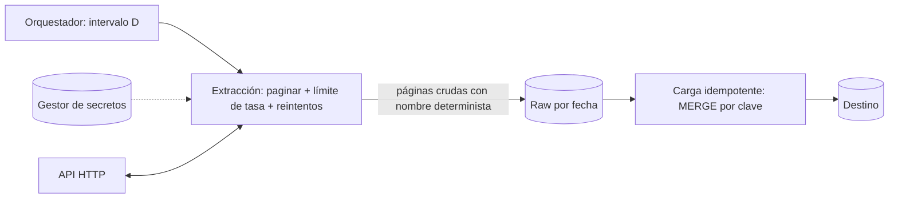

## 1. Resumen

Ingestar desde una API es leer datos de un servicio HTTP que no controlamos y que impone sus reglas: paginación, límites de tasa, autenticación y errores transitorios. Una ingesta confiable recorre todas las páginas sin saltarse ni repetir, respeta el límite (429 y `Retry-After`), reintenta solo lo transitorio, guarda las credenciales fuera del código y escribe de forma idempotente, para poder repetir un período sin duplicar.

## 2. Qué es

Es un tipo de ingesta con cinco partes:

- **contrato:** endpoint, parámetros, formato de respuesta y significado de cada código HTTP;
- **paginación:** cursor, número de página, offset o URL "siguiente";
- **límite de tasa:** cuántas peticiones por intervalo acepta la API y qué responde al superarlo;
- **autenticación:** API key, OAuth u otro esquema, con secretos gestionados;
- **incrementalidad:** qué parámetro permite pedir solo lo nuevo (fecha de modificación, cursor de cambios).

## 3. Problema que resuelve

Muchas fuentes de negocio (CRM, pagos, marketing, SaaS) solo exponen sus datos por API. Una ingesta ingenua pierde páginas cuando los datos cambian mientras se pagina, se bloquea por exceder el límite, duplica registros al reintentar o deja la API key en un repositorio.

## 4. Cómo funciona

1. **Definir el rango:** por ejemplo, registros modificados en el día lógico D (ver `incremental-pipelines`).
2. **Paginar** hasta la condición de fin: sin cursor siguiente, página vacía o un máximo de páginas como protección.
3. **Respetar el límite:** esperar entre páginas; ante **429 Too Many Requests**, esperar lo que indique `Retry-After` si viene.
4. **Reintentar solo lo transitorio** (429, 5xx, timeouts) con backoff y límite; fallar de inmediato ante 400, 401, 403 y 404.
5. **Guardar la respuesta cruda** (raw) por período y luego **cargar de forma idempotente** en el destino, por clave o reemplazando el período.

Sobre la idempotencia del lado de la API: según la RFC 9110, `GET`, `PUT` y `DELETE` son idempotentes; `POST` no lo es. Reintentar un `GET` es seguro; reintentar un `POST` que crea algo no lo es sin una clave de idempotencia que la API acepte.

## 5. Cuándo utilizarlo

- Fuentes SaaS o de terceros sin acceso directo a su base de datos.
- Volúmenes moderados, donde la API alcanza para el período de carga.
- Datos que la fuente expone con un filtro de modificación o un cursor de cambios.

## 6. Cuándo no utilizarlo

- Si la fuente ofrece exportaciones masivas (archivos, réplica, CDC): suelen ser más baratas y completas para grandes volúmenes.
- Si la API no permite filtrar por modificación y el volumen es grande: habría que leer todo en cada ejecución.
- Para eventos de baja latencia, si la fuente ofrece webhooks o un stream: pedir por API cada pocos segundos malgasta el límite de tasa.

## 7. Ejemplo sencillo

Cada noche se piden los pedidos modificados ayer, 100 por página, siguiendo el campo `next` de cada respuesta hasta que venga vacío. Si la API responde 429, se espera lo que indica `Retry-After` y se reintenta la misma página.

## 8. Ejemplo de producción

Una tarea diaria de Airflow lee facturas de un sistema de pagos:

- la API key vive en el gestor de secretos y se lee como conexión de Airflow;
- pide `updated_since` y `updated_until` del intervalo de la ejecución;
- pagina por cursor con un máximo de páginas como protección y respeta 429 y `Retry-After`;
- escribe cada respuesta cruda en `raw/facturas/fecha=D/pagina=N.json`, con nombres deterministas, así que reintentar sobrescribe en vez de duplicar;
- una segunda tarea carga el día con `MERGE` por `factura_id` y versión;
- al final, compara la cantidad de registros cargados con el total que informa la API.

## 9. Arquitectura



## 10. Código

```python
# Python 3.12, solo biblioteca estándar: paginación por cursor, 429/Retry-After y reintentos acotados.
# Requiere: una API con parámetros updated_since/updated_until y respuesta {"data": [...], "next": "<cursor>"}.
import json
import random
import time
from collections.abc import Iterator
from urllib.error import HTTPError, URLError
from urllib.parse import urlencode
from urllib.request import urlopen

RETRYABLE = {429, 500, 502, 503, 504}


def get_page(url: str, params: dict[str, str], attempts: int = 5) -> dict:
    full_url = f"{url}?{urlencode(params)}"
    for attempt in range(1, attempts + 1):
        try:
            with urlopen(full_url, timeout=30) as response:
                return json.load(response)
        except HTTPError as exc:                            # subclase de URLError: va primero
            if exc.code not in RETRYABLE or attempt == attempts:
                raise                                       # 4xx permanentes y reintentos agotados
            retry_after = exc.headers.get("Retry-After", "")
            wait = float(retry_after) if retry_after.isdigit() else random.uniform(0, 2 ** attempt)
        except (URLError, TimeoutError):                    # red o timeout: transitorio
            if attempt == attempts:
                raise
            wait = random.uniform(0, 2 ** attempt)
        time.sleep(wait)
    raise AssertionError("inalcanzable")


def iter_pages(url: str, since: str, until: str, max_pages: int = 10_000) -> Iterator[dict]:
    params = {"updated_since": since, "updated_until": until}
    for _ in range(max_pages):                              # protección ante un cursor que no termina
        page = get_page(url, params)
        yield page
        if not page.get("next"):
            return
        params = {**params, "cursor": page["next"]}
    raise RuntimeError(f"se superó el máximo de {max_pages} páginas")
```

`Retry-After` puede venir como segundos o como fecha HTTP; el ejemplo solo interpreta segundos y, si no, usa backoff. La autenticación (por ejemplo, una cabecera con el token) se agrega con un `urllib.request.Request`, leyendo el secreto del gestor de secretos. Cada página se guarda con un nombre determinista por día y número de página, así que repetir la ejecución sobrescribe en lugar de duplicar.

## 11. GCP

En **Managed Service for Apache Airflow (ex Cloud Composer)**, el servicio de Google construido sobre Apache Airflow, la ingesta se orquesta con tareas Python o con el **HttpOperator** del provider HTTP. Su `pagination_function` recibe cada respuesta y devuelve los parámetros de la siguiente petición; el operador repite llamadas hasta que la función no devuelve nada. `response_check` valida el contenido de la respuesta.

## 12. AWS

En **Step Functions**, el **HTTP Task** (`http:invoke`) llama APIs HTTPS directamente desde el flujo:

- la autenticación va en una **conexión de EventBridge** (Basic, OAuth o API Key), cuyo secreto EventBridge guarda cifrado en Secrets Manager;
- cada petición vence a los **60 segundos**;
- los reintentos se declaran en el estado: el ejemplo oficial reintenta 429, 502, 503 y 504 con backoff de factor 2 y jitter completo.

A diferencia del HttpOperator, la paginación no es una función del operador: se modela con estados del flujo.

## 13. Azure

En **Data Factory**, el **conector REST** de la actividad Copy trae paginación declarativa (`paginationRules`, por ejemplo la URL siguiente tomada de `$.paging.next`, con una condición de fin y un `MaxRequestNumber` opcional) y un `requestInterval` entre páginas de 1 segundo por defecto. `httpRequestTimeout` (1 minuto 40 segundos por defecto) es el tiempo para obtener respuesta. Solo admite respuestas JSON.

## 14. Buenas prácticas

- Pedir por rango de modificación del intervalo lógico, no "desde la última vez" sin registro.
- Poner siempre un máximo de páginas y un timeout por petición.
- Respetar 429 y `Retry-After`; reintentar solo 429, 5xx y errores de red.
- Guardar la respuesta cruda antes de transformar, con nombres deterministas.
- **Seguridad:** credenciales en un gestor de secretos (conexiones de Airflow, conexión de EventBridge, Key Vault), nunca en el código ni en los logs; tratar 401 y 403 como errores permanentes que requieren intervención.
- **Observabilidad:** registrar páginas, registros, reintentos y respuestas 429 por ejecución; comparar el total cargado con el que informa la API cuando existe.
- **Costo:** muchas APIs cobran o limitan por petición; usar el tamaño de página máximo permitido y evitar releer períodos completos.

## 15. Errores frecuentes

- Paginar por offset sobre datos que cambian mientras se lee y perder o repetir registros.
- Ignorar el 429 y seguir enviando peticiones.
- Reintentar un `POST` que crea recursos y duplicarlos.
- Usar "ahora" como fin del rango: dos ejecuciones distintas nunca piden lo mismo.
- Dejar la API key en el repositorio o en los logs.

## 16. Trade-offs

Las herramientas declarativas (conector REST de Data Factory, HTTP Task) reducen código y traen reintentos y paginación configurables, a cambio de menos flexibilidad ante APIs con reglas propias. El código propio cubre cualquier API, a cambio de mantener paginación, límites y reintentos.

## 17. Conceptos relacionados

- `retries`: backoff, jitter y límite.
- `incremental-pipelines`: pedir solo lo nuevo por intervalo.
- `python-error-handling-and-retries`: el manejo de errores en Python.
- `idempotency`: repetir un período sin duplicar.
- Con ficha: `python-api-consumption`, `batch-ingestion`.
- Del blueprint, pendiente de ficha: `data-contracts`.

## 18. Preguntas técnicas abiertas

1. ¿Cómo paginarías una API que solo ofrece offset sobre datos que cambian durante la lectura?
2. ¿Qué harías si la API no informa el total de registros y necesitas reconciliar?
3. ¿Cómo repartirías el límite de tasa entre varias tareas que usan la misma API key?

## 19. Laboratorio relacionado

Pendiente (F4): snippet "ingesta API con reintentos" (A-F3.2) y lab de tipo A.

## 20. Fuentes

- IETF: *RFC 6585* (429 Too Many Requests) y *RFC 9110* (semántica HTTP). Referencia canónica (Nivel 4).
- Microsoft Learn: *Copy and transform data from and to a REST endpoint* (Data Factory).
- AWS: *Call HTTPS APIs in Step Functions workflows*.
- Apache Airflow: *HTTP Operators* (provider HTTP).
- Python: *urllib.request* y *urllib.error*.
- Google Cloud: *Managed Airflow overview*.

El detalle de cada fuente está en `sources` del frontmatter.

## 21. Fecha de última verificación

2026-10-01. Pasa a `verified`: revisión B-F3.1 del lote 3 aplicada, sin VERIFY pendientes.

## 22. Historial de cambios importantes

- 2026-09-30: creación (lote 3 de F3).
- 2026-10-01: `verification_status: verified` (revisión B-F3.1 del lote 3 aplicada; sin VERIFY pendientes).
- 2026-10-06: la sección de conceptos relacionados ya no lista como pendientes de ficha a `python-api-consumption`, `batch-ingestion`, que ya tienen ficha.
