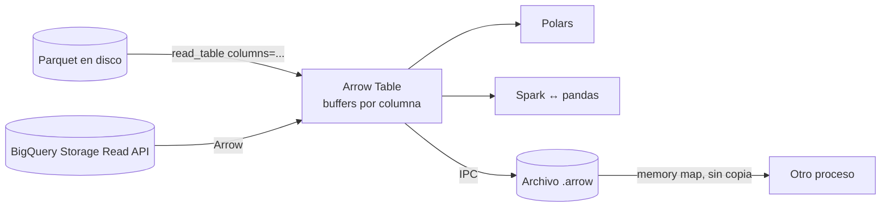

## 1. Resumen

Apache Arrow define cómo representar una tabla **en memoria**, por columnas e independiente del lenguaje:

- cada columna es un buffer contiguo de valores más un bitmap que marca los nulos;
- los datos se recorren rápido y se pueden compartir entre procesos o herramientas sin convertirlos.

Polars lo usa como formato interno. Spark y pandas lo usan para intercambiar datos. BigQuery puede entregar resultados en Arrow. Parquet es el formato columnar en disco; Arrow es su par en memoria.

## 2. Qué es

- **Especificación:** un layout en memoria, metadatos y un protocolo de transporte, estables desde la versión 1.0.0.
- **Array:** una columna con:
  - buffer de valores;
  - bitmap de validez (un bit por posición: nulo o no);
  - offsets para tipos de largo variable como `string`.
- **Esquema y tipos:**
  - enteros, flotantes, texto, fechas y tipos anidados (`list`, `struct`, `map`);
  - el **tipo diccionario**, que guarda valores repetidos como índices a una lista de valores únicos.
- **Table y RecordBatch:** conjuntos de columnas con el mismo esquema.
- **IPC:** formato para escribir y leer record batches en streaming o en archivo con el mismo layout de memoria. Leído desde un memory map, no necesita copiar.

## 3. Problema que resuelve

Mover datos entre herramientas suele costar más que procesarlos: cada una tiene su representación, y pasar de una a otra exige serializar, copiar y convertir tipos. Un formato común en memoria permite que el lector de Parquet, el DataFrame, el motor de consulta y el cliente del warehouse hablen el mismo formato y, cuando los tipos lo permiten, compartan buffers sin copiarlos. Además, el layout columnar acelera los scans y las operaciones vectorizadas.

## 4. Cómo funciona

1. Cada columna se guarda en buffers contiguos y alineados, con un relleno recomendado de 64 bytes para instrucciones SIMD.
2. Los nulos no son un valor especial dentro del buffer: van en el bitmap de validez. Por eso un entero con nulos sigue siendo entero en Arrow.
3. El acceso a una posición es O(1), y un scan de una columna recorre memoria contigua.
4. Para compartir datos, el formato IPC escribe los mismos buffers. Leer desde un memory map da batches sin copia.
5. **Conversión con pandas:**
   - solo es sin copia en casos limitados, porque la representación interna de pandas suele ser otra;
   - en el peor caso conviven dos copias de los datos;
   - los enteros con nulos pasan a `float64` con `NaN`, salvo que se pida un tipo nullable de pandas.

## 5. Cuándo utilizarlo

- Intercambiar datos entre bibliotecas y procesos (Polars, DuckDB, Spark, pandas, clientes de warehouse) sin serializar a CSV o JSON.
- Leer Parquet seleccionando columnas y procesar en formato columnar.
- Guardar resultados intermedios que otro proceso leerá con memory map (IPC).
- Tipos estrictos con nulos reales y diccionarios para columnas de pocos valores distintos.

## 6. Cuándo no utilizarlo

- Como formato de almacenamiento de largo plazo en un lake: para eso Parquet, que además comprime y lleva estadísticas.
- Para registros que se actualizan uno a uno: el layout columnar favorece lecturas por columna, no escrituras puntuales.
- Si toda la cadena es pandas con tipos de NumPy y volúmenes pequeños: la conversión a Arrow puede agregar copias sin beneficio.

## 7. Ejemplo sencillo

```python
import pyarrow as pa

columna = pa.array([1, 2, None])
print(columna.type, columna.null_count)   # int64 1: el nulo no convierte la columna en float
print(columna.to_pandas().dtype)          # float64: pandas usa NaN para el nulo
```

## 8. Ejemplo de producción

Un job lee 40 GB de Parquet con PyArrow, pero selecciona solo 5 de 60 columnas. Agrega con Polars, que usa el formato de memoria de Arrow, y escribe el resultado en IPC para un segundo proceso. Ese proceso lo abre con memory map y lo publica. Nadie pasa por CSV ni por objetos de Python fila a fila. Los enteros con nulos mantienen su tipo de punta a punta, y la única conversión a pandas se hace al final, sobre el resultado agregado.

## 9. Arquitectura



## 10. Código

```python
# Python 3.12 y PyArrow 25.0.1 (ejecutado): tabla columnar con esquema, Parquet con columnas y filtro, e IPC.
import tempfile
from pathlib import Path

import pyarrow as pa
import pyarrow.compute as pc
import pyarrow.parquet as pq

esquema = pa.schema([
    pa.field("venta_id", pa.string(), nullable=False),
    pa.field("tienda", pa.dictionary(pa.int8(), pa.string())),   # valores repetidos: diccionario
    pa.field("monto", pa.int64()),
])
tabla = pa.table(
    {"venta_id": ["v1", "v2", "v3", "v4"], "tienda": ["T1", "T2", "T1", "T2"], "monto": [120, 40, None, 75]},
    schema=esquema,
)
print(tabla.num_rows, tabla.column("monto").null_count)          # 4 1
print(pc.sum(tabla.column("monto")).as_py())                     # 235: los nulos no suman

base = Path(tempfile.mkdtemp())
pq.write_table(tabla, base / "ventas.parquet")
leida = pq.read_table(base / "ventas.parquet", columns=["venta_id", "monto"], filters=[("monto", ">", 50)])
print(leida.column_names, leida.column("venta_id").to_pylist())  # ['venta_id', 'monto'] ['v1', 'v4']

with pa.OSFile(str(base / "ventas.arrow"), "wb") as sink, pa.ipc.new_file(sink, tabla.schema) as writer:
    writer.write_table(tabla)                                    # formato IPC: el mismo layout de memoria en disco
with pa.memory_map(str(base / "ventas.arrow"), "r") as source:
    mapeada = pa.ipc.open_file(source).read_all()
    print(mapeada.equals(tabla), mapeada.schema.field("tienda").type)   # True dictionary<values=string, indices=int8, ordered=0>

df = tabla.to_pandas()
print(df["monto"].dtype, df["tienda"].dtype)                     # float64 category
```

Ejecutado con PyArrow 25.0.1 en el entorno de pruebas. La salida muestra lo que dice la documentación: `monto` es `int64` con un nulo en Arrow y pasa a `float64` en pandas, y el diccionario de `tienda` llega a pandas como `category`. Con `filters`, `read_table` devolvió solo `v1` y `v4`. No se pasó por `mypy --strict`, porque depende de los stubs de PyArrow.

## 11. GCP

La **BigQuery Storage Read API** permite elegir Apache Arrow o Apache Avro como formato de serialización de una sesión de lectura, y el esquema llega en la respuesta inicial. Con Arrow, los datos de BigQuery pueden pasar a Polars o pandas sin reconvertir fila por fila.

## 12. AWS

Esta ficha no cita una fuente de AWS sobre Arrow. Arrow se usa igual en cualquier runtime de Python. Para Spark administrado en AWS, ver `pyspark-dataframes`.

## 13. Azure

Esta ficha no cita una fuente de Azure sobre Arrow. Para Spark administrado en Azure, ver `pyspark-dataframes`.

## 14. Buenas prácticas

- Declarar el esquema (tipos y nulabilidad) en lugar de inferirlo, sobre todo en la frontera con fuentes externas.
- Tipo diccionario para columnas con pocos valores distintos.
- Leer solo las columnas necesarias de Parquet.
- Pedir tipos nullable al convertir a pandas (`types_mapper`) si los enteros con nulos deben seguir siendo enteros.
- **Seguridad:** el IPC y los memory maps comparten datos sin copia: el archivo `.arrow` tiene los mismos datos que la tabla, así que aplica el mismo control de acceso que a la fuente y se borra al terminar si es intermedio.
- **Observabilidad:** registrar el esquema leído y el número de filas por batch; un cambio de tipo en la fuente (entero que llega como texto) aparece primero como un esquema distinto.
- **Costo:** cada conversión con copia duplica la memoria pico del proceso; evitar idas y vueltas entre pandas y Arrow reduce la memoria que hay que reservar en el contenedor o la función.

## 15. Errores frecuentes

- Esperar que `to_pandas()` sea siempre sin copia.
- Perder el tipo entero por un nulo al pasar a pandas y cargar `120.0` en lugar de `120`.
- Usar IPC como almacenamiento de largo plazo en lugar de Parquet.
- Esquemas inferidos distintos entre archivos del mismo origen, que fallan al concatenar tablas.

## 16. Trade-offs

Arrow da un intercambio rápido y tipos estrictos, a cambio de un modelo más rígido que el de pandas (esquema fijo) y de aprender otra API. El layout columnar es excelente para scans y agregaciones, pero no para modificar filas sueltas. La conversión sin copia depende del tipo de cada columna, y no siempre es posible.

## 17. Conceptos relacionados

- `row-vs-columnar-formats` y `parquet-format`: el formato en disco.
- `python-dataframes`: Polars y pandas sobre Arrow.
- `pyspark-dataframes`: Arrow en la conversión con pandas.

## 18. Preguntas técnicas abiertas

1. ¿En qué paso de tu pipeline hay hoy una conversión innecesaria (CSV, JSON u objetos de Python) que Arrow podría evitar?
2. ¿Cómo detectarías que un archivo nuevo de la fuente llegó con un esquema distinto antes de concatenarlo?
3. ¿Cuándo preferirías IPC y cuándo Parquet para un resultado intermedio?

## 19. Laboratorio relacionado

Pendiente (F4).

## 20. Fuentes

- Apache Arrow: *Columnar Format*, *Data Types and In-Memory Data Model*, *Pandas Integration*, *Reading and Writing the Apache Parquet Format* y *Streaming, Serialization, and IPC*.
- Polars: *Coming from pandas*.
- Apache Spark 4.2.0: *Arrow in PySpark*.
- Google Cloud: *BigQuery Storage Read API*.

El detalle de cada fuente está en `sources` del frontmatter.

## 21. Fecha de última verificación

2026-10-08. `review_required`: pendiente de revisión B-F3.1 del lote F3b-03b.

## 22. Historial de cambios importantes

- 2026-10-08: creación (lote F3b-03b).
