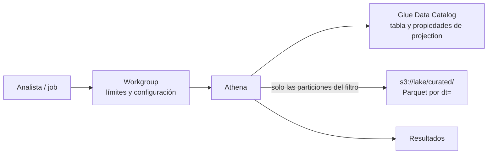

## 1. Resumen

**Amazon Athena** ejecuta SQL directamente sobre archivos en S3, sin servidores ni carga previa. Las tablas se definen en el **Glue Data Catalog**: nombre, columnas, formato, ubicación y particiones.

Según su página de precios, en la modalidad por consulta se paga por **bytes escaneados**, con un mínimo de 10 MB por consulta. Por eso el diseño se trata de leer menos:

- particiones por fecha y filtros sobre ellas;
- formatos columnares (Parquet, ORC);
- **partition projection**, para que Athena calcule las particiones en lugar de buscarlas en el catálogo.

Los **workgroups** separan cargas y ponen límites de datos por consulta.

## 2. Qué es

- **Tabla externa:** definición en el Data Catalog que apunta a un prefijo de S3; los datos no se mueven.
- **Particiones:**
  - estilo Hive (`dt=2026-10-01/`): se registran con `MSCK REPAIR TABLE`;
  - sin ese estilo (`2026/10/01/`): con `ALTER TABLE ADD PARTITION`.
- **Partition projection:** propiedades de la tabla (`projection.enabled`, tipo, rango y formato de cada columna, y `storage.location.template`) con las que Athena calcula los valores y ubicaciones de las particiones sin llamar a `GetPartitions`.
- **Formatos columnares:** Parquet y ORC comprimen por columna y permiten predicate pushdown.
- **Workgroup:** separa cargas y equipos, impone configuración y tiene controles de datos por consulta (cancela) y por workgroup (alarma).
- **Iceberg:** Athena lee, escribe, hace time travel y DDL sobre tablas Apache Iceberg.
- **Spark en Athena:** también ejecuta aplicaciones de Apache Spark sin administrar recursos.

## 3. Problema que resuelve

Consultar el lake sin levantar un clúster ni cargar a un warehouse: análisis ad hoc, exploración de datos nuevos, validaciones y consultas poco frecuentes. Se paga por consulta, no por capacidad encendida.

## 4. Cómo funciona

1. La consulta llega a un workgroup, que aplica su configuración y límites.
2. Athena busca la tabla en el Data Catalog.
3. Resuelve las particiones: con projection las calcula; si no, las pide al catálogo (`GetPartitions`).
4. Poda las particiones que no cumplen el filtro y lee solo esos objetos de S3, solo las columnas pedidas si el formato es columnar.
5. Cobra por los bytes escaneados, redondeados al megabyte.

## 5. Cuándo utilizarlo

- Consultas ad hoc o poco frecuentes sobre el lake.
- Validar datos recién llegados a `raw/` o `curated/`.
- Tablas con muchas particiones por fecha: con projection.

## 6. Cuándo no utilizarlo

- Tableros con consultas repetidas cada pocos minutos sobre los mismos datos: un warehouse o tablas materializadas cuestan menos (ver `redshift-architecture`).
- Datos en JSON o CSV sin particionar y consultados a menudo: primero convertirlos, por ejemplo con CTAS a Parquet.
- Cargas transaccionales de filas sueltas.

## 7. Ejemplo sencillo

`SELECT ... WHERE dt = '2026-10-01'` sobre una tabla Parquet particionada por día lee un solo prefijo y solo las columnas del `SELECT`. La misma consulta sin el filtro recorre todo el histórico y cuesta proporcionalmente más.

## 8. Ejemplo de producción

Un equipo de analítica tiene tres workgroups:

- `adhoc`: límite de datos por consulta, para que una consulta sin filtro se cancele;
- `etl`: consultas programadas de validación, con su propio límite;
- `bi`: un tablero que lee tablas Parquet particionadas.

Las tablas de `curated/` usan partition projection por `dt`, así no hay que registrar particiones después de cada carga.

## 9. Arquitectura



## 10. Código

```sql
-- Athena SQL (no ejecutado): tabla externa Parquet particionada por dt con partition projection, para no
-- registrar particiones ni llamar a GetPartitions; y una consulta que filtra por la partición.
CREATE EXTERNAL TABLE IF NOT EXISTS ventas.ventas_diarias (
  id_venta  bigint,
  id_tienda int,
  monto     decimal(12,2)
)
PARTITIONED BY (dt string)
STORED AS PARQUET
LOCATION 's3://mi-data-lake/curated/ventas_diarias/'
TBLPROPERTIES (
  'projection.enabled'        = 'true',
  'projection.dt.type'        = 'date',
  'projection.dt.format'      = 'yyyy-MM-dd',
  'projection.dt.range'       = '2024-01-01,NOW',
  'storage.location.template' = 's3://mi-data-lake/curated/ventas_diarias/dt=${dt}/'
);

-- Filtrar por dt lee solo los objetos de esos días; sin el filtro, Athena recorre todo el prefijo.
SELECT id_tienda, sum(monto) AS total
FROM ventas.ventas_diarias
WHERE dt BETWEEN '2026-10-01' AND '2026-10-07'
GROUP BY id_tienda;
```

**No ejecutado:** el SQL de Athena no se corrió (moto no ejecuta SQL; ADR-011). Las propiedades de projection siguen *Set up partition projection* y *Supported types for partition projection*; con fechas de un día, `interval` es opcional y vale 1 día, por eso no se declara.

## 11. GCP

No aplica de forma específica: esta ficha describe Athena. Lo más cercano en GCP son las tablas externas de BigQuery (ver `bigquery-external-tables`), que se consultan dentro del warehouse y se cobran según el modelo de BigQuery; no son equivalentes.

## 12. AWS

**Amazon Athena.** Las particiones, partition projection, los formatos columnares, los workgroups, Iceberg y el cobro por bytes escaneados (mínimo de 10 MB por consulta) son los de sus páginas. Los precios se consultan en la página de precios.

## 13. Azure

No aplica de forma específica: los motores serverless de Azure tienen su propio modelo.

## 14. Buenas prácticas

- Parquet u ORC en todo lo que se consulta a menudo.
- Partición por fecha y filtro obligatorio en las consultas.
- Partition projection en tablas con muchas particiones o con carga continua.
- Un workgroup por tipo de carga, con límite por consulta.
- **Seguridad:** el acceso a las tablas y a S3 va por IAM o por Lake Formation (ver `lake-formation-permissions`), y los workgroups separan qué equipo usa qué configuración.
- **Observabilidad:** seguir los bytes escaneados por consulta y por workgroup; una consulta que escanea todo el histórico indica un filtro faltante.
- **Costo:** se paga por bytes escaneados; las DDL y las consultas fallidas no se cobran y las canceladas sí. Los montos se consultan en la página de precios.

## 15. Errores frecuentes

- Consultar JSON sin particionar y pagar por todo el histórico.
- Olvidar registrar las particiones nuevas y no ver los datos del día.
- Un solo workgroup sin límites para todo el equipo.

## 16. Trade-offs

Athena no tiene nada que administrar y cobra por lo que lee, a cambio de que el costo dependa del diseño de los archivos y de cada consulta. Para consultas repetidas sobre los mismos datos, un warehouse con datos cargados suele ser más rápido y predecible. Partition projection evita el catálogo de particiones, pero las particiones tienen que seguir el patrón declarado.

## 17. Conceptos relacionados

- `partition-pruning` y `scan-reduction`: leer menos.
- `parquet-format` y `row-vs-columnar-formats`: por qué el formato importa.
- `glue-catalog-and-etl`: donde viven las tablas.
- `s3-data-lake`: los datos que consulta.
- `bigquery-external-tables`: lo más cercano en GCP.
- `redshift-architecture`: el warehouse.
- `lake-formation-permissions`: el acceso a las tablas y a S3 con Lake Formation (§14).

## 18. Preguntas técnicas abiertas

1. ¿Cuál es tu consulta de Athena que más bytes escanea, y qué partición le falta?
2. ¿Qué tablas pasarías a partition projection?
3. ¿Qué límite por consulta pondrías al workgroup ad hoc?

## 19. Laboratorio relacionado

Pendiente (F4).

## 20. Fuentes

- AWS, Amazon Athena User Guide: *What is Amazon Athena?*, *Partition your data*, *Use partition projection with Amazon Athena*, *Set up partition projection*, *Supported types for partition projection*, *Use columnar storage formats*, *Create a table from query results (CTAS)*, *Use workgroups to control query access and costs* y *Query Apache Iceberg tables*; *Amazon Athena pricing*.

El detalle de cada fuente está en `sources` del frontmatter.

## 21. Fecha de última verificación

2026-10-13. Pasa a `verified`: revisión B-F3.1 del lote F3b-09a aplicada, sin VERIFY pendientes.

## 22. Historial de cambios importantes

- 2026-10-12: creación (lote F3b-09a).
- 2026-10-13: revisión B-F3.1 del lote F3b-09a aplicada (docs/reviews/cards-f3b-09a.md): filas aprobadas sin cambios en esta ficha.
- 2026-10-13: `verification_status: verified` (sin VERIFY pendientes).
- 2026-10-14: lote F3b-rel (regla del §17): relations incluye `lake-formation-permissions`; el §17 nombra `lake-formation-permissions`, que el cuerpo ya citaba.
