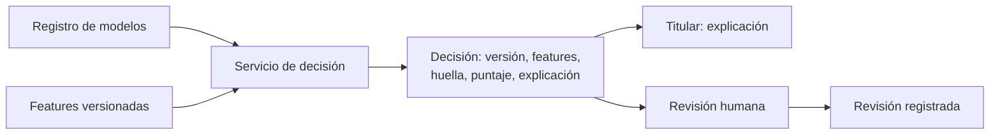

## 1. Resumen

Esta ficha no es asesoría legal: cubre lo que hay que registrar técnicamente para que una decisión automatizada se pueda explicar y revisar.

La ley da al titular derecho a oponerse y a no ser objeto de decisiones automatizadas con efectos jurídicos o significativos, salvo excepciones (contrato, consentimiento, ley). **En todos los casos**, el responsable debe asegurar información, explicación, intervención humana y revisión de la decisión. Eso es imposible si no se sabe qué modelo decidió, con qué versión y con qué datos. Por cada decisión se registra:

- **modelo y versión** (del registro de modelos);
- **features** usadas y la **huella** de los datos de entrada;
- **puntaje, resultado y explicación** (contribución de cada feature);
- la **revisión humana**, si la hubo.

Con eso la decisión se puede **reproducir**, explicar y revisar.

## 2. Qué es

- **[Obligación legal · art. 8 bis]** Derecho a no ser objeto de decisiones automatizadas con efectos significativos, con excepciones; en todos los casos, explicación, intervención humana, punto de vista y revisión.
- **[Obligación legal · art. 5]** El acceso del titular incluye información significativa sobre la lógica aplicada.
- **[Decisión de arquitectura]** Cada decisión es un registro inmutable con lo necesario para reproducirla.

## 3. Problema que resuelve

**[Buena práctica]** Un titular pide que revisen por qué le rechazaron una solicitud hace tres meses. El modelo se reentrenó dos veces desde entonces y las tablas de features cambiaron. Nadie puede decir con qué versión ni con qué datos se decidió.

## 4. Cómo funciona

1. **[Decisión de arquitectura]** Los modelos se registran con versión; las decisiones referencian la versión exacta.
2. **[Buena práctica]** Al decidir, guardar features, huella de los datos de entrada, puntaje, resultado y contribuciones.
3. **[Obligación legal · art. 5]** Con las contribuciones se arma la explicación de la lógica para el titular.
4. **[Obligación legal · art. 8 bis]** Ante una solicitud de revisión, reproducir la decisión con la versión registrada y registrar la intervención humana y su resultado.
5. **[Buena práctica]** Guardar el titular con seudónimo en el registro, no con el RUT.

## 5. Cuándo utilizarlo

- En todo modelo que decide sobre personas con efectos significativos (crédito, precios personalizados, selección).
- Desde el primer despliegue: no se puede reconstruir después.

## 6. Cuándo no utilizarlo

- Para decidir si la decisión cae en una excepción de la ley: lo decide el área legal.
- Como sustituto de la evaluación de impacto, que estos tratamientos exigen.

## 7. Ejemplo sencillo

| Paso | Resultado |
|---|---|
| Decisión | Rechazado (puntaje 0,8, `riesgo-v1`) |
| Explicación | `atraso_dias` 0,3 y `deuda_sobre_ingreso` 0,3 |
| Reproducir con la versión registrada | Igual |
| Con la versión nueva | Rechazado |
| Revisión humana | Aprobado, con revisor y motivo |

## 8. Ejemplo de producción

- Registro de modelos con versiones inmutables.
- Una tabla de decisiones de solo anexar, con versión, features, huella de los datos, resultado y explicación.
- Las features se leen de un almacén versionado, para poder reproducir.
- Las revisiones humanas se registran junto a la decisión original, sin sobrescribirla.

### Evidencia de cumplimiento

| Evidencia | Dónde queda | Quién la produce |
|---|---|---|
| Registro de cada decisión | Tabla de decisiones (solo anexar) | Servicio de decisión |
| Versiones de modelo | Registro de modelos | Equipo de ML |
| Revisiones humanas | Tabla de revisiones | Revisor |

## 9. Arquitectura



## 10. Código

```python
# Python 3.12, biblioteca estándar (ejecutado en la CI): trazabilidad de decisiones automatizadas. Cada decisión
# queda con el modelo, su versión, las features usadas, la huella de los datos de entrada, el puntaje y su
# explicación; con eso se puede reproducir, explicar y someter a revisión humana, que también queda registrada.
import hashlib
import json
from dataclasses import asdict, dataclass

MODELOS = {  # registro de modelos: versión -> pesos (un modelo lineal simple, para poder explicarlo)
    "riesgo-v1": {"intercepto": 0.2, "atraso_dias": 0.01, "deuda_sobre_ingreso": 0.5},
    "riesgo-v2": {"intercepto": 0.1, "atraso_dias": 0.012, "deuda_sobre_ingreso": 0.6},
}
UMBRAL = 0.6


@dataclass(frozen=True)
class Decision:
    titular: str
    modelo: str
    features: dict[str, float]
    huella_datos: str
    puntaje: float
    resultado: str
    contribuciones: dict[str, float]


def decidir(titular: str, version: str, features: dict[str, float]) -> Decision:
    pesos = MODELOS[version]
    contrib = {k: round(pesos[k] * v, 4) for k, v in features.items()}
    puntaje = round(pesos["intercepto"] + sum(contrib.values()), 4)
    huella = hashlib.sha256(json.dumps(features, sort_keys=True).encode()).hexdigest()[:12]
    return Decision(titular, version, features, huella, puntaje, "rechazado" if puntaje >= UMBRAL else "aprobado", contrib)


registro = [decidir("t-001", "riesgo-v1", {"atraso_dias": 30.0, "deuda_sobre_ingreso": 0.6})]  # seudónimo, no el RUT
d = registro[0]
print(f"decisión: {d.resultado} (puntaje {d.puntaje}, modelo {d.modelo}, datos {d.huella_datos})")
print("explicación:", sorted(d.contribuciones.items(), key=lambda kv: -kv[1]))
reproducida = decidir(d.titular, d.modelo, d.features)
print("reproducible con la versión registrada:", reproducida == d)
print("con la versión nueva daría:", decidir(d.titular, "riesgo-v2", d.features).resultado)
revision = {"decision": asdict(d), "revisor": "analista-credito", "resultado_final": "aprobado", "motivo": "ingreso acreditado"}
print("revisión humana registrada:", revision["revisor"], "->", revision["resultado_final"])
```

El script se **ejecuta en la CI** con la biblioteca estándar y pasa `mypy --strict`. Un modelo lineal permite explicar cada contribución. Imprime la decisión rechazada con modelo, versión y huella de los datos, la explicación, que se reproduce igual con la versión registrada, el resultado con la versión nueva y la revisión humana registrada.

## 11. GCP

En GCP, **Model Registry on Gemini Enterprise Agent Platform**. Según *Ley 19628 SOBRE PROTECCION DE LOS DATOS PERSONALES* e *Introduction to Model Registry* (no ejecutado):

| | Registro (este ejemplo) | Model Registry | Etiqueta |
|---|---|---|---|
| Versiones | Diccionario `MODELOS` | Repositorio central del ciclo de vida, con versiones | **[Decisión de arquitectura]** |
| Registro por decisión | Tabla propia | No es el registro de decisiones; hay que construirlo | **[Buena práctica]** |

## 12. AWS

En AWS, **SageMaker Model Registry**. Según *Ley 19628 SOBRE PROTECCION DE LOS DATOS PERSONALES* y *Model Registration Deployment with Model Registry* (no ejecutado):

| | Registro (este ejemplo) | SageMaker Model Registry | Etiqueta |
|---|---|---|---|
| Versiones y metadata | Diccionario `MODELOS` | Versiones, métricas, Model Cards y linaje del modelo | **[Decisión de arquitectura]** |
| Registro por decisión | Tabla propia | No es el registro de decisiones; hay que construirlo | **[Buena práctica]** |

## 13. Azure

En Azure, **Azure Machine Learning**. Según *Ley 19628 SOBRE PROTECCION DE LOS DATOS PERSONALES* y *MLOps model management with Azure Machine Learning* (no ejecutado):

| | Registro (este ejemplo) | Azure Machine Learning | Etiqueta |
|---|---|---|---|
| Linaje y auditoría | Huella de los datos | Linaje de ML y audit trail de los activos; data assets versionados | **[Decisión de arquitectura]** |
| Explicación | Contribuciones del modelo lineal | Interpretabilidad de modelos | **[Buena práctica]** |

## 14. Buenas prácticas

- **[Obligación legal · art. 8 bis]** Un camino operativo para la revisión humana, con plazo y registro.
- **[Decisión de arquitectura]** Versiones de modelo y de features inmutables; las decisiones apuntan a ellas.
- **[Buena práctica]** **Seguridad:** el registro de decisiones usa seudónimos y tiene acceso restringido.
- **[Buena práctica]** **Observabilidad:** alertar si la tasa de revisiones humanas que revierten decisiones sube.
- **[Buena práctica]** **Costo:** guardar la huella y las features usadas, no copias completas de los datos de entrada.

## 15. Errores frecuentes

- Sobrescribir el modelo en producción sin versión.
- Registrar solo el resultado, sin features ni versión.
- Que la revisión humana reemplace el registro original.

## 16. Trade-offs

Un modelo simple se explica directamente y puede rendir menos; uno complejo exige técnicas de explicación aparte. Guardar las features de cada decisión permite reproducir y cuesta almacenamiento.

## 17. Conceptos relacionados

- `data-lineage`: de qué datos sale cada decisión.
- `data-subject-requests`: el acceso a la lógica.
- `dpia-technical-input`: la evaluación de impacto.

## 18. Preguntas técnicas abiertas

1. ¿Puedes decir con qué versión de modelo se tomó una decisión de hace tres meses?
2. ¿Tus features están versionadas?
3. ¿Dónde se registran hoy las revisiones humanas?

## 19. Laboratorio relacionado

Pendiente (F4).

## 20. Fuentes

- BCN Ley Chile: *Ley 19628 SOBRE PROTECCION DE LOS DATOS PERSONALES* (versión con vigencia diferida desde 2026-12-01).
- Google Cloud: *Introduction to Model Registry*.
- AWS: *Model Registration Deployment with Model Registry*.
- Microsoft Learn: *MLOps model management with Azure Machine Learning*.

El detalle de cada fuente está en `sources` del frontmatter.

## 21. Fecha de última verificación

2026-10-21: texto legal consultado ese día en BCN. `review_required`: pendiente de revisión B-F3.1 del lote F3b-19d; pasa a `verified` solo con la aprobación explícita de Felipe (`owner_approved_at`). Revisión mensual.

## 22. Historial de cambios importantes

- 2026-10-21: creación (lote F3b-19d).
