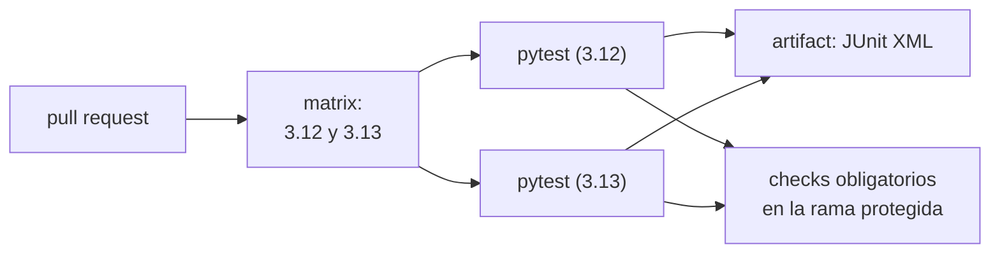

## 1. Resumen

Testing automatizado en CI es correr los tests en cada push y pull request, en una máquina limpia, y que el resultado decida si el cambio puede entrar. Según la documentación de cada plataforma:

- **cómo se corren:** con los mismos comandos que en local; en GitHub Actions, con `setup-python`, que su guía recomienda;
- **en qué combinaciones:** una **matrix** crea un job por cada combinación de variables, como versiones de Python;
- **qué queda:** un reporte **JUnit XML**, que GitLab, Azure Pipelines, CodeBuild y Cloud Build saben leer o guardar;
- **qué decide:** en GitHub, un **check de estado obligatorio** en la rama protegida impide el merge si falla.

## 2. Qué es

- **Job de test:** corre la suite (`pytest -q`) en un runner o agente.
- **Matrix:** variables (por ejemplo `python-version`) que multiplican el job.
- **`fail-fast`:** si una combinación falla, se cancelan o no las demás.
- **Reporte JUnit XML:** formato de resultados que las plataformas muestran (GitLab en el merge request, Azure en la pestaña Tests, CodeBuild en report groups).
- **Check obligatorio:** resultado del job que la rama protegida exige en `successful`, `skipped` o `neutral`.

## 3. Problema que resuelve

Un test que solo corre en la máquina de quien lo escribió no protege a nadie. En datos, la falla típica es una transformación que cambia en silencio: duplica filas o pierde las que traen un id vacío. Si el test corre en cada pull request y es obligatorio, ese cambio no llega a main.

## 4. Cómo funciona

1. El pull request dispara el workflow.
2. La matrix crea dos jobs, uno por versión de Python.
3. Cada job instala dependencias y corre `pytest --junitxml=…`.
4. El reporte se sube como artifact con `if: ${{ always() }}`, para guardarlo aunque los tests fallen.
5. Con `fail-fast: false`, una versión que falla no cancela la otra.
6. Los jobs son checks del pull request; si la rama los exige, el merge espera a que pasen.

## 5. Cuándo utilizarlo

- En toda transformación, validación o utilidad con tests.
- Matrix cuando el código debe correr en varias versiones (una librería) o al preparar una actualización de versión.
- Checks obligatorios en la rama principal.

## 6. Cuándo no utilizarlo

- Matrix con muchas combinaciones que nadie necesita: multiplica minutos.
- Tests que llaman a servicios reales en cada pull request: lentos y frágiles; mejor dobles o emuladores.
- Un check obligatorio que falla al azar: el equipo aprende a ignorarlo.

## 7. Ejemplo sencillo

`dedupe_latest` deja la última versión de cada id. Sus tests comprueban que queda la versión más nueva, que aplicarla dos veces da lo mismo y que una fila sin id se rechaza. Corren en cada pull request en Python 3.12 y 3.13.

## 8. Ejemplo de producción

Un repositorio de datos con:

- un job de tests unitarios en matrix, con reporte JUnit guardado como artifact;
- tests de idempotencia de cada transformación;
- los checks de tests obligatorios en main;
- los tests contra servicios reales separados, en un workflow nocturno.

## 9. Arquitectura



## 10. Código

```python
# Python 3.12 y pytest (ejecutado en la CI; mypy --strict sin errores): la transformación y sus tests en un archivo,
# como los corre el workflow de abajo. Deja la última versión de cada id según updated_at.
from __future__ import annotations

import pytest

Row = dict[str, str]


def dedupe_latest(rows: list[Row]) -> list[Row]:
    latest: dict[str, Row] = {}
    for row in rows:
        if not row.get("id"):
            raise ValueError(f"fila sin id: {row}")
        current = latest.get(row["id"])
        if current is None or row["updated_at"] > current["updated_at"]:
            latest[row["id"]] = row
    return sorted(latest.values(), key=lambda r: r["id"])


def test_keeps_latest_version_of_each_id() -> None:
    rows = [
        {"id": "1", "updated_at": "2026-10-01", "estado": "creado"},
        {"id": "1", "updated_at": "2026-10-02", "estado": "pagado"},
        {"id": "2", "updated_at": "2026-10-01", "estado": "creado"},
    ]
    assert [r["estado"] for r in dedupe_latest(rows)] == ["pagado", "creado"]


def test_is_idempotent() -> None:
    rows = [{"id": "1", "updated_at": "2026-10-02"}, {"id": "1", "updated_at": "2026-10-01"}]
    once = dedupe_latest(rows)
    assert dedupe_latest(once) == once


@pytest.mark.parametrize("row", [{"updated_at": "2026-10-01"}, {"id": "", "updated_at": "2026-10-01"}])
def test_rejects_rows_without_id(row: Row) -> None:
    with pytest.raises(ValueError, match="sin id"):
        dedupe_latest([row])
```

```yaml
# GitHub Actions (.github/workflows/tests.yml; validado con actionlint en la CI, no ejecutado): los tests en dos
# versiones de Python con una matrix, el resultado en JUnit XML y el reporte guardado como artifact aunque fallen.
name: tests

on:
  pull_request:
  push:
    branches: [main]

permissions:
  contents: read

jobs:
  pytest:
    runs-on: ubuntu-24.04
    strategy:
      fail-fast: false
      matrix:
        python-version: ["3.12", "3.13"]
    steps:
      - uses: actions/checkout@v7
      - uses: actions/setup-python@v7
        with:
          python-version: ${{ matrix.python-version }}
      - run: pip install -r requirements.txt
      - run: pytest -q --junitxml=reports/junit-${{ matrix.python-version }}.xml
      - uses: actions/upload-artifact@v7
        if: ${{ always() }}
        with:
          name: junit-${{ matrix.python-version }}
          path: reports/
```

El archivo de Python se **ejecuta en la CI**: el test del proyecto lo corre con pytest y pasa `mypy --strict`. Usa `pytest.mark.parametrize` para los casos inválidos. El workflow se **valida con actionlint en la CI** (ADR-014) **y no se ejecutó**: una matrix de dos versiones, el reporte JUnit por versión y `upload-artifact` con `if: ${{ always() }}`.

## 11. GCP

En GCP, **Cloud Build** corre los tests como un paso. Las diferencias, según sus páginas:

| | GitHub Actions | Cloud Build |
|---|---|---|
| Correr pytest | Paso del job, con `setup-python` | Paso con la imagen de Python, `entrypoint: python` y los argumentos de pytest |
| Reporte | JUnit XML como artifact | JUnit XML nombrado con `$SHORT_SHA`; un paso posterior guarda los logs |
| Varias versiones | Matrix | Las páginas citadas no lo tratan |

## 12. AWS

En AWS, **CodeBuild** tiene reportes de tests. Las diferencias, según sus páginas:

| | GitHub Actions | AWS CodeBuild |
|---|---|---|
| Reporte | JUnit XML guardado como artifact | Report group declarado en el buildspec; un reporte nuevo por corrida, en JUnit XML, Cucumber JSON y otros formatos |
| Dónde se ve | Artifact del workflow | En el report group del proyecto |

## 13. Azure

En **Azure Pipelines**, el pipeline de Python corre una vez por versión indicada, y las versiones pueden ir en paralelo en agentes distintos. Los resultados se ven en la pestaña Tests (*Build and publish a Python app*). En GitLab, los reportes JUnit (`artifacts:reports:junit`) aparecen en el merge request (*Unit test reports*).

## 14. Buenas prácticas

- Los mismos comandos que en local.
- Reporte JUnit guardado aunque fallen los tests.
- Checks de tests obligatorios en la rama principal.
- Un test de idempotencia por transformación.
- **Seguridad:** el workflow de tests con `permissions: contents: read`: solo lee el repositorio.
- **Observabilidad:** los reportes JUnit muestran qué test falló sin leer logs.
- **Costo:** cada combinación de la matrix es un job facturado; una matrix chica y tests rápidos.

## 15. Errores frecuentes

- Tests que pasan en local y fallan en CI por depender de archivos o variables de la máquina.
- Dejar que una falla cancele las otras versiones (`fail-fast`) y no saber en cuáles falla.
- Subir el reporte solo si pasa, justo cuando no hace falta.
- Checks que no son obligatorios: el merge entra igual.

## 16. Trade-offs

Más combinaciones en la matrix dan más cobertura de versiones a cambio de minutos y tiempo de espera. Checks obligatorios protegen main, pero un test inestable bloquea a todos. Tests contra servicios reales detectan más, pero son lentos y caros para cada pull request.

## 17. Conceptos relacionados

- `ci-cd-pipelines`: el pipeline donde corren.
- `testing-with-pytest`: cómo se escriben los tests.
- `pull-requests`: donde sus resultados son checks.
- `build-artifacts`: el reporte como artifact.
- `idempotency`: lo que comprueba uno de los tests del ejemplo.
- `ci-cd-for-data`: tests de datos sobre los modelos del pull request.

## 18. Preguntas técnicas abiertas

1. ¿Qué checks son obligatorios hoy en tu rama principal?
2. ¿Qué test de tu suite falla al azar, y qué harías con él?
3. ¿En qué versiones de Python necesitas que corra tu código?

## 19. Laboratorio relacionado

Pendiente (F4).

## 20. Fuentes

- GitHub Docs: *Building and testing Python*, *Running variations of jobs in a workflow*, *About protected branches* y *Workflow syntax for GitHub Actions*.
- GitLab Docs: *Unit test reports*. Microsoft Learn: *Build and publish a Python app*.
- Google Cloud: *Build and test Python applications*. AWS: *Test reports in AWS CodeBuild*. pytest: *How to parametrize fixtures and test functions*.

El detalle de cada fuente está en `sources` del frontmatter.

## 21. Fecha de última verificación

2026-10-14. Pasa a `verified`: revisión B-F3.1 del lote F3b-11a aplicada, sin VERIFY pendientes.

## 22. Historial de cambios importantes

- 2026-10-14: creación (lote F3b-11a).
- 2026-10-14: revisión B-F3.1 del lote F3b-11a aplicada (docs/reviews/cards-f3b-11a.md): relations y §17 incluyen `ci-cd-for-data` (lote 11b), que no se nombraron al crear 11a para no tocarla al crear 11b.
- 2026-10-14: `verification_status: verified` (sin VERIFY pendientes).
