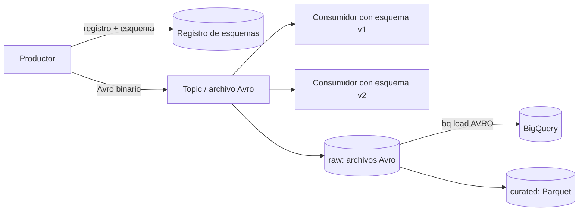

## 1. Resumen

Avro es un formato de serialización **por filas** con **esquema en JSON** y datos en **binario compacto**. Un archivo Avro lleva su esquema, así que cualquiera puede leerlo sin información externa. Lo central para ingeniería de datos es la **resolución de esquemas**: un lector con una versión distinta del esquema puede leer datos escritos con otra, ignorando campos que ya no usa y completando con valores por defecto los que se agregaron. Por eso es común en mensajería, registros de esquemas y zonas raw, y BigQuery lo recomienda para cargar datos.

## 2. Qué es

Es un formato abierto de Apache, definido por su especificación:

- **Esquema:** declarado en JSON, con tipos primitivos (`string`, `int`, `long`…), complejos (records, enums, arrays, maps, unions) y lógicos (`date`, `decimal`, timestamps).
- **Codificación binaria:** no incluye nombres de campos ni separadores, así que es compacta y el lector depende del esquema.
- **Object container file:** el archivo guarda el esquema y los registros en bloques que pueden comprimirse (codecs bzip2, snappy, xz, zstandard), con marcadores que permiten dividirlo para procesarlo en paralelo.
- **Single-object encoding:** identifica el esquema de cada registro guardado por separado; la especificación pone como ejemplo registros Avro en un topic de Kafka durante semanas, cuando conviven varias versiones del esquema.

## 3. Problema que resuelve

Intercambiar registros entre sistemas que evolucionan por separado. Con CSV o JSON sin esquema, los tipos se adivinan y un campo nuevo rompe a los lectores viejos o se pierde. Con Avro, cada dato viaja con un esquema formal, y las reglas de resolución definen qué pasa cuando escritor y lector usan versiones distintas.

## 4. Cómo funciona

Según la especificación, cuando el **esquema del escritor** y el **del lector** difieren:

1. Los campos de un record se emparejan **por nombre**, sin importar el orden.
2. Si el escritor tiene un campo que el lector no tiene, **se ignora**.
3. Si el lector tiene un campo **con default** que el escritor no tiene, **se usa el default**.
4. Si el lector tiene un campo **sin default** que el escritor no tiene, **es un error**.
5. Los alias permiten renombrar campos y tipos.

Consecuencia práctica: agregar un campo **con default** permite que lectores nuevos lean datos viejos. Los registros de esquemas (Glue, Event Hubs) formalizan qué cambios se permiten con modos de compatibilidad.

## 5. Cuándo utilizarlo

- Mensajería y streaming (Kafka, Event Hubs, Pub/Sub con esquema), donde se intercambian registros completos.
- Zona raw o de intercambio entre sistemas, cuando hay que preservar tipos y esquema.
- Cargas a BigQuery: su documentación lo presenta como el formato preferido para cargar.
- Cuando el esquema evoluciona y hace falta leer datos de varias versiones.

## 6. Cuándo no utilizarlo

- Para consultas analíticas que leen pocas columnas de muchas filas: Parquet u ORC, que son columnares, leen menos.
- Para inspección manual o intercambio con personas: el binario no se lee a simple vista.
- Sin gobierno de esquemas: Avro facilita la evolución, pero si cada productor cambia el esquema sin reglas, los lectores fallan igual.

## 7. Ejemplo sencillo

La versión 1 del esquema de `Pedido` tiene `pedido_id` y `monto`. La versión 2 agrega `canal` con default `"web"`. Un lector con la versión 2 lee archivos escritos con la 1: `canal` aparece como `"web"`. Un lector con la versión 1 lee archivos de la 2 e ignora `canal`.

## 8. Ejemplo de producción

Una empresa publica eventos de pedidos en un topic de Event Hubs con esquemas Avro en el registro de esquemas de Event Hubs. Una nueva versión agrega un campo con valor por defecto, y los consumidores viejos siguen funcionando. Un proceso de aterrizaje guarda los eventos en archivos Avro en el lake y los carga a BigQuery con `bq load --source_format=AVRO`, sin declarar esquema. Para el análisis, la capa curada se reescribe en Parquet.

## 9. Arquitectura



## 10. Código

```json
{
  "type": "record",
  "name": "Pedido",
  "namespace": "empresa.ventas",
  "fields": [
    {"name": "pedido_id", "type": "string"},
    {"name": "monto", "type": {"type": "bytes", "logicalType": "decimal", "precision": 12, "scale": 2}},
    {"name": "canal", "type": "string", "default": "web"}
  ]
}
```

```bash
# Carga a BigQuery: el esquema se toma de los archivos Avro (no se declara).
# Requiere: bq autenticado, el dataset raw y archivos .avro escritos con el esquema anterior.
bq load --source_format=AVRO --replace=true \
  raw.pedidos gs://empresa-lake/raw/pedidos/dt=2026-10-05/*.avro
```

El campo `canal`, con default `"web"`, es el que permite que un lector con este esquema lea archivos escritos antes de que el campo existiera. Para el decimal, BigQuery decide el tipo destino (`NUMERIC`, `BIGNUMERIC` o `STRING`) según precisión, escala y los tipos destino indicados.

## 11. GCP

**BigQuery** recomienda Avro para cargar datos: carga más rápido que CSV y JSON delimitado por líneas, se lee en paralelo aunque los bloques estén comprimidos y el esquema sale de los propios archivos (del último en orden alfabético, si hay varios). **Pub/Sub** admite esquemas Avro en los topics y rechaza los mensajes que no los cumplen; no valida los valores por defecto del esquema.

## 12. AWS

**Redshift** carga Avro con `COPY ... FORMAT AS AVRO` desde S3, EMR o hosts por SSH (no desde DynamoDB). **Athena** consulta archivos Avro con `STORED AS AVRO`. **Glue Schema Registry** guarda esquemas Avro con modos de compatibilidad (`BACKWARD`, `FORWARD`, `FULL`, `NONE`…), que deciden qué cambios se aceptan entre versiones.

## 13. Azure

**Data Factory** lee y escribe Avro; al escribir se elige el codec (`none`, `deflate` o `snappy`, aunque la Copy activity no admite Snappy en Avro), y al leer lo detecta en los metadatos del archivo. No admite espacios en los nombres de columnas. El **registro de esquemas de Event Hubs** admite esquemas Avro organizados en schema groups.

## 14. Buenas prácticas

- Todo campo nuevo con valor por defecto, para no romper a los lectores existentes.
- No reutilizar ni cambiar el tipo de un campo existente; agregar uno nuevo.
- Registrar los esquemas en un registro con modo de compatibilidad definido.
- Usar tipos lógicos (`decimal`, `date`, timestamps) en lugar de strings o enteros sin significado.
- Avro para escribir e intercambiar; Parquet para la capa que se consulta.
- **Seguridad:** el esquema viaja con los datos y documenta los campos; marcar en el esquema o el catálogo cuáles contienen datos personales.
- **Observabilidad:** registrar qué versión de esquema escribió cada lote y alertar ante errores de resolución en los consumidores.
- **Costo:** los bloques comprimidos ahorran almacenamiento y transferencia; en BigQuery, Avro carga en paralelo aun comprimido, a diferencia de CSV y JSON con gzip.

## 15. Errores frecuentes

- Agregar un campo sin default y romper a los lectores que leen datos viejos.
- Cambiar el nombre de un campo sin alias.
- Guardar montos como `float` o como texto en lugar de `decimal`.
- Consultar analíticamente archivos Avro grandes cuando se podría haber convertido a un formato columnar.
- Suponer que Pub/Sub valida los valores por defecto del esquema.

## 16. Trade-offs

Avro da esquema formal, evolución controlada y escritura eficiente de registros completos, a cambio de no ser legible a simple vista y de leer filas completas en consultas analíticas. Frente a JSON: más compacto y tipado, menos legible. Frente a Parquet: mejor para escribir e intercambiar, peor para consultar pocas columnas.

## 17. Conceptos relacionados

- `row-vs-columnar-formats`: Avro es un formato por filas.
- `parquet-format`: la alternativa columnar.
- `schema-evolution`: cómo cambian los esquemas.
- `compression`: codecs de los bloques.

## 18. Preguntas técnicas abiertas

1. ¿Qué cambios de esquema permitirías sin coordinar con los consumidores?
2. ¿Cuándo convertirías Avro a Parquet en tu pipeline?
3. ¿Cómo sabrías qué versión de esquema escribió un archivo concreto?

## 19. Laboratorio relacionado

Pendiente (F4).

## 20. Fuentes

- Apache: *Avro Specification* (1.12.0).
- Google Cloud: *Load Avro data from Cloud Storage* y *bq command-line tool reference* (BigQuery); *Schema overview* (Pub/Sub).
- AWS: *AWS Glue Schema Registry*, *Data format parameters* (Amazon Redshift) y *CREATE TABLE* (Amazon Athena).
- Microsoft Learn: *Avro format* (Azure Data Factory) y *Schema Registry concepts* (Event Hubs).

El detalle de cada fuente está en `sources` del frontmatter.

## 21. Fecha de última verificación

2026-10-06. Pasa a `verified`: revisión B-F3.1 del lote F3b-01b aplicada, sin VERIFY pendientes.

## 22. Historial de cambios importantes

- 2026-10-06: creación (lote F3b-01b, dominio 01-fundamentals).
- 2026-10-06: revisión B-F3.1 del lote F3b-01b aplicada (docs/reviews/cards-f3b-01b.md), sin cambios pedidos.
- 2026-10-06: `verification_status: verified` (sin VERIFY pendientes).
- 2026-10-13: `page_title` en cada cita, con el título de la página citada (ADR-012); sin cambios de contenido.
