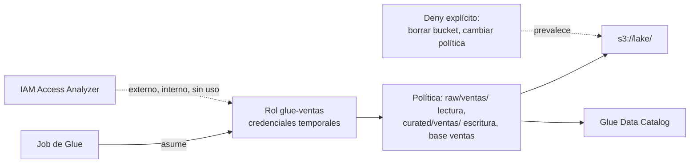

## 1. Resumen

En AWS, todo acceso pasa por **IAM**. Para una plataforma de datos, la regla práctica según su documentación es:

- cada job, función o servicio usa un **rol** con **credenciales temporales**, nunca claves de largo plazo;
- todo está **denegado por defecto** (denegación implícita) y un **Deny explícito** prevalece sobre cualquier Allow;
- las políticas dan el **mínimo privilegio**: acciones y recursos concretos, acotados con **condiciones** (por ejemplo, prefijos de S3);
- los accesos sin uso se revisan y se quitan; **IAM Access Analyzer** muestra accesos externos, internos y sin uso.

Sobre los datos del lake, IAM se complementa con Lake Formation (ver `lake-formation-permissions`).

## 2. Qué es

- **Rol:** identidad con permisos que se asume y entrega credenciales temporales. Tiene una **política de confianza** (quién puede asumirlo, por ejemplo `glue.amazonaws.com`) y **políticas de permisos**.
- **Políticas de identidad y de recurso:** las primeras van en roles, usuarios o grupos; las segundas en recursos, como un bucket.
- **Evaluación:**
  - por defecto, denegación implícita;
  - en la misma cuenta, el permiso efectivo es la unión de identidad y recurso;
  - un Deny explícito en cualquiera prevalece;
  - con un permissions boundary, el resultado es la intersección.
- **Condition:** acota una política con operadores (`StringEquals`, `StringLike`) y claves de contexto; el ejemplo de §10 acota el listado del bucket con `s3:prefix`.
- **Access Analyzer:** analizadores de acceso externo, interno y sin uso.

## 3. Problema que resuelve

Una plataforma de datos tiene muchos actores (jobs de Glue, funciones, Airflow, analistas) y muchos datos de distinta sensibilidad. Sin roles y políticas acotadas, un job comprometido o un error de código puede leer o borrar mucho más de lo que necesita.

## 4. Cómo funciona

1. Se crea un rol por job o servicio, con una política de confianza que solo deja asumirlo al servicio que corresponde.
2. Se le adjunta una política con las acciones y recursos exactos: leer `raw/ventas/`, escribir `curated/ventas/`, la base `ventas` del catálogo.
3. Cuando el servicio corre, asume el rol y recibe credenciales temporales.
4. Cada solicitud se evalúa: lo no permitido está denegado por defecto y un Deny explícito siempre gana.
5. Access Analyzer y la revisión periódica muestran accesos externos o sin uso para quitarlos.

## 5. Cuándo utilizarlo

- Siempre: todo acceso a AWS pasa por IAM.
- Un rol por job, función, entorno de Airflow o máquina de estado.
- Condiciones para acotar por prefijo, etiqueta o red cuando las acciones solas no alcanzan.

## 6. Cuándo no utilizarlo

- Como único control fino sobre tablas y columnas del lake: para eso, Lake Formation.
- Claves de acceso de largo plazo en código o variables de entorno: roles.
- Un rol compartido para todos los jobs.

## 7. Ejemplo sencillo

El rol `glue-ventas` solo lo puede asumir Glue. Puede leer `raw/ventas/`, escribir `curated/ventas/` y leer y agregar particiones de la base `ventas`. Si el job intenta leer `raw/finanzas/`, la solicitud se deniega por defecto.

## 8. Ejemplo de producción

Una plataforma define en Terraform, revisado en cada cambio:

- un rol por job de Glue, por función y por entorno de MWAA, cada uno con sus prefijos;
- un Deny explícito sobre borrar el bucket o cambiar su política, que prevalece aunque otra política lo permita;
- Access Analyzer para accesos externos y sin uso, revisado cada mes;
- personas con federación y credenciales temporales, sin usuarios con claves.

## 9. Arquitectura



## 10. Código

```hcl
# Terraform (validado en la CI con terraform validate, sin credenciales; no se aplicó): rol de un job de Glue con
# mínimo privilegio. La política de confianza deja que solo Glue lo asuma; la de permisos lee raw/ventas/, escribe
# curated/ventas/ y toca solo la base "ventas" del catálogo. Un Deny explícito impide borrar el bucket o cambiar
# su política, aunque otra política lo permita.
# Requiere: provider hashicorp/aws ~> 6.0.
terraform {
  required_providers {
    aws = {
      source  = "hashicorp/aws"
      version = "~> 6.0"
    }
  }
}

provider "aws" {
  region = "us-east-1"
}

variable "lake_bucket" {
  type = string
}

data "aws_caller_identity" "current" {}

data "aws_iam_policy_document" "trust" {
  statement {
    actions = ["sts:AssumeRole"]
    principals {
      type        = "Service"
      identifiers = ["glue.amazonaws.com"]
    }
  }
}

resource "aws_iam_role" "glue_ventas" {
  name               = "glue-ventas"
  assume_role_policy = data.aws_iam_policy_document.trust.json
}

data "aws_iam_policy_document" "permisos" {
  statement {
    sid       = "LeerRaw"
    actions   = ["s3:GetObject"]
    resources = ["arn:aws:s3:::${var.lake_bucket}/raw/ventas/*"]
  }
  statement {
    sid       = "EscribirCurated"
    actions   = ["s3:PutObject"]
    resources = ["arn:aws:s3:::${var.lake_bucket}/curated/ventas/*"]
  }
  statement {
    sid       = "ListarSoloSusPrefijos"
    actions   = ["s3:ListBucket"]
    resources = ["arn:aws:s3:::${var.lake_bucket}"]
    condition {
      test     = "StringLike"
      variable = "s3:prefix"
      values   = ["raw/ventas/*", "curated/ventas/*"]
    }
  }
  statement {
    sid     = "CatalogoVentas"
    actions = ["glue:GetTable", "glue:GetPartitions", "glue:BatchCreatePartition"]
    resources = [
      "arn:aws:glue:us-east-1:${data.aws_caller_identity.current.account_id}:catalog",
      "arn:aws:glue:us-east-1:${data.aws_caller_identity.current.account_id}:database/ventas",
      "arn:aws:glue:us-east-1:${data.aws_caller_identity.current.account_id}:table/ventas/*",
    ]
  }
  statement {
    sid       = "NuncaTocarElBucket"
    effect    = "Deny"
    actions   = ["s3:DeleteBucket", "s3:PutBucketPolicy"]
    resources = ["arn:aws:s3:::${var.lake_bucket}"]
  }
}

resource "aws_iam_role_policy" "glue_ventas" {
  name   = "permisos-ventas"
  role   = aws_iam_role.glue_ventas.id
  policy = data.aws_iam_policy_document.permisos.json
}
```

El bloque de Terraform se valida en la CI con `terraform validate`, sin credenciales (`make validate-terraform`), y **no se aplicó**. No hay código de Python ejecutado: moto no simula la evaluación de políticas de IAM (ADR-011).

## 11. GCP

No aplica de forma específica: esta ficha describe IAM de AWS. En GCP, IAM tiene otro modelo de roles, jerarquía de recursos y cuentas de servicio (ver `gcp-iam-for-data`); no son lo mismo.

## 12. AWS

**AWS IAM.** Los roles y credenciales temporales, los tipos de política, la evaluación (denegación implícita, Deny explícito, permissions boundaries), Condition, las buenas prácticas y Access Analyzer son los de sus páginas.

## 13. Azure

No aplica de forma específica.

## 14. Buenas prácticas

- Un rol por job o servicio; nunca claves de largo plazo para cargas de trabajo.
- Mínimo privilegio: acciones y ARNs concretos, con condiciones donde haga falta.
- Deny explícito para lo que nunca debe pasar, como borrar el bucket del lake.
- Roles y políticas como código, revisados.
- **Seguridad:** federación y MFA para personas; Access Analyzer para accesos externos y sin uso; quitar lo que no se usa.
- **Observabilidad:** revisar periódicamente accesos sin uso y hallazgos de Access Analyzer.
- **Costo:** el costo que importa de un permiso amplio es el riesgo de un borrado o una fuga de datos, y lo que cuesta recuperarse.

## 15. Errores frecuentes

- Un rol con `s3:*` sobre todo el bucket para un job que lee un prefijo.
- Claves de acceso en el código o en variables de entorno.
- Un rol compartido por todos los jobs, que nadie se anima a recortar.
- Creer que un Allow en otra política anula un Deny explícito.

## 16. Trade-offs

Los roles acotados reducen el daño posible de un error o un compromiso, a cambio de más roles y políticas que mantener. Las condiciones dan precisión, con políticas más difíciles de leer. Lake Formation simplifica el acceso fino a tablas, sumando otro modelo que convive con IAM.

## 17. Conceptos relacionados

- `gcp-iam-for-data`: IAM en GCP.
- `lake-formation-permissions`: permisos sobre el catálogo y los datos.
- `s3-data-lake` y `glue-catalog-and-etl`: los recursos del ejemplo.
- `infrastructure-as-code`: roles y políticas como código.
- `gcp-secret-manager-usage`: dónde van los secretos, en GCP.

## 18. Preguntas técnicas abiertas

1. ¿Cuántos roles de tu plataforma tienen permisos sobre todo un bucket?
2. ¿Qué acciones prohibirías con un Deny explícito?
3. ¿Cada cuánto revisas los accesos sin uso?

## 19. Laboratorio relacionado

Pendiente (F4).

## 20. Fuentes

- AWS, IAM User Guide: *IAM roles*, *Policies and permissions in IAM*, *How AWS enforcement code logic evaluates requests to allow or deny access*, *Policy evaluation logic*, *IAM JSON policy elements: Condition*, *Security best practices in IAM* y *Using IAM Access Analyzer*.

El detalle de cada fuente está en `sources` del frontmatter.

## 21. Fecha de última verificación

2026-10-12. `review_required`: pendiente de revisión B-F3.1 del lote F3b-09b.

## 22. Historial de cambios importantes

- 2026-10-12: creación (lote F3b-09b).
