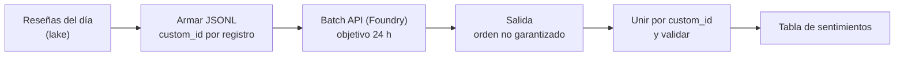

## 1. Resumen

La IA de Azure cambió de nombre. La página *What is Microsoft Foundry?* tiene una tabla, «Evolution of Foundry», que dice:

- «Azure AI Studio / Azure AI Foundry» → **Microsoft Foundry**;
- «Azure AI Services» → **Foundry Tools**;
- el modelo de recursos pasa de «Hub + Azure OpenAI + Azure AI Services» a un **recurso de Foundry** con proyectos.

Para el data engineer, lo relevante es el lado de los datos:

- la **Getting started with Azure OpenAI batch deployments** procesa un archivo **JSONL** con muchas solicitudes, cada una con **`custom_id`**; tiene un objetivo de 24 horas y la página dice que las respuestas **no vuelven en el mismo orden**: se unen por `custom_id`;
- **Document Intelligence**, en Foundry Tools, extrae datos de formularios y documentos.

RAG, agentes y evaluación de modelos van en el dominio 21.

## 2. Qué es

- **Microsoft Foundry:** la plataforma de IA de Azure (antes Azure AI Studio / Azure AI Foundry), con un recurso de Foundry y proyectos.
- **Foundry Tools:** API y modelos preconstruidos (lenguaje, traducción, voz, visión), incluidos Azure OpenAI y Document Intelligence (antes Azure AI Services, según la misma tabla).
- **Batch API:**
  - un archivo JSONL, una solicitud por línea, con `custom_id`, `method`, `url` y `body`;
  - procesamiento asíncrono con cuota aparte y objetivo de 24 horas;
  - el `model` es el nombre del deployment de Global Batch;
  - las respuestas no respetan el orden del archivo.
- **Document Intelligence:** procesamiento inteligente de documentos.

## 3. Problema que resuelve

Clasificar, resumir o extraer datos de millones de textos o documentos con modelos de IA, sin hacer millones de llamadas síncronas, y llevar el resultado al lake como cualquier otro dato.

## 4. Cómo funciona

1. Un job arma el JSONL con un `custom_id` estable por registro.
2. Se sube el archivo y se crea el batch contra el deployment de Global Batch.
3. Foundry procesa las solicitudes de forma asíncrona, con objetivo de 24 horas.
4. El job descarga la salida y la une con las solicitudes por `custom_id`; falla si falta alguna.
5. El resultado se carga al lake particionado por día.

## 5. Cuándo utilizarlo

- Enriquecer grandes volúmenes de texto sin urgencia.
- Extraer datos de documentos (facturas, formularios) con Document Intelligence.
- Pipelines que ya viven en Azure.

## 6. Cuándo no utilizarlo

- Respuestas inmediatas dentro de una aplicación: llamadas en tiempo real, no batch.
- Asumir que la salida viene en el orden de la entrada.
- Usar los nombres anteriores (Azure AI Studio, Azure AI Services) para buscar documentación nueva.

## 7. Ejemplo sencillo

Dos reseñas, `r1` y `r2`, se convierten en dos líneas del JSONL con su `custom_id`. La salida llega con `r2` antes que `r1`: unir por `custom_id` deja cada respuesta con su reseña.

## 8. Ejemplo de producción

Cada noche:

1. un job arma el JSONL con las reseñas nuevas del día, con el id de la reseña como `custom_id`;
2. crea un batch contra el deployment de Global Batch;
3. al terminar, une respuestas y solicitudes por `custom_id`, falla si falta alguna y escribe la tabla de sentimientos por día.

## 9. Arquitectura



## 10. Código

```python
# Python 3.12, solo biblioteca estándar (ejecutado en la CI; mypy --strict sin errores): arma el archivo JSONL de la
# Batch API de Microsoft Foundry (una solicitud por línea, con custom_id) y une las respuestas con las solicitudes por
# custom_id, porque la página dice que no vuelven en el mismo orden. Subir el archivo y crear el batch, con el
# cliente de OpenAI contra el endpoint del proyecto, no se ejecutó.
from __future__ import annotations

import json
from typing import Any


def build_batch(reviews: dict[str, str], deployment: str) -> str:
    lines = []
    for review_id, text in sorted(reviews.items()):
        request = {
            "custom_id": review_id,
            "method": "POST",
            "url": "/v1/responses",
            "body": {"model": deployment, "input": f"Clasifica el sentimiento (positivo, neutro o negativo): {text}"},
        }
        lines.append(json.dumps(request, ensure_ascii=False))
    return "\n".join(lines) + "\n"


def join_responses(batch_jsonl: str, output_jsonl: str) -> dict[str, dict[str, Any]]:
    """Une cada respuesta con su solicitud por custom_id; falla si falta alguna."""
    requests = {json.loads(line)["custom_id"]: json.loads(line) for line in batch_jsonl.splitlines() if line}
    responses = {json.loads(line)["custom_id"]: json.loads(line) for line in output_jsonl.splitlines() if line}
    missing = sorted(set(requests) - set(responses))
    if missing:
        raise ValueError(f"solicitudes sin respuesta: {missing}")
    return {cid: {"solicitud": requests[cid], "respuesta": responses[cid]} for cid in sorted(requests)}
```

`build_batch` y `join_responses` se **ejecutan en la CI** (Python 3.12, solo biblioteca estándar) y pasan `mypy --strict`. El test arma el JSONL, simula una salida en otro orden y comprueba la unión y el error si falta una respuesta. **Subir el archivo y crear el batch no se ejecutó**: no hay emulador en la CI y no se llamó a Azure (ADR-013). El formato de cada línea es el de la página de la Batch API.

## 11. GCP

No aplica de forma específica: esta ficha describe Foundry. En GCP, la plataforma es Gemini Enterprise Agent Platform (ver `vertex-ai-for-data-engineers`). Las diferencias de la inferencia por lotes, según sus páginas:

| | Foundry (Batch API) | Agent Platform (Gemini) |
|---|---|---|
| Entrada | Un archivo JSONL con `custom_id` por solicitud | Una tabla de BigQuery en la misma región del job, o archivos en Cloud Storage |
| Salida | Archivo de respuestas, en otro orden; se une por `custom_id` | Una tabla de BigQuery o JSONL en Cloud Storage |
| Plazo y costo | Objetivo de 24 horas; 50 % menos que global standard | Asíncrona y de alto volumen, con descuento frente a tiempo real |

## 12. AWS

No aplica de forma específica. En AWS es Bedrock (ver `bedrock-for-data-engineers`). Las diferencias, según sus páginas:

| | Foundry (Batch API) | Bedrock |
|---|---|---|
| Identificador por registro | `custom_id`, obligatorio para unir | `recordId`; si falta, Bedrock lo agrega en la salida |
| Orden de la salida | No idéntico al del archivo | No garantizado |
| Dónde viven los archivos | Se suben a Foundry | JSONL en S3; la salida también en S3 |

## 13. Azure

**Microsoft Foundry.** Los nombres actuales y anteriores son los de la tabla «Evolution of Foundry»; la Batch API, Foundry Tools y Document Intelligence, los de sus páginas. La tecnología conserva el slug `azure-ai`, con los nombres anteriores como alias de búsqueda (ADR-010).

## 14. Buenas prácticas

- `custom_id` estable por registro, para unir y re-ejecutar sin duplicar.
- Validar que cada solicitud tenga respuesta antes de cargar.
- Entradas y salidas particionadas por día en el lake.
- Usar los nombres actuales (Microsoft Foundry, Foundry Tools) en la documentación del equipo.
- **Seguridad:** acceso al recurso de Foundry por identidad (ver `entra-id-for-data`); revisar qué datos personales se envían al modelo.
- **Observabilidad:** seguir el estado de cada batch, las solicitudes sin respuesta y la distribución de resultados por día.
- **Costo:** la Batch API cuesta 50 % menos que global standard, según su página. Los montos se consultan en la página de precios.

## 15. Errores frecuentes

- Asumir que las respuestas vuelven en el orden del archivo.
- `custom_id` generado al azar en cada corrida.
- Cargar resultados sin validar que estén todos.
- Buscar la documentación por los nombres anteriores y no encontrar las páginas nuevas.

## 16. Trade-offs

La Batch API procesa grandes volúmenes con menor costo y cuota aparte, a cambio de un objetivo de 24 horas en lugar de respuestas inmediatas. Document Intelligence evita armar un modelo propio para documentos, dentro de lo que sus modelos cubren.

## 17. Conceptos relacionados

- `vertex-ai-for-data-engineers` y `bedrock-for-data-engineers`: la inferencia por lotes en GCP y AWS.
- `json-format` y `batch-ingestion`: cómo se preparan los lotes.
- `entra-id-for-data`: el acceso al recurso de Foundry.
- Del blueprint, pendiente de ficha: `rag` (dominio 21).

## 18. Preguntas técnicas abiertas

1. ¿Qué textos o documentos de tu plataforma podrías procesar en batch?
2. ¿Qué usarías como `custom_id` para re-ejecutar un día?
3. ¿Qué documentos extraerías con Document Intelligence?

## 19. Laboratorio relacionado

Pendiente (F4).

## 20. Fuentes

- Microsoft Learn: *What is Microsoft Foundry?*, *What are Foundry Tools?*, *What is Azure Document Intelligence in Foundry Tools?* y *Getting started with Azure OpenAI batch deployments*.
- AWS, Bedrock: *Format and upload your batch inference data* y *Process multiple prompts with batch inference*. Google Cloud: *Batch inference for BigQuery* y *Batch inference with Gemini*.

El detalle de cada fuente está en `sources` del frontmatter.

## 21. Fecha de última verificación

2026-10-14. Pasa a `verified`: revisión B-F3.1 del lote F3b-10b aplicada, sin VERIFY pendientes.

## 22. Historial de cambios importantes

- 2026-10-13: creación (lote F3b-10b), con los nombres actuales según la tabla «Evolution of Foundry» y los anteriores como alias de búsqueda.
- 2026-10-14: revisión B-F3.1 del lote F3b-10b aplicada (docs/reviews/cards-f3b-10b.md): filas aprobadas sin cambios en esta ficha.
- 2026-10-14: `verification_status: verified` (sin VERIFY pendientes).
