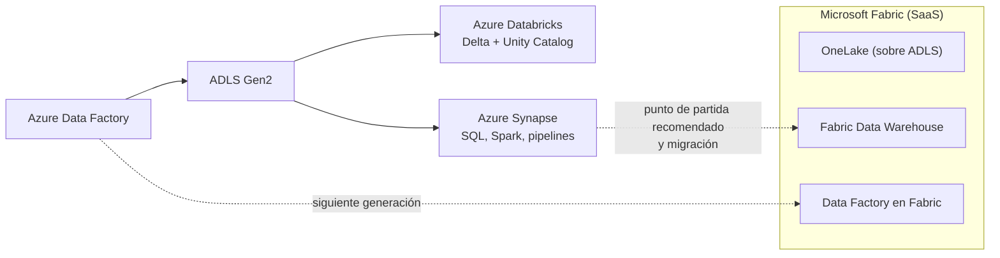

## 1. Resumen

Azure tiene cuatro servicios de analítica que se superponen en parte. Esta ficha dice qué es cada uno y cómo se relacionan **según las páginas de Microsoft**, al 2026-10-13:

| Servicio | Qué es, según su página | Relación con Fabric, según Microsoft |
|---|---|---|
| **Azure Data Factory** | Servicio de ETL e integración de datos en la nube para orquestar movimiento y transformación | «Data Factory in Microsoft Fabric is the next generation of Azure Data Factory»; a quien es nuevo, le recomienda empezar con Fabric Data Factory; las cargas existentes pueden actualizarse |
| **Azure Synapse Analytics** | Servicio de analítica que reúne SQL (dedicado y serverless), Spark, Data Explorer y pipelines | Sus páginas recomiendan empezar con Fabric Data Warehouse a quien es nuevo; los pools dedicados pueden actualizarse a Fabric; hay guía de migración |
| **Microsoft Fabric** | Plataforma de analítica SaaS con experiencias sobre un modelo compartido de cómputo y almacenamiento, y OneLake | — |
| **Azure Databricks** | Plataforma de datos, analítica e IA con lakehouse sobre Delta Lake y gobierno con Unity Catalog | Las páginas citadas de Databricks no la presentan como reemplazo de otro servicio |

Ninguna de las páginas citadas dice que Data Factory o Synapse estén deprecados o retirados. Lo que dicen es que Fabric es la siguiente generación (Data Factory) o el punto de partida recomendado (warehouse), con caminos de actualización.

## 2. Qué es

- **Integración y orquestación:** Data Factory (pipelines, Copy, triggers) y su siguiente generación en Fabric; Synapse tiene pipelines; Databricks orquesta con Lakeflow Jobs.
- **Warehouse:** pools SQL dedicados de Synapse y Fabric Data Warehouse.
- **Spark:** Synapse Spark, Fabric Data Engineering y Azure Databricks.
- **Almacenamiento:** ADLS Gen2 debajo de todos; OneLake, construido sobre ADLS, en Fabric.
- **Gobierno:** Unity Catalog en Databricks; OneLake Catalog y Microsoft Purview en Fabric.

## 3. Problema que resuelve

Elegir entre servicios que hacen cosas parecidas con nombres que cambian. Sin un mapa, es fácil empezar un proyecto nuevo en un servicio que Microsoft ya no recomienda como punto de partida, o afirmar que algo está deprecado sin que nadie lo haya dicho.

## 4. Cómo funciona

Una plataforma típica combina estas piezas:

1. ADLS Gen2 (u OneLake en Fabric) guarda los datos.
2. Data Factory (o Data Factory en Fabric) mueve los datos y orquesta.
3. Spark (Databricks, Synapse o Fabric) transforma.
4. Un warehouse (pool dedicado de Synapse o Fabric Data Warehouse) sirve las consultas SQL.
5. El gobierno vive en Unity Catalog, OneLake Catalog o Purview, según la plataforma.

## 5. Cuándo utilizarlo

- Al empezar un proyecto: leer qué recomienda Microsoft para cada pieza hoy.
- Al planificar migraciones de ADF o Synapse a Fabric.
- Al decidir entre Databricks y Fabric para el lakehouse.

## 6. Cuándo no utilizarlo

- Como sustituto de las fichas de cada servicio: el detalle técnico está en `data-factory-pipelines`, `synapse-analytics`, `fabric-onelake-and-workloads` y `azure-databricks-lakehouse`.
- Para afirmar fechas de retiro: no hay ninguna en las páginas citadas.

## 7. Ejemplo sencillo

Un equipo nuevo que necesita un warehouse lee el aviso de las páginas de Synapse y empieza con Fabric Data Warehouse. Un equipo con pipelines de ADF en producción los mantiene y evalúa la actualización a Data Factory en Fabric con la guía de Microsoft.

## 8. Ejemplo de producción

Una empresa con ADF, un pool dedicado de Synapse y Databricks:

- mantiene Databricks para el lakehouse y el ML, con Unity Catalog;
- planifica la migración del pool dedicado a Fabric Data Warehouse con la guía y el asistente de migración;
- evalúa llevar sus pipelines de ADF a Data Factory en Fabric.

Cada decisión cita la página de Microsoft que la respalda.

## 9. Arquitectura

## 10. Código

Sin código: esta ficha es un mapa de servicios. El código está en las fichas de cada servicio (`data-factory-pipelines`, `synapse-analytics`, `fabric-onelake-and-workloads` y `azure-databricks-lakehouse`).

## 11. GCP

No aplica de forma específica: esta ficha describe el mapa de Azure. En GCP, el mapa equivalente se reparte entre BigQuery, Dataflow, Managed Service for Apache Spark, Composer y Knowledge Catalog (ver `orchestration-landscape` y las fichas de 08-gcp). Las diferencias de cada pieza están en el §11 de las fichas de cada servicio de Azure.

| Pieza | Azure | GCP (ver su ficha) |
|---|---|---|
| Integración y orquestación | Data Factory y Data Factory en Fabric | `composer-environments`, `dataform-workflows` |
| Warehouse | Synapse dedicado y Fabric Data Warehouse | `bigquery-architecture` |
| Spark y lakehouse | Databricks, Synapse Spark, Fabric | `bigquery-biglake-tables`, `dataflow-execution-model` |

## 12. AWS

No aplica de forma específica. En AWS, las piezas son servicios separados (ver las fichas de 09-aws). Las diferencias de cada pieza están en el §12 de las fichas de cada servicio de Azure.

| Pieza | Azure | AWS (ver su ficha) |
|---|---|---|
| Integración y orquestación | Data Factory y Data Factory en Fabric | `glue-catalog-and-etl`, `step-functions-workflows`, `mwaa-managed-airflow` |
| Warehouse | Synapse dedicado y Fabric Data Warehouse | `redshift-architecture` |
| Spark y lakehouse | Databricks, Synapse Spark, Fabric | `emr-spark-clusters`, `lake-formation-permissions` |

## 13. Azure

**Data Factory, Synapse, Fabric y Databricks.** Lo que es cada uno y su relación con Fabric son los de sus páginas, citadas tal cual en el §1. Esta ficha se revisa en cada actualización de esas páginas.

## 14. Buenas prácticas

- Antes de empezar un proyecto, leer el aviso de la página de cada servicio.
- Citar la página de Microsoft en cada decisión de migración.
- No decir «deprecado» ni dar fechas de retiro sin una página que lo diga.
- Un servicio por responsabilidad: no dos warehouses ni dos orquestadores sin motivo.
- **Seguridad:** el gobierno depende de la plataforma (Unity Catalog, OneLake Catalog, Purview); definir cuál manda para cada dato.
- **Observabilidad:** saber qué servicio corre cada paso, para no buscar un fallo en el lugar equivocado.
- **Costo:** cada servicio tiene su modelo (actividades y DIU, pools, capacidad F, DBU); combinar servicios suma modelos de costo.

## 15. Errores frecuentes

- Decir que Synapse o ADF están deprecados sin una página que lo diga.
- Empezar un proyecto nuevo sin leer la recomendación actual de Microsoft.
- Tener el mismo dato gobernado en dos lugares sin dueño claro.
- Migrar por moda, sin un motivo de capacidad, costo o funcionalidad.

## 16. Trade-offs

Fabric concentra almacenamiento, ingesta, warehouse y reportes en un SaaS con capacidad compartida; Microsoft lo presenta como la siguiente generación de Data Factory y el punto de partida para warehouses nuevos. Databricks da un lakehouse con Spark y gobierno propios. ADF y Synapse siguen disponibles, con caminos de actualización a Fabric.

## 17. Conceptos relacionados

- `data-factory-pipelines`, `synapse-analytics`, `fabric-onelake-and-workloads` y `azure-databricks-lakehouse`: cada servicio.
- `adls-gen2-storage`: el almacenamiento común.
- `orchestration-landscape`: el panorama general de orquestadores.
- `composer-environments`, `dataform-workflows`, `bigquery-architecture`, `bigquery-biglake-tables` y `dataflow-execution-model`: las piezas de GCP de la tabla del §11.
- `glue-catalog-and-etl`, `step-functions-workflows`, `mwaa-managed-airflow`, `redshift-architecture`, `emr-spark-clusters` y `lake-formation-permissions`: las piezas de AWS de la tabla del §12.

## 18. Preguntas técnicas abiertas

1. ¿Qué servicio usarías hoy para un warehouse nuevo en Azure, y qué página lo respalda?
2. ¿Qué te haría elegir Databricks o Fabric para el lakehouse?
3. ¿Qué cargas existentes migrarías primero a Fabric?

## 19. Laboratorio relacionado

Pendiente (F4).

## 20. Fuentes

- Microsoft Learn: *What is Azure Data Factory?*, *What is Data Factory in Microsoft Fabric?*, *What is Azure Synapse Analytics?*, *Guidance for designing distributed tables using dedicated SQL pool in Azure Synapse Analytics*, *Migration planning: Azure Synapse Analytics dedicated SQL pools to Fabric Data Warehouse*, *What is Microsoft Fabric?*, *What is OneLake?*, *What is Azure Databricks?*, *What is Unity Catalog?* y *Lakeflow Jobs*.

El detalle de cada fuente está en `sources` del frontmatter.

## 21. Fecha de última verificación

2026-10-14. Pasa a `verified`: revisión B-F3.1 del lote F3b-10a aplicada, sin VERIFY pendientes.

## 22. Historial de cambios importantes

- 2026-10-13: creación (lote F3b-10a).
- 2026-10-14: revisión B-F3.1 del lote F3b-10a aplicada (docs/reviews/cards-f3b-10a.md): relations y §17 incluyen las once fichas de GCP y AWS que nombran el §11 y el §12.
- 2026-10-14: `verification_status: verified` (sin VERIFY pendientes).
