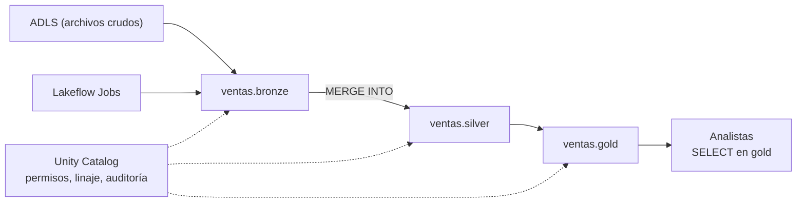

## 1. Resumen

**Azure Databricks** es una plataforma de datos, analítica e IA que administra la infraestructura de Spark en la cuenta de Azure del cliente. El lakehouse se apoya en dos piezas, según su documentación:

- **Delta Lake**, la capa de almacenamiento de las tablas: archivos Parquet más un **log de transacciones** que da ACID;
- **Unity Catalog**, la capa de gobierno: aplica el **control de acceso al consultar**, registra **linaje** y **actividad** para auditoría, con el espacio de nombres **`catálogo.esquema.objeto`**.

Los datos se organizan en capas **medallion** (bronze, silver, gold), se actualizan con **`MERGE INTO`** y se orquestan con **Lakeflow Jobs**.

## 2. Qué es

- **Workspace:** el entorno de Databricks en la suscripción de Azure.
- **Delta Lake:** Parquet más un log de transacciones; ACID, metadatos escalables, compatible con las API de Spark y con Structured Streaming.
- **Unity Catalog:**
  - control de acceso al consultar una tabla o llamar a un modelo;
  - linaje y auditoría;
  - tres niveles: catálogo, esquema y objeto;
  - tablas y volúmenes **administrados** (Unity Catalog gobierna y administra el almacenamiento) o **externos** (solo gobierna).
- **Medallion:** bronze (crudo), silver (validado), gold (enriquecido).
- **Lakeflow Jobs:** jobs que programan y orquestan tareas (notebooks, ETL, ML), con integraciones como dbt y Azure Data Factory.

## 3. Problema que resuelve

Un lake de archivos no tiene transacciones ni un lugar único donde dar permisos. Delta Lake agrega ACID sobre Parquet, y Unity Catalog centraliza permisos, linaje y auditoría de tablas y modelos, para todos los workspaces.

## 4. Cómo funciona

1. Los archivos crudos llegan a ADLS y se cargan a tablas bronze.
2. Un job transforma bronze a silver con `MERGE INTO`: actualiza lo que existe e inserta lo nuevo.
3. Las tablas gold agregan para los consumidores.
4. Unity Catalog decide en cada consulta si el usuario puede leer la tabla y registra el linaje.
5. Lakeflow Jobs encadena las tareas y las programa.

## 5. Cuándo utilizarlo

- Lakehouse con Spark como motor principal y gobierno centralizado.
- Cargas de ingeniería de datos y ML sobre las mismas tablas.
- Equipos que necesitan linaje y auditoría por tabla.

## 6. Cuándo no utilizarlo

- Solo SQL sobre datos ya cargados en un warehouse: un warehouse alcanza.
- Pipelines chicos que no justifican clústeres de Spark.
- Gobernar los datos fuera de Unity Catalog cuando ya está habilitado: el control se aplica ahí.

## 7. Ejemplo sencillo

La tabla `ventas.silver.pedidos` recibe cada día los pedidos nuevos y actualizados con `MERGE INTO`. Si el job se re-ejecuta, los pedidos ya cargados se actualizan, no se duplican.

## 8. Ejemplo de producción

Un workspace premium con Unity Catalog:

- catálogo `ventas` con esquemas `bronze`, `silver` y `gold`;
- un job de Lakeflow Jobs diario: carga bronze, `MERGE INTO` a silver, agregados a gold;
- los analistas tienen `SELECT` solo sobre `ventas.gold`;
- el linaje de Unity Catalog muestra de qué tablas sale cada tabla gold.

## 9. Arquitectura



## 10. Código

```sql
-- SQL de Azure Databricks con Unity Catalog (no ejecutado: no hay Databricks en local ni en la CI).
-- Espacio de nombres de tres niveles (catálogo.esquema.tabla), capas medallion y MERGE idempotente.
CREATE CATALOG IF NOT EXISTS ventas;
CREATE SCHEMA IF NOT EXISTS ventas.silver;
CREATE SCHEMA IF NOT EXISTS ventas.gold;

CREATE TABLE IF NOT EXISTS ventas.silver.pedidos (
  id_pedido  BIGINT,
  estado     STRING,
  updated_at TIMESTAMP,
  dt         DATE
);

-- Re-ejecutar el día actualiza las filas existentes en lugar de duplicarlas.
MERGE INTO ventas.silver.pedidos AS t
USING ventas.bronze.pedidos_del_dia AS s
ON t.id_pedido = s.id_pedido
WHEN MATCHED AND s.updated_at > t.updated_at THEN UPDATE SET *
WHEN NOT MATCHED THEN INSERT *;

-- El acceso se da en Unity Catalog, no en el almacenamiento.
GRANT SELECT ON SCHEMA ventas.gold TO `analistas`;
```

```hcl
# Terraform (validado en la CI con terraform validate, sin credenciales; no se aplicó): workspace de Azure Databricks.
# Requiere: provider hashicorp/azurerm ~> 5.0; un grupo de recursos existente. Unity Catalog se configura aparte.
terraform {
  required_providers {
    azurerm = {
      source  = "hashicorp/azurerm"
      version = "~> 5.0"
    }
  }
}

provider "azurerm" {
  features {}
}

variable "resource_group_name" {
  type = string
}

variable "location" {
  type    = string
  default = "eastus2"
}

resource "azurerm_databricks_workspace" "datos" {
  name                = "dekh-dbx"
  resource_group_name = var.resource_group_name
  location            = var.location
  sku                 = "premium"
}
```

**No ejecutado:** el SQL de Databricks no se corrió (no hay Databricks en local ni en la CI; ADR-013). Usa el espacio de nombres de tres niveles de Unity Catalog y la forma de `MERGE INTO` de *Upsert into a Delta Lake table using merge*; `UPDATE SET *` e `INSERT *` toman todas las columnas. Los nombres son ilustrativos.

El bloque de Terraform se valida en la CI con `terraform validate`, sin credenciales (`make validate-terraform`), y **no se aplicó**.

## 11. GCP

No aplica de forma específica: esta ficha describe Azure Databricks. Lo más cercano en GCP es Managed Service for Apache Spark con Knowledge Catalog (ver `dataplex-governance`). Las diferencias, según sus páginas:

| | Azure Databricks | GCP |
|---|---|---|
| Spark | Clústeres administrados en la cuenta del cliente | Managed Service for Apache Spark: despliegue en clúster o serverless |
| Gobierno | Unity Catalog: control de acceso al consultar, linaje y auditoría | Knowledge Catalog: metadatos técnicos y de negocio, descubrimiento y calidad |
| Formato de las tablas | Delta Lake como base del lakehouse | Las páginas citadas no fijan un formato por defecto |

## 12. AWS

No aplica de forma específica. Lo más cercano es EMR con Lake Formation (ver `emr-spark-clusters` y `lake-formation-permissions`). Las diferencias, según sus páginas:

| | Azure Databricks | EMR / Lake Formation |
|---|---|---|
| Spark | Plataforma con la infraestructura administrada por Databricks | EMR: clústeres de EC2 con las versiones de una release (por ejemplo, Spark 3.5.8 en emr-7.14.0) |
| Formato de las tablas | Delta Lake como base | La release incluye Delta, Iceberg y Hudi; no impone uno |
| Gobierno | Unity Catalog | Lake Formation: permisos por base, tabla, columna, fila y celda en los motores integrados |

## 13. Azure

**Azure Databricks.** Delta Lake, Unity Catalog, medallion, `MERGE INTO` y Lakeflow Jobs son los de sus páginas. Los precios por DBU y por máquinas virtuales se consultan en la página de precios.

## 14. Buenas prácticas

- Unity Catalog habilitado y permisos por catálogo y esquema, no por almacenamiento.
- Elegir a conciencia entre tablas administradas (Unity Catalog gobierna y administra el almacenamiento) y externas (solo gobierna).
- `MERGE INTO` con condición de fecha de actualización para re-ejecutar sin duplicar ni retroceder.
- Capas medallion con responsables claros.
- **Seguridad:** `GRANT` en Unity Catalog a grupos, no a usuarios; acceso al almacenamiento por credenciales de Unity Catalog.
- **Observabilidad:** usar el linaje y la auditoría de Unity Catalog; seguir duración y fallas de cada job.
- **Costo:** se pagan DBU según el tipo de cómputo y el nivel, más las VM. Los montos se consultan en la página de precios.

## 15. Errores frecuentes

- Dar acceso a los archivos de ADLS directamente y saltarse Unity Catalog.
- `INSERT` en lugar de `MERGE` y duplicar al re-ejecutar.
- Tablas gold que se recalculan completas cada vez sin necesidad.
- Clústeres interactivos encendidos para cargas programadas.

## 16. Trade-offs

Databricks da un lakehouse con Spark, Delta y gobierno integrados, a cambio de otra plataforma que operar y pagar (DBU más VM). Fabric ofrece un modelo SaaS con capacidad compartida; EMR y los servicios de GCP dan más piezas separadas.

## 17. Conceptos relacionados

- `lakehouse` y `pipeline-layers`: el patrón y las capas.
- `pyspark-dataframes` y `upsert`: el código.
- `emr-spark-clusters`, `lake-formation-permissions` y `dataplex-governance`: Spark y gobierno en AWS y GCP.
- `adls-gen2-storage`: el almacenamiento.
- `azure-analytics-landscape`: Databricks en el mapa de Azure.

## 18. Preguntas técnicas abiertas

1. ¿Qué tablas de tu lake serían administradas y cuáles externas?
2. ¿Cómo darías acceso a gold sin exponer bronze?
3. ¿Qué parte de tu pipeline dejarías en Lakeflow Jobs y qué en un orquestador externo?

## 19. Laboratorio relacionado

Pendiente (F4).

## 20. Fuentes

- Microsoft Learn, Azure Databricks: *What is Azure Databricks?*, *What is Delta Lake in Azure Databricks?*, *What is Unity Catalog?*, *What is the medallion lakehouse architecture?*, *Upsert into a Delta Lake table using merge* y *Lakeflow Jobs*; *Azure Databricks pricing*.
- AWS: *Understanding how to create and work with Amazon EMR clusters*, *Amazon EMR release 7.14.0* y *What is AWS Lake Formation?*. Google Cloud: *Compare Managed Service for Apache Spark serverless and cluster deployments* y *Knowledge Catalog overview*.

El detalle de cada fuente está en `sources` del frontmatter.

## 21. Fecha de última verificación

2026-10-14. Pasa a `verified`: revisión B-F3.1 del lote F3b-10a aplicada, sin VERIFY pendientes.

## 22. Historial de cambios importantes

- 2026-10-13: creación (lote F3b-10a).
- 2026-10-14: revisión B-F3.1 del lote F3b-10a aplicada (docs/reviews/cards-f3b-10a.md): filas aprobadas sin cambios en esta ficha.
- 2026-10-14: `verification_status: verified` (sin VERIFY pendientes).
