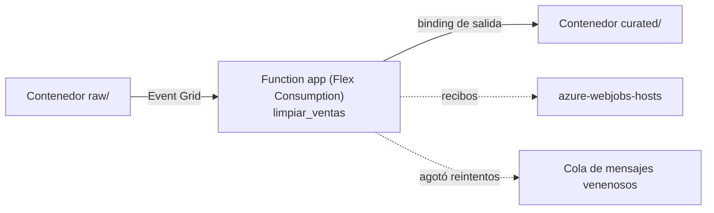

## 1. Resumen

**Azure Functions** ejecuta código ante un evento, sin servidores que administrar. Para datos sirve en pasos cortos y reactivos: un archivo llega al lake, un mensaje llega a una cola. Según su documentación:

- el plan recomendado para apps serverless nuevas es **Flex Consumption**; el plan Consumption es «legacy»;
- el **timeout** por defecto es de **30 minutos**, sin máximo en Flex, Premium y Dedicated; una función HTTP tiene **230 segundos** para responder, sin importar el timeout;
- el **blob trigger** puede basarse en **Event Grid** (menor latencia) o sondear el contenedor (por defecto);
- el runtime guarda **recibos** para no llamar dos veces a la función por el mismo blob.

En Python, el **modelo v2** declara triggers y bindings con decoradores.

## 2. Qué es

- **Function app:** el conjunto de funciones que se despliega junto, en un plan de hosting.
- **Trigger y bindings:** el trigger dispara la función; los bindings conectan entradas y salidas sin código de cliente.
- **Planes:**
  - *Flex Consumption*: el recomendado para serverless nuevo;
  - *Premium* y *Dedicated*: instancias reservadas;
  - *Container Apps*: funciones en un entorno de Container Apps;
  - *Consumption*: legacy (en Linux, retirado).
- **Timeout:** `functionTimeout` en `host.json`; 30 minutos por defecto; sin máximo en Flex, Premium, Dedicated y Container Apps; 230 segundos para responder HTTP.
- **Blob trigger:** `source="EventGrid"` o el sondeo por defecto (`LogsAndContainerScan`); recibos en `azure-webjobs-hosts`; tras los reintentos, el blob va a una cola de mensajes venenosos.
- **Reintentos:** el origen depende del trigger: la extensión (Blob, Queue, Service Bus), una política por función (Event Hubs, Kafka, Timer) o una cola de mensajes muertos (RabbitMQ).

## 3. Problema que resuelve

Muchos pasos de un pipeline son chicos y reactivos: validar o limpiar un archivo al llegar, mover un mensaje. Functions los corre al ocurrir el evento, escala con la cantidad de eventos y, en Flex Consumption, cobra por uso.

## 4. Cómo funciona

1. Un archivo nuevo llega a `raw/` en la cuenta del lake.
2. Event Grid avisa y el blob trigger dispara `limpiar_ventas`.
3. La función lee el blob, descarta líneas inválidas y escribe el resultado en `curated/` con el mismo nombre, por el binding de salida.
4. El recibo marca el blob como procesado; si la función falla, se reintenta y, al agotar los reintentos, el blob va a la cola de mensajes venenosos.

## 5. Cuándo utilizarlo

- Limpiezas, validaciones o copias chicas al llegar un archivo.
- Consumir mensajes de colas o eventos con lógica corta.
- Pegamento entre servicios.

## 6. Cuándo no utilizarlo

- Respuestas HTTP que tardan más de 230 segundos.
- Transformaciones distribuidas de grandes volúmenes: Spark.
- Proyectos nuevos en el plan Consumption: su página lo marca como legacy.

## 7. Ejemplo sencillo

Un proveedor deja `raw/lote-01.jsonl`. La función escribe `curated/lote-01.jsonl` solo con las filas válidas y los montos redondeados. Si el mismo blob se vuelve a escribir, la función corre de nuevo y sobrescribe la salida.

## 8. Ejemplo de producción

Una function app en Flex Consumption con Python 3.12 e identidad administrada:

- blob trigger por Event Grid sobre `raw/`;
- salida en otro contenedor, para que la función no se dispare a sí misma;
- los blobs que agotan los reintentos se revisan desde la cola de mensajes venenosos;
- la identidad tiene acceso solo a esos dos contenedores.

## 9. Arquitectura



## 10. Código

```python
# Python 3.12, modelo de programación v2 de Azure Functions (no ejecutado: requiere el host de Functions y una cuenta de
# almacenamiento; no se desplegó). Un blob nuevo en raw/ dispara la función, que escribe su versión limpia en curated/
# con el mismo nombre (otro contenedor: la salida no vuelve a disparar la función; un reintento sobrescribe).
import json

import azure.functions as func

app = func.FunctionApp()


def limpiar(texto: str) -> str:
    filas = []
    for linea in texto.splitlines():
        try:
            fila = json.loads(linea)
        except json.JSONDecodeError:
            continue
        if isinstance(fila, dict) and "id" in fila and isinstance(fila.get("monto"), (int, float)):
            filas.append(json.dumps({"id": fila["id"], "monto": round(float(fila["monto"]), 2)}))
    return "".join(f + "\n" for f in filas)


@app.blob_trigger(arg_name="entrada", path="raw/{name}", connection="LakeStorage", source="EventGrid")
@app.blob_output(arg_name="salida", path="curated/{name}", connection="LakeStorage")
def limpiar_ventas(entrada: func.InputStream, salida: func.Out[str]) -> None:
    salida.set(limpiar(entrada.read().decode("utf-8")))
```

```hcl
# Terraform (validado en la CI con terraform validate, sin credenciales; no se aplicó): function app en el plan Flex
# Consumption, el que su página recomienda para apps serverless nuevas, con Python e identidad administrada.
# Requiere: provider hashicorp/azurerm ~> 5.0; grupo de recursos y cuenta de almacenamiento existentes.
terraform {
  required_providers {
    azurerm = {
      source  = "hashicorp/azurerm"
      version = "~> 5.0"
    }
  }
}

provider "azurerm" {
  features {}
}

variable "resource_group_name" {
  type = string
}

variable "location" {
  type    = string
  default = "eastus2"
}

variable "storage_blob_endpoint" {
  type        = string
  description = "Endpoint de Blob de la cuenta de almacenamiento de la app (https://<cuenta>.blob.core.windows.net)"
}

resource "azurerm_service_plan" "flex" {
  name                = "dekh-func-flex"
  resource_group_name = var.resource_group_name
  location            = var.location
  os_type             = "Linux"
  sku_name            = "FC1"
}

resource "azurerm_function_app_flex_consumption" "ventas" {
  name                        = "dekh-func-ventas"
  resource_group_name         = var.resource_group_name
  location                    = var.location
  service_plan_id             = azurerm_service_plan.flex.id
  storage_container_type      = "blobContainer"
  storage_container_endpoint  = "${var.storage_blob_endpoint}/deployments"
  storage_authentication_type = "SystemAssignedIdentity"
  runtime_name                = "python"
  runtime_version             = "3.12"
  maximum_instance_count      = 40
  instance_memory_in_mb       = 2048

  identity {
    type = "SystemAssigned"
  }

  site_config {}
}
```

El script en Python 3.12 con el modelo v2 **no se ejecutó**: necesita el host de Azure Functions y una cuenta de almacenamiento, y no se desplegó (ADR-013). Los parámetros del decorador (`path`, `connection`, `source="EventGrid"`) son los de la página del blob trigger.

El bloque de Terraform se valida en la CI con `terraform validate`, sin credenciales (`make validate-terraform`), y **no se aplicó**.

## 11. GCP

No aplica de forma específica: esta ficha describe Azure Functions. Lo más cercano en GCP es Cloud Run (ver `cloud-run-for-data`). Las diferencias, según sus páginas:

| | Azure Functions | Cloud Run |
|---|---|---|
| Modelo | Function app con triggers y bindings declarativos | Services, jobs, worker pools e instances; las funciones son una forma de desplegar código como service |
| Disparo por archivo | Blob trigger por Event Grid o por sondeo | Un service que recibe el evento por HTTP |
| Recursos | Planes de hosting (Flex Consumption recomendado) | Contenedores administrados por Cloud Run |

## 12. AWS

No aplica de forma específica. Lo más cercano es Lambda (ver `lambda-for-data`). Las diferencias, según sus páginas:

| | Azure Functions | Lambda |
|---|---|---|
| Duración máxima | Sin máximo en Flex, Premium y Dedicated (30 minutos por defecto); 230 segundos para responder HTTP | 15 minutos |
| Disparo por archivo | Blob trigger (Event Grid o sondeo), con recibos para no repetir | Notificación de S3, invocación asíncrona; advertencia de bucles si escribe en el mismo bucket |
| Reintentos | Según el trigger: extensión (Blob, Queue), política por función (Event Hubs, Kafka) | Dos en asíncrona; lote completo en streams; los fija la cola en SQS |

## 13. Azure

**Azure Functions.** Los planes, el timeout, los triggers y bindings, el blob trigger con Event Grid y recibos, los reintentos y el modelo v2 de Python son los de sus páginas.

## 14. Buenas prácticas

- Flex Consumption para apps serverless nuevas, como recomienda su página.
- Blob trigger por Event Grid y salida en otro contenedor.
- Funciones sin estado y defensivas, y nada de procesos largos dentro de una función.
- Revisar la cola de mensajes venenosos.
- **Seguridad:** identidad administrada para la function app y conexiones sin claves; acceso solo a los contenedores que usa.
- **Observabilidad:** seguir ejecuciones fallidas, duración y mensajes venenosos; un aumento indica datos de entrada inválidos.
- **Costo:** depende del plan de hosting. Según *Azure Functions pricing* (consultada el 2026-10-14), en Flex Consumption las instancias bajo demanda se cobran por la memoria aprovisionada mientras ejecutan funciones y por el número de ejecuciones; las instancias siempre listas suman la memoria de base mientras están inactivas. Los montos no se copian.

## 15. Errores frecuentes

- Escribir la salida en el mismo contenedor que dispara la función.
- Crear apps nuevas en el plan Consumption legacy.
- Una función HTTP que tarda más de 230 segundos.
- Ignorar la cola de mensajes venenosos.

## 16. Trade-offs

Functions dispara código con poco esfuerzo y bindings declarativos, a cambio de los límites de cada plan y de un modelo de reintentos que cambia por trigger. Container Apps aguanta procesos más largos y contenedores propios, con más que configurar.

## 17. Conceptos relacionados

- `lambda-for-data` y `cloud-run-for-data`: lo más cercano en AWS y GCP.
- `event-driven-pipelines` e `idempotency`: el patrón y su requisito.
- `adls-gen2-storage`: el lake donde llegan los archivos.

## 18. Preguntas técnicas abiertas

1. ¿Qué paso de tu pipeline es corto y reactivo, y podría ser una función?
2. ¿Qué haces con un blob que agota los reintentos?
3. ¿Cuándo pasarías una función a un job de Container Apps?

## 19. Laboratorio relacionado

Pendiente (F4).

## 20. Fuentes

- Microsoft Learn, Azure Functions: *What is Azure Functions?*, *Azure Functions hosting options*, *Azure Functions triggers and bindings*, *Azure Blob storage trigger for Azure Functions*, *Azure Functions error handling and retries*, *Azure Functions developer reference guide for Python apps* y *Best practices for reliable Azure Functions*; *Azure Functions pricing*.
- AWS, Lambda: *Lambda quotas*, *Understanding retry behavior in Lambda* y *Process Amazon S3 event notifications with Lambda*. Google Cloud, Cloud Run: *What is Cloud Run* y *Deployment options and resource model*.

El detalle de cada fuente está en `sources` del frontmatter.

## 21. Fecha de última verificación

2026-10-14. Pasa a `verified`: revisión B-F3.1 del lote F3b-10b aplicada, sin VERIFY pendientes.

## 22. Historial de cambios importantes

- 2026-10-13: creación (lote F3b-10b).
- 2026-10-14: revisión B-F3.1 del lote F3b-10b aplicada (docs/reviews/cards-f3b-10b.md): el costo de Flex Consumption cita *Azure Functions pricing* (2026-10-14), sin montos.
- 2026-10-14: `verification_status: verified` (sin VERIFY pendientes).
