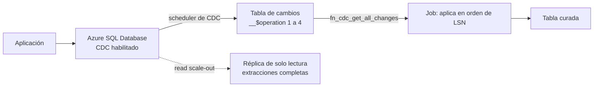

## 1. Resumen

Una base de **Azure SQL Database** que atiende una aplicación no debería cargar con las consultas del pipeline. Según su documentación, hay tres formas de sacar datos:

- **Réplica de solo lectura (read scale-out):** las extracciones leen de una réplica, aisladas de la carga de escritura.
- **Change tracking:** dice **qué filas cambiaron**, sin cuántas veces ni los valores intermedios.
- **Change data capture (CDC):** guarda **cada cambio** en tablas de cambios. La columna `__$operation` indica la operación: 1 delete, 2 insert, 3 y 4 la imagen previa y posterior de un update. En Azure SQL lo ejecuta un **scheduler** propio, no el SQL Server Agent. **No está disponible en Basic, S0, S1 ni S2.**

## 2. Qué es

- **Réplica de solo lectura:** mismo tamaño de cómputo que la primaria; read scale-out envía las consultas de solo lectura a ella.
- **Change tracking:** registra que una fila cambió. El pipeline lee la fila actual de la base.
- **CDC:**
  - se habilita en la base y luego por tabla (`sys.sp_cdc_enable_table`), que crea una **instancia de captura**;
  - la instancia tiene una tabla de cambios y funciones como `cdc.fn_cdc_get_all_changes_<instancia>` (todos los cambios) y, opcionalmente, `fn_cdc_get_net_changes_<instancia>` (el neto);
  - `__$operation`: 1 delete, 2 insert, 3 update (imagen previa), 4 update (imagen posterior).

## 3. Problema que resuelve

Llevar los datos de una base operacional al lake o al warehouse sin afectar a la aplicación, con inserciones, actualizaciones y borrados, y sin recargar todo cada vez.

## 4. Cómo funciona

1. Se habilita CDC en la base y en la tabla `ventas.pedidos`.
2. El scheduler de CDC de Azure SQL captura los cambios en la tabla de cambios.
3. El pipeline lee los cambios entre el último LSN procesado y el actual con `fn_cdc_get_all_changes_...`.
4. Los aplica en orden de LSN: 2 y 4 reemplazan la fila por id, 1 la borra, 3 se ignora.
5. Guarda el último LSN para la próxima corrida.

## 5. Cuándo utilizarlo

- **Réplica:** extracciones por lotes con SQL, sin cargar a la primaria.
- **Change tracking:** cuando basta saber qué filas cambiaron y leer su versión actual.
- **CDC:** cuando hace falta cada cambio, con borrados y el orden en que ocurrieron.

## 6. Cuándo no utilizarlo

- CDC en los niveles Basic, S0, S1 o S2: no está disponible.
- Change tracking si hace falta el historial de valores: no lo guarda.
- Consultas pesadas del pipeline sobre la primaria.

## 7. Ejemplo sencillo

Base: el pedido 1 está «creado». Los cambios traen un insert del pedido 2 (operación 2), el update del pedido 1 a «pagado» (operaciones 3 y 4) y el delete del pedido 2 (operación 1). Aplicados en orden de LSN, queda el pedido 1 «pagado». Aplicados dos veces, el resultado es el mismo.

## 8. Ejemplo de producción

Una base de pedidos en un nivel con CDC:

- CDC habilitado en `ventas.pedidos`;
- un job por hora lee los cambios desde el último LSN guardado y los aplica a la tabla curada;
- las extracciones completas, una vez por semana, leen de la réplica de solo lectura;
- una alerta avisa si el último LSN no avanza.

## 9. Arquitectura



## 10. Código

```sql
-- T-SQL de Azure SQL Database (no ejecutado: no hay Azure SQL ni SQL Server en local ni en la CI).
-- Habilitar CDC en la base y en una tabla, y leer todos los cambios entre dos LSN.
EXEC sys.sp_cdc_enable_db;

EXEC sys.sp_cdc_enable_table
    @source_schema = N'ventas',
    @source_name   = N'pedidos',
    @role_name     = NULL;

DECLARE @desde binary(10) = sys.fn_cdc_get_min_lsn('ventas_pedidos');
DECLARE @hasta binary(10) = sys.fn_cdc_get_max_lsn();

-- __$operation: 1 = delete, 2 = insert, 3 = update (imagen previa), 4 = update (imagen posterior).
SELECT __$start_lsn, __$operation, id, estado, monto
FROM cdc.fn_cdc_get_all_changes_ventas_pedidos(@desde, @hasta, N'all')
ORDER BY __$start_lsn;
```

```python
# Python 3.12, solo biblioteca estándar (ejecutado en la CI; mypy --strict sin errores): aplica las filas que devuelve
# cdc.fn_cdc_get_all_changes_<instancia> sobre el estado actual de una tabla. __$operation: 1 delete, 2 insert,
# 3 update (imagen previa: se ignora), 4 update (imagen posterior). Las filas se aplican en orden de __$start_lsn;
# aplicar dos veces el mismo lote deja el mismo estado.
from __future__ import annotations

from typing import Any

Row = dict[str, Any]


def apply_cdc(state: dict[int, Row], changes: list[Row]) -> dict[int, Row]:
    result = dict(state)
    for change in sorted(changes, key=lambda c: c["__$start_lsn"]):
        op = change["__$operation"]
        row = {k: v for k, v in change.items() if not k.startswith("__$")}
        if op in (2, 4):
            result[row["id"]] = row
        elif op == 1:
            result.pop(row["id"], None)
        elif op != 3:
            raise ValueError(f"__$operation desconocida: {op}")
    return result


if __name__ == "__main__":
    base = {1: {"id": 1, "estado": "creado", "monto": 100}}
    lote = [
        {"__$start_lsn": b"\x02", "__$operation": 3, "id": 1, "estado": "creado", "monto": 100},
        {"__$start_lsn": b"\x02", "__$operation": 4, "id": 1, "estado": "pagado", "monto": 100},
        {"__$start_lsn": b"\x01", "__$operation": 2, "id": 2, "estado": "creado", "monto": 50},
        {"__$start_lsn": b"\x03", "__$operation": 1, "id": 2, "estado": "creado", "monto": 50},
    ]
    una = apply_cdc(base, lote)
    print(una, "idempotente:", apply_cdc(una, lote) == una)
```

**No ejecutado:** el T-SQL no se corrió (no hay Azure SQL ni SQL Server en local ni en la CI; ADR-013). Usa los procedimientos y la función de consulta que describe *What is change data capture (CDC)?*.

El script en Python 3.12, solo con biblioteca estándar, se **ejecuta en la CI** y pasa `mypy --strict`. Aplica el ejemplo de §7, con los códigos de `__$operation` de esa página, y comprueba que aplicarlo dos veces da el mismo estado. **No leyó cambios reales de Azure SQL.**

## 11. GCP

No aplica de forma específica: esta ficha describe Azure SQL. El caso equivalente en GCP es Cloud SQL con Datastream (ver `cloud-sql-as-source`). Las diferencias, según sus páginas:

| | Azure SQL Database | Cloud SQL |
|---|---|---|
| Capturar cambios | CDC nativo en la base, con tablas de cambios y un scheduler propio | Datastream: servicio serverless de CDC que lee de la base y escribe en BigQuery o Cloud Storage |
| Réplicas para leer | Read scale-out: réplica de solo lectura con el mismo cómputo que la primaria | Réplicas de lectura en Cloud SQL |
| Qué lee el pipeline | Las funciones de CDC dentro de la base | El destino de Datastream |

## 12. AWS

No aplica de forma específica. El caso equivalente es RDS con DMS (ver `rds-as-source`). Las diferencias, según sus páginas:

| | Azure SQL Database | RDS / DMS |
|---|---|---|
| Capturar cambios | CDC nativo; `__$operation` 1 a 4 | DMS lee los logs de la base y escribe en S3 con `I`, `U` o `D` en el primer campo |
| Dónde quedan los cambios | Tablas de cambios en la misma base | Archivos de CDC en el destino (por ejemplo, S3) |
| Réplicas para leer | Read scale-out | Réplicas de lectura asíncronas |

## 13. Azure

**Azure SQL Database.** Read scale-out, change tracking, CDC con su scheduler, las funciones de consulta y los códigos de `__$operation` son los de sus páginas.

## 14. Buenas prácticas

- Nunca extraer del primario; réplica, change tracking o CDC.
- Guardar el último LSN procesado y aplicar en orden.
- Ignorar la imagen previa (operación 3) al reconstruir el estado.
- Elegir change tracking cuando no hace falta el historial.
- **Seguridad:** el usuario del pipeline solo con lectura de las funciones de CDC o de la réplica; credenciales fuera del código (ver `key-vault-secrets`).
- **Observabilidad:** seguir el LSN procesado frente al actual y el tamaño de las tablas de cambios.
- **Costo:** una réplica de solo lectura usa el mismo cómputo que la primaria; CDC agrega tablas de cambios en la base. Los montos se consultan en la página de precios de Azure SQL Database.

## 15. Errores frecuentes

- Habilitar CDC en un nivel Basic o S0–S2 y no encontrar la opción.
- Tratar la operación 3 como el valor nuevo.
- Perder el último LSN y reprocesar o saltarse cambios.
- Usar change tracking esperando el historial de valores.

## 16. Trade-offs

CDC da cada cambio con su orden sin herramientas externas, a cambio de tablas de cambios en la base y de un pipeline que guarde su LSN. Change tracking es más liviano y solo dice qué cambió. Una réplica aísla las extracciones completas con el costo de su cómputo.

## 17. Conceptos relacionados

- `database-ingestion`, `change-data-capture` y `change-detection`: los patrones.
- `rds-as-source` y `cloud-sql-as-source`: los casos en AWS y GCP.
- `idempotency`: aplicar cambios sin duplicar.
- `key-vault-secrets`: dónde van las credenciales.

## 18. Preguntas técnicas abiertas

1. ¿Qué tablas necesitan el historial de cambios y cuáles solo saber qué cambió?
2. ¿Dónde guardarías el último LSN procesado?
3. ¿Tu base está en un nivel que admite CDC?

## 19. Laboratorio relacionado

Pendiente (F4).

## 20. Fuentes

- Microsoft Learn: *What is Azure SQL Database?*, *Use read-only replicas to offload read-only query workloads*, *Change data capture (CDC) with Azure SQL Database*, *What is change data capture (CDC)?* y *About Change Tracking (SQL Server)*.
- AWS: *Working with DB instance read replicas*, *Creating tasks for ongoing replication* y *Using Amazon S3 as a target*. Google Cloud: *Datastream overview* y *About replication in Cloud SQL*.

El detalle de cada fuente está en `sources` del frontmatter.

## 21. Fecha de última verificación

2026-10-13. `review_required`: pendiente de revisión B-F3.1 del lote F3b-10b.

## 22. Historial de cambios importantes

- 2026-10-13: creación (lote F3b-10b).
