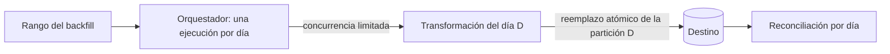

## 1. Resumen

Un backfill reprocesa un rango histórico de datos: para completar días que faltan, corregir un error de transformación o poblar una tabla recién creada. Es una operación rutinaria si el pipeline es idempotente y trabaja por períodos; si no, es la operación más riesgosa del mes.

## 2. Qué es

Es la ejecución deliberada de un pipeline sobre períodos pasados, normalmente uno por período (día, hora), con los mismos parámetros que tendría la ejecución original de ese período. Se distingue de `replay`, que vuelve a entregar eventos ya capturados, y de *catchup*, que es la política del scheduler para crear ejecuciones pendientes.

## 3. Problema que resuelve

Los datos históricos se estropean o faltan: un bug que corrompió tres semanas, una fuente que estuvo caída, una métrica nueva que necesita historia. Sin un mecanismo de backfill, la única salida es reprocesar todo o corregir a mano.

## 4. Cómo funciona

1. Se define el rango y la unidad (por ejemplo, del 2026-08-01 al 2026-08-31, por día).
2. Se genera una ejecución por período, con la fecha lógica del período, no la fecha actual.
3. Cada ejecución **reemplaza** el resultado de su período (sobrescritura de partición o `MERGE` con versión), de modo que repetirla no duplica.
4. Se limita la concurrencia para no saturar el origen ni el destino, y se controla el orden si un período depende del anterior.

En **Airflow**, cada ejecución de un Dag tiene un *data interval*. El backfill crea ejecuciones en un rango según el schedule del Dag y permite elegir qué hacer con los períodos ya ejecutados: no crear nada (`none`), reprocesar solo los fallidos (`failed`) o reprocesar también los completados (`completed`).

## 5. Cuándo utilizarlo

- Corregir un error de lógica que afectó un rango conocido.
- Recuperar períodos no cargados por una caída.
- Poblar la historia de una tabla o métrica nueva.
- Reconstruir tras un cambio de esquema que obliga a recalcular.

## 6. Cuándo no utilizarlo

- Cuando el pipeline no es idempotente: primero hay que arreglar eso, o el backfill duplicará.
- Cuando el origen ya no tiene los datos del rango (retención vencida): el backfill producirá huecos o datos distintos.
- Para reprocesar eventos de un stream dentro de su retención: allí `replay` suele ser más directo.

## 7. Ejemplo sencillo

Una tabla diaria quedó vacía del 10 al 12 de agosto. Se ejecuta la carga para esos tres días, uno por uno, y cada ejecución reemplaza la partición de su día.

## 8. Ejemplo de producción

Se detecta que la conversión de moneda usó una tasa errónea durante agosto. Se corrige el código, se despliega y se lanza un backfill de 31 días en Airflow con reproceso `completed`, un máximo de 4 ejecuciones concurrentes y en orden inverso (primero los días más recientes, que son los más consultados). Cada ejecución reemplaza su partición en una transacción. Al terminar, una reconciliación compara totales por día contra el origen, y el tablero de incidentes registra el rango corregido.

## 9. Arquitectura



## 10. Código

```bash
# Airflow 3 (CLI): backfill de agosto, reprocesando también los días ya completados,
# con 4 ejecuciones concurrentes y empezando por los más recientes.
# Requiere: un Dag "ventas_diarias" con schedule temporal. Opciones tomadas del ejemplo oficial de Airflow 3.3.2;
# en otra versión, confirmarlas con `airflow backfill create --help`.
airflow backfill create --dag-id ventas_diarias \
  --from-date 2026-08-01 --to-date 2026-08-31 \
  --reprocess-behavior completed \
  --max-active-runs 4 \
  --run-backwards
```

```sql
-- Tarea del día (BigQuery): reemplazo atómico e idempotente de la partición del día lógico.
BEGIN TRANSACTION;
DELETE FROM `proyecto.dataset.ventas` WHERE fecha = @dia;
INSERT INTO `proyecto.dataset.ventas`
SELECT * FROM `proyecto.dataset.ventas_calculadas` WHERE fecha = @dia;
COMMIT TRANSACTION;
```

## 11. GCP

En **Managed Service for Apache Airflow (ex Cloud Composer)**, el servicio administrado construido sobre Apache Airflow, el backfill se hace con los mecanismos de Airflow: data intervals, backfill por rango y `catchup` (desactivado por defecto). En **BigQuery**, la escritura por partición dentro de una transacción de varias sentencias hace que cada día reprocesado se reemplace de forma atómica.

## 12. AWS

En **AWS Glue**, los *job bookmarks* guardan qué datos ya procesó un job para no reprocesarlos (en S3, por fecha de modificación de los objetos). Para un backfill hay que decidir explícitamente cómo tratar el bookmark, porque su propósito es justamente evitar el reproceso. No es el mismo modelo que el data interval de Airflow: el estado vive en el job, no en la fecha lógica de cada ejecución.

## 13. Azure

En **Data Factory**, un *tumbling window trigger* divide el tiempo en ventanas fijas y dispara una ejecución por ventana. Su `startTime` y su `endTime` pueden estar en el pasado, así que un rango histórico se procesa ventana por ventana. Es un disparador con estado por ventana, distinto del backfill por CLI de Airflow.

## 14. Buenas prácticas

- Diseñar cada ejecución con la fecha lógica del período, nunca con "ahora".
- Reemplazar el período completo (partición o `MERGE` con versión) para que repetir sea seguro.
- Limitar la concurrencia y, si hay dependencias entre períodos, respetar el orden.
- Reconciliar al terminar y dejar registro del rango y del motivo.
- **Seguridad:** usar la misma cuenta de servicio que el pipeline normal; un backfill no debe tener permisos más amplios "por ser excepcional".
- **Observabilidad:** seguir el avance por período (pendientes, en curso, fallidos) y alertar si un período queda fallido.
- **Costo:** un backfill multiplica el costo de un día por el tamaño del rango, más el costo de leer el origen; estimarlo antes de lanzarlo.

## 15. Errores frecuentes

- Usar la fecha de ejecución en lugar de la fecha lógica: todos los días del backfill procesan "hoy".
- Backfill sobre un pipeline con `INSERT` ciego: duplica cada período.
- Concurrencia sin límite que satura la base de origen de producción.
- Olvidar que el origen puede haber cambiado o purgado datos del rango.

## 16. Trade-offs

Reprocesar por períodos es seguro y controlable, pero lento para rangos largos. Una reconstrucción completa en una sola ejecución es más rápida, pero menos controlable y más difícil de reanudar si falla a la mitad.

## 17. Conceptos relacionados

- `idempotency`: requisito del backfill.
- `partitioning`: la unidad natural de reemplazo.
- `replay`: reproceso de eventos ya capturados.
- `incremental-load`: la carga que el backfill reutiliza con un rango explícito.
- Con ficha: `catchup`, `data-reconciliation`.
- `failure-recovery`: cómo se combinan reintentos, checkpoints, DLQ, replay y backfill para volver a un estado correcto.

## 18. Preguntas técnicas abiertas

1. ¿Cómo diseñarías un pipeline para que un backfill de un año no requiera código especial?
2. ¿Qué harías si el backfill necesita datos que el origen ya purgó?
3. ¿Cómo evitarías que un backfill degrade la base de origen en horario productivo?

## 19. Laboratorio relacionado

Pendiente (F4): lab de tipo B sobre duplicados tras un reproceso (§25).

## 20. Fuentes

- Apache Airflow: *Backfill* y *Dag Runs*.
- Google Cloud: *Managed Airflow overview* (Managed Service for Apache Airflow) y *Multi-statement transactions* (BigQuery).
- AWS: *Tracking processed data using job bookmarks* (Glue).
- Microsoft Learn: *Create tumbling window triggers* (Data Factory).

El detalle de cada fuente está en `sources` del frontmatter.

## 21. Fecha de última verificación

2026-09-30. Las opciones de la CLI coinciden con el ejemplo oficial de Airflow 3.3.2 (stable al 2026-09-30). Pasa a `verified`: revisión B-F3.1 del lote 2 aplicada, sin VERIFY pendientes.

## 22. Historial de cambios importantes

- 2026-09-30: creación (lote 2 de F3).
- 2026-09-30: revisión B-F3.1 aplicada: nombre y fuente de Managed Service for Apache Airflow (ex Cloud Composer).
- 2026-09-30: `verification_status: verified` (revisión B-F3.1 del lote 2 aplicada; sin VERIFY pendientes).
- 2026-10-06: la sección de conceptos relacionados ya no lista como pendientes de ficha a `catchup`, `data-reconciliation`, que ya tienen ficha.
- 2026-10-11: §17 enlaza `failure-recovery`, que ya tiene ficha (lote F3b-05a); antes figuraba como pendiente de ficha.
- 2026-10-13: `page_title` en cada cita, con el título de la página citada (ADR-012); sin cambios de contenido.
- 2026-10-14: lote F3b-rel (regla del §17): relations incluye `catchup`, `data-reconciliation`, `failure-recovery`.
