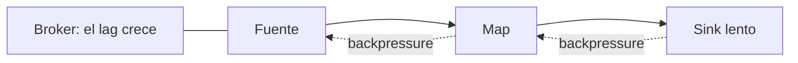

## 1. Resumen

Hay **backpressure** cuando una parte del pipeline produce más rápido de lo que la siguiente puede consumir. Según Flink, los registros fluyen hacia adelante y la backpressure se propaga hacia atrás, hasta la fuente: el operador lento frena a los anteriores en vez de perder datos.

Dos formas de manejarla:

- **Flink:** la presión se propaga sola entre operadores, y el motor la mide por subtarea (`backPressuredTimeMsPerSecond`) con estados OK, LOW y HIGH;
- **Spark Structured Streaming:** el tamaño de cada micro-batch se limita en la fuente (`maxFilesPerTrigger`, `maxOffsetsPerTrigger`), lo que Databricks llama *admission control*.

En los dos casos, si la presión dura, el lag del consumidor crece: hay que escalar o hacer más rápido el operador lento.

## 2. Qué es

- **Backpressure:** un operador que espera porque el siguiente no acepta más datos.
- **Subtarea backpressured, idle o busy:** las tres métricas de Flink, que suman cerca de 1000 ms por segundo.
- **OK / LOW / HIGH:** hasta 10 %, hasta 50 % y más de 50 % del tiempo con backpressure.
- **Admission control:** límites de entrada por micro-batch en Structured Streaming.
- **Lag:** lo pendiente en la fuente, que crece si la presión no se resuelve (ver `offsets`).

## 3. Problema que resuelve

Un job lee eventos y los escribe en una base que se vuelve lenta. Sin backpressure, el job acumularía eventos en memoria hasta caerse. Con backpressure, la lectura se frena: los eventos esperan en el broker, el lag crece y hay una señal clara de dónde está el cuello de botella. En Spark, tras una parada larga, un primer micro-batch con todo el atraso puede ser tan grande que derrame a disco; limitar la entrada lo divide en batches manejables.

## 4. Cómo funciona

1. El operador lento (por ejemplo, el sink) deja de aceptar datos al ritmo que llegan.
2. En Flink, el operador anterior queda esperando, y así hasta la fuente, que lee más lento.
3. La métrica `backPressuredTimeMsPerSecond` de los operadores anteriores sube.
4. En Spark, cada micro-batch toma como máximo lo que permite el límite de la fuente.
5. Lo que no se lee sigue en el broker o en el almacenamiento; el lag lo muestra.

## 5. Cuándo utilizarlo

- Siempre que la velocidad de los operadores no sea constante, como sinks externos.
- Para recuperarse de un atraso sin batches gigantes: límites de entrada en Spark.
- Para encontrar el cuello de botella: la subtarea que no está backpressured pero sí ocupada, detrás de las que sí lo están.

## 6. Cuándo no utilizarlo

- Como solución permanente: si la presión es constante, falta capacidad.
- Límites de entrada tan bajos que el pipeline nunca alcanza la entrada.
- Leer la métrica del operador equivocado: el que muestra backpressure no es el lento, es el de antes.

## 7. Ejemplo sencillo

Seis archivos de 100 eventos pendientes. Sin límite, un solo micro-batch toma los 600. Con `maxFilesPerTrigger=2`, el atraso se procesa en tres micro-batches de 200.

## 8. Ejemplo de producción

Un job de Kafka a una base de datos:

- en Flink, una alerta si el sink queda en HIGH por más de 10 minutos;
- en Spark, `maxOffsetsPerTrigger` para que un atraso no genere un batch enorme;
- el lag del grupo como señal principal, con un umbral según la retención del topic;
- escalado del sink (más conexiones, escritura por lotes) antes que más workers en la lectura.

## 9. Arquitectura



## 10. Código

```python
# Python 3.12 y PySpark 4.2.0 en modo local (ejecutado en la CI con Java 17): en Structured Streaming el tamaño de
# cada micro-batch se limita en la fuente (admission control). Con 6 archivos pendientes, sin límite un solo
# micro-batch los toma todos; con maxFilesPerTrigger=2, el atraso se procesa en lotes de 2 archivos.
import json
import sys
import tempfile
from pathlib import Path

from pyspark.sql import DataFrame, SparkSession

base = Path(sys.argv[1] if len(sys.argv) > 1 else tempfile.mkdtemp())
src = base / "eventos"
src.mkdir(parents=True, exist_ok=True)
for i in range(6):   # un atraso acumulado: 6 archivos de 100 eventos cada uno
    (src / f"{i}.json").write_text("\n".join(json.dumps({"n": n}) for n in range(100)), encoding="utf-8")

spark = (SparkSession.builder.master("local[2]").config("spark.sql.shuffle.partitions", "2")
         .config("spark.ui.showConsoleProgress", "false").getOrCreate())
spark.sparkContext.setLogLevel("ERROR")


def batches(max_files: int | None) -> list[int]:
    """Filas por micro-batch al procesar el atraso, con o sin límite por trigger."""
    sizes: list[int] = []
    reader = spark.readStream.schema("n INT")
    if max_files is not None:
        reader = reader.option("maxFilesPerTrigger", max_files)

    def record(batch: DataFrame, _batch_id: int) -> None:
        sizes.append(batch.count())

    name = "sin-limite" if max_files is None else f"max-{max_files}"
    query = (reader.json(str(src)).writeStream.foreachBatch(record)
             .option("checkpointLocation", str(base / f"checkpoint-{name}")).trigger(availableNow=True).start())
    query.awaitTermination()
    return [s for s in sizes if s]


print(f"sin límite: micro-batches de {batches(None)} filas")
print(f"maxFilesPerTrigger=2: micro-batches de {batches(2)} filas")
spark.stop()
```

El script se **ejecuta en la CI con PySpark 4.2.0 en modo local y Java 17**. Imprime `sin límite: micro-batches de [600] filas` y `maxFilesPerTrigger=2: micro-batches de [200, 200, 200] filas`. La backpressure de Flink no tiene código propio: se lee en la interfaz web y en las métricas de cada subtarea (*Monitoring Back Pressure*), y no se ejecutó.

## 11. GCP

En GCP, **Dataflow** ajusta los workers. Según *Horizontal Autoscaling* (no ejecutado):

| | Spark Structured Streaming | Dataflow |
|---|---|---|
| Ante más trabajo | Límites de entrada por micro-batch; los recursos los fija el clúster | Agrega o quita workers según la CPU y el paralelismo; el autoescalado también funciona en streaming |

## 12. AWS

En AWS, **Managed Service for Apache Flink** corre Flink. Según *What is Amazon Managed Service for Apache Flink?* y *Monitoring Back Pressure* de Flink 2.3 (no ejecutado):

| | Flink propio | Managed Service for Apache Flink |
|---|---|---|
| Backpressure | Se propaga entre operadores y se mide por subtarea | La misma de Flink |
| Escalado | Lo decide el equipo | El servicio administra la infraestructura y el escalado |

## 13. Azure

En Azure, **Azure Databricks** corre Structured Streaming. Según *Configure Structured Streaming batch size on Azure Databricks* (no ejecutado):

| | Spark Structured Streaming | Azure Databricks |
|---|---|---|
| Control de entrada | `maxFilesPerTrigger` y `maxBytesPerTrigger` en la fuente de archivos | Admission controls: `maxFilesPerTrigger`, `maxBytesPerTrigger` y límites propios de cada fuente, como `maxOffsetsPerTrigger` en Kafka |
| Cambiarlos | — | Se pueden cambiar sin reiniciar el checkpoint |

## 14. Buenas prácticas

- Medir el lag y, en Flink, el estado de backpressure de cada subtarea.
- Buscar el cuello de botella después del último operador con backpressure.
- Límites de entrada en Spark para que un atraso no genere un batch enorme.
- **Seguridad:** sin aspectos propios.
- **Observabilidad:** lag, tiempo por micro-batch y métricas busy, idle y backpressured.
- **Costo:** escalar todo el pipeline por un sink lento cuesta más que arreglar el sink.

## 15. Errores frecuentes

- Escalar la fuente cuando el lento es el sink.
- Ignorar la backpressure hasta que el lag pasa la retención y se pierden eventos.
- Un primer micro-batch sin límites tras una parada larga.
- Confundir backpressure con falla: el pipeline sigue, más lento.

## 16. Trade-offs

La backpressure protege al pipeline de quedarse sin memoria, a cambio de latencia y lag. Limitar la entrada da batches estables y tarda más en recuperar un atraso. Escalar resuelve la presión con más costo; optimizar el operador lento, con más trabajo.

## 17. Conceptos relacionados

- `stateful-stream-processing`: operadores con estado que suelen ser lentos.
- `offsets`: el lag que crece.
- `producers-and-consumers`: el consumidor que lee a su ritmo.
- `spark-structured-streaming`: el control de entrada en Spark.

## 18. Preguntas técnicas abiertas

1. ¿Qué operador de tu pipeline es el más lento y cómo lo sabes?
2. ¿Qué pasa con tu job tras una parada de una hora?
3. ¿Cuánto lag puede acumular tu consumidor antes de perder datos?

## 19. Laboratorio relacionado

Pendiente (F4).

## 20. Fuentes

- Apache Flink 2.3: *Monitoring Back Pressure*.
- Apache Spark 4.2.0: *Structured Streaming Programming Guide* (APIs on DataFrames and Datasets).
- Google Cloud: *Horizontal Autoscaling*.
- AWS: *What is Amazon Managed Service for Apache Flink?*.
- Microsoft Learn: *Configure Structured Streaming batch size on Azure Databricks*.

El detalle de cada fuente está en `sources` del frontmatter.

## 21. Fecha de última verificación

2026-10-19. `review_required`: pendiente de revisión B-F3.1 del lote F3b-14b.

## 22. Historial de cambios importantes

- 2026-10-19: creación (lote F3b-14b).
