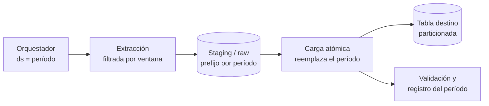

## 1. Resumen

La ingesta batch trae datos al destino en **lotes periódicos y acotados**: cada ejecución procesa una ventana (un día, una hora) completa. Es el modo de ingesta más simple de operar y razonar. Bien hecha cumple tres reglas:

- cada ejecución está parametrizada por su período;
- la carga es atómica y **reemplaza** ese período en lugar de agregar;
- repetirla da el mismo resultado.

Con eso, los reintentos y los reprocesos son seguros.

## 2. Qué es

Es una forma consolidada de mover datos, opuesta a la ingesta streaming (evento a evento, continua). Su unidad es el **lote**: un conjunto finito de datos, definido por una ventana de tiempo o por una entrega (un archivo, un export), que se extrae, se carga y se confirma como un todo. Las fuentes típicas son exports de bases de datos, archivos de socios, extracciones de APIs y transferencias programadas desde aplicaciones SaaS.

## 3. Problema que resuelve

La mayoría de las preguntas de negocio no necesitan datos de hace un segundo: un reporte diario, una conciliación o un modelo de forecast funcionan con datos de ayer o de la última hora. El batch da esa frescura con menos piezas que el streaming: sin estado continuo, sin ordenamiento de eventos y con fallos que se resuelven repitiendo el lote.

## 4. Cómo funciona

1. **Definir la ventana:** cada ejecución recibe su período (`2026-10-01`) desde el orquestador, no calcula "ayer" con el reloj. Así un reintento o un backfill procesan exactamente el mismo período.
2. **Extraer:** consultar la fuente filtrando por la ventana, o tomar los archivos de su prefijo o manifest.
3. **Aterrizar:** escribir el lote en un área de staging o en la zona raw del lake.
4. **Cargar de forma atómica y reemplazando el período:**
   - en BigQuery, un load job es atómico (todo o nada) y `WRITE_TRUNCATE` reemplaza la tabla o, con decorador, la partición;
   - donde la carga solo agrega (Redshift `COPY`), se borra el período en una transacción antes de cargar, o se carga a staging y se hace `MERGE`.
5. **Validar y registrar:** contar filas, comparar con la fuente y registrar qué período quedó cargado.

## 5. Cuándo utilizarlo

- Cuando la frescura necesaria es de horas o de un día.
- Fuentes que entregan por lotes: exports nocturnos, archivos diarios, APIs con paginación por fecha.
- Cargas iniciales y reprocesos históricos, incluso en sistemas que después operan en streaming.
- Cuando se prioriza simplicidad operativa y costo predecible.

## 6. Cuándo no utilizarlo

- Cuando el valor depende de reaccionar en segundos (fraude, alertas operacionales): streaming.
- Ventanas tan cortas que los lotes se solapan o chocan con cuotas (en BigQuery, la cuota por defecto es de 1500 cargas por tabla y día).
- Fuentes que solo exponen cambios como eventos (CDC, colas): forzarlas a lotes agrega latencia sin simplificar.

## 7. Ejemplo sencillo

Cada día a las 02:00, el orquestador ejecuta la ingesta con `ds=2026-10-01`. El job exporta los pedidos de ese día de la base operacional a `gs://lake/raw/pedidos/dt=2026-10-01/` y los carga en la partición `20261001` de `staging.pedidos`, reemplazándola. Si falla y se reintenta, o si se reprocesa la semana siguiente, la partición termina igual.

## 8. Ejemplo de producción

Un pipeline diario ingesta 40 tablas de un ERP. Cada tabla es una tarea parametrizada por `ds`. Las tablas grandes se extraen por la columna de modificación y las pequeñas completas. Los archivos van a Cloud Storage en Parquet, y cada tabla se carga con un job por partición con `WRITE_TRUNCATE`. Un control compara conteos contra la fuente y marca el día como completo en una tabla de control. Las tareas reintentan con backoff ante errores transitorios; un error de validación falla la tarea sin reintentos. Los backfills se lanzan desde el orquestador por rango de fechas, sin código especial.

## 9. Arquitectura



## 10. Código

```python
# Python 3.12 y google-cloud-bigquery: carga el Parquet de un día reemplazando solo esa partición.
# Requiere: tabla proyecto.staging.pedidos particionada por día sobre la columna fecha (DATE);
# archivos en gs://empresa-lake/raw/pedidos/dt=AAAA-MM-DD/*.parquet con fecha igual a ese día;
# credenciales con permiso para crear load jobs y escribir en la tabla.
from datetime import date

from google.cloud import bigquery


def load_day(client: bigquery.Client, day: date) -> int:
    uri = f"gs://empresa-lake/raw/pedidos/dt={day.isoformat()}/*.parquet"
    destination = f"proyecto.staging.pedidos${day:%Y%m%d}"  # decorador: solo esa partición
    job_config = bigquery.LoadJobConfig(
        source_format=bigquery.SourceFormat.PARQUET,
        write_disposition=bigquery.WriteDisposition.WRITE_TRUNCATE,  # reemplaza, no agrega
    )
    job = client.load_table_from_uri(uri, destination, job_config=job_config)
    job.result()  # espera; el job es atómico: carga todo o nada
    return job.output_rows


if __name__ == "__main__":
    rows = load_day(bigquery.Client(), date(2026, 10, 1))  # el orquestador pasa la fecha
    print(f"cargadas {rows} filas")
```

Repetir `load_day` con la misma fecha deja la partición igual: es seguro reintentar y reprocesar. Si algún archivo trae filas de otro día, BigQuery rechaza la carga porque el decorador debe coincidir con los datos.

## 11. GCP

En **BigQuery**, los load jobs desde Cloud Storage son atómicos. Google recomienda `WRITE_TRUNCATE` precisamente para los reintentos, porque el cliente puede no distinguir un job fallido de uno exitoso cuya respuesta se perdió. Con decoradores de partición (`tabla$20261001`) y `WRITE_TRUNCATE` se reemplaza un solo día. La cuota por defecto de 1500 cargas por tabla y día marca el límite práctico de frecuencia. Para fuentes SaaS y otras nubes, **BigQuery Data Transfer Service** programa cargas recurrentes y backfills sin código.

## 12. AWS

En **Redshift**, `COPY` desde S3 es la carga batch estándar, pero **agrega** a las filas existentes: no hay un equivalente directo de `WRITE_TRUNCATE` por partición. Para que repetir no duplique, se borra el período y se ejecuta el `COPY` en la misma transacción, o se carga a una tabla staging y se aplica `MERGE`. Un **manifest** asegura que entren exactamente los archivos del lote.

## 13. Azure

En **Data Factory**, la **Copy activity** es la pieza de ingesta batch: lee de la fuente, serializa, comprime y mapea columnas, y escribe en el destino. También permite configurar qué hacer con filas incompatibles. La idempotencia no viene dada: se logra con un paso previo que limpia el período en el destino, o cargando a staging y aplicando `MERGE` en Synapse o Fabric Warehouse.

## 14. Buenas prácticas

- Parametrizar cada ejecución por su período; nunca usar "ahora" dentro del job.
- Cargar reemplazando el período (partición o tabla staging), no agregando.
- Aterrizar primero en almacenamiento de objetos: permite reintentar la carga sin volver a extraer.
- Validar conteos contra la fuente y registrar los períodos completos.
- Reintentar errores transitorios con backoff; fallar sin reintentar ante errores de datos.
- **Seguridad:** las credenciales de las fuentes van en un gestor de secretos; la zona de aterrizaje hereda la sensibilidad de los datos de origen.
- **Observabilidad:** registrar por período filas extraídas, filas cargadas y duración; alertar si un período no se completa a tiempo o si el conteo difiere de la fuente.
- **Costo y capacidad:** extraer solo la ventana y cargar en formatos columnares; en BigQuery, los load jobs usan por defecto un pool compartido de slots sin capacidad garantizada, así que un batch con plazo estricto no debería depender de su throughput.

## 15. Errores frecuentes

- Calcular la fecha con el reloj dentro del job: un reintento después de medianoche carga el día equivocado.
- Agregar (`WRITE_APPEND` o `COPY` a secas) sin limpiar: cada reintento duplica.
- Ventanas que no se tocan o se solapan entre ejecuciones: huecos o duplicados.
- Dar por terminado un lote sin comparar con la fuente.
- Tratar un lote parcial (fuente aún escribiendo) como completo.

## 16. Trade-offs

Simplicidad, costo predecible y reprocesos triviales, a cambio de latencia igual o mayor que la ventana. Ventanas más cortas bajan la latencia, pero multiplican ejecuciones, cuotas y archivos pequeños. Con ventanas de minutos, el batch empieza a parecerse a un streaming mal hecho: es el momento de evaluar streaming.

## 17. Conceptos relacionados

- `batch-vs-streaming`: la decisión de fondo.
- `file-ingestion` y `api-ingestion`: las dos fuentes batch más comunes.
- `idempotency`: por qué reemplazar el período.
- `backfill`: reprocesar períodos pasados.
- `incremental-load`: traer solo lo nuevo de cada ventana.
- Del blueprint, pendiente de ficha: `data-ingestion`.

## 18. Preguntas técnicas abiertas

1. La fuente a veces termina de escribir el día a las 03:30 y el lote corre a las 02:00. ¿Cómo lo detectarías y qué cambiarías?
2. ¿Cómo harías idempotente una carga en un destino que solo permite agregar?
3. ¿A partir de qué frescura requerida dejarías el batch por streaming?

## 19. Laboratorio relacionado

Pendiente (F4).

## 20. Fuentes

- Google Cloud: *Batch loading data*, *Load data into partitioned tables*, *Introduction to partitioned tables* y *What is BigQuery Data Transfer Service?* (BigQuery); *Load Parquet data from Cloud Storage*; referencia de `Client` y `LoadJob` (biblioteca cliente de Python).
- AWS: *COPY* y *Using a manifest to specify data files* (Amazon Redshift).
- Microsoft Learn: *Copy activity in Azure Data Factory*.

El detalle de cada fuente está en `sources` del frontmatter.

## 21. Fecha de última verificación

2026-10-04. Pasa a `verified`: revisión B-F3.1 del lote 5 aplicada, sin VERIFY pendientes.

## 22. Historial de cambios importantes

- 2026-10-02: creación (lote 5 de F3).
- 2026-10-04: revisión B-F3.1 del lote 5 aplicada (docs/reviews/cards-lote5.md): viñeta de Observabilidad en §14.
- 2026-10-04: `verification_status: verified` (revisión B-F3.1 del lote 5 aplicada; sin VERIFY pendientes).
