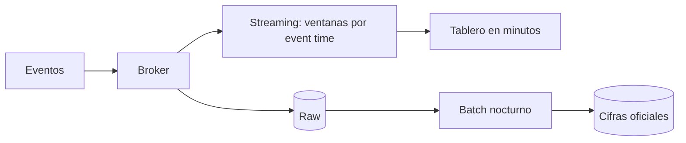

## 1. Resumen

**Batch** procesa un conjunto acotado de datos de una vez, cada cierto tiempo (por ejemplo, el día anterior). **Streaming** procesa un flujo no acotado de eventos a medida que llegan. La elección depende de la latencia que el negocio realmente necesita, porque el streaming exige más en operación, en manejo del tiempo y en costo.

## 2. Qué es

Son dos modos de procesamiento, no dos tecnologías. Muchos motores admiten ambos: Apache Beam, que ejecuta Dataflow, define batch y streaming con un mismo modelo. La diferencia de fondo es si los datos de entrada están **acotados** (bounded) o **no acotados** (unbounded).

## 3. Problema que resuelve

Obliga a decidir cuán frescos deben estar los datos y cuánto cuesta lograrlo. Un informe diario no gana nada con streaming. La detección de fraude o un tablero operativo sí necesitan segundos.

## 4. Cómo funciona

- **Batch**: se lee un rango cerrado (un día, un archivo), se transforma y se escribe. Si falla, se reintenta el rango completo.
- **Streaming**: se leen eventos de un broker (Pub/Sub, Kafka, Kinesis, Event Hubs) y se procesan de forma continua. Para agregar, se agrupan en **ventanas** según el tiempo del evento (*event time*), no según cuándo se procesa. Hay que decidir qué hacer con los eventos que llegan tarde.

## 5. Cuándo utilizarlo

- **Batch**: informes periódicos, cargas históricas, backfills, transformaciones pesadas sin urgencia.
- **Streaming**: reacción en segundos (alertas, fraude, personalización), tableros operativos, integración event-driven entre sistemas.

## 6. Cuándo no utilizarlo

- **Streaming** no conviene si nadie consume los datos antes de la próxima ventana batch: pagas la complejidad sin beneficio.
- **Batch** no conviene si el valor del dato se pierde en minutos, o si los lotes crecen tanto que no terminan antes del siguiente ciclo.

## 7. Ejemplo sencillo

Contar ventas por hora:

- En **batch**, un job a las 01:00 lee las ventas del día anterior y escribe 24 filas.
- En **streaming**, cada venta entra a una ventana de una hora según su timestamp, y el conteo se emite al cerrarse la ventana.

## 8. Ejemplo de producción

Pedidos publicados en Pub/Sub alimentan un pipeline de Dataflow que agrega por ventanas de 5 minutos para un tablero operativo, con una dead-letter para mensajes inválidos. En paralelo, un batch nocturno recalcula el día completo desde la capa raw y corrige los eventos tardíos. La cifra oficial es la del batch; la del tablero es provisional.

## 9. Arquitectura



## 10. Código

```python
# Apache Beam (Python): el mismo conteo por ventana sirve para batch o streaming.
# Requiere: pip install apache-beam[gcp]; en streaming, la fuente es ReadFromPubSub en lugar de un Create.
import apache_beam as beam
from apache_beam.transforms.window import FixedWindows, TimestampedValue

with beam.Pipeline() as p:
    (
        p
        | beam.Create([("tienda-1", 1_759_200_000), ("tienda-1", 1_759_200_120), ("tienda-2", 1_759_203_700)])
        | beam.Map(lambda kv: TimestampedValue(kv[0], kv[1]))  # event time = timestamp del evento
        | beam.WindowInto(FixedWindows(3600))                   # ventanas de 1 hora
        | beam.combiners.Count.PerElement()
        | beam.Map(print)
    )
```

## 11. GCP

- **Dataflow** ejecuta pipelines de Apache Beam, un modelo unificado para batch y streaming, con ventanas según el timestamp de cada elemento.
- **Pub/Sub** es la entrada típica en streaming. Su entrega por defecto es at-least-once y sin orden garantizado, así que el pipeline debe ser idempotente.

## 12. AWS

**Kinesis Data Streams** recolecta y procesa grandes streams de registros en tiempo real. Su capacidad se gestiona con un modo elegido por stream: **On-demand Standard**, **On-demand Advantage** o **Provisioned**, y se puede cambiar de modo. Los registros se retienen **24 horas por defecto, ampliables hasta 8760 horas (365 días)**, lo que permite volver a leerlos dentro de ese plazo. No es un equivalente directo de Pub/Sub: el modelo de capacidad, de retención y de lectura es distinto.

## 13. Azure

**Event Hubs** es una plataforma de streaming con particiones ordenadas para escalar el throughput. Su documentación indica compatibilidad con Apache Kafka que permite ejecutar cargas de Kafka existentes sin cambios de código. Antes de migrar, conviene comprobar que las funciones del ecosistema Kafka que se usen (conectores, transacciones, herramientas) estén cubiertas: es una recomendación, no un límite verificado aquí.

## 14. Buenas prácticas

- Partir de la latencia que el negocio necesita, no de la tecnología.
- En streaming, agrupar por event time y definir explícitamente cómo tratar los eventos tardíos.
- Guardar siempre el crudo para poder recalcular en batch (reconciliación).
- Diseñar consumidores idempotentes: la entrega por defecto suele ser at-least-once.
- **Observabilidad:** en streaming, vigilar el retraso del consumidor (antigüedad del mensaje más antiguo sin confirmar), el avance del tiempo de evento y la tasa de eventos tardíos o apartados; en batch, la duración de cada ejecución y la frescura del resultado.
- **Seguridad:** tópicos y suscripciones son recursos con permisos propios: separar quién publica de quién consume y no transportar datos sensibles que el consumidor no necesite.
- **Costo:** el streaming consume recursos de forma continua, aunque no haya consultas; el batch concentra el costo en ventanas. Calcular ambos con el volumen real antes de decidir.

## 15. Errores frecuentes

- Elegir streaming "por moderno" para datos que se consultan una vez al día.
- Agregar por processing time y obtener cifras distintas en cada reproceso.
- No tener dead-letter ni reintentos: un mensaje malformado detiene o descarta en silencio.
- Suponer orden global en un broker que no lo garantiza.

## 16. Trade-offs

El batch es más barato, más simple de operar y de reprocesar, pero tiene más latencia. El streaming baja la latencia a segundos, a cambio de operación continua, manejo de estado y tiempo, y más costo. Muchas plataformas combinan ambos: streaming para lo provisional, batch para la cifra oficial.

## 17. Conceptos relacionados

- `change-data-capture`: convierte una base en un flujo.
- `dead-letter-queue`, `idempotency`: requisitos del streaming confiable.
- Con ficha: `late-arriving-data`.
- Del blueprint, pendientes de ficha: `event-time-vs-processing-time`, `windowing`, `watermarks`, `lambda-architecture`, `kappa-architecture`.

## 18. Preguntas técnicas abiertas

1. ¿Qué preguntas le harías al negocio antes de decidir entre batch y streaming para un tablero de ventas?
2. ¿Cómo reconciliarías las cifras de un pipeline streaming con las de un batch nocturno?
3. ¿Qué haces con los eventos que llegan horas tarde a una agregación por ventanas?

## 19. Laboratorio relacionado

Pendiente (F4): arquitecturas "Streaming pipeline" y "Batch pipeline" (§24) y lab de tipo D sobre analytics casi en tiempo real (§25).

## 20. Fuentes

- Google Cloud: *Programming model for Apache Beam* (Dataflow); *Subscription overview* (Pub/Sub).
- AWS: *What is Amazon Kinesis Data Streams?*; *Choose the right mode to stream in*; *Change the data retention period*.
- Microsoft Learn: *What is Azure Event Hubs*.

El detalle de cada fuente está en `sources` del frontmatter.

## 21. Fecha de última verificación

2026-09-30. El VERIFY de Kinesis (modos de capacidad y retención) se resolvió con documentación oficial. Pasa a `verified`: revisión B-F3.1 aprobada y aplicada, sin VERIFY pendientes.

## 22. Historial de cambios importantes

- 2026-09-30: creación (lote 1 de F3).
- 2026-09-30: revisión B-F3.1 aplicada (docs/reviews/cards-lote1.md): relaciones completas, seguridad, observabilidad y costo, notas de fuentes y ejemplos corregidos.
- 2026-09-30: VERIFY resuelto: modos de capacidad y retención de Kinesis Data Streams.
- 2026-09-30: `verification_status: verified` (revisión B-F3.1 aprobada y aplicada; VERIFY resueltos).
- 2026-10-06: la sección de conceptos relacionados ya no lista como pendiente de ficha a `late-arriving-data`, que ya tiene ficha.
- 2026-10-13: `page_title` en cada cita, con el título de la página citada (ADR-012); sin cambios de contenido.
