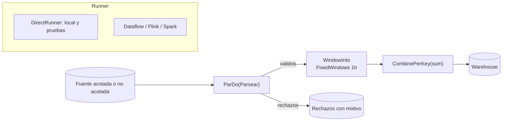

## 1. Resumen

Apache Beam es un modelo para escribir pipelines de datos que luego ejecuta un **runner**: Dataflow en Google Cloud, Flink, Spark o el DirectRunner local. El pipeline es un grafo de **PCollections** inmutables y **PTransforms**:

- `ParDo` procesa cada elemento;
- `GroupByKey` y `Combine` reducen por clave;
- las **ventanas** por tiempo de evento hacen que las agregaciones funcionen igual en batch y en streaming.

Se prueba en local con el DirectRunner, que además verifica que el pipeline respete el modelo.

## 2. Qué es

- **Pipeline:** la tarea completa, desde la lectura hasta la escritura.
- **PCollection:** conjunto de datos distribuido.
  - Puede ser **acotado** (un archivo) o **no acotado** (una suscripción).
  - Es inmutable: cada transformación produce una nueva.
- **PTransform:**
  - `ParDo` con un `DoFn` para procesar cada elemento (como "map");
  - `GroupByKey` para agrupar pares clave/valor (como "shuffle");
  - `Combine` para agregar (suma, conteo);
  - transformaciones compuestas.
- **Salidas adicionales:** un `DoFn` puede emitir a varias salidas con tags, por ejemplo válidos y rechazos.
- **Windowing:** asigna cada elemento a ventanas según su marca de tiempo (fijas, deslizantes, de sesión o la global). `GroupByKey` y `Combine` agregan por ventana.
- **Runner:** quien ejecuta el pipeline. El código no cambia, cambian las opciones.

## 3. Problema que resuelve

Escribir un pipeline para batch y otro para streaming, y además atarlo a un motor concreto, duplica lógica y dificulta migrar. Beam separa **qué** se calcula (el grafo de transformaciones) de **dónde** se ejecuta (el runner). También define cómo agregar datos que llegan en desorden, con ventanas por tiempo de evento en lugar de por hora de llegada.

## 4. Cómo funciona

1. El programa construye el grafo: `p | "Leer" >> ... | "Parsear" >> beam.ParDo(...)`. Al definirlo no se procesan datos.
2. Al salir del `with beam.Pipeline(...)`, o con `run()`, el runner recibe el grafo, lo optimiza y lo ejecuta, repartiendo los elementos entre workers.
3. Cada `DoFn` recibe elementos y emite cero o más salidas con `yield`. Los elementos pueden llevar una marca de tiempo de evento (`TimestampedValue`).
4. `WindowInto(FixedWindows(3600))` asigna cada elemento a su hora de evento. `CombinePerKey(sum)` suma por clave **dentro de cada ventana**.
5. En pruebas, `assert_that(pcoll, equal_to([...]))` verifica el contenido de una PCollection cuando el pipeline corre en el DirectRunner.

## 5. Cuándo utilizarlo

- Pipelines que deben correr en streaming y en batch con la misma lógica.
- Ingesta y transformación en Dataflow (Google Cloud) o en un runner de Flink.
- Agregaciones por tiempo de evento con datos que llegan tarde o desordenados.
- Separar registros inválidos a una salida de rechazos sin detener el pipeline.

## 6. Cuándo no utilizarlo

- Para transformaciones batch que caben en SQL dentro del warehouse: un job de Beam agrega infraestructura sin ganar nada.
- Para procesar pocos datos en un script: el arranque y el modelo de Beam pesan más que el trabajo.
- Si el equipo ya opera Spark y no necesita streaming con tiempo de evento: Spark puede ser la herramienta común.
- Para lógica que necesita estado global mutable compartido entre elementos: el modelo no lo permite de forma simple. Hay estado y timers por clave, que no se cubren en esta ficha.

## 7. Ejemplo sencillo

```python
import apache_beam as beam
from apache_beam.options.pipeline_options import PipelineOptions

with beam.Pipeline(options=PipelineOptions(runner="DirectRunner")) as p:
    (p
     | beam.Create([("T1", 100), ("T2", 40), ("T1", 20)])
     | beam.CombinePerKey(sum)
     | beam.Map(print))      # ('T1', 120) y ('T2', 40), en cualquier orden
```

## 8. Ejemplo de producción

Una ingesta de eventos de punto de venta lee de una suscripción de mensajería, parsea cada mensaje con un `DoFn` que envía los inválidos a una salida de rechazos, y asigna los válidos a ventanas de una hora por tiempo de evento. Suma montos por tienda y escribe los totales en el warehouse, y los rechazos en una tabla aparte con el motivo. El mismo código, con otra fuente acotada, reprocesa un día histórico en batch. En la CI, el pipeline corre en el DirectRunner con `assert_that` sobre eventos de prueba, incluidos uno mal formado y uno de la hora siguiente.

## 9. Arquitectura



## 10. Código

```python
# Python 3.12 y Apache Beam 2.77.0 con DirectRunner (ejecutado): parseo con salida de rechazos,
# ventanas fijas por hora de evento, suma por tienda y verificación con assert_that.
import json

import apache_beam as beam
from apache_beam.options.pipeline_options import PipelineOptions
from apache_beam.testing.util import assert_that, equal_to
from apache_beam.transforms.window import FixedWindows, TimestampedValue

EVENTOS = [
    '{"tienda": "T1", "monto": 100, "ts": 1791367200}',   # 2026-10-07 10:00 UTC
    '{"tienda": "T1", "monto": 20, "ts": 1791367800}',    # 10:10, misma hora
    '{"tienda": "T2", "monto": 40, "ts": 1791368400}',    # 10:20
    '{"tienda": "T1", "monto": 5, "ts": 1791370800}',     # 11:00, otra ventana
    'no es json',
]


class Parsear(beam.DoFn):
    RECHAZOS = "rechazos"

    def process(self, linea: str):  # sin anotación: con -> Iterator[object], Beam rechazó el CombinePerKey (TypeCheckError)
        try:
            evento = json.loads(linea)
            yield TimestampedValue((evento["tienda"], int(evento["monto"])), evento["ts"])   # tiempo de evento
        except (ValueError, KeyError) as error:
            yield beam.pvalue.TaggedOutput(self.RECHAZOS, f"{type(error).__name__}: {linea}")


class Formatear(beam.DoFn):
    def process(self, par: tuple[str, int], ventana=beam.DoFn.WindowParam):  # la ventana del elemento
        tienda, total = par
        yield f"{ventana.start.to_utc_datetime():%H:%M} {tienda} {total}"


with beam.Pipeline(options=PipelineOptions(runner="DirectRunner")) as p:
    salidas = (
        p
        | "Leer" >> beam.Create(EVENTOS)
        | "Parsear" >> beam.ParDo(Parsear()).with_outputs(Parsear.RECHAZOS, main="validos")
    )
    totales = (
        salidas.validos
        | "Ventana 1h" >> beam.WindowInto(FixedWindows(60 * 60))
        | "Sumar" >> beam.CombinePerKey(sum)
        | "Formatear" >> beam.ParDo(Formatear())
    )
    assert_that(totales, equal_to(["10:00 T1 120", "10:00 T2 40", "11:00 T1 5"]), label="totales")
    assert_that(salidas[Parsear.RECHAZOS], equal_to(["JSONDecodeError: no es json"]), label="rechazos")
print("pipeline OK")
```

Se ejecutó con Apache Beam 2.77.0 y el DirectRunner en el entorno de pruebas: imprime `pipeline OK` y las dos `assert_that` pasan. Beam también emite avisos que no afectan el resultado, como el de `GCSFileSystem`, porque falta el extra de Google Cloud. El evento de las 11:00 queda en otra ventana aunque sea de la misma tienda. Con una anotación `-> Iterator[object]` en `Parsear.process`, Beam rechazó el `CombinePerKey` con un `TypeCheckError` (su verificación de tipos usa las anotaciones), por eso el método no la lleva. No se pasó por `mypy --strict`.

## 11. GCP

**Dataflow** es el servicio administrado de Google Cloud para ejecutar pipelines de Beam con el Dataflow Runner. El runner sube el código y las dependencias a un bucket de Cloud Storage y crea un job. Ofrece autoescalado de workers durante la vida del job y rebalanceo dinámico del trabajo. El mismo código se lanza con `--runner=DataflowRunner`, el proyecto, la región y una ubicación temporal en Cloud Storage.

## 12. AWS

**Managed Service for Apache Flink** puede ejecutar aplicaciones que usan Beam con el runner de Flink, con las mismas capacidades de Beam que ese runner. Su documentación indica que las métricas de Beam no se ven en la consola del servicio. La página citada pertenece a la guía para desarrolladores en **Java**, y esta ficha no verifica el soporte para pipelines de Beam escritos en Python en ese servicio.

## 13. Azure

Esta ficha no cita una fuente de Azure sobre un runner de Beam administrado.

## 14. Buenas prácticas

- Probar cada pipeline con el DirectRunner y `assert_that`, incluidos casos inválidos y de borde de ventana.
- Rechazos como salida adicional con el motivo, no excepciones que detengan el pipeline.
- Marcas de tiempo de evento explícitas cuando la agregación es por tiempo.
- No modificar los elementos de entrada dentro de un `DoFn`: crear nuevos.
- Nombres explícitos para cada transformación (`"Parsear" >> ...`): identifican los pasos en el grafo y al monitorear.
- **Seguridad:** los workers del runner usan una identidad (cuenta de servicio o rol) con permisos solo sobre las fuentes y destinos del pipeline; los rechazos pueden contener datos personales y requieren el mismo control que la fuente.
- **Observabilidad:** contar válidos y rechazos por paso, y vigilar el retraso entre tiempo de evento y tiempo de procesamiento en streaming; un aumento de rechazos suele ser un cambio en la fuente.
- **Costo:** el costo es tiempo de workers del runner; agregar y filtrar pronto reduce lo que viaja en `GroupByKey`, y en batch conviene revisar si el mismo resultado sale más barato en SQL.

## 15. Errores frecuentes

- Agrupar por hora de llegada en lugar de por tiempo de evento y obtener totales distintos al reprocesar.
- Lanzar excepciones por registros inválidos: un solo registro malo hace fallar el paso en lugar de quedar como rechazo.
- Modificar el elemento recibido en un `DoFn` y afectar a otros pasos.
- Probar solo en el runner de la nube: los errores aparecen tarde y cuestan más de depurar.
- Anotaciones de tipo genéricas en `DoFn` que impiden a Beam inferir pares clave/valor.

## 16. Trade-offs

Beam ofrece un modelo único para batch y streaming y portabilidad entre runners. A cambio, tiene una curva de aprendizaje (ventanas, triggers, coders) y una depuración más indirecta que un script. La portabilidad es real para el modelo, pero las capacidades varían por runner, y Beam publica una matriz de capacidades. Para batch puro dentro de un warehouse, SQL suele ser más simple y barato.

## 17. Conceptos relacionados

- `batch-vs-streaming`: el mismo modelo para ambos.
- `late-arriving-data`: datos tardíos y ventanas.
- `dead-letter-queue`: la salida de rechazos.
- `python-generators`: `yield` en un `DoFn`.
- `testing-with-pytest`: pruebas del pipeline.

## 18. Preguntas técnicas abiertas

1. ¿Qué ventana usarías para totales por hora de ventas que pueden llegar con hasta 30 minutos de retraso, y qué harías con las que lleguen después?
2. ¿Qué casos pondrías en el test del DirectRunner para confiar en el pipeline antes de lanzarlo en la nube?
3. ¿Cuándo preferirías Beam en Dataflow a una consulta programada en el warehouse?

## 19. Laboratorio relacionado

Pendiente (F4).

## 20. Fuentes

- Apache Beam: *Programming Guide*, *Direct Runner*, *Dataflow Runner* y referencia del SDK de Python 2.77.0.
- Google Cloud: *Set Dataflow pipeline options*.
- AWS: *Use Apache Beam with Managed Service for Apache Flink applications*.

El detalle de cada fuente está en `sources` del frontmatter.

## 21. Fecha de última verificación

2026-10-09. Pasa a `verified`: revisión B-F3.1 del lote F3b-03b aplicada, sin VERIFY pendientes.

## 22. Historial de cambios importantes

- 2026-10-08: creación (lote F3b-03b).
- 2026-10-09: revisión B-F3.1 del lote F3b-03b aplicada (docs/reviews/cards-f3b-03b.md): filas aprobadas sin cambios en esta ficha.
- 2026-10-09: `verification_status: verified` (sin VERIFY pendientes).
- 2026-10-13: `page_title` en cada cita, con el título de la página citada (ADR-012); sin cambios de contenido.
