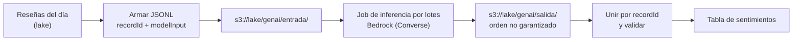

## 1. Resumen

**Amazon Bedrock** da acceso administrado a modelos fundacionales por API. Para el data engineer, lo relevante no es el prompt sino el **dato**: preparar entradas, procesar grandes volúmenes y unir resultados. Según su documentación:

- la **inferencia por lotes** lee archivos **JSONL en S3**: una línea por registro, con `recordId` y `modelInput` en formato InvokeModel o **Converse**;
- la salida se escribe en S3 de forma asíncrona y **su orden no está garantizado**, así que se une con la entrada por `recordId`;
- **Knowledge Bases** recupera información de datos propios para mejorar las respuestas.

RAG, agentes y evaluación de modelos van en el dominio 21. Esta ficha cubre el servicio desde el lado de los datos.

## 2. Qué es

- **Modelos fundacionales:** de varias empresas, accesibles por API (para aplicaciones nuevas, el endpoint `bedrock-runtime`).
- **Converse:** cuerpo común para modelos de mensajes: `messages` (rol y contenido), `system` e `inferenceConfig` (`maxTokens`, `temperature`).
- **Inferencia por lotes:**
  - entrada: JSONL en S3, cada línea con `recordId` y `modelInput`;
  - job: `CreateModelInvocationJob` con nombre, rol de servicio, modelo, `modelInvocationType` (`InvokeModel` o `Converse`), entrada y salida en S3;
  - cada registro se procesa de forma independiente, sin varios turnos;
  - la salida no conserva el orden de la entrada.
- **Knowledge Bases:** recuperación sobre datos propios para enriquecer respuestas.

## 3. Problema que resuelve

Clasificar, resumir o extraer datos de millones de textos (reseñas, tickets, documentos) con un modelo fundacional sin hacer millones de llamadas síncronas: se arma un archivo, se lanza un job y se procesa la salida como cualquier otro dato del lake.

## 4. Cómo funciona

1. Un job del pipeline arma el JSONL de entrada con un `recordId` estable por registro y lo sube a S3.
2. Se crea el job de inferencia por lotes con el modelo, el rol y las ubicaciones de S3.
3. Bedrock procesa cada registro de forma independiente y escribe la salida en S3.
4. El pipeline une salida y entrada por `recordId`, valida que no falte ninguno y carga el resultado al lake.

## 5. Cuándo utilizarlo

- Enriquecer grandes volúmenes de texto con un modelo fundacional, sin urgencia.
- Prompts independientes entre sí (uno por registro).
- Pipelines que ya viven en AWS y guardan los datos en S3.

## 6. Cuándo no utilizarlo

- Respuestas en tiempo real dentro de una aplicación: invocación síncrona, no lotes.
- Tareas que requieren varios turnos de conversación por registro.
- Clasificaciones que un modelo propio más chico resuelve igual (ver `sagemaker-for-data-engineers`).

## 7. Ejemplo sencillo

Dos reseñas, `r1` y `r2`, se convierten en dos líneas JSONL con su `recordId` y un mensaje de Converse que pide clasificar el sentimiento. La salida llega con `r2` antes que `r1`: unir por `recordId` deja cada resultado con su reseña.

## 8. Ejemplo de producción

Cada noche:

1. un job toma las reseñas nuevas del día, arma el JSONL con el id de la reseña como `recordId` y lo sube a `s3://lake/genai/entrada/dt=<día>/`;
2. se crea un job de inferencia por lotes con formato Converse y salida en `s3://lake/genai/salida/dt=<día>/`;
3. al terminar, otro paso une salida y entrada por `recordId`, falla si falta algún registro y escribe la tabla de sentimientos particionada por día.

## 9. Arquitectura



## 10. Código

```python
# Python 3.12 y boto3. Ejecutado en la CI: build_jsonl y join_outputs (solo biblioteca estándar; mypy --strict con
# boto3-stubs). No ejecutado: submit_job, porque moto no simula CreateModelInvocationJob (ADR-011) y no se llamó a AWS.
# Arma la entrada de una inferencia por lotes de Bedrock (una línea JSON por registro, con recordId y el cuerpo de
# Converse) y une la salida con la entrada por recordId, porque el orden de salida no está garantizado.
from __future__ import annotations

import json
from typing import TYPE_CHECKING, Any

if TYPE_CHECKING:
    from mypy_boto3_bedrock import BedrockClient


def build_jsonl(reviews: dict[str, str], max_tokens: int = 200) -> str:
    """reviews: id de la reseña -> texto. Devuelve el contenido del archivo JSONL de entrada."""
    lines = []
    for review_id, text in sorted(reviews.items()):
        model_input = {
            "messages": [{"role": "user", "content": [{"text": f"Clasifica el sentimiento (positivo, neutro o negativo): {text}"}]}],
            "inferenceConfig": {"maxTokens": max_tokens, "temperature": 0},
        }
        lines.append(json.dumps({"recordId": review_id, "modelInput": model_input}, ensure_ascii=False))
    return "\n".join(lines) + "\n"


def join_outputs(input_jsonl: str, output_jsonl: str) -> dict[str, dict[str, Any]]:
    """Une cada registro de salida con su entrada por recordId; falla si falta alguno."""
    inputs = {json.loads(line)["recordId"]: json.loads(line) for line in input_jsonl.splitlines() if line}
    outputs = {json.loads(line)["recordId"]: json.loads(line) for line in output_jsonl.splitlines() if line}
    missing = sorted(set(inputs) - set(outputs))
    if missing:
        raise ValueError(f"registros sin salida: {missing}")
    return {rid: {"entrada": inputs[rid], "salida": outputs[rid]} for rid in sorted(inputs)}


def submit_job(bedrock: BedrockClient, job: str, model_id: str, role_arn: str, input_uri: str, output_uri: str) -> str:
    """No ejecutado: crea el job de inferencia por lotes con formato Converse."""
    response = bedrock.create_model_invocation_job(
        jobName=job,
        modelId=model_id,
        roleArn=role_arn,
        modelInvocationType="Converse",
        inputDataConfig={"s3InputDataConfig": {"s3Uri": input_uri}},
        outputDataConfig={"s3OutputDataConfig": {"s3Uri": output_uri}},
    )
    return response["jobArn"]
```

`build_jsonl` y `join_outputs` se **ejecutan en la CI** (Python 3.12, solo biblioteca estándar) y el módulo pasa `mypy --strict` con `boto3-stubs`. El test arma el JSONL, simula una salida en otro orden y comprueba la unión y el error si falta un registro. **`submit_job` no se ejecutó:** moto no simula `CreateModelInvocationJob` (ADR-011) y no se llamó a AWS. Sus parámetros son los de la API Reference.

## 11. GCP

No aplica de forma específica: esta ficha describe Bedrock. En GCP, la plataforma es Gemini Enterprise Agent Platform (ver `vertex-ai-for-data-engineers`). Las diferencias de la inferencia por lotes, según sus páginas:

| | Bedrock | Agent Platform (Gemini) |
|---|---|---|
| Entrada | JSONL en S3: una línea por registro con `recordId` y `modelInput` | Una tabla de BigQuery en la misma región del job (sin multirregión), o archivos en Cloud Storage |
| Salida | JSONL en S3, sin orden garantizado; se une por `recordId` | Una tabla de BigQuery o JSONL en Cloud Storage |
| Modelos | Modelos fundacionales de varias empresas, con formato InvokeModel o Converse | La página citada describe la inferencia por lotes con Gemini |

Para un data engineer, la diferencia práctica es dónde viven los datos: con Bedrock, el pipeline arma y lee archivos en S3; con Agent Platform, puede leer y escribir tablas de BigQuery.

## 12. AWS

**Amazon Bedrock.** El acceso a modelos, Converse, la inferencia por lotes (formato JSONL, `recordId`, orden de salida, `CreateModelInvocationJob`) y Knowledge Bases son los de sus páginas. Los precios por modelo y por inferencia por lotes se consultan en la página de precios.

## 13. Azure

No aplica de forma específica.

## 14. Buenas prácticas

- `recordId` estable y único por registro, para unir y re-ejecutar sin duplicar.
- Validar que cada registro de entrada tenga salida antes de cargar.
- Entradas y salidas particionadas por día en S3.
- `temperature` 0 cuando se busca una clasificación repetible.
- **Seguridad:** el rol de servicio del job solo con acceso a sus prefijos de entrada y salida; revisar qué datos personales se envían al modelo.
- **Observabilidad:** seguir el estado de cada job, los registros sin salida y la distribución de resultados por día.
- **Costo:** se paga por tokens según el modelo, con precios propios para lotes; prompts más cortos y `maxTokens` acotado bajan el costo. Los montos se consultan en la página de precios.

## 15. Errores frecuentes

- Asumir que la salida viene en el mismo orden que la entrada.
- `recordId` generado al azar en cada corrida, que impide re-ejecutar de forma idempotente.
- Cargar resultados sin validar que estén todos.
- Usar inferencia síncrona, registro por registro, para millones de textos.

## 16. Trade-offs

Bedrock da modelos fundacionales sin entrenar ni operar infraestructura, a cambio de pagar por token y de depender del modelo elegido. La inferencia por lotes es asíncrona y conviene para volumen, sin respuesta inmediata. Un modelo propio en SageMaker AI puede costar menos para una tarea acotada, con el trabajo de entrenarlo y mantenerlo.

## 17. Conceptos relacionados

- `vertex-ai-for-data-engineers`: la plataforma de IA de GCP.
- `s3-data-lake`, `batch-ingestion` y `json-format`: cómo se preparan y guardan los lotes.
- `sagemaker-for-data-engineers`: modelos propios en AWS.
- `rag`: recuperar datos propios para el modelo (dominio 21).

## 18. Preguntas técnicas abiertas

1. ¿Qué textos de tu plataforma podrías enriquecer con inferencia por lotes?
2. ¿Qué usarías como `recordId` para poder re-ejecutar un día?
3. ¿Cómo validarías que el modelo clasificó bien una muestra?

## 19. Laboratorio relacionado

Pendiente (F4).

## 20. Fuentes

- AWS, Amazon Bedrock User Guide: *Overview*, *Process multiple prompts with batch inference*, *Format and upload your batch inference data*, *Create a batch inference job* y *Amazon Bedrock Knowledge Bases*.
- AWS, Amazon Bedrock API Reference: *CreateModelInvocationJob* y *Converse*; *Amazon Bedrock pricing*.

El detalle de cada fuente está en `sources` del frontmatter.

## 21. Fecha de última verificación

2026-10-13. Pasa a `verified`: revisión B-F3.1 del lote F3b-09b aplicada, sin VERIFY pendientes.

## 22. Historial de cambios importantes

- 2026-10-12: creación (lote F3b-09b).
- 2026-10-13: revisión B-F3.1 del lote F3b-09b aplicada (docs/reviews/cards-f3b-09b.md): el §11 compara la inferencia por lotes con la de Gemini en Agent Platform (entrada, salida y modelos), con fuente de cada lado.
- 2026-10-13: `verification_status: verified` (sin VERIFY pendientes).
- 2026-10-25: §17 y `relations` enlazan `rag`, creadas en el lote F3b-21b (regla del §17); sin otros cambios.
